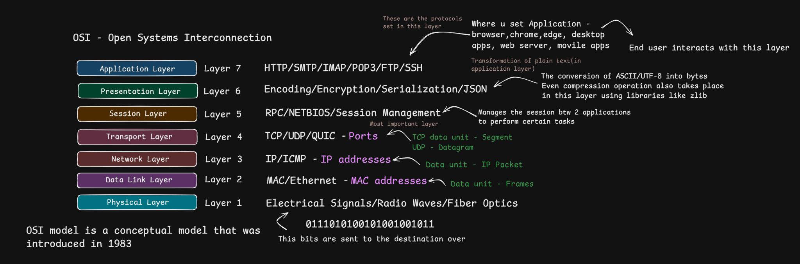
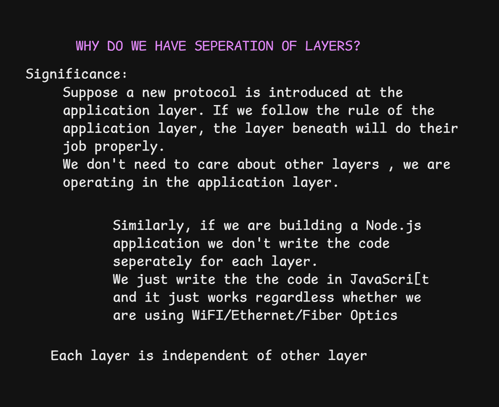
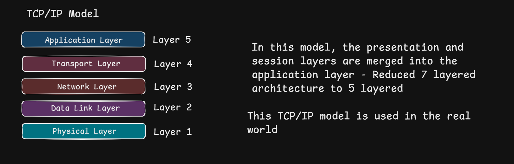
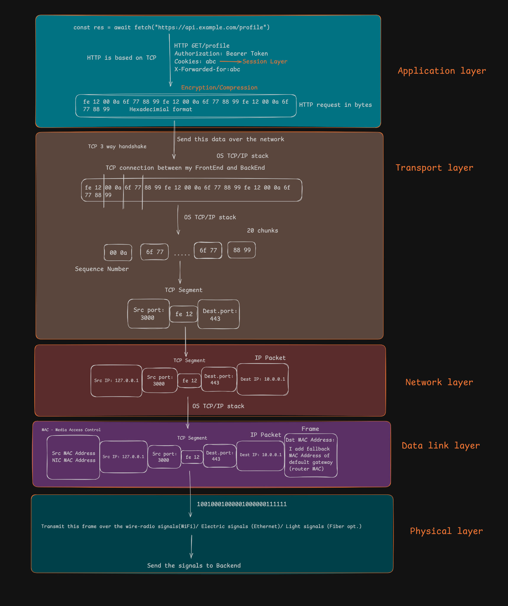
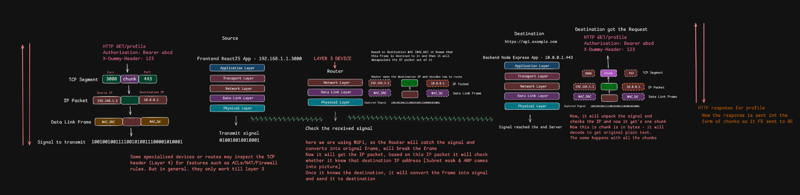

# OSI Model, TCP/IP Model, and Data Encapsulation

> [!NOTE]
> **Section:** Computer Networking — [Chai aur Networking](https://youtu.be/ZOLkWBVMcwU?si=ZLqjeaR1zeGbco4D)
>
> **Learning objective:** Understand the OSI and TCP/IP models, their layers and responsibilities, and how data is encapsulated and transmitted between networked devices.

[← Back to Computer Networking Repository](https://github.com/Priya200227/computer-networking)

---

## 1. Why Do We Use Network Layers?

Networking involves several responsibilities: applications create messages, transport protocols handle process-to-process communication, IP forwards packets between networks, and link technologies deliver frames over local connections.

A **layered model** organizes these responsibilities into manageable groups. Each layer provides services to the layer above and uses services from the layer below.

### Why layering matters

- **Abstraction:** Applications do not need to manage the physical transmission of data.
- **Modularity:** Different technologies can work together through standardized protocols.
- **Flexibility:** Applications can communicate over Wi-Fi, Ethernet, or cellular networks without being rewritten.
- **Troubleshooting:** Helps identify problems in areas such as DNS, transport connections, routing, or physical connectivity.

> [!NOTE]
> Network layers are a conceptual way to organize responsibilities. They are not necessarily seven separate software modules inside every device.

## 2. The OSI Model

The **Open Systems Interconnection (OSI) model** is a seven-layer reference model used to understand how network communication works.

| Layer | Name | Main responsibility | Examples |
|---:|---|---|---|
| 7 | Application | Network services used by applications | HTTP, DNS, SMTP, SSH |
| 6 | Presentation | Data representation, encoding, and transformation | Character encoding, serialization |
| 5 | Session | Managing communication sessions | Session management concepts |
| 4 | Transport | Process-to-process communication and transport services | TCP, UDP |
| 3 | Network | Logical addressing and routing between networks | IPv4, IPv6, ICMP |
| 2 | Data Link | Local-link framing and delivery | Ethernet, Wi-Fi MAC |
| 1 | Physical | Transmission of bits as signals | Copper, fiber, radio |

### Understanding the layers

- **Layer 7 — Application:** Defines the network communication used by applications, such as an HTTP request.
- **Layer 6 — Presentation:** Deals with data representation, encoding, and transformation.
- **Layer 5 — Session:** Describes how communication sessions are established and managed.
- **Layer 4 — Transport:** Supports communication between processes using protocols such as TCP and UDP.
- **Layer 3 — Network:** Uses IP addresses to identify destinations and route packets.
- **Layer 2 — Data Link:** Delivers frames across a local network link using link-layer addressing.
- **Layer 1 — Physical:** Transmits bits through electrical, optical, or radio signals.

> [!TIP]
> **Remember the direction:**
> - Top to bottom: Data moves towards transmission.
> - Bottom to top: Received data moves towards the application.

## 3. The TCP/IP Model

The **TCP/IP model** describes the protocol architecture used by the Internet.

It is commonly represented using either four or five layers. This repository uses the **five-layer teaching model** to make the Data Link and Physical responsibilities easier to understand.

| Layer | Main responsibility | Examples |
|---|---|---|
| Application | Application-level network communication | HTTP, DNS, SMTP, SSH |
| Transport | Process-to-process communication | TCP, UDP |
| Network / Internet | IP addressing and routing | IPv4, IPv6, ICMP |
| Data Link | Local-link framing and delivery | Ethernet, Wi-Fi |
| Physical | Transmission of bits | Radio, copper, fiber |

> [!NOTE]
> In the four-layer TCP/IP model, Data Link and Physical are combined into one **Link / Network Access** layer.
>
> The TCP/IP model does not define separate Presentation and Session layers in the same way as the OSI reference model. Their functions are handled by application protocols, libraries, and other mechanisms.

## 4. OSI vs. TCP/IP Model

Both models describe networking responsibilities, but they organize them differently.

| OSI model | Five-layer TCP/IP model |
|---|---|
| Application (Layer 7) | Application |
| Presentation (Layer 6) | Application |
| Session (Layer 5) | Application |
| Transport (Layer 4) | Transport |
| Network (Layer 3) | Network / Internet |
| Data Link (Layer 2) | Data Link |
| Physical (Layer 1) | Physical |

**Key distinction:**

- **OSI:** A seven-layer reference model for understanding networking.
- **TCP/IP:** A protocol architecture used for Internet communication.

The mapping is based on responsibilities, not a perfect one-to-one relationship between protocols and layers.

## 5. Data Encapsulation and Decapsulation

**Encapsulation** is the process of adding protocol-specific information as data moves down the sender's networking stack.

**Decapsulation** is the process of processing and removing that information as data moves up the receiver's networking stack.

### How encapsulation works

Consider an application sending a request to a remote server.

1. **Application layer:** The application creates data, such as an HTTP request.
2. **Transport layer:** TCP or UDP adds transport information, including source and destination ports.
3. **Network layer:** IP adds source and destination IP addresses and creates an IP packet.
4. **Data Link layer:** The packet is encapsulated inside a frame with link-layer addressing.
5. **Physical layer:** The frame is transmitted as signals over the network medium.

### Protocol Data Units (PDUs)

Each layer uses its own terminology for the data it processes.

| Layer | Data unit |
|---|---|
| Application | Data / Message |
| Transport (TCP) | Segment |
| Transport (UDP) | Datagram |
| Network | IP packet |
| Data Link | Frame |
| Physical | Bits / Signals |

> [!IMPORTANT]
> These terms are not interchangeable:
> - A **TCP segment** is carried inside an IP packet.
> - An **IP packet** is carried inside a link-layer frame.
> - The frame is transmitted as physical signals.

### What happens at the receiver?

The receiving device processes the incoming data in the reverse direction:

1. Physical layer receives the signals.
2. Data Link layer processes the frame.
3. Network layer processes the IP packet.
4. Transport layer processes the TCP segment or UDP datagram.
5. Application layer receives the application data.

This reverse process is called **decapsulation**.

> [!NOTE]
> TCP provides an ordered byte stream. Application writes do not necessarily correspond one-to-one with TCP segments. TCP segmentation depends on implementation and network conditions.

## 6. What Happens at a Router?

A router forwards IP packets between networks. It does not simply forward the original Ethernet frame unchanged.

### Router forwarding process

1. The source device determines that the destination is outside its local subnet.
2. It sends the frame to its next hop, usually the default gateway.
3. The router receives the frame and processes the enclosed IP packet.
4. It examines the destination IP address and consults its routing table.
5. It selects the outgoing interface and next hop.
6. It encapsulates the packet in a new link-layer frame for the outgoing network.
7. The process repeats across routed networks until the packet reaches its destination.

### What changes during routing?

| Information | What happens |
|---|---|
| MAC addresses | Link-layer addresses are replaced for each new link |
| Source and destination IP | Generally remain unchanged during ordinary routing |
| Other IP header fields | Some fields, such as TTL in IPv4, change during forwarding |
| Transport information | Normally carried through unchanged by ordinary routers |

> [!IMPORTANT]
> **MAC addressing is hop-by-hop, while IP addressing is generally end-to-end.**
>
> NAT, firewalls, and other network devices may modify packet information, so this is the normal routing behaviour rather than an absolute rule.

### Important protocol distinction

- HTTP/1.1 and HTTP/2 commonly use TCP.
- HTTP/3 uses QUIC over UDP.
- HTTPS protects HTTP communication using TLS; HTTP/3 integrates TLS-based security through QUIC.

---

## Key Takeaway

> [!IMPORTANT]
> The OSI model helps us understand networking responsibilities, while the TCP/IP architecture describes the protocols used for Internet communication.

Remember the complete data journey:

**Application Data → Transport Segment/Datagram → IP Packet → Link-Layer Frame → Physical Signals**

At the receiver, the process happens in reverse through decapsulation.

## References

- [RFC 1122 — Requirements for Internet Hosts](https://www.rfc-editor.org/rfc/rfc1122.html)
- [RFC 9293 — Transmission Control Protocol (TCP)](https://www.rfc-editor.org/rfc/rfc9293.html)
- [RFC 9114 — HTTP/3](https://www.rfc-editor.org/rfc/rfc9114.html)
- [ISO 7498-1 — OSI Basic Reference Model](https://www.iso.org/standard/20269.html)
- [Cisco — TCP/IP Overview](https://www.cisco.com/c/en/us/support/docs/ip/routing-information-protocol-rip/13769-5.pdf)
- [Reference Video — What Makes OSI and TCP/IP Models Different](https://youtu.be/ZOLkWBVMcwU?si=ZLqjeaR1zeGbco4D)

---

**Next:** [Routing and Packet Travel](../09-routing-and-packet-travel/README.md)
