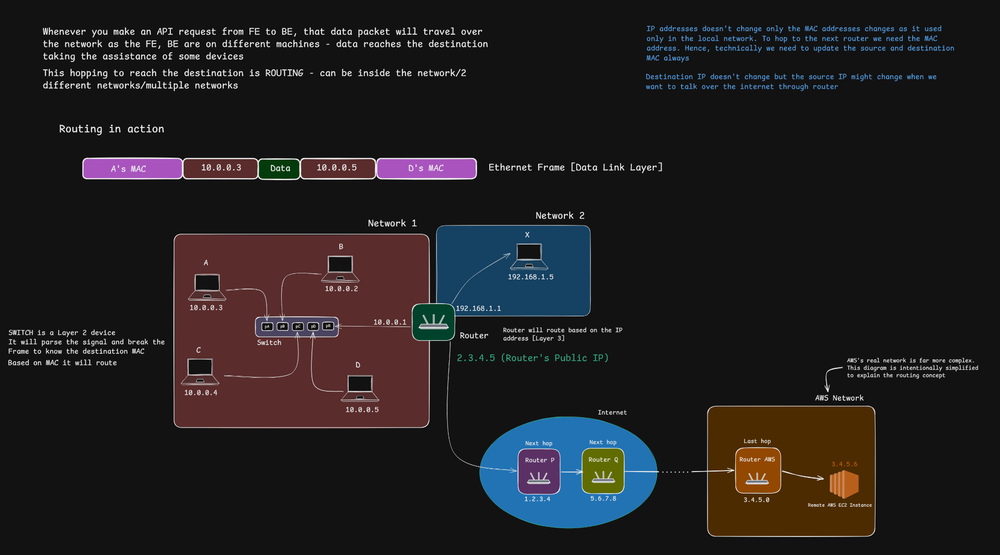
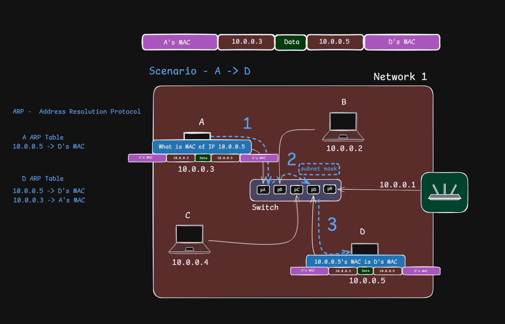
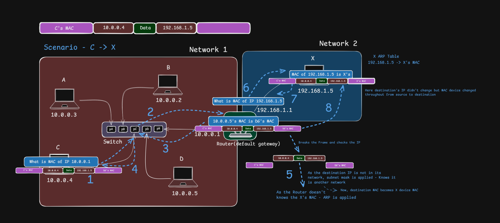
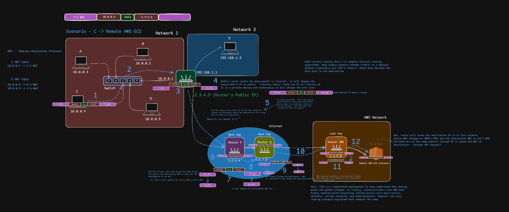

# Routing: How Packets Travel Across Networks

>[!NOTE]
> **Section:** Computer Networking — [Chai aur Networking](https://youtu.be/GBhaNXK-ows?si=MQEk14etHW1qwOwW)
>
> **Learning objective:** Understand how routers forward IP packets between networks, how switches deliver frames within a LAN, and how ARP and default gateways help devices communicate with local, remote, and cloud-hosted destinations.

[← Back to Computer Networking Repository](https://github.com/Priya200227/computer-networking)

---

## 1. What Is Routing?

**Routing** is the process of selecting the next hop and outgoing interface for an IP packet so that it can move toward its destination network.

A router makes forwarding decisions using its **routing/forwarding table**. It does not need to calculate the entire end-to-end path for every packet.

### Three important networking operations

| Operation | Purpose | Device / mechanism |
|---|---|---|
| Address resolution | Find the MAC address of a local next hop | ARP (IPv4) |
| Switching | Forward frames within a local network | Layer 2 switch |
| Routing | Forward packets between IP networks | Router |

A host uses its IP address and subnet prefix to determine whether a destination is local or remote.

- **Same subnet:** Send the frame to the destination's MAC address.
- **Different subnet:** Send the frame to the next-hop router, usually the default gateway.

> [!IMPORTANT]
> The IP packet contains the final destination IP address. The frame's destination MAC address identifies the next hop on the current local link.

## 2. Routing Overview and Network Devices

The diagram illustrates three parts:

- **Network 1:** Hosts A, B, C, and D connected through a switch (`10.0.0.0/24`).
- **Network 2:** A separate network connected through a router (`192.168.1.0/24`).
- **Internet / AWS:** A remote destination reached through multiple routers.

The addresses are illustrative, not an actual Internet or AWS topology.

### 2.1 Ethernet Switch

A **Layer 2 switch** forwards Ethernet frames within a local network using its MAC address table.

- Learns MAC addresses from incoming frames.
- Forwards known unicast frames to the appropriate port.
- Floods unknown unicast and broadcast frames within the relevant VLAN, subject to switch configuration.

> [!NOTE]
> A normal Layer 2 switch makes forwarding decisions using MAC addresses, not Internet destination IP addresses.

### 2.2 Router and Routing Table

A **router** connects different IP networks and forwards packets toward their destinations.

It examines the destination IP address and selects an outgoing interface and next hop using its forwarding information.

When multiple routes match, routers use **Longest Prefix Match**: the most specific matching network prefix is preferred.

Example routing table:

| Destination | Target |
|---|---|
| `10.0.0.0/24` | Directly connected |
| `192.168.1.0/24` | Directly connected |
| `0.0.0.0/0` | Upstream next hop (default route) |

### 2.3 Default Gateway and ARP

- **Default gateway:** The first-hop router used for off-subnet destinations when no more-specific route applies.
- **ARP:** Resolves a known IPv4 address to its MAC address on the local link.

> [!IMPORTANT]
> ARP does not discover a remote Internet server's MAC address. For remote communication, a host normally uses ARP to resolve its **default gateway's MAC address**.
>
> IPv6 uses Neighbor Discovery Protocol (NDP) instead of ARP.

## 3. Scenario A — Communication Within the Same Network

Suppose Host A wants to send data to Host D.

| Host | IPv4 address |
|---|---|
| A | `10.0.0.3` |
| B | `10.0.0.2` |
| C | `10.0.0.4` |
| D | `10.0.0.5` |

Assume both A and D belong to the same subnet.

### Communication process

1. **Check destination:** A determines that D (`10.0.0.5`) is on the same subnet.
2. **Check ARP cache:** A checks whether D's MAC address is already known.
3. **ARP request:** If the mapping is missing, A broadcasts an ARP request.
4. **ARP reply:** D responds with its MAC address.
5. **Frame delivery:** A creates an Ethernet frame addressed to D's MAC address.
6. **Switch forwarding:** The switch uses its MAC address table to forward the frame to D's port.

### Addresses during communication

| Field | Value |
|---|---|
| Source IP | `10.0.0.3` |
| Destination IP | `10.0.0.5` |
| Source MAC | A's MAC |
| Destination MAC | D's MAC |

> [!TIP]
> **Same subnet → Resolve destination MAC (if needed) → Switch forwards frame → Destination receives data.**
>
> The default gateway is not needed for this ordinary same-subnet communication.

## 4. Scenario B — Communication Between Different Networks

Now suppose Host C wants to communicate with Host X on another network.

| Device | IPv4 address |
|---|---|
| Host C | `10.0.0.4` |
| Router interface (Network 1) | `10.0.0.1` |
| Router interface (Network 2) | `192.168.1.1` |
| Host X | `192.168.1.5` |

### Communication process

1. **Check destination:** C determines that `192.168.1.5` is outside its local subnet.
2. **Select next hop:** C chooses its default gateway (`10.0.0.1`).
3. **Resolve gateway MAC:** C checks its ARP cache or broadcasts an ARP request for `10.0.0.1`.
4. **Send first frame:** C sends the frame to the router's Network 1 MAC address.
5. **Router processes packet:** The router removes the incoming link-layer framing and examines the destination IP.
6. **Routing decision:** The router checks its forwarding table and selects Network 2.
7. **Resolve destination MAC:** If necessary, the router uses ARP on Network 2 to discover X's MAC address.
8. **Create new frame:** The router builds a new frame addressed to X's MAC address.
9. **Deliver packet:** X receives and processes the packet.

### Why do MAC addresses change while IP addresses usually remain the same?

A MAC address is used for delivery over a particular local link. When a router forwards a packet, it creates a new link-layer frame for the outgoing link.

The IP source and destination addresses generally remain unchanged during ordinary routing, unless NAT or another mechanism modifies them.

| Information | C → Router | Router → X |
|---|---|---|
| Source MAC | C's MAC | Router's Network 2 MAC |
| Destination MAC | Router's Network 1 MAC | X's MAC |
| Source IP | `10.0.0.4` | `10.0.0.4` |
| Destination IP | `192.168.1.5` | `192.168.1.5` |

> [!IMPORTANT]
> **MAC addresses are hop-by-hop. IP addresses are generally end-to-end.**
>
> Routers also decrement the IPv4 TTL and update the IPv4 header checksum when forwarding packets.

## 5. Scenario C — Communication With a Remote AWS EC2 Instance

This scenario illustrates how a local device can communicate with a remote cloud-hosted service.

### Simplified communication process

1. The source host identifies the destination as off-subnet.
2. It sends the first frame to its default gateway.
3. The gateway forwards the packet to an upstream network.
4. Multiple Internet routers forward the packet using their forwarding tables.
5. The destination cloud network receives the traffic.
6. Cloud routing and network controls determine how the traffic reaches the intended EC2 instance.

> [!NOTE]
> The intermediate routers and example IP addresses in the diagram are illustrative. The actual Internet route depends on network topology and routing policies.

### How does AWS handle routing?

In Amazon VPC, **route tables** determine where network traffic is directed.

- A public subnet can use a default IPv4 route (`0.0.0.0/0`) pointing to an Internet Gateway.
- A private subnet commonly uses a NAT Gateway or another configured egress path for outbound IPv4 Internet access.
- Security groups and network ACLs control permitted traffic.

> [!IMPORTANT]
> An Internet Gateway route alone does not make an EC2 instance publicly reachable. Public addressing, routing, security rules, and host configuration must also be correct.

## 6. What Changes at Each Router Hop?

For ordinary IPv4 routing without NAT:

| Field | Behaviour |
|---|---|
| Ethernet MAC addresses | Rebuilt for each outgoing link |
| Source IP | Generally remains unchanged |
| Destination IP | Generally remains unchanged |
| IPv4 TTL | Decremented by each forwarding router |
| IPv4 header checksum | Updated when the IPv4 header changes |
| NAT | Can translate IP addresses and transport ports |

Other devices, such as firewalls, proxies, load balancers, and tunnels, may inspect or modify traffic.

### Quick revision

| Concept | Remember |
|---|---|
| Routing | Selects the next hop for an IP packet |
| Forwarding table | Used to make packet-forwarding decisions |
| Longest Prefix Match | Selects the most specific matching route |
| Default gateway | First-hop router for off-subnet traffic |
| ARP | Resolves IPv4 addresses to local MAC addresses |
| Switch | Forwards frames using MAC address information |
| Router | Forwards IP packets between networks |
| NAT | Translates IP addresses and often transport ports |
| TTL | Limits how many IPv4 router hops a packet can traverse |

---

## Key Takeaway

> [!IMPORTANT]
> **IP addresses identify the packet's destination; MAC addresses deliver the frame to the next hop on the current local link.**

The complete communication process:

**Host → Switch → Default Gateway → Routers → Destination Network → Destination Host**

- Switches forward frames within local networks.
- Routers forward packets between IP networks.
- ARP resolves local IPv4 next-hop addresses to MAC addresses.
- Routing tables determine where packets should go next.

## References

- [Amazon VPC — Configure Route Tables](https://docs.aws.amazon.com/vpc/latest/userguide/VPC_Route_Tables.html)
- [Amazon VPC — Internet Gateway](https://docs.aws.amazon.com/vpc/latest/userguide/VPC_Internet_Gateway.html)
- [Reference Video — How Routing Determines Your Data's Journey Across Networks](https://youtu.be/GBhaNXK-ows?si=MQEk14etHW1qwOwW)

---

**Next:** [ICMP, Ping and Traceroute](../10-icmp-ping-traceroute/README.md)
