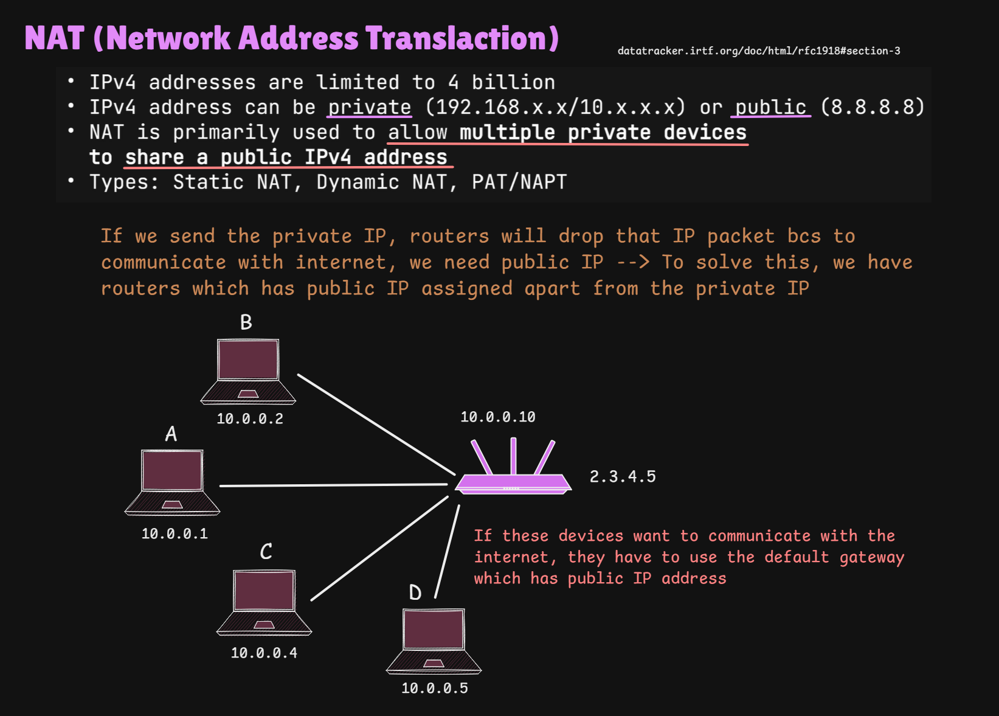
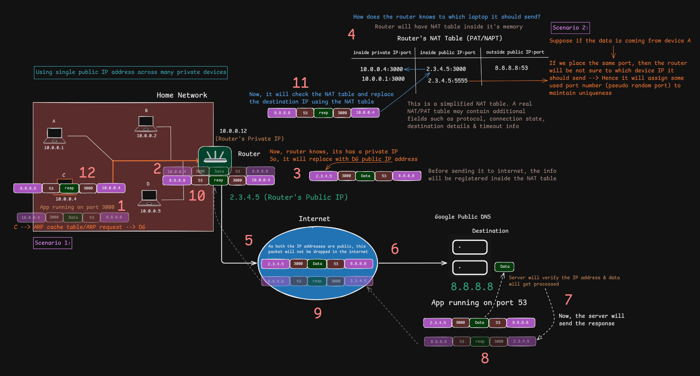

# NAT (Network Address Translation)

> [!NOTE]
> **Section:** Computer Networking - [NAT](https://youtu.be/VdfL9H2vEkU?si=_Zjj1XtqcFM4SXGT)
>
>**Purpose:** Understand how devices using private IPv4 addresses communicate with the public Internet through NAT, and how PAT allows multiple devices to share a single public IPv4 address.

---

## 1. What is NAT?

**NAT (Network Address Translation)** is a technique used by routers to modify IP address information in packet headers as packets pass between networks.

Its common purpose is to allow multiple devices using private IPv4 addresses to share a public IPv4 address when accessing the Internet.

### Why do we need NAT?

- IPv4 uses a 32-bit address space, providing approximately 4.29 billion possible addresses.
- Not every IPv4 address is available for public use.
- Private IPv4 addresses cannot be routed across the public Internet.
- NAT allows devices in a private network to communicate externally using a public address.

### Private vs Public IP addresses

| Private IP address | Public IP address |
|---|---|
| Used within private networks | Used for communication across the public Internet |
| Not globally routable | Globally routable |
| Can be reused across different private networks | Must be globally unique while assigned |
| Example: `10.0.0.1` | Example: `8.8.8.8` |

**RFC 1918 private IPv4 ranges:**

| Range | CIDR notation |
|---|---|
| `10.0.0.0 – 10.255.255.255` | `10.0.0.0/8` |
| `172.16.0.0 – 172.31.255.255` | `172.16.0.0/12` |
| `192.168.0.0 – 192.168.255.255` | `192.168.0.0/16` |

---

## 2. How NAT works

Consider a home network containing multiple devices:

- Laptop A: `10.0.0.1`
- Laptop B: `10.0.0.2`
- Device C: `10.0.0.4`
- Device D: `10.0.0.5`

The router has:
- Private/LAN IP: `10.0.0.10`
- Public/WAN IP: `2.3.4.5`

When a device wants to access the Internet, it sends the packet to its default gateway.

The router translates the packet's source address from the private IP to its public IP before forwarding it externally.

### Basic packet flow

1. A device sends a packet to an external destination.
2. The packet reaches the router through the default gateway.
3. The router replaces the packet's private source IP with its public IP.
4. The router forwards the translated packet to the Internet.
5. The external server sends a response to the router's public IP.
6. The router checks its translation table and identifies the original internal device.
7. The router translates the destination back to the internal IP and forwards the response.

**Key point:** The router maintains translation information so that response traffic can be delivered to the correct internal device.

---

## 3. PAT (Port Address Translation)

**PAT (Port Address Translation)** is a form of NAT that uses port numbers to allow multiple internal devices to share one public IPv4 address.

It is also commonly called NAT Overload or NAPT.

### Why are port numbers needed?

Imagine two internal devices accessing the same external server.

Both devices might use the same source port number. If the router translated only their IP addresses to the same public IP, it would need another way to distinguish their connections.

PAT solves this by assigning different external source ports.

### Example

Suppose:

- Device A: `10.0.0.1:3000`
- Device B: `10.0.0.4:3000`
- Router public IP: `2.3.4.5`

The router could create these mappings:

| Internal address:port | Translated public address:port |
|---|---|
| `10.0.0.1:3000` | `2.3.4.5:5555` |
| `10.0.0.4:3000` | `2.3.4.5:3000` |

These are illustrative port mappings.

Even though both devices use the same internal port, the router assigns distinct public-side port mappings so it can distinguish the connections.

### NAT/PAT translation table

The router stores mapping information in a translation table.

When a response arrives, it checks the destination public IP and port against the table and forwards the packet to the corresponding internal device.

> [!IMPORTANT]
> A real NAT/PAT table can contain additional information, including transport protocol, connection state, destination details and timeouts. The diagram shows a simplified representation.

---

## 4. Types of NAT

| Type | Description |
|---|---|
| **Static NAT** | Permanently maps one private IP address to one public IP address. |
| **Dynamic NAT** | Maps private IP addresses to public IP addresses from a configured pool. |
| **PAT / NAPT** | Allows multiple private devices to share a public IP by using different port mappings. |

### Quick comparison

- Static NAT → Fixed one-to-one mapping.
- Dynamic NAT → Temporary one-to-one mapping from a public IP pool.
- PAT → Many-to-one mapping using port numbers.

---

## 5. Important points to remember

> [!IMPORTANT]
> - NAT modifies address information as packets pass between networks.
> - PAT uses port numbers to distinguish multiple connections sharing a public IP.
> - The router maintains translation state to handle returning traffic.
> - NAT is commonly deployed at the boundary between a private network and an external network.

> [!NOTE]
> NAT is not the same as a firewall. NAT changes address information; firewall policies control which traffic is allowed or denied.

Also, NAT is not a requirement for all Internet communication. IPv6 provides a vastly larger address space and generally allows globally addressed devices to communicate without traditional IPv4 NAT.

---

## 6. Key Takeaway

**NAT translates IP addresses, while PAT additionally uses port numbers to allow multiple internal devices to share a single public IPv4 address.**

This is one of the techniques that helped extend the practical usability of IPv4 despite its limited address space.

---

## References

1. [RFC 1918 – Address Allocation for Private Internets](https://datatracker.ietf.org/doc/html/rfc1918)
2. [RFC 3022 – Traditional IP Network Address Translator](https://datatracker.ietf.org/doc/html/rfc3022)

---

