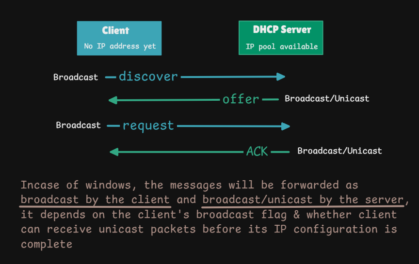
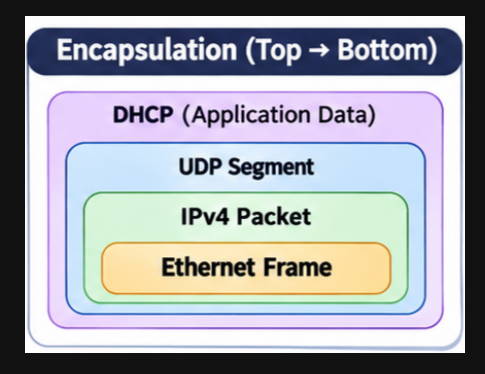
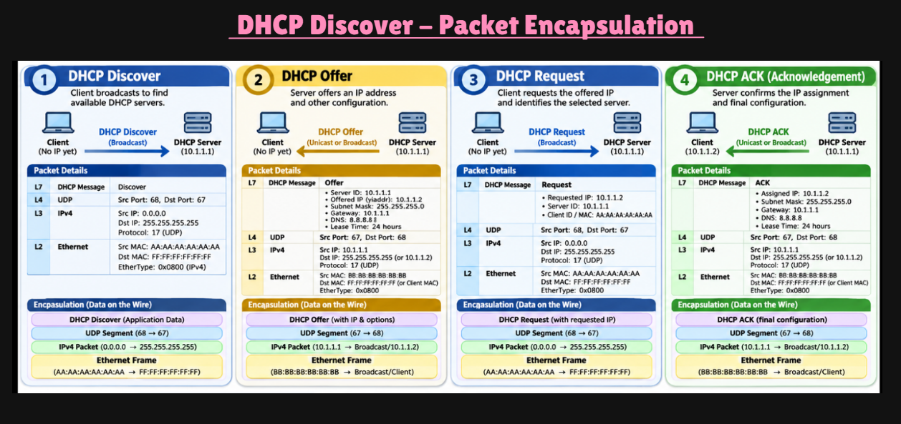
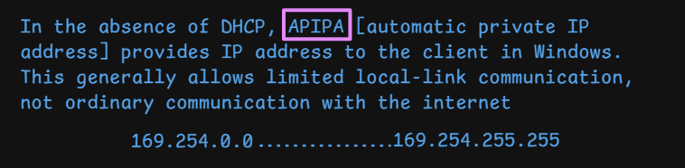
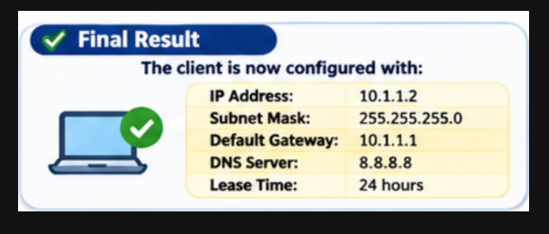

# DHCP - Dynamic Host Configuration Protocol

> [!NOTE]
> **Section:** Computer Networking - [DHCP & DORA Packet Flow](https://youtu.be/jhpiuyNEpIc?si=oHkRlkKLCCxqmfnZ)
>   
> **Learning objective:** Understand how a device automatically obtains an IPv4 configuration, how DHCP's DORA process works, and how DHCP messages are encapsulated and delivered.

[← Back to Networking Fundamentals Repository](https://github.com/Priya200227/computer-networking/tree/main/01-network-fundamentals) 


---

## 1. What Is DHCP?

**DHCP (Dynamic Host Configuration Protocol)** is an application-layer protocol that automatically provides network configuration to devices joining a network.

A DHCP server can provide:

- **IP address** - identifies the device on the IP network.
- **Subnet mask** - identifies the network and host portions of the address.
- **Default gateway** - provides the next hop for traffic destined outside the local network.
- **DNS server** - resolves domain names into IP addresses.
- **Lease time** - determines how long the client may use the assigned configuration.

### Key facts

| Property | Value |
|---|---|
| Protocol layer | Application layer (L7) |
| Transport protocol | UDP |
| DHCP server port | 67 |
| DHCP client port | 68 |
| Main purpose | Automatic network configuration |

> [!IMPORTANT]
> DHCP uses **UDP**, not TCP. The DHCP server receives requests on UDP port **67**, while the client uses UDP port **68**.

---

## 2. How DHCP Works - DORA

During the typical initial IPv4 address allocation, DHCP uses a four-message exchange known as **DORA**:

1. **Discover** - the client searches for DHCP servers.
2. **Offer** - a server offers an IP address and configuration.
3. **Request** - the client requests the offered configuration from its selected server.
4. **Acknowledgement (ACK)** - the server confirms the assignment.


### Example network configuration

The following values are used in the packet examples throughout these notes:

| Parameter | Example value |
|---|---|
| DHCP server IP | `10.1.1.1` |
| Offered client IP | `10.1.1.2` |
| Subnet mask | `255.255.255.0` |
| Default gateway | `10.1.1.1` |
| DNS server | `8.8.8.8` |
| Lease time | 24 hours |

These are illustrative values. A DHCP server does not have to be the default gateway; one device can perform both roles in a small network.

### 2.1 DHCP Discover

**Direction:** Client → DHCP server(s)

A client that does not yet have an IPv4 address sends a DHCP Discover message to find available DHCP servers.

Typical initial-discovery packet values:

| Field | Value |
|---|---|
| DHCP message type | Discover |
| Source IPv4 address | `0.0.0.0` |
| Destination IPv4 address | `255.255.255.255` |
| Source UDP port | `68` |
| Destination UDP port | `67` |
| Ethernet destination | `FF:FF:FF:FF:FF:FF` (broadcast) |

**Why is the source IP `0.0.0.0`?**

The client has not yet been assigned an IPv4 address.

**Why does it broadcast?**

The client does not know the DHCP server's IP address. A broadcast allows DHCP servers on the local broadcast domain to receive the Discover message.

### 2.2 DHCP Offer

**Direction:** DHCP server → Client

A DHCP server that receives the Discover message may respond with a DHCP Offer. The offer proposes an available IP address and can include other configuration parameters.

Example offer:

| Parameter | Offered value |
|---|---|
| Offered IP | `10.1.1.2` |
| Subnet mask | `255.255.255.0` |
| Default gateway | `10.1.1.1` |
| DNS server | `8.8.8.8` |
| Lease time | 24 hours |

The Offer identifies the server so the client can select which offer to accept.

> [!NOTE]
> A DHCP Offer may be broadcast or unicast. Its delivery depends on the client's state, the broadcast flag, and whether the client can receive unicast traffic before completing configuration.

### 2.3 DHCP Request

**Direction:** Client → DHCP server(s)

The client selects an offer and sends a DHCP Request to indicate which server and IP address it wants to use.

The message commonly includes:

- **Requested IP address (Option 50)** - the address the client is requesting.
- **Server identifier (Option 54)** - identifies the selected DHCP server.

During the initial allocation process, this message is commonly broadcast. This also informs other DHCP servers that their offers were not selected.

### 2.4 DHCP ACK - Acknowledgement

**Direction:** DHCP server → Client

The selected DHCP server sends a DHCP ACK to confirm the IP address assignment and configuration.

The client can then configure its network interface using the supplied settings.

---

## 3. DHCP Message Flow

The following diagram shows the typical initial DORA exchange and the possible broadcast/unicast delivery behavior.



| Message | Typical initial exchange |
|---|---|
| Discover | Broadcast |
| Offer | Broadcast or unicast |
| Request | Broadcast |
| ACK | Broadcast or unicast |

The exact delivery behavior is influenced by the DHCP broadcast flag and whether the client can receive unicast packets before its IP configuration is complete.

> [!IMPORTANT]
> DORA describes the typical **initial address allocation**. It is not repeated for every lease renewal. A client renewing an existing lease can commonly send a DHCP Request directly to the server and receive an ACK.

---

## 4. DHCP Packet Encapsulation

DHCP is an application-layer protocol. Its messages are carried inside UDP datagrams, which are encapsulated in IP packets and then in link-layer frames.



The encapsulation order when sending data is:

```text
DHCP Message
    ↓
UDP Datagram
    ↓
IPv4 Packet
    ↓
Ethernet Frame
```

The receiving device processes the headers in the reverse order:

```text
Ethernet Frame
    ↓
IPv4 Packet
    ↓
UDP Datagram
    ↓
DHCP Message
```

### Layer-by-layer breakdown

| Layer | Protocol / Data | Purpose |
|---|---|---|
| L7 - Application | DHCP | Discover, Offer, Request, ACK |
| L4 - Transport | UDP | Uses client/server ports 68 and 67 |
| L3 - Network | IPv4 | Carries source and destination IP addresses |
| L2 - Data Link | Ethernet | Carries source and destination MAC addresses |

### DHCP Discover - packet details



For an initial DHCP Discover on an Ethernet IPv4 network:

| Layer | Source | Destination |
|---|---|---|
| UDP | Port `68` | Port `67` |
| IPv4 | `0.0.0.0` | `255.255.255.255` |
| Ethernet | Client MAC address | `FF:FF:FF:FF:FF:FF` |

**Keep these roles separate:**

- **IP addresses** identify network-layer endpoints.
- **MAC addresses** deliver frames across the local link.
- **UDP ports** identify the application endpoints receiving the datagram.

---

## 5. Common DHCP Options

DHCP uses options to carry configuration parameters.

| Option | Name | Purpose |
|---|---|---|
| 1 | Subnet Mask | Provides the subnet mask |
| 3 | Router | Provides the default gateway |
| 6 | Domain Name Server | Provides DNS server addresses |
| 50 | Requested IP Address | Indicates the IP address requested by the client |
| 51 | IP Address Lease Time | Specifies the lease duration |
| 53 | DHCP Message Type | Identifies Discover, Offer, Request, ACK, etc. |
| 54 | Server Identifier | Identifies the DHCP server |
| 55 | Parameter Request List | Lists configuration options requested by the client |
| 61 | Client Identifier | Identifies the DHCP client |

---

## 6. What Happens When DHCP Is Unavailable?

If a Windows device cannot obtain an IPv4 configuration from a DHCP server, it may automatically assign itself an IPv4 link-local address using **APIPA (Automatic Private IP Addressing)**.

The IPv4 link-local block is:

```text
169.254.0.0/16
```

The range commonly available for host assignment is:

```text
169.254.0.1 – 169.254.255.254
```



This can allow limited communication with other devices on the same local link that also have compatible link-local addresses.

> [!WARNING]
> An APIPA address does not provide ordinary routed Internet connectivity. It is a fallback for local-link communication, not a replacement for a working DHCP configuration.

---

## 7. Final Configuration - What the Client Receives

After a successful DHCP exchange, the client configures its network interface using the parameters supplied by the DHCP server.

For our example, the client receives:



```text
IP Address      : 10.1.1.2
Subnet Mask     : 255.255.255.0
Default Gateway : 10.1.1.1
DNS Server      : 8.8.8.8
Lease Time      : 24 hours
```

The lease is temporary. The client must renew it according to DHCP's lease-renewal process to continue using the address.

---

## 8. Key Takeaways

- DHCP automatically provides network configuration to clients.
- DHCP is an **application-layer protocol** that uses **UDP**.
- The server uses UDP port **67**; the client uses UDP port **68**.
- DORA stands for **Discover → Offer → Request → Acknowledgement**.
- Discover and Request are typically broadcast during initial allocation.
- Offer and ACK can be broadcast or unicast.
- DHCP can provide an IP address, subnet mask, default gateway, DNS server, and lease time.
- APIPA uses the IPv4 link-local block `169.254.0.0/16` when a Windows device cannot obtain a DHCP configuration.

> **In one sentence:** DHCP automates the process of giving a device the network configuration it needs to communicate.

---

## 9. References

- [RFC 2131 - Dynamic Host Configuration Protocol](https://datatracker.ietf.org/doc/html/rfc2131)
- [RFC 2132 - DHCP Options and BOOTP Vendor Extensions](https://datatracker.ietf.org/doc/html/rfc2132)
- [Microsoft - Automatic Private IP Addressing](https://learn.microsoft.com/en-us/troubleshoot/windows-server/networking/automatic-private-ip-addressing)

---

**Next:** [IPv6](../33-ipv6/README.md)
