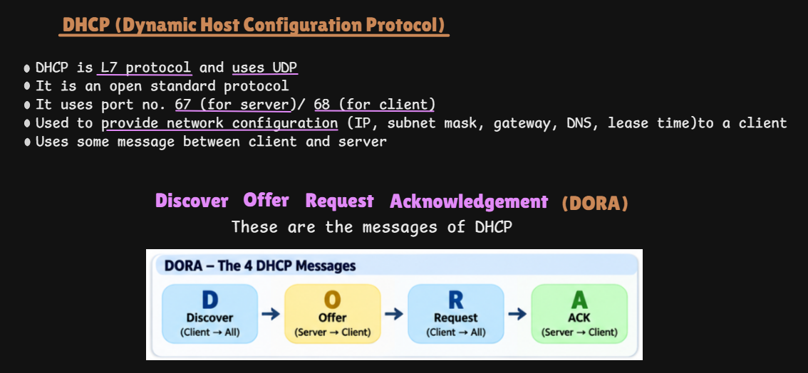
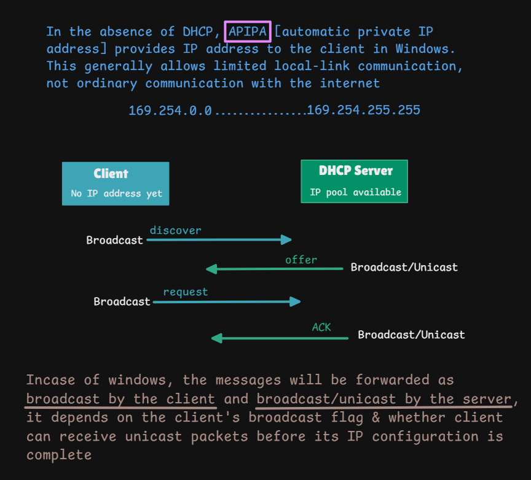
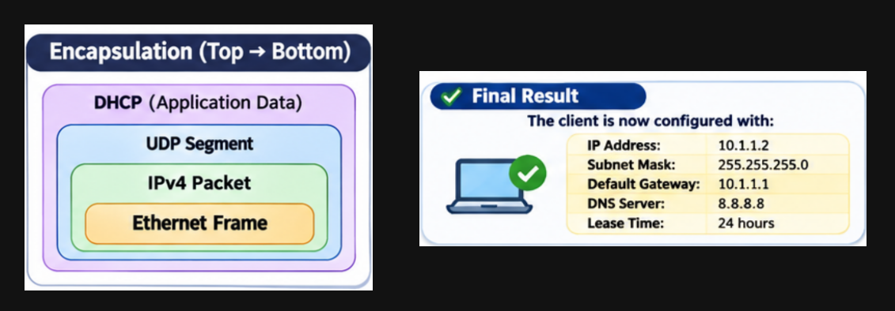

# DHCP - Dynamic Host Configuration Protocol

> [!NOTE]
> **Section:** Computer Networking - [DHCP & DORA Packet Flow](https://youtu.be/jhpiuyNEpIc?si=oHkRlkKLCCxqmfnZ)
> 
> **Learning objective:** Understand how a device automatically obtains an IP address and other network settings, how DHCP's DORA process works, and how DHCP messages travel through the network layers.

[← Back to Computer Networking Repository](../../README.md)

---

## 1. What Is DHCP?

**DHCP (Dynamic Host Configuration Protocol)** is an application-layer protocol that automatically provides network configuration to devices joining a network.

Instead of manually configuring every device, a DHCP server can assign:

- **IP address** — identifies the device on the IP network.
- **Subnet mask** — identifies the network and host portions of the address.
- **Default gateway** — provides the next hop for traffic destined outside the local network.
- **DNS server** — resolves domain names into IP addresses.
- **Lease time** — determines how long the client can use the assigned configuration.

### Key facts

| Property | Value |
|---|---|
| Protocol layer | Application layer (L7) |
| Transport protocol | UDP |
| DHCP server port | 67 |
| DHCP client port | 68 |
| Standard | Open Internet standard |
| Main purpose | Automatic network configuration |

> [!IMPORTANT]
> DHCP uses **UDP**, not TCP. The client listens on UDP port **68**, while the DHCP server listens on UDP port **67**.

---

## 2. How DHCP Works — DORA

When a device initially obtains an IPv4 configuration through DHCP, it commonly follows a four-message process called **DORA**:

1. **Discover** — client searches for DHCP servers.
2. **Offer** — server offers an IP address and configuration.
3. **Request** — client requests the offered configuration.
4. **Acknowledgement (ACK)** — server confirms the assignment.



### Example network

For the examples in this section, assume:

| Parameter | Example value |
|---|---|
| DHCP server IP | `10.1.1.1` |
| Offered client IP | `10.1.1.2` |
| Subnet mask | `255.255.255.0` |
| Default gateway | `10.1.1.1` |
| DNS server | `8.8.8.8` |
| Lease time | 24 hours |

These are illustrative values. A DHCP server does not have to be the default gateway; one device can perform both roles in a small network.

### 2.1 DHCP Discover

**Who sends it?** Client → DHCP servers

When a device joins a network, it may not have an IP address yet. It sends a DHCP Discover message to find available DHCP servers.

Typical initial-discovery packet values:

| Field | Value |
|---|---|
| DHCP message type | Discover |
| Source IP | `0.0.0.0` |
| Destination IP | `255.255.255.255` |
| Source UDP port | `68` |
| Destination UDP port | `67` |
| Ethernet destination | `FF:FF:FF:FF:FF:FF` (broadcast) |

**Why does the client use `0.0.0.0`?**

Because it does not yet have an assigned IPv4 address.

**Why broadcast?**

Because the client does not know the DHCP server's IP address. A broadcast allows DHCP servers on the local broadcast domain to receive the discovery message.

### 2.2 DHCP Offer

**Who sends it?** DHCP server → Client

After receiving the Discover message, a DHCP server can respond with a DHCP Offer.

The offer proposes an available IP address and may include other configuration information.

Example offer:

| Parameter | Offered value |
|---|---|
| Offered IP | `10.1.1.2` |
| Subnet mask | `255.255.255.0` |
| Default gateway | `10.1.1.1` |
| DNS server | `8.8.8.8` |
| Lease time | 24 hours |

The server identifies itself in the offer so the client can identify which DHCP server made the offer.

> [!NOTE]
> A DHCP Offer may be broadcast or unicast. The delivery method depends on the client's state and broadcast flag, as well as the network implementation.

### 2.3 DHCP Request

**Who sends it?** Client → DHCP servers

The client selects an offer and sends a DHCP Request message to indicate which server and IP configuration it wants to use.

The request typically includes:

- **Requested IP address** — the address the client wants, commonly DHCP Option 50.
- **Server identifier** — identifies the selected DHCP server, commonly DHCP Option 54.

The client commonly broadcasts this request during the initial allocation process. This also informs other DHCP servers that their offers were not selected.

### 2.4 DHCP ACK — Acknowledgement

**Who sends it?** DHCP server → Client

The selected DHCP server responds with a DHCP ACK to confirm the IP address assignment and configuration.

The client can now configure its network interface with the supplied settings.

Example final configuration:

| Parameter | Assigned value |
|---|---|
| IP address | `10.1.1.2` |
| Subnet mask | `255.255.255.0` |
| Default gateway | `10.1.1.1` |
| DNS server | `8.8.8.8` |
| Lease time | 24 hours |

> [!IMPORTANT]
> The client should not treat an offered address as a completed assignment merely because it received an Offer. The server's ACK confirms the allocation.

---

## 3. DHCP Message Flow

The typical initial DHCP exchange is:

```text
       CLIENT                         DHCP SERVER
         |                                  |
         | -------- DISCOVER ------------> |
         |          Broadcast              |
         |                                  |
         | <--------- OFFER --------------- |
         |       Broadcast / Unicast        |
         |                                  |
         | -------- REQUEST -------------> |
         |          Broadcast              |
         |                                  |
         | <---------- ACK ---------------- |
         |       Broadcast / Unicast        |
         |                                  |
         |     IP configuration ready      |
```



### Broadcast vs Unicast

| Message | Typical initial exchange |
|---|---|
| Discover | Broadcast |
| Offer | Broadcast or unicast |
| Request | Broadcast |
| ACK | Broadcast or unicast |

The exact delivery behavior is influenced by the DHCP broadcast flag and whether the client can receive unicast packets before its IP configuration is complete.

---

## 4. DHCP Packet Encapsulation

DHCP is an application-layer protocol, but its messages are transported inside UDP, IPv4, and Ethernet frames.

When a DHCP message travels across an Ethernet network, the encapsulation is:

```text
+----------------------------------+
| Ethernet Frame                   |
|  +----------------------------+  |
|  | IPv4 Packet                |  |
|  |  +----------------------+  |  |
|  |  | UDP Datagram         |  |  |
|  |  |  +----------------+  |  |  |
|  |  |  | DHCP Message   |  |  |  |
|  |  |  +----------------+  |  |  |
|  |  +----------------------+  |  |
|  +----------------------------+  |
+----------------------------------+
```


### Layer-by-layer breakdown

| Layer | Protocol / Data | Purpose |
|---|---|---|
| L7 — Application | DHCP | Discover, Offer, Request, ACK |
| L4 — Transport | UDP | Uses source and destination ports 68 and 67 |
| L3 — Network | IPv4 | Carries source and destination IP addresses |
| L2 — Data Link | Ethernet | Carries source and destination MAC addresses |

### Important packet details

For the initial DHCP Discover:

| Layer | Source | Destination |
|---|---|---|
| UDP | Port 68 | Port 67 |
| IPv4 | `0.0.0.0` | `255.255.255.255` |
| Ethernet | Client MAC | `FF:FF:FF:FF:FF:FF` |

**Remember:** IP addresses and MAC addresses serve different purposes.

- IP addresses are used for logical network-layer communication.
- MAC addresses are used for delivery over the local link.
- UDP ports identify the sending and receiving application endpoints.

---

## 5. Common DHCP Options

DHCP uses options to carry configuration parameters.

| Option | Name | Purpose |
|---|---|---|
| 1 | Subnet Mask | Provides the subnet mask |
| 3 | Router | Provides the default gateway |
| 6 | Domain Name Server | Provides DNS server addresses |
| 50 | Requested IP Address | Indicates the IP address requested by the client |
| 51 | IP Address Lease Time | Specifies the lease duration |
| 53 | DHCP Message Type | Identifies Discover, Offer, Request, ACK, etc. |
| 54 | Server Identifier | Identifies the DHCP server |
| 55 | Parameter Request List | Lists configuration options requested by the client |
| 61 | Client Identifier | Identifies the DHCP client |

---

## 6. What Happens When DHCP Is Unavailable?

If a Windows device cannot obtain an IPv4 configuration from a DHCP server, it may automatically assign itself an IPv4 link-local address using **APIPA (Automatic Private IP Addressing)**.

The IPv4 link-local range is:

```text
169.254.0.0/16
```

Usable host addresses are normally:

```text
169.254.0.1 – 169.254.255.254
```

This allows limited communication with other devices on the same local link that also have compatible link-local addresses.

> [!WARNING]
> An APIPA address does not provide ordinary routed Internet connectivity. It is a fallback for local-link communication, not a replacement for a working DHCP configuration.

---

## 7. Final Configuration — What the Client Receives

After a successful DHCP exchange, the client configures its network interface using the parameters supplied by the DHCP server.



For our example, the client receives:

```text
IP Address      : 10.1.1.2
Subnet Mask     : 255.255.255.0
Default Gateway : 10.1.1.1
DNS Server      : 8.8.8.8
Lease Time      : 24 hours
```

The lease is temporary. The client must renew it according to DHCP's lease-renewal process to continue using the address.

---

## 8. Key Takeaways

- DHCP automatically provides IP configuration to clients.
- DHCP is an **application-layer protocol** that uses **UDP**.
- The server uses UDP port **67**; the client uses UDP port **68**.
- DORA stands for **Discover → Offer → Request → Acknowledgement**.
- Discover and Request are typically broadcast during initial allocation.
- Offer and ACK can be broadcast or unicast.
- DHCP provides more than an IP address: it can also provide the subnet mask, gateway, DNS servers, and lease time.
- APIPA uses the IPv4 link-local range `169.254.0.0/16` when a Windows device cannot obtain a DHCP configuration.

> **In one sentence:** DHCP automates the process of giving a device the network configuration it needs to communicate.

---

## 9. References

- [RFC 2131 — Dynamic Host Configuration Protocol](https://datatracker.ietf.org/doc/html/rfc2131)
- [RFC 2132 — DHCP Options and BOOTP Vendor Extensions](https://datatracker.ietf.org/doc/html/rfc2132)
- [Microsoft — Automatic Private IP Addressing](https://learn.microsoft.com/en-us/troubleshoot/windows-server/networking/automatic-private-ip-addressing)

---

**Next topic:** 
