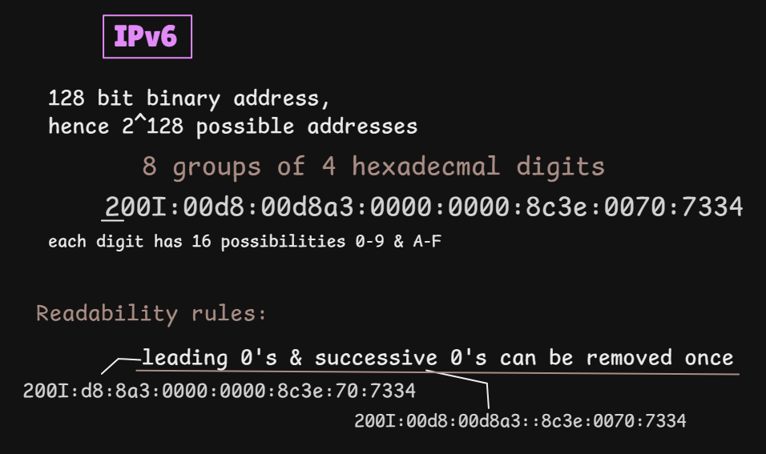
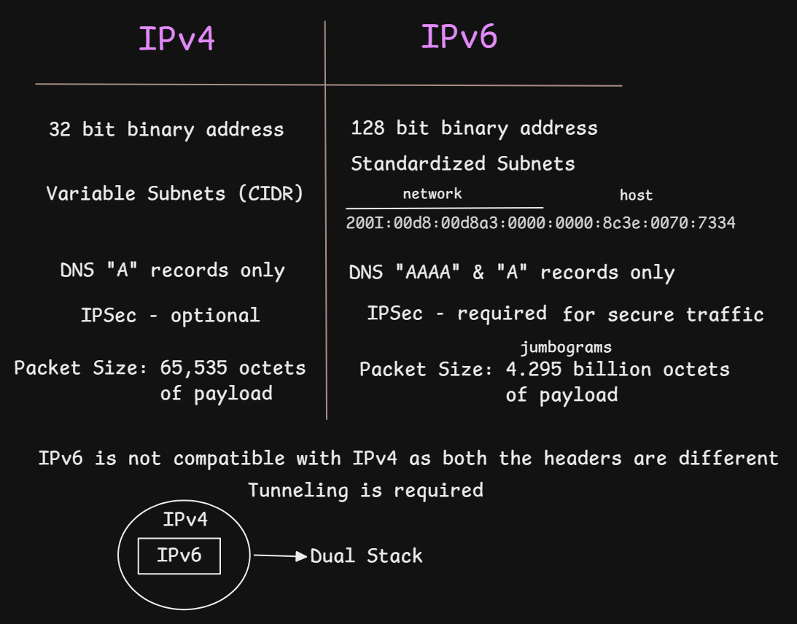
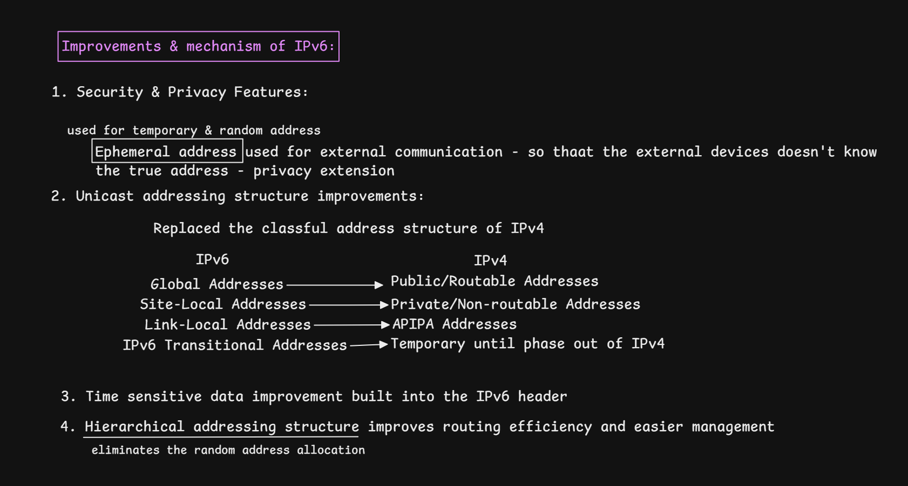

# IPv6 — Internet Protocol Version 6

> [!NOTE]
> **Section:** Computer Networking — Network Fundamentals  
> **Learning objective:** Understand why IPv6 was introduced, how IPv6 addresses are written and shortened, how IPv6 differs from IPv4, and the key mechanisms used for IPv6 addressing and communication.

[← Back to Computer Networking Repository](../../README.md)

---

## 1. What Is IPv6?

**IPv6 (Internet Protocol version 6)** is the network-layer protocol designed to succeed IPv4. Its most visible change is a much larger address space.

- IPv4 addresses are **32 bits** long.
- IPv6 addresses are **128 bits** long.
- IPv6 provides \(2^{128}\) possible addresses.

The larger address space helps support the growth of Internet-connected devices and reduces the need to conserve public addresses in the same way as IPv4.

---

## 2. IPv6 Address Format

An IPv6 address is 128 bits, represented as **eight groups of four hexadecimal digits**, separated by colons.

Example:

```text
2001:0db8:0000:0000:0000:ff00:0042:8329
```

Each hexadecimal digit represents 4 bits. Therefore:
- 4 hexadecimal digits = 16 bits
- 8 groups × 16 bits = 128 bits
- Each digit can be `0–9` or `a–f` (case-insensitive)



### 2.1 IPv6 address shortening rules

**Rule 1 — Remove leading zeros in each group**

```text
2001:0db8:0000:0000:0000:ff00:0042:8329
                         ↓
2001:db8:0:0:0:ff00:42:8329
```

Only zeros at the beginning of an individual group can be removed. Do not remove zeros at the end of a group.

**Rule 2 — Replace one consecutive sequence of zero groups with `::`**

```text
2001:db8:0:0:0:ff00:42:8329
              ↓
2001:db8::ff00:42:8329
```

> [!IMPORTANT]
> `::` can be used **only once** in an IPv6 address. If it appeared more than once, the number of omitted zero groups would be ambiguous.

The shortened address `2001:db8::ff00:42:8329` expands to:

```text
2001:0db8:0000:0000:0000:ff00:0042:8329
```

---

## 3. IPv4 vs IPv6



| Feature | IPv4 | IPv6 |
|---|---|---|
| Address length | 32 bits | 128 bits |
| Representation | Decimal, e.g. `192.0.2.10` | Hexadecimal, e.g. `2001:db8::10` |
| Address space | \(2^{32}\) | \(2^{128}\) |
| Header | Variable length, 20–60 bytes | Fixed 40-byte base header |
| Broadcast | Supported | No broadcast; multicast is used instead |
| Address configuration | Manual or DHCPv4 | Manual, SLAAC, and/or DHCPv6 |
| Address resolution | ARP | Neighbor Discovery Protocol (NDP), using ICMPv6 |
| Header checksum | Present | No base-header checksum |
| Fragmentation | Source and routers can fragment | Only the source fragments; routers do not fragment |
| DNS record | A | AAAA |

### Important corrections

- IPv6 does **not** make IPsec mandatory for every IPv6 connection. IPsec support is part of the IPv6 standards architecture, but use of IPsec is not universally required for all traffic.
- DNS can contain both **A** records (IPv4) and **AAAA** records (IPv6) for the same hostname.
- IPv6 does not use broadcast addresses. It uses multicast for functions that would otherwise rely on broadcast.
- The IPv6 base header is 40 bytes. Its 16-bit Payload Length field can represent up to 65,535 bytes after the base header; the Jumbo Payload option supports larger payloads.

---

## 4. IPv6 Addressing Structure and Address Types

IPv6 uses hierarchical addressing and prefix lengths to identify network prefixes and interface identifiers. It does not use the old IPv4 class A/B/C system.

A prefix is written using CIDR notation, for example:

```text
2001:db8:1234:1::/64
```

The `/64` indicates that the first 64 bits are the network prefix. The remaining bits identify an interface within that subnet.

### Common IPv6 address types

| Address type | Prefix / example | Purpose |
|---|---|---|
| Global Unicast | Commonly `2000::/3` | Globally routable unicast addresses |
| Link-Local | `fe80::/10` | Communication on the local link; used by IPv6 Neighbor Discovery |
| Unique Local | `fc00::/7` (commonly `fd00::/8`) | Private/internal IPv6 addressing; not globally routed |
| Multicast | `ff00::/8` | One-to-many delivery to a multicast group |
| Loopback | `::1/128` | Refers to the local host |
| Unspecified | `::/128` | Represents the absence of an address; used in specific initialization situations |



> [!NOTE]
> IPv6 has **unicast, multicast, and anycast** addressing. Anycast uses the same unicast address on multiple interfaces; routing delivers traffic to one of the nearest or best-matched instances. IPv6 has no broadcast address.

---

## 5. How Does a Device Get an IPv6 Address?

IPv6 supports multiple ways to configure addresses:

- **Static configuration:** an administrator configures the address and related settings.
- **SLAAC (Stateless Address Autoconfiguration):** a host uses information advertised by a router to configure its own address.
- **DHCPv6:** a DHCPv6 server can provide addresses and/or other configuration information.

A network may use SLAAC, DHCPv6, or a combination, depending on its configuration.

### Neighbor Discovery Protocol (NDP)

IPv6 does not use ARP. It uses **Neighbor Discovery Protocol (NDP)**, which operates through ICMPv6 messages.

NDP helps devices:
- Discover neighboring devices on the local link.
- Resolve an IPv6 next-hop address to a link-layer address.
- Discover routers and prefixes.
- Check whether an address is already in use (Duplicate Address Detection).

---

## 6. IPv6 Header — What Changes?

The IPv6 base header is simpler than the IPv4 header and has a fixed size of **40 bytes**.

Important fields include:

| Field | Purpose |
|---|---|
| Version | Identifies IPv6 (`6`) |
| Traffic Class | Traffic handling / QoS marking |
| Flow Label | Identifies packets belonging to a flow |
| Payload Length | Length of data after the 40-byte base header |
| Next Header | Identifies the next extension header or upper-layer protocol |
| Hop Limit | Limits how many router hops a packet can traverse |
| Source Address | 128-bit sender address |
| Destination Address | 128-bit destination address |

IPv6 can use **extension headers** for optional network-layer information. The base header does not contain an IPv4-style header checksum.

> [!IMPORTANT]
> IPv6 routers do not fragment packets in transit. If fragmentation is needed, the source host performs it using the Fragment extension header. Path MTU Discovery is therefore important.

---

## 7. IPv4 and IPv6 Coexistence

IPv6 is not directly compatible with IPv4 at the packet-header level. An IPv4-only device cannot simply interpret an IPv6 packet as an IPv4 packet.

Networks use transition techniques to support coexistence:

| Technique | How it works |
|---|---|
| Dual Stack | A device or network runs IPv4 and IPv6 at the same time |
| Tunneling | Carries packets of one protocol across infrastructure that supports the other protocol |
| Translation | Converts traffic between IPv4 and IPv6, for example using NAT64 with DNS64 in some deployments |

**Dual Stack** is a common deployment approach: devices have IPv4 and IPv6 connectivity and use whichever is available and selected by address-selection mechanisms.

---

## 8. Key Takeaways

- IPv6 addresses are **128 bits** long and written as eight hexadecimal groups.
- Leading zeros in a group can be omitted; one consecutive run of zero groups can be compressed with `::`.
- `::` can appear only once in an address.
- IPv6 uses prefixes such as `/64` for hierarchical network addressing.
- IPv6 has no broadcast; it uses multicast and also supports anycast.
- SLAAC and DHCPv6 are mechanisms for IPv6 configuration.
- IPv6 uses NDP over ICMPv6 instead of ARP.
- The IPv6 base header is fixed at 40 bytes; routers do not fragment packets.
- Dual Stack, tunneling, and translation help IPv4 and IPv6 coexist.

> **In one sentence:** IPv6 expands the Internet's address space and updates packet handling and neighbor discovery to support scalable IP communication.

---

## 9. What You Should Learn Next

The supplied notes introduce IPv6, but they are **not sufficient for a complete practical understanding**. Make sure you can explain and work through these topics:

1. **IPv6 address types and scopes** — global unicast, link-local, unique local, multicast, anycast.
2. **Prefix notation and subnetting** — especially `/64`, network prefixes, and interface identifiers.
3. **SLAAC and Router Advertisements** — how hosts learn prefixes and default routers.
4. **DHCPv6** — stateful vs stateless DHCPv6 and how it differs from DHCPv4.
5. **NDP and ICMPv6** — Neighbor Solicitation, Neighbor Advertisement, Router Solicitation, Router Advertisement, and Duplicate Address Detection.
6. **IPv6 packet header and extension headers** — including the Fragment header.
7. **IPv6 routing and transition mechanisms** — dual stack, tunneling, and NAT64/DNS64.

Prioritise address types, `/64` prefixes, SLAAC, NDP, and the IPv6 header first. You do not need to master every extension header or transition mechanism immediately.

---

## 10. References

- [RFC 8200 — Internet Protocol, Version 6 (IPv6) Specification](https://datatracker.ietf.org/doc/html/rfc8200)
- [RFC 4291 — IP Version 6 Addressing Architecture](https://datatracker.ietf.org/doc/html/rfc4291)
- [RFC 5952 — A Recommendation for IPv6 Address Text Representation](https://datatracker.ietf.org/doc/html/rfc5952)
- [RFC 4861 — Neighbor Discovery for IP Version 6 (IPv6)](https://datatracker.ietf.org/doc/html/rfc4861)
- [RFC 4862 — IPv6 Stateless Address Autoconfiguration](https://datatracker.ietf.org/doc/html/rfc4862)
- [RFC 8415 — DHCP for IPv6 (DHCPv6)](https://datatracker.ietf.org/doc/html/rfc8415)

---

**Next topic:** Add the next topic link here when its README is ready.

