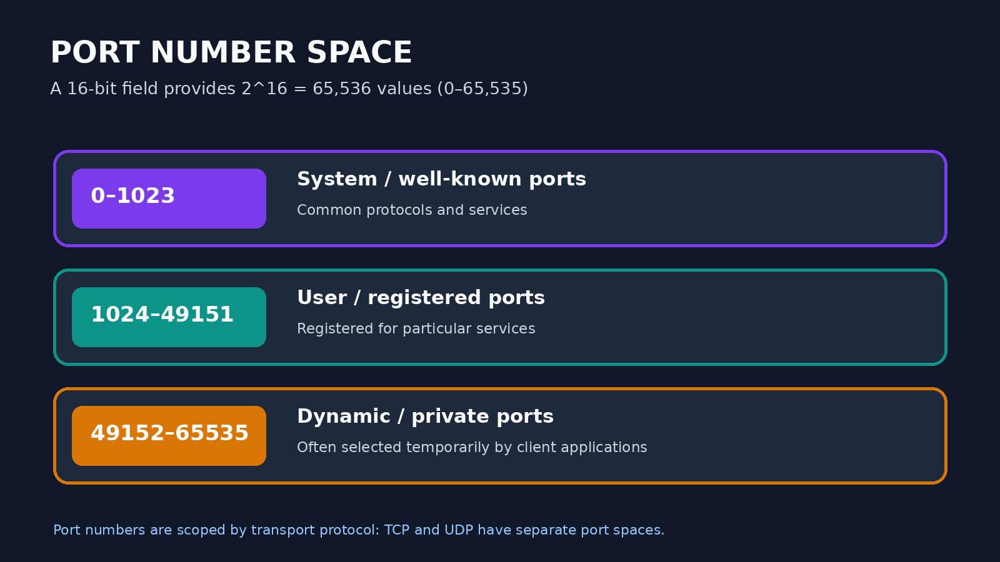
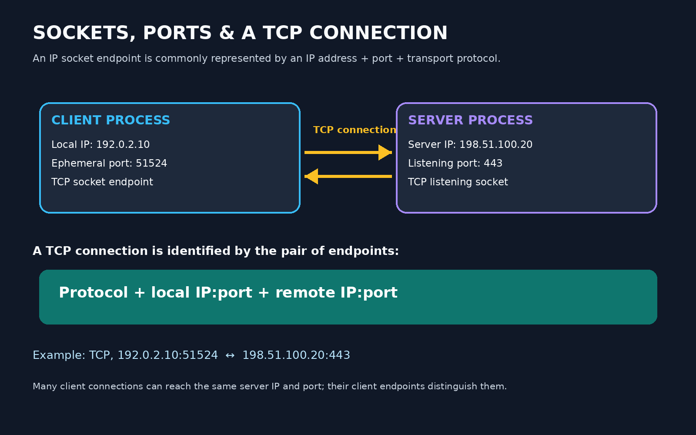

# Ports and Sockets

>[!NOTE]
>
> **Learning objective:** Understand how transport-layer port numbers identify application endpoints, how operating systems expose network communication through sockets, and how TCP and UDP sockets differ.

[← Back to Networking Fundamentals Repository](https://github.com/Priya200227/computer-networking/tree/main/01-network-fundamentals) 

---

## 1. Port numbers

A **port number** is a 16-bit value in the TCP or UDP header. It helps the receiving host deliver transport-layer data to the appropriate application process or socket.

- A 16-bit field has \(2^{16} = 65,536\) possible values.
- The numeric range is **0–65,535**.
- TCP and UDP maintain separate port-number spaces. A TCP service and a UDP service can use the same numeric port without being the same endpoint.
- Port numbers are interpreted together with an IP address and transport protocol; a port alone does not globally identify an application.

### Port-number ranges

| Range | IANA category | Typical meaning |
|---|---|---|
| `0–1023` | System Ports (well-known ports) | Common, standardised services |
| `1024–49151` | User Ports (registered ports) | Registered service/application ports |
| `49152–65535` | Dynamic/Private Ports | Commonly used for temporary client-side ports |

**Important precision:** These ranges are not a rule that every port below 1024 is permanently reserved by the operating system, nor that every port above 49151 is always available. Port `0` is reserved and has special meaning in APIs; operating systems commonly assign ephemeral client ports from a configurable range. The exact ephemeral range depends on the operating system.

### Common ports to recognise

| Service | Common port | Transport |
|---|---:|---|
| HTTP | 80 | TCP |
| HTTPS | 443 | TCP; HTTP/3 uses QUIC over UDP 443 |
| DNS | 53 | UDP and TCP |
| SSH | 22 | TCP |
| MySQL | 3306 | TCP |
| Microsoft SQL Server | 1433 | TCP (default instance) |
| PostgreSQL | 5432 | TCP |
| Redis | 6379 | TCP |

Ports are conventions defined by standards and service configurations. A service can sometimes be configured to listen on a different port.

### How a port helps deliver data

Suppose a client sends an HTTPS request to a server:

- Server IP address: `198.51.100.20`
- Server port: `443`
- Transport: TCP (for HTTP/1.1 or HTTP/2 over TCP)

The destination IP helps the network layer deliver the packet to the host. The destination port helps the transport layer identify the receiving socket/application endpoint on that host.

A port does **not** tell us with certainty which application is running. It indicates the endpoint being addressed; applications can use non-default ports.

## 2. What is a socket?

A **socket** is an operating-system programming interface and communication endpoint abstraction that applications use to send and receive data. Sockets can support communication between processes on the same machine or across a network.

Applications generally use the socket API (for example, `socket()`, `bind()`, `listen()`, `accept()`, `connect()`, `send()` and `recv()`). The operating system's networking stack handles the underlying transport and network operations.

### Socket endpoint vs TCP connection

For an IP-based transport socket, a useful simplified endpoint description is:

**Transport protocol + IP address + port number**

For example:

`TCP, 192.0.2.10:51524`

A TCP connection is identified by the two endpoints:

- Local IP address and local port
- Remote IP address and remote port
- Transport protocol (TCP)

This is commonly described as a **4-tuple** for TCP (the protocol is understood from the context), or a 5-tuple when the protocol is explicitly included.

This distinction matters because many clients can connect to the same server IP and port. Their different client-side IP/port combinations distinguish the connections.

>[!NOTE]
> **Avoid this oversimplification - **“A socket is just an IP address + port.” That describes an IP socket address/endpoint in a simplified way, not every aspect of a socket object or a complete TCP connection.

## 3. How an application uses sockets

A simplified TCP server lifecycle:

1. **Create:** The server creates a TCP socket.
2. **Bind:** It associates the socket with a local IP address and port (for example, `0.0.0.0:8080`).
3. **Listen:** It marks the socket as ready to accept incoming TCP connection requests.
4. **Accept:** When a client connection is established, the server obtains a connected socket for that client.
5. **Exchange data:** The application reads from and writes to the connected socket.
6. **Close:** The application closes the connection when finished.

A simplified TCP client lifecycle:

1. Create a TCP socket.
2. Call `connect()` with the server's IP address and port.
3. The operating system performs TCP connection establishment.
4. Exchange application data through the socket.
5. Close the socket when finished.

The TCP three-way handshake (SYN, SYN-ACK, ACK) establishes the TCP connection. It is not repeated before every application message.

### Where the socket API fits

The application calls the socket API to request communication. The operating system's networking stack performs transport/network processing such as TCP segmentation, retransmission, flow control and IP routing. A socket is an interface to that machinery—not a device that independently performs all those functions.

## 4. TCP sockets vs UDP sockets

| Feature | TCP socket | UDP socket |
|---|---|---|
| Communication model | Connection-oriented | Connectionless datagrams |
| Handshake | TCP connection establishment uses a three-way handshake | No transport-level handshake is required |
| Delivery guarantee | Reliable delivery while the connection remains viable; failures are reported | No delivery guarantee |
| Ordering | Provides an ordered byte stream | Datagrams may be lost or arrive out of order |
| Data boundaries | Stream; application message boundaries are not preserved | Datagram boundaries are preserved |
| Transport mechanisms | Retransmission, flow control and congestion control | No equivalent built-in reliability/flow-control service |
| Common uses | Web traffic over TCP, database connections, file transfer, SSH | DNS queries, real-time media, gaming, QUIC transport |

### Important TCP clarification

TCP provides a **byte stream**, not a message-oriented protocol. If an application writes two separate chunks, the receiving application is not guaranteed to read them as two matching chunks. Applications that need message boundaries must define framing (for example, length-prefixing or delimiters).

TCP's reliability means it retransmits lost data and delivers bytes in order to the receiving application. It does not mean every connection will always succeed; network failures, resets and timeouts still occur.

### Important UDP clarification

UDP is often described as “unreliable,” but that means UDP itself does not guarantee delivery, ordering or duplicate suppression. It does not mean every UDP packet is lost or corrupted. An application can build additional mechanisms on top of UDP when required. QUIC, for example, uses UDP as its underlying transport while implementing its own reliability and security mechanisms.

## 5. A practical example: connecting to a database

Imagine a Python application connecting to PostgreSQL:

- Database server: `10.0.2.15`
- PostgreSQL port: `5432`
- Transport: TCP
- Client: the Python process running on an application host

The client operating system normally selects an ephemeral local port, such as `51524`. The connection can be represented as:

`TCP 10.0.1.20:51524 → 10.0.2.15:5432`

The server listens on port `5432`. The database host's firewall/security rules must allow connections from the application host. The operating system associates the established connection with the appropriate socket.

This is why understanding ports and sockets is useful when diagnosing database connection errors: the database may be running, but the network path or port may still be blocked, misconfigured or unreachable.

## 8. References

- [IANA – Service Name and Transport Protocol Port Number Registry](https://www.iana.org/assignments/service-names-port-numbers/service-names-port-numbers.xhtml)
- [RFC 6335 – Internet Assigned Numbers Authority (IANA) Procedures for the Management of the Service Name and Transport Protocol Port Number Registry](https://www.rfc-editor.org/rfc/rfc6335)
- [RFC 9293 – Transmission Control Protocol (TCP)](https://www.rfc-editor.org/rfc/rfc9293)
- [RFC 768 – User Datagram Protocol (UDP)](https://www.rfc-editor.org/rfc/rfc768)
- [Linux manual – socket(2)](https://man7.org/linux/man-pages/man2/socket.2.html)
- [Python – Socket Programming HOWTO](https://docs.python.org/3/howto/sockets.html)

---

**Next:** Firewalls and security groups.

