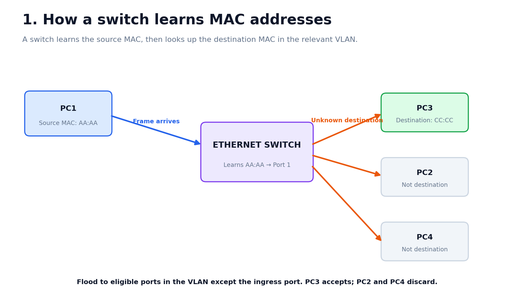
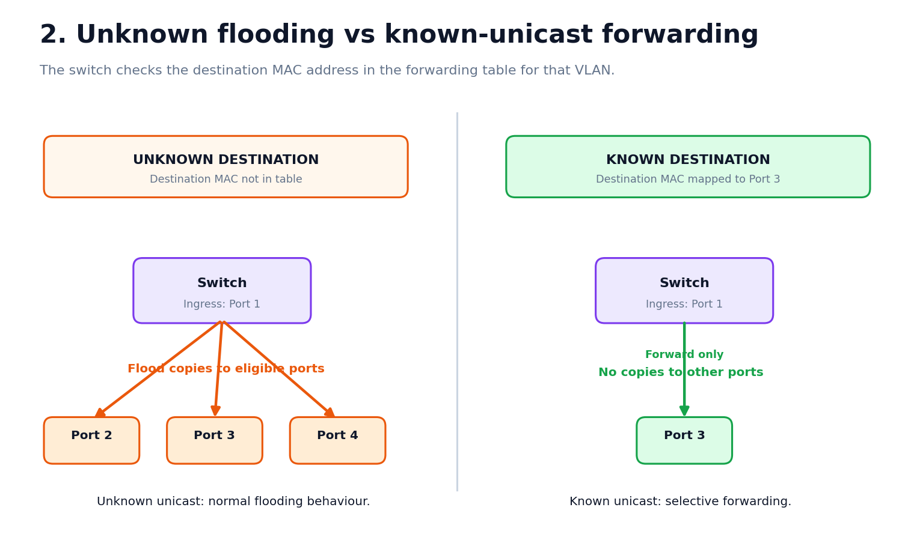
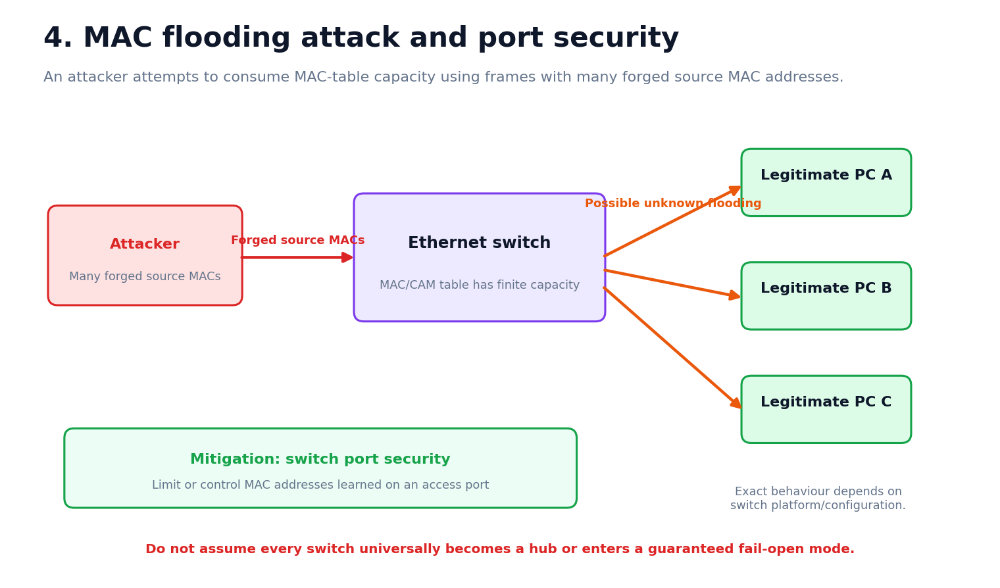
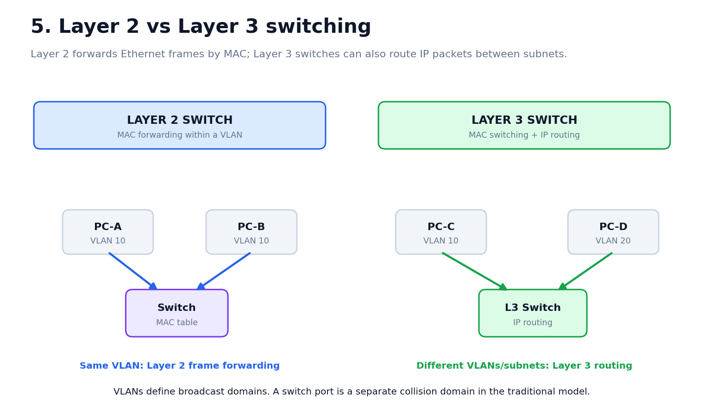
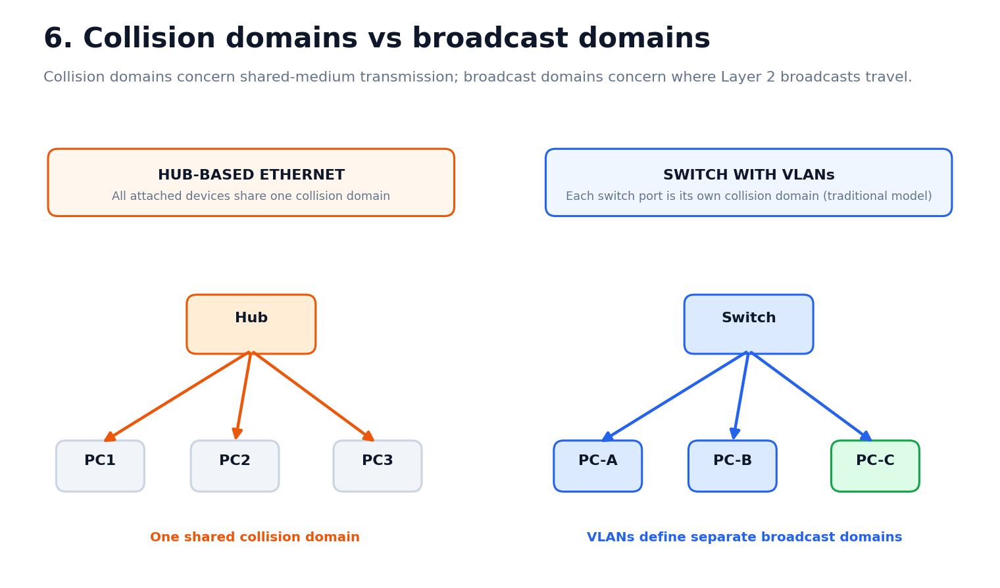
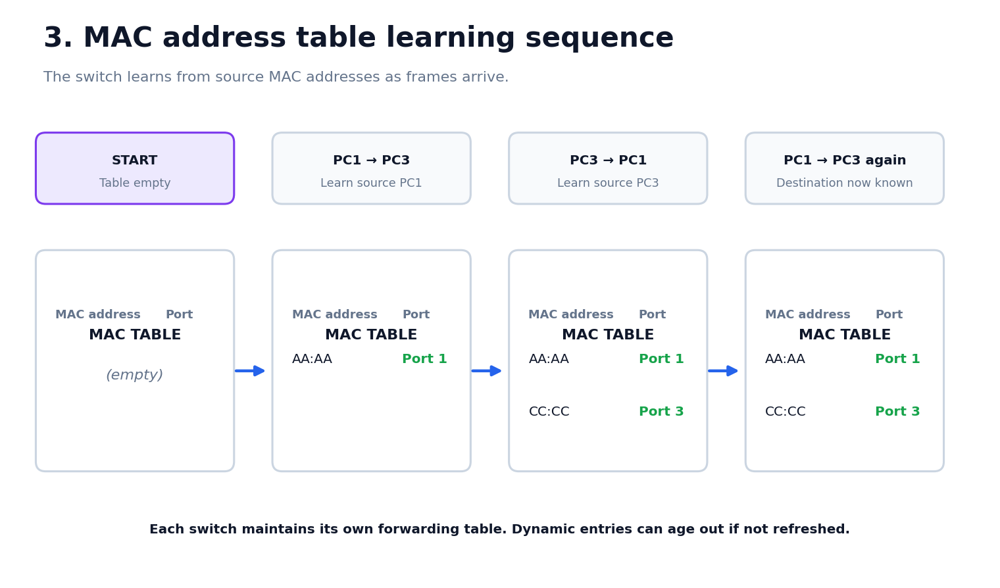

# 🔌 Ethernet Switching Fundamentals

>[!NOTE]
>
> 🎯 **Learning objective:**  Understand how Ethernet switches learn MAC addresses, build forwarding tables, and decide where to send frames. This note also covers **unknown-unicast flooding**, MAC address aging, **MAC flooding attacks**, **MAC address flapping**, **VLAN**-aware forwarding, and Layer 2 vs **Layer 3 switching**.


## 💡 Why This Topic Matters

Devices on the same Ethernet LAN need a way to deliver frames without sending every frame to every device. An Ethernet switch learns which MAC addresses are reachable through which ports and uses that information to forward frames selectively.

This topic builds on your notes about MAC addresses, IP vs MAC addresses, ARP, and **VLAN**s. Add links to those existing README files using the correct paths in your repository.

---

## 🖼️ Visual Revision Diagrams

Keep these PNG files in the `assets/` folder beside this README.

### 1. MAC learning and **unknown-unicast flooding**



### 2. Unknown-unicast flooding vs known-unicast forwarding




### 4. **MAC flooding attack** and port-security mitigation



### 5. Layer 2 vs **Layer 3 switch**ing



### 6. Collision domains vs **broadcast domain**s



---

## 1. 🔀 What Is an Ethernet Switch?


An **Ethernet switch** connects devices within a Local Area Network (LAN). A typical **Layer 2 switch** makes forwarding decisions using the **destination MAC address** in an Ethernet frame.

When a frame arrives, the switch:

1. Learns or refreshes the **source MAC address** against the ingress port and **VLAN**.
2. Looks up the **destination MAC address** in its **MAC address table**.
3. Forwards, floods, or filters the frame based on the lookup result.

A switch is more selective than an Ethernet hub: it can send a **known unicast** frame only through the port leading to the destination device.

### Hub vs switch

| Ethernet hub | Ethernet switch |
|---|---|
| Repeats incoming signals to its other ports | Makes forwarding decisions using MAC address information |
| Does not learn MAC addresses | Learns **source MAC address**es |
| All connected devices share one **collision domain** | Each switch port is a separate **collision domain** in the traditional Ethernet model |
| Shared bandwidth; traditionally half-duplex | Dedicated port bandwidth; commonly full-duplex |
| Does not selectively forward a frame to one destination port | Forwards **known unicast** frames to the destination port |

> [!IMPORTANT]
> A hub is a Layer 1 repeater, not an intelligent frame-forwarding device. Hubs are largely obsolete in modern Ethernet networks.

---

## 2. The MAC Address Table (CAM Table)

A switch maintains a §§**MAC address table**§§, commonly called a §§**CAM table**§§ (Content Addressable Memory table).



The table maps a learned MAC address to the interface/port and **VLAN** where the switch learned it.

A simplified entry looks like this:

| **VLAN** | MAC address | Switch port |
|---:|---|---|
| 10 | `AA:AA:AA:AA:AA:AA` | `Gi0/1` |
| 10 | `BB:BB:BB:BB:BB:BB` | `Gi0/2` |
| 20 | `CC:CC:CC:CC:CC:CC` | `Gi0/3` |

The actual table can contain additional information, such as whether an entry is dynamic or static and its aging information. The same MAC address can have separate entries in different **VLAN** contexts.

### *How does a switch learn a MAC address?*

A switch learns from the §§**source MAC address**§§ of an incoming Ethernet frame.

For example:

- PC1 is connected to switch port 1.
- PC1 sends a frame.
- The switch reads PC1's **source MAC address**.
- It records: `PC1 MAC → Port 1` in the relevant **VLAN**.

The switch does not need to know the destination device before learning the source. Learning happens as frames arrive.

### *How does the switch forward a frame?*

After learning/refreshing the **source MAC address**, the switch checks the frame's §§**destination MAC address**§§.

| Destination lookup result | Switch action |
|---|---|
| Destination MAC is known on another port | Forward the frame only out of that port (**known unicast** forwarding) |
| Destination MAC is unknown in that **VLAN** | Flood the frame out eligible ports in that **VLAN**, except the ingress port (**unknown-unicast flooding**) |
| Destination MAC is learned on the same ingress port | Filter/drop the frame instead of sending it back out the same port |
| Destination is an Ethernet broadcast address | Flood within the **VLAN**, except the ingress port |

Multicast forwarding can depend on switch configuration and features such as IGMP snooping; do not assume every multicast frame is always handled identically.

---

## 3. Example: PC1 Sends a Frame to PC3

Assume four PCs are connected to one switch:

- PC1 → Port 1
- PC2 → Port 2
- PC3 → Port 3
- PC4 → Port 4

Initially, the switch's **MAC address table** is empty.

### Step 1 - PC1 sends a frame

PC1 sends an Ethernet frame addressed to PC3.

The switch receives the frame on Port 1 and learns PC1's **source** MAC address:

| MAC address | Port |
|---|---|
| PC1 MAC | Port 1 |

### Step 2 - The switch looks up PC3

The switch checks the **destination MAC address**, but PC3 is not yet in the table.

The destination is an §§**un**known unicast****§§ destination.

### Step 3 - The switch floods the frame

The switch sends a copy of the frame out the other eligible ports in the same **VLAN**, excluding Port 1.

PC2 and PC4 receive the frame but discard it because the **destination MAC address** is not theirs. PC3 accepts and processes it.

> [!NOTE]
> Flooding does not send the frame back through the port on which it arrived. The ingress port is excluded.

### Step 4 - PC3 replies

PC3 sends a reply. When the reply reaches the switch on Port 3, the switch learns PC3's **source MAC address**:

| MAC address | Port |
|---|---|
| PC1 MAC | Port 1 |
| PC3 MAC | Port 3 |

### Step 5 - Subsequent frames are forwarded directly

The next time PC1 sends a frame to PC3, the switch finds PC3's MAC address in its table and forwards the frame only through Port 3.

> [!TIP]
> **Key takeaway:** The switch learns ****source MAC address**es**; it looks up ****destination MAC address**es** to make forwarding decisions.

---

## 4. Unknown-Unicast Flooding vs MAC Flooding Attack

These terms sound similar but describe different things.

### Unknown-unicast flooding - normal switch behaviour

This happens when a switch receives a unicast frame but does not have an entry for its **destination MAC address** in the relevant **VLAN**'s **MAC address table**.

The switch floods the frame through eligible ports in that **VLAN**, except the ingress port. This helps the frame reach the destination while the switch learns where devices are connected.

It can happen when:

- The switch has just started and its dynamic MAC table is empty.
- A device has not transmitted recently and its entry has aged out.
- A device has moved to another switch port.
- The switch has not yet learned the **destination MAC address**.

### **MAC flooding attack** (**CAM table** overflow attack)

A §§**MAC flooding attack**§§ is a Layer 2 attack in which an attacker sends many Ethernet frames with numerous forged **source MAC address**es in an attempt to consume the switch's MAC address-table capacity.

If the table cannot accommodate additional entries, the switch may be unable to learn some legitimate **destination MAC address**es. Frames for those unknown destinations may then be flooded within the relevant **VLAN**, depending on the switch's implementation and configuration.

> [!WARNING]
> This can increase traffic exposure and may allow an attacker on the same **VLAN** to observe traffic that would otherwise be selectively forwarded. It does **not** mean every switch universally changes into a hub or enters a guaranteed “fail-open mode”.

### How can it be mitigated?

One relevant Layer 2 control is **switch **port security****:

- Limit the number of MAC addresses that a switch port can learn.
- Optionally allow specified MAC addresses.
- Configure an appropriate violation action, depending on the platform and operational requirements.

Port security is a mitigation, not a complete security strategy. Its configuration and available actions vary by switch vendor and model.

---

## 5. MAC Address Aging

Dynamic MAC address entries are not permanent.

A switch maintains an aging timer for dynamic entries. If it does not receive traffic from a learned **source MAC address** within the configured aging period, it can remove that entry.

Why aging is useful:

- Devices can disconnect or move to another port.
- Old entries should not remain in the table indefinitely.
- The switch can relearn a device's current location when it transmits again.

If an entry has aged out and a frame later arrives for that destination, the switch may treat the destination as unknown and flood the frame within the **VLAN**.

> [!NOTE]
> The aging interval is configurable and vendor/platform dependent. Do not treat a particular value, such as 300 seconds, as a universal Ethernet standard.

---

## 6. MAC Address Learning Across Multiple Switches

Switches learn MAC addresses from frames they receive, including frames arriving from another switch.

Example:

```text
PC-A ── Switch 1 ───── Switch 2 ── PC-B
```

1. PC-A sends a frame towards PC-B.
2. Switch 1 learns PC-A's **source MAC address** on the port connected to PC-A.
3. If PC-B's destination MAC is unknown, Switch 1 floods the frame within the relevant **VLAN**, including towards the inter-switch link if it is an eligible forwarding port.
4. Switch 2 receives the frame and learns PC-A's **source MAC address** on its inter-switch port.
5. PC-B receives the frame and replies.
6. Switch 2 learns PC-B's **source MAC address** on the port connected to PC-B.
7. Switch 1 learns PC-B's **source MAC address** on the inter-switch port.

Both switches build their own forwarding information. They do not need to exchange ordinary host MAC-table entries with one another for this basic learning process.

---

## 7. MAC Address Flapping

§§**MAC address flapping**§§ occurs when a switch repeatedly learns the same MAC address on different ports over a short period.

Possible causes include:

- A Layer 2 loop.
- Incorrect or unexpected network cabling.
- Misconfigured link aggregation or switching.
- A device genuinely moving between network attachment points.

Frequent flapping can make forwarding unstable and may indicate a network design or configuration problem.

Do not confuse **MAC address flapping** with a normal device move. A single legitimate move can cause the switch to update its entry; repeated rapid movement is the warning sign.

---

## 8. CAM Table and **TCAM** - Are They the Same?

They are related hardware concepts, but they are not interchangeable.

- **CAM (Content Addressable Memory):** Commonly used for exact-match lookups, such as Ethernet MAC address forwarding entries.
- ****TCAM** (Ternary Content Addressable Memory):** Supports matching values with `0`, `1`, and “don't care” bits. It is commonly used for more flexible matching, such as access-control and policy rules.

For this topic, remember the distinction only. You do not need to study switch ASIC architecture or memory implementation details.

---

## 9. **VLAN**-Aware MAC Address Learning

A switch's MAC forwarding decision is made in a **VLAN** context.

A **VLAN** creates a separate Layer 2 **broadcast domain**. The switch therefore needs to consider both the **destination MAC address** and the **VLAN** when forwarding a frame.

For example:

| **VLAN** | MAC address | Port |
|---:|---|---|
| 10 | `AA:AA:AA:AA:AA:AA` | Port 1 |
| 20 | `AA:AA:AA:AA:AA:AA` | Port 5 |

The same MAC value can appear in separate **VLAN** contexts. A MAC address learned in **VLAN** 10 does not automatically provide a forwarding entry for **VLAN** 20.

When the destination is unknown, flooding is limited to eligible ports in the frame's **VLAN**. A **Layer 2 switch** does not flood a **VLAN** 10 frame into **VLAN** 20.

This connects directly to the earlier **VLAN** topic: ****VLAN**s separate **broadcast domain**s, and MAC learning/forwarding is **VLAN**-aware.**

---

## 10. Layer 2 Switch vs Layer 3 Switch


| **Layer 2 switch** | **Layer 3 switch** |
|---|---|
| Forwards Ethernet frames using MAC addresses | Performs **Layer 2 switch**ing and can also route IP packets |
| Operates primarily at OSI Layer 2 | Operates at Layers 2 and 3 |
| Does not route between IP subnets by ordinary Layer 2 forwarding alone | Can route between **VLAN**s/subnets using Layer 3 interfaces |
| Uses a MAC address forwarding table | Uses MAC forwarding and IP routing/forwarding information |

A **Layer 3 switch** is also called a **multilayer switch**. It can perform inter-**VLAN** routing, often in hardware. It does not make routers obsolete: dedicated routers and **Layer 3 switch**es serve different roles depending on network scale, features and design.

---

## 11. Collision Domains and Broadcast Domains

### Collision domain

A §§**collision domain**§§ is a network segment in which devices share a medium where simultaneous transmissions can collide.

- A traditional Ethernet hub places all connected devices in one shared **collision domain**.
- A switch separates **collision domains** by port in the traditional Ethernet model.
- Modern switched Ethernet links commonly operate full-duplex, so ordinary Ethernet collisions do not occur on those links.

### Broadcast domain

A §§**broadcast domain**§§ is the Layer 2 network area in which a broadcast frame is propagated.

- A **VLAN** defines a separate Layer 2 **broadcast domain**.
- Switches forward broadcasts within the relevant **VLAN**.
- Routers do not normally forward Layer 2 broadcasts between IP networks/**VLAN**s.

> [!IMPORTANT]
> **Do not mix these up:** A switch separates **collision domain**s, while **VLAN**s (and Layer 3 boundaries) define broadcast-domain separation.

---

## 12. Quick Revision

| Question | Short answer |
|---|---|
| What address does a switch learn from an incoming frame? | Source MAC address |
| What address does it look up to decide where to send the frame? | Destination MAC address |
| What does the MAC/**CAM table** map? | MAC address + **VLAN** context to a switch port |
| What happens when the destination MAC is known? | Forward to the associated port |
| What happens when the destination MAC is unknown? | Flood within the **VLAN**, except the ingress port |
| Why does a switch age MAC entries? | To remove stale dynamic mappings |
| What is MAC flooding? | An attack that attempts to exhaust the **MAC address table** using many forged **source MAC address**es |
| What is **MAC address flapping**? | A MAC address repeatedly appearing on different switch ports |
| What is **port security** used for? | Limiting or controlling MAC addresses learned on a switch port |
| What does a **Layer 3 switch** add? | IP routing, including inter-**VLAN** routing |
| What separates **broadcast domain**s? | **VLAN**s / Layer 3 boundaries |
| What separates **collision domain**s on a switch? | Individual switch ports |

---

## References

1. [Cisco - Configure MAC Address Learning and Forwarding](https://www.cisco.com/c/en/us/td/docs/switches/lan/c9000/lyr2-fwd/cdp-lldp-mac-udld/cdp-lldp-mac-udld-configuration-guide/c-configure-mac.html) - source MAC learning, destination lookup, forwarding, flooding, filtering and aging.
2. [Cisco - Unicast Flooding in Switched Campus Networks](https://www.cisco.com/c/en/us/support/docs/switches/catalyst-6000-series-switches/23563-143.html) - explains **unknown-unicast flooding** and why it occurs.
3. [Cisco - CAM Table Issues and Troubleshooting](https://www.cisco.com/c/en/us/support/docs/switches/catalyst-6500-series-switches/71079-arp-cam-tableissues.html) - MAC learning, **VLAN** context, CAM entries and flooding.
4. [Cisco Press - Routing and Switching Essentials, Chapter 2](https://www.ciscopress.com/content/images/9781587133183/samplepages/1587133180.pdf) - switching fundamentals and **MAC address table** overflow attacks.
5. [Cisco - Layer 2 Security Features](https://www.cisco.com/c/en/us/support/docs/switches/catalyst-3750-series-switches/72846-layer2-secftrs-catl3fixed.pdf) - **port security** and **CAM table** overflow mitigation.

