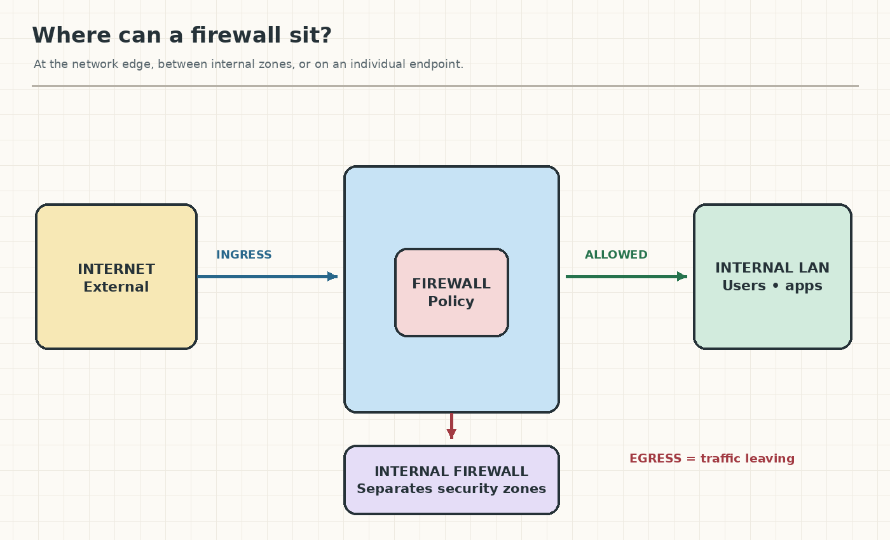
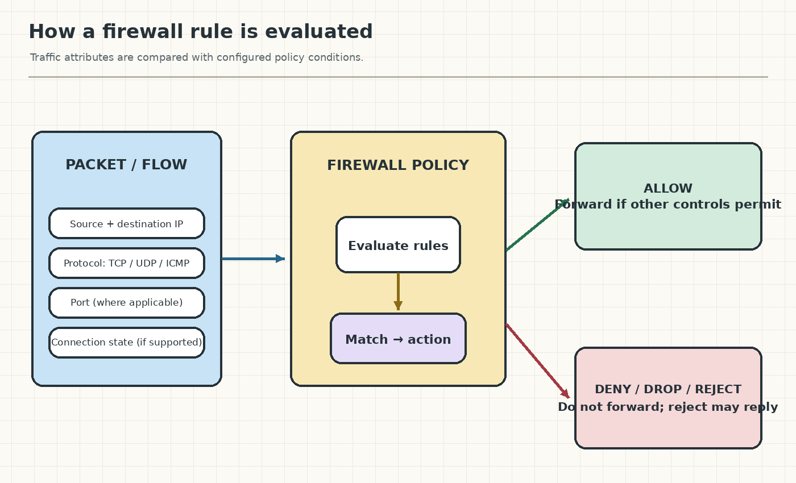
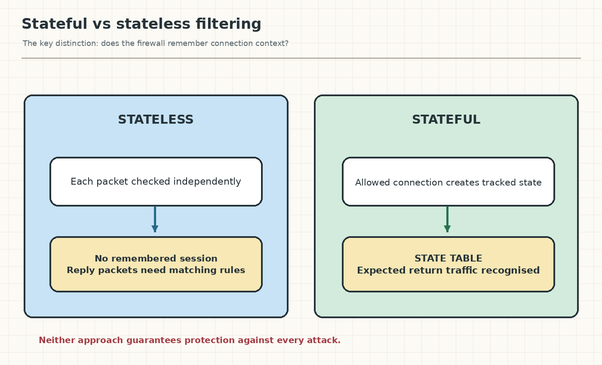
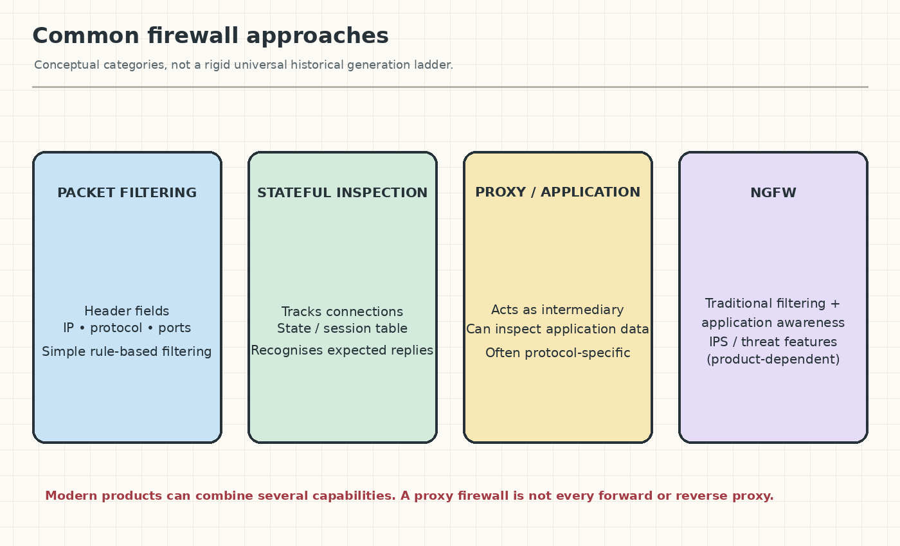

# 🔥 Firewall Fundamentals

> 🎯 **Learning objective:** Understand what a firewall does, where it is placed, how traffic rules work, and the difference between stateless and stateful inspection. Learn enough to reason about network security in application and cloud architecture—not to administer enterprise firewalls.

[⬅️ Back to Computer Networking repository](../README.md)

---

## 1. What is a firewall?

A **firewall** is a hardware, software or cloud-based security control that monitors and filters network traffic according to a defined security policy. It decides which traffic is permitted and which traffic is denied.

A firewall can inspect traffic entering a protected environment (**ingress**) or leaving it (**egress**).

### Why use firewalls?

- **Access control:** restrict which systems and services can communicate.
- **Network segmentation:** limit traffic between internal network zones.
- **Exposure reduction:** allow only connections that are required.
- **Policy enforcement:** apply network access rules.
- **Logging and visibility:** record permitted or denied traffic when logging is enabled.

> [!IMPORTANT]
> A firewall is one layer of security, not a complete security solution. It does not automatically stop phishing, compromised accounts, malicious activity inside permitted encrypted traffic, or every malware / denial-of-service attack.

---

## 2. Where can a firewall be placed?

Firewalls are not only installed at the boundary between an organisation and the Internet.

<figure>
  
  <figcaption><strong>Figure 1.</strong> Common firewall placement patterns.</figcaption>
</figure>

### 2.1 Perimeter / edge firewall

Placed between an external network (often the Internet) and an internal network.

Example: filtering traffic entering or leaving an office network.

### 2.2 Internal / segmentation firewall

Placed between internal network segments or security zones.

Example: restricting which application servers can communicate with a database network.

### 2.3 Host-based firewall

Software running on an individual computer or server. Examples include Windows Defender Firewall and Linux host firewall rules. It controls traffic to and from that particular host.

### Ingress vs egress

| Term | Meaning |
|---|---|
| Ingress | Traffic entering the protected network, zone or host |
| Egress | Traffic leaving the protected network, zone or host |

These terms are relative to the boundary being discussed. A packet leaving one network may be ingress traffic to the next network.

---

## 3. Firewall rules and policies

A firewall evaluates traffic against rules or policies. A rule commonly contains some combination of:

| Field | What it identifies | Example |
|---|---|---|
| Source | Where traffic originates | `10.0.1.25` |
| Destination | Where traffic is going | `10.0.2.10` |
| Protocol | Transport or network protocol | TCP, UDP, ICMP |
| Port | Service endpoint, where applicable | TCP 443 |
| Direction | Inbound or outbound relative to a boundary | Inbound |
| Action | What to do when the rule matches | Allow, deny, drop, reject |

A firewall may also consider connection state, interface, user identity, application identity, time, or other attributes depending on its capabilities.

<figure>
  
  <figcaption><strong>Figure 2.</strong> Conceptual firewall rule evaluation.</figcaption>
</figure>

### Rule order

Some firewalls evaluate rules in order and stop when a matching rule is found (**first-match processing**). Others use different evaluation models.

**Do not assume all firewalls use the same rule-order behaviour.** Understand the specific product's policy model.

### Default deny

A **default-deny** policy means traffic is denied unless a rule explicitly permits it. This is a useful security principle because it limits access to known requirements rather than allowing everything by default.

The exact default behaviour varies by product and configuration. A secure design explicitly defines permitted traffic and how unmatched traffic is handled.

### Allow, deny, drop and reject

- **Allow:** permit the traffic to continue.
- **Deny / drop:** do not forward the traffic. A silent drop sends no response to the source.
- **Reject:** block the traffic and may send an error response, depending on the firewall and protocol.

---

## 4. Stateless vs stateful firewalls

This is one of the most important distinctions to understand.

<figure>
  
  <figcaption><strong>Figure 3.</strong> Stateless and stateful traffic inspection.</figcaption>
</figure>

### 4.1 Stateless filtering

A stateless firewall evaluates each packet independently using information available in that packet and its configured rules. It does not remember the connection history of previous packets.

For example, an inbound packet and its reply packet are evaluated separately. Rules must account for the required traffic in both directions.

### 4.2 Stateful inspection

A stateful firewall tracks active connections in a **state table**.

When an allowed connection is established, the firewall records connection information. It can then recognise expected packets belonging to that connection, including legitimate return traffic.

Example:

1. A client initiates an allowed connection to a server.
2. The firewall permits it and tracks the connection state.
3. The server sends response packets.
4. The firewall recognises those packets as part of the established connection.

| Feature | Stateless | Stateful |
|---|---|---|
| Tracks connections | No | Yes |
| Decision basis | Individual packet + rules | Packet + connection context + rules |
| Return traffic | Must be handled by explicit rules | Expected return traffic can be recognised automatically |
| Context | Limited | More connection-aware |

> [!TIP]
> **Stateless = evaluates packets individually. Stateful = tracks connections.**

Neither approach is automatically sufficient on its own for every security requirement.

---

## 5. Common firewall approaches

The video presents four useful categories. Treat them as conceptual approaches with increasing inspection context—not as a strict, universally accepted historical generation sequence.

<figure>
  
  <figcaption><strong>Figure 4.</strong> Common firewall approaches.</figcaption>
</figure>

### 5.1 Packet-filtering firewall

Examines basic packet attributes such as:
- Source and destination IP addresses
- Protocol
- Port numbers, where applicable

**Strengths:** simple, fast and relatively lightweight.

**Limitations:** limited application context; a basic packet filter cannot understand the full meaning of application data.

### 5.2 Stateful inspection firewall

Tracks connection state and evaluates whether packets belong to expected, permitted connections.

**Strengths:** connection-aware filtering and simpler handling of legitimate return traffic.

**Limitations:** may still have limited application-level visibility compared with application-aware controls.

### 5.3 Proxy / application-layer firewall

Acts as an intermediary and can inspect traffic at the application layer. It may understand application protocols and apply rules based on application-level information, rather than relying only on IP addresses and ports.

**Strengths:** can provide more detailed application-aware filtering.

**Limitations:** additional processing, configuration complexity and protocol-specific considerations.

> [!NOTE]
> A **proxy firewall** is a security control that filters application traffic. Do not confuse it with every ordinary forward proxy or reverse proxy. Those concepts are related, but they are not interchangeable.

### 5.4 Next-Generation Firewall (NGFW)

An NGFW combines traditional firewall capabilities with additional security features. Depending on the product, these may include:

- Application awareness and application control
- Intrusion Prevention System (IPS) capabilities
- Deep packet inspection
- Threat intelligence integration
- URL filtering or malware inspection

**Strengths:** richer visibility and more advanced policy enforcement.

**Limitations:** greater cost and complexity; advanced inspection can require additional resources and careful tuning.

Not every NGFW includes every feature, and encrypted traffic inspection has its own limitations and privacy implications.

---

## 6. What firewalls can and cannot do

### What they can help with

- Restricting access to services and ports.
- Preventing unauthorised network paths when rules are correctly configured.
- Separating systems into security zones.
- Enforcing inbound and outbound traffic policies.
- Logging network activity for troubleshooting and security monitoring.
- Detecting or blocking certain threats when advanced inspection features are enabled.

### What they do not guarantee

- They do not stop every malware infection.
- They do not prevent phishing or social engineering by themselves.
- They do not automatically detect every malicious action inside allowed traffic.
- They do not guarantee protection against every port scan or DoS/DDoS attack.
- They cannot compensate for weak identity controls, vulnerable applications or poor configuration.

> [!WARNING]
> Misconfigured firewall rules can expose services that should not be reachable. Security depends on the policy, placement, product capabilities and ongoing maintenance—not merely on having a firewall.

---

## 7. How this connects to AWS networking

You will encounter firewall-like controls when learning AWS VPC networking.

| AWS control | Scope | Stateful? | Rule actions |
|---|---|---|---|
| Security Group (SG) | Network interface / resource | Yes | Allow rules |
| Network ACL (NACL) | Subnet | No | Allow and deny rules |

- **Security Groups** track connections. Response traffic for an allowed connection is automatically permitted.
- **Network ACLs** are stateless. Return traffic must be allowed by the applicable rules as well.

They are not identical to a traditional perimeter firewall appliance, but they provide network traffic filtering within a VPC.

Official AWS references:
- [Security groups for your VPC](https://docs.aws.amazon.com/vpc/latest/userguide/vpc-security-groups.html)
- [Network ACLs for your VPC](https://docs.aws.amazon.com/vpc/latest/userguide/vpc-network-acls.html)
- [Infrastructure security in Amazon VPC](https://docs.aws.amazon.com/vpc/latest/userguide/infrastructure-security.html)

---

## 8. Quick revision

| Concept | One-line explanation |
|---|---|
| Firewall | Monitors and filters traffic using a security policy |
| Ingress | Traffic entering a protected boundary |
| Egress | Traffic leaving a protected boundary |
| Perimeter firewall | Filters traffic at a network boundary |
| Internal firewall | Separates internal network zones |
| Host-based firewall | Filters traffic on an individual endpoint |
| Firewall rule | Conditions and action used to handle traffic |
| Default deny | Deny traffic unless explicitly permitted |
| Stateless | Evaluates packets independently |
| Stateful | Tracks active connections |
| Packet filtering | Filters using basic packet attributes |
| Proxy firewall | Inspects application traffic through an intermediary |
| NGFW | Combines traditional filtering with advanced security capabilities |
| Security Group | AWS stateful resource-level traffic control |
| NACL | AWS stateless subnet-level traffic control |

---

## 9. Knowledge check

You should be able to answer these without looking at the notes:

1. What is the purpose of a firewall?
2. What is the difference between ingress and egress?
3. Where can firewalls be deployed?
4. What information can a firewall rule evaluate?
5. What does default deny mean?
6. How does stateful inspection differ from stateless filtering?
7. What does a proxy firewall inspect?
8. What additional capabilities may an NGFW provide?
9. Why is a firewall not a complete security solution?
10. How do AWS Security Groups differ from NACLs?

---

## 10. Learning boundary — what you need and what you can skip

For your current networking foundation, learn to:

- Explain the purpose and placement of a firewall.
- Read a basic source/destination/protocol/port/action rule.
- Explain default deny.
- Distinguish stateful from stateless inspection.
- Recognise packet filtering, proxy firewalls and NGFWs.
- Understand how Security Groups and NACLs fit into AWS VPC networking.

You do **not** need to study:
- Vendor-specific firewall command-line configuration.
- Building complex enterprise firewall rule sets.
- IPS signature tuning or threat-hunting workflows.
- Deep packet inspection internals.
- SOC operations or advanced incident response.

That is a different learning path. For your data, backend and cloud goals, conceptual understanding and the ability to reason about application connectivity are enough at this stage.

---

## 📚 11. References

### Video used for this chapter

- [Firewall Fundamentals Explained | Network Security for Beginners — Antisyphon Training](https://youtu.be/K4ilFsm2GvA)

### Documentation

- [Cisco — What Is a Firewall?](https://www.cisco.com/site/us/en/learn/topics/security/what-is-a-firewall.html)
- [AWS — Infrastructure security in Amazon VPC](https://docs.aws.amazon.com/vpc/latest/userguide/infrastructure-security.html)
- [AWS — Security groups](https://docs.aws.amazon.com/vpc/latest/userguide/vpc-security-groups.html)
- [AWS — Network ACLs](https://docs.aws.amazon.com/vpc/latest/userguide/vpc-network-acls.html)

---

## ➡️ 12. Where this fits in the learning path

Firewall fundamentals connect directly to:
- [VPC and cloud networking](../03-aws-vpc-security-groups-nacls/README.md)
- [Security Groups and NACLs](../03-aws-vpc-security-groups-nacls/README.md)
- [Proxies and reverse proxies](../04-proxy-and-reverse-proxy/README.md)

[⬅️ Back to Computer Networking repository](../README.md)

