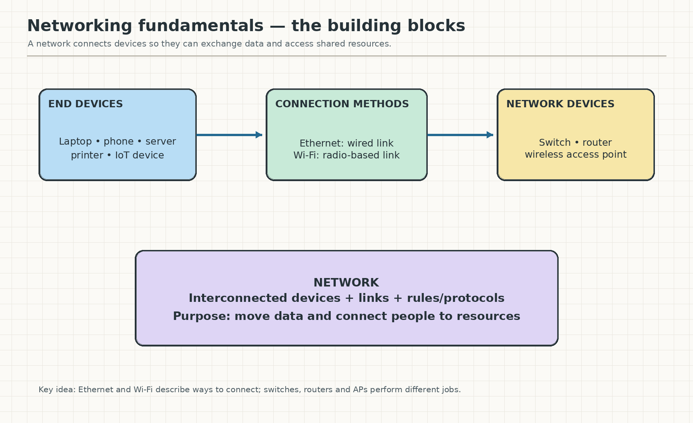
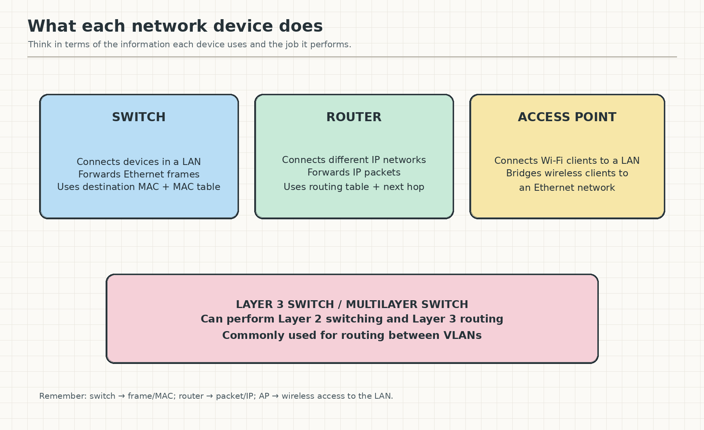
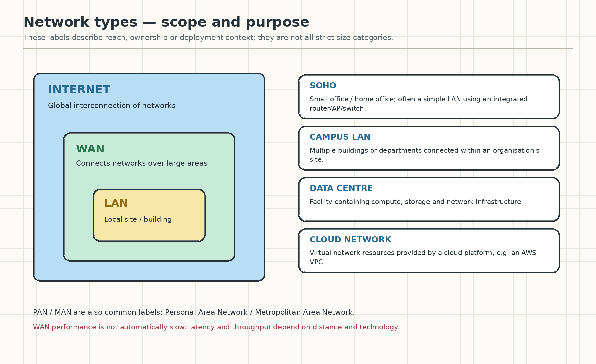
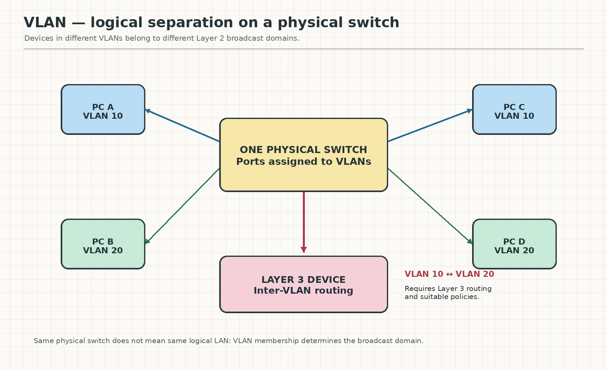
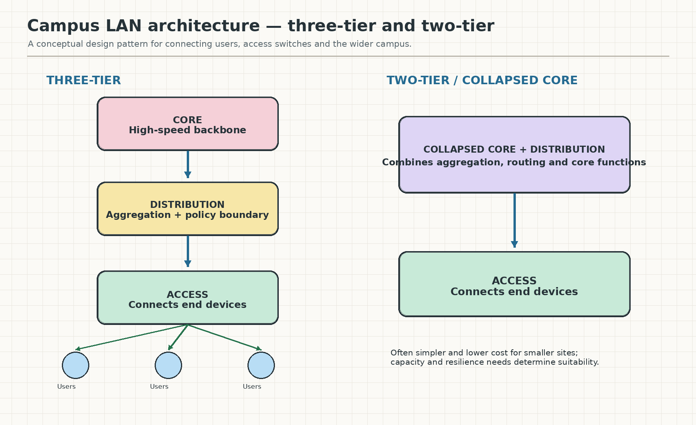
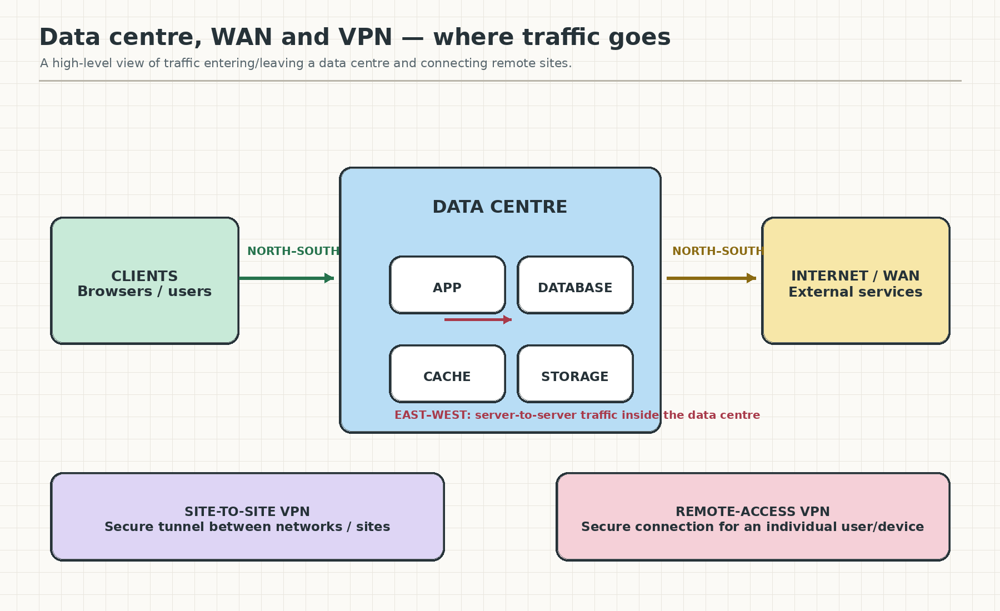

# 🌐 Networking Fundamentals and Network Architecture

> 🎯 **Learning objective:** Understand what a computer network is, why networks exist, how common network types are organised, and what the main networking devices do. This chapter establishes the foundation for the later topics in this repository: IP addressing, subnetting, Ethernet switching, routing, DNS, TCP, HTTP, TLS and cloud networking.

> **Scope:** Conceptual understanding for application development, data engineering, cloud and backend systems. This is not an enterprise network-engineering or device-configuration guide.

[⬅️ Back to Computer Networking repository](../README.md)

---

## 🧭 1. What is a computer network?

A **computer network** is a group of interconnected devices that communicate and exchange data using agreed rules called **protocols**.

A network may connect laptops, phones, servers, printers, storage systems, cameras and other devices.

### Why do networks exist?

- **Communication:** exchange messages and data.
- **Resource sharing:** access shared printers, storage and services.
- **Centralised services:** use applications and databases hosted on servers.
- **Internet access:** reach services outside the local network.
- **Collaboration:** allow users and systems to work with shared information.

<figure>
  
  <figcaption><strong>Figure 1.</strong> The building blocks of a network.</figcaption>
</figure>

### Basic components

| Component | Meaning | Examples |
|---|---|---|
| End devices | Devices that originate or consume data | Laptop, phone, server, printer |
| Network interface | Hardware/software interface used to connect to a network | Ethernet NIC, Wi-Fi adapter |
| Transmission medium | Carries signals between devices | Copper cable, fibre, radio |
| Intermediary devices | Connect devices or forward traffic | Switch, router, access point |
| Protocols | Rules governing communication | Ethernet, IP, TCP, UDP, DNS, HTTP |

---

## 🔌 2. How devices connect: Ethernet and Wi-Fi

### Ethernet

**Ethernet** is a family of wired networking technologies commonly used in local area networks (LANs). Devices typically connect using copper Ethernet cables or fibre-optic links.

- Common in offices, homes, campuses and data centres.
- A switch commonly connects wired devices within a LAN.
- Ethernet frames contain source and destination MAC addresses.

### Wi-Fi

**Wi-Fi** is a family of wireless LAN technologies. Devices communicate over radio waves rather than a dedicated physical cable between each client and the access point.

- A wireless client connects to an access point (AP).
- The AP provides wireless access to a network, often bridging wireless clients into the wired LAN.
- Wi-Fi uses a shared radio medium; it is not simply a wireless Ethernet hub.

| Ethernet | Wi-Fi |
|---|---|
| Wired connection | Wireless radio connection |
| Uses copper or fibre links | Uses radio-frequency signals |
| Often predictable and stable | Mobility and convenience |
| Common for desktops, servers and switches | Common for phones, laptops and tablets |

---

## 🧰 3. Core networking devices

The most important distinction is the job each device performs.

<figure>
  
  <figcaption><strong>Figure 2.</strong> Main network devices and their roles.</figcaption>
</figure>

### 3.1 Switch

A **network switch** connects devices within a Layer 2 network, commonly a LAN.

- Forwards Ethernet **frames**.
- Learns source MAC addresses and associates them with switch ports.
- Uses its MAC address table (also called a CAM table) to decide where to forward known unicast frames.
- Unknown unicast frames are generally flooded within the relevant VLAN, excluding the ingress port.

**Remember:** A switch's normal Layer 2 forwarding decision is based on the destination MAC address.

### 3.2 Router

A **router** connects different IP networks and forwards IP packets between them.

- Examines the destination IP address.
- Uses its routing table to select a route and next hop.
- Connects networks such as a home LAN to an ISP network, or one enterprise subnet to another.

**Remember:** A router makes a Layer 3 forwarding decision using IP routing information.

### 3.3 Layer 2 switch vs Layer 3 switch

| Feature | Layer 2 switch | Layer 3 switch |
|---|---|---|
| Main role | Switches frames within a Layer 2 network | Switches frames and routes packets |
| Forwarding information | MAC address table | MAC table and IP routing information |
| Typical use | Connecting devices in a VLAN | High-speed routing between VLANs/subnets |
| OSI functions | Layer 2 | Layer 2 and Layer 3 |

A Layer 3 switch is also called a **multilayer switch**. It can perform inter-VLAN routing. Do not assume that every Layer 3 switch is always faster than every router; performance depends on hardware, features and workload.

### 3.4 Wireless Access Point (AP)

An **access point** connects wireless clients to a network, usually bridging Wi-Fi clients into a wired LAN.

An AP is not necessarily a router. In many enterprise networks, the router, switch and access point are separate devices.

---

## 🗺️ 4. Types and scopes of networks

Network labels describe different things: geographic scope, organisational context or deployment environment. They are useful categories, but not all are mutually exclusive.

<figure>
  
  <figcaption><strong>Figure 3.</strong> Common network scopes and deployment contexts.</figcaption>
</figure>

### 4.1 PAN — Personal Area Network

A **Personal Area Network** connects devices around an individual over a short range.

Examples:
- Phone connected to wireless earbuds using Bluetooth.
- Laptop connected to a phone hotspot.

### 4.2 LAN — Local Area Network

A **Local Area Network** connects devices within a limited area, such as a home, office, floor or building.

Typical characteristics:
- Usually high-speed, relatively low-latency connectivity.
- Often uses Ethernet switches and Wi-Fi access points.
- May be privately operated by a household or organisation.

A LAN is not defined solely by being owned by one organisation.

### 4.3 MAN — Metropolitan Area Network

A **Metropolitan Area Network** connects networks across a city or metropolitan region.

Example: connecting multiple offices or facilities across a city.

### 4.4 WAN — Wide Area Network

A **Wide Area Network** connects networks over large geographic areas, such as between cities, countries or continents.

WAN connectivity may use:
- Leased lines
- MPLS services
- Metro Ethernet
- Broadband internet
- Cellular connectivity
- VPNs over public internet connections

> [!IMPORTANT]
> A WAN is not automatically slow or high-latency. Performance depends on distance, routing, medium, capacity, congestion and service quality.

### 4.5 Internet

The **Internet** is a global system of interconnected networks that communicate using the Internet Protocol suite.

It is not one giant LAN. It is a network of networks connected through service providers, routing systems and interconnection points.

### 4.6 SOHO — Small Office / Home Office

SOHO describes a small-office or home-office environment. It is a deployment context, not a separate protocol or strict network-size category.

A simple SOHO setup may combine several functions in one multifunction device:
- Router
- Ethernet switch
- Wi-Fi access point
- Basic firewall

### 4.7 Campus LAN

A campus network connects users and resources across multiple buildings or departments within an organisation's site.

It commonly uses access switches, distribution functions, a core network and wireless access points.

### 4.8 Data centre network

A **data centre** is a facility that houses servers, storage and networking equipment. Its network connects:
- Servers to storage
- Servers to other servers
- Data-centre resources to external users and networks

Data centres host workloads such as websites, APIs, databases, streaming services and cloud infrastructure.

### 4.9 Cloud network

A cloud network is a logically defined network environment built using a cloud provider's infrastructure.

For example, an AWS **Virtual Private Cloud (VPC)** provides a logically isolated virtual network in which you define IP ranges, subnets, route tables and network controls.

---

## 🏷️ 5. VLAN — Virtual LAN

A **VLAN (Virtual Local Area Network)** logically separates a switched Layer 2 network into multiple broadcast domains.

A single physical switch can carry traffic for multiple VLANs.

Example:
- VLAN 10 — Engineering
- VLAN 20 — Finance
- VLAN 30 — Guest Wi-Fi

Devices in different VLANs are logically separated at Layer 2, even if they connect to the same physical switch.

<figure>
  
  <figcaption><strong>Figure 4.</strong> VLANs create separate Layer 2 broadcast domains; Layer 3 routing enables communication between them.</figcaption>
</figure>

### Inter-VLAN routing

Devices in different VLANs need a Layer 3 function to communicate. This is called **inter-VLAN routing**.

It can be provided by:
- A router with suitable interfaces or subinterfaces.
- A Layer 3 switch with VLAN interfaces (SVIs).

> [!TIP]
> **VLAN = logical Layer 2 separation. Inter-VLAN routing = Layer 3 communication between VLANs.**

---

## 🏢 6. Campus network architecture

Larger campus networks are often organised into layers. This makes the network easier to scale, operate and protect.

<figure>
  
  <figcaption><strong>Figure 5.</strong> Conceptual three-tier and two-tier campus network designs.</figcaption>
</figure>

### 6.1 Three-tier architecture

| Layer | Main responsibility |
|---|---|
| Access | Connects end devices, phones, printers and access points |
| Distribution | Aggregates access switches and commonly applies routing and network policies |
| Core | Provides high-capacity connectivity between major network blocks |

**Why use it?**
- Scalability
- Manageability
- Resilience and redundancy
- Separation of responsibilities

### 6.2 Two-tier / collapsed-core architecture

A two-tier design combines the distribution and core functions into one layer.

It is often suitable for smaller campus networks where a separate core layer would add unnecessary complexity and cost.

> [!NOTE]
> These are design patterns, not mandatory layers every network must have. The appropriate design depends on scale, traffic, resilience and operational requirements.

### 6.3 Data-centre network traffic directions

Two useful terms describe traffic in a data centre:

- **North–south traffic:** traffic entering or leaving the data-centre environment, such as a browser request reaching an application.
- **East–west traffic:** traffic moving between systems inside the data centre, such as an application server calling a database or another service.

<figure>
  
  <figcaption><strong>Figure 6.</strong> High-level data-centre traffic directions and VPN use cases.</figcaption>
</figure>

Modern applications often generate significant east–west traffic because application services, caches, databases and other components communicate with one another.

---

## 🔐 7. WAN connectivity and VPN

### 7.1 Common WAN connectivity options

| Option | Basic idea |
|---|---|
| Leased line | Dedicated point-to-point connectivity from a provider |
| MPLS | Provider-managed forwarding service using labels across a provider network |
| Metro Ethernet | Ethernet-based connectivity across a metropolitan area |
| Broadband | General-purpose internet access |
| Cellular | Connectivity using a mobile network |

You only need to recognise what these options are used for. Detailed provider configuration is outside this chapter's scope.

### 7.2 VPN — Virtual Private Network

A **VPN** creates a protected logical connection across an underlying network. VPN technologies commonly use encryption and authentication to protect traffic.

Two common use cases:

**Site-to-site VPN**
- Connects two networks, such as a branch office and headquarters.
- Often configured on network gateways or firewalls.
- Devices at each site can communicate through the protected tunnel, subject to routing and security rules.

**Remote-access VPN**
- Connects an individual user's device to an organisation's network or services.
- Common for employees working remotely.

> [!IMPORTANT]
> A VPN does not turn the underlying public internet into a physically private network. It provides a protected logical tunnel over the underlying connectivity.

---

## ☁️ 8. On-premises vs cloud and service models

### On-premises

Infrastructure is hosted and operated in an organisation's own facilities or chosen data-centre environment. The organisation is responsible for managing the physical infrastructure and relevant software layers.

### Cloud

A cloud provider delivers computing resources and services over a network. The customer consumes resources without necessarily owning or operating the underlying physical hardware.

### IaaS, PaaS and SaaS

| Model | What the provider offers | Conceptual example |
|---|---|---|
| IaaS — Infrastructure as a Service | Virtual machines, storage and networking building blocks | Rent virtual servers and configure the OS and application |
| PaaS — Platform as a Service | A managed platform for building and deploying applications | Deploy application code to a managed application platform |
| SaaS — Software as a Service | A complete application delivered to users | Use an application through a browser |

> [!NOTE]
> IaaS, PaaS and SaaS are **cloud service models**, not types of computer networks. The amount of infrastructure you manage decreases as you move from IaaS toward SaaS, although the exact responsibility split varies by service.

---

## ⚡ 9. Quick revision — one-line definitions

| Term | Remember it as |
|---|---|
| Network | Connected devices exchanging data |
| Ethernet | Common wired LAN technology |
| Wi-Fi | Wireless LAN technology using radio |
| Switch | Connects devices and forwards frames using MAC information |
| Router | Connects IP networks and forwards packets |
| Layer 3 switch | Switch that can also route between IP networks |
| Access point | Connects wireless clients to a LAN |
| LAN | Network within a limited local area |
| WAN | Connects networks over large geographic areas |
| Internet | Global interconnection of networks |
| SOHO | Small office / home office environment |
| VLAN | Logical Layer 2 network / broadcast domain |
| Inter-VLAN routing | Layer 3 communication between VLANs |
| Campus LAN | Network connecting an organisation's campus |
| Data centre | Facility housing compute, storage and network systems |
| North–south traffic | Traffic entering or leaving a data centre |
| East–west traffic | Traffic between systems inside a data centre |
| VPN | Protected logical connection over an underlying network |
| IaaS | Infrastructure as a Service |
| PaaS | Platform as a Service |
| SaaS | Software as a Service |

---

## 🧠 10. What you should be able to explain

Use this checklist to test whether you understand the chapter.

- [ ] What is a computer network, and why do we need one?
- [ ] How are Ethernet and Wi-Fi different?
- [ ] What is the difference between a switch, router and access point?
- [ ] What is the difference between a Layer 2 switch and a Layer 3 switch?
- [ ] What are PAN, LAN, MAN and WAN?
- [ ] How is the Internet different from a LAN or WAN?
- [ ] What is SOHO?
- [ ] What is a VLAN, and why do organisations use it?
- [ ] Why is Layer 3 routing needed for communication between VLANs?
- [ ] What are access, distribution and core layers?
- [ ] What is the difference between two-tier and three-tier campus design?
- [ ] What is a data centre?
- [ ] What is the difference between north–south and east–west traffic?
- [ ] What is the difference between site-to-site and remote-access VPN?
- [ ] How do IaaS, PaaS and SaaS differ?

---

## 📚 11. References and further reading

These are reference materials for definitions and architecture concepts. You do not need to read every page in depth.

1. [Cisco — What Is a Computer Network?](https://www.cisco.com/site/us/en/learn/topics/networking/what-is-a-computer-network.html)
2. [Cisco — What Is a LAN?](https://www.cisco.com/site/us/en/learn/topics/networking/what-is-a-lan-local-area-network.html)
3. [Cisco — What Is a WAN?](https://www.cisco.com/site/us/en/learn/topics/networking/what-is-a-wan-wide-area-network.html)
4. [Cisco — What Is a Network Switch?](https://www.cisco.com/site/us/en/learn/topics/networking/what-is-a-network-switch.html)
5. [Cisco — What Is a Router?](https://www.cisco.com/site/us/en/learn/topics/networking/what-is-a-router.html)
6. [Cisco — What Is a VLAN?](https://www.cisco.com/site/us/en/learn/topics/networking/what-is-a-vlan-virtual-local-area-network.html)
7. [Cisco — Campus LAN and Wireless LAN Design Guide](https://www.cisco.com/c/en/us/td/docs/solutions/CVD/Campus/cisco-campus-lan-wlan-design-guide.html)
8. [AWS — What Is Amazon VPC?](https://docs.aws.amazon.com/vpc/latest/userguide/what-is-amazon-vpc.html)
9. [AWS — Cloud Computing Concepts: IaaS, PaaS and SaaS](https://aws.amazon.com/types-of-cloud-computing/)

---

## ➡️ 12. Where this fits in the learning path

This chapter gives the vocabulary and architecture context for the rest of the repository.

**Suggested next topics:**
- [IP addressing and IPv4](../03-ipv4-addressing/README.md)
- [Subnet masks](../04-subnet-masks/README.md)
- [Default gateway](../05-default-gateway/README.md)
- [MAC address](../06-mac-address/README.md)
- [ARP](../08-arp/README.md)

> **Revision principle:** Understand what each network component does, what kind of traffic it handles, and where it fits. You do not need to learn enterprise device configuration or advanced network engineering for this learning goal.

