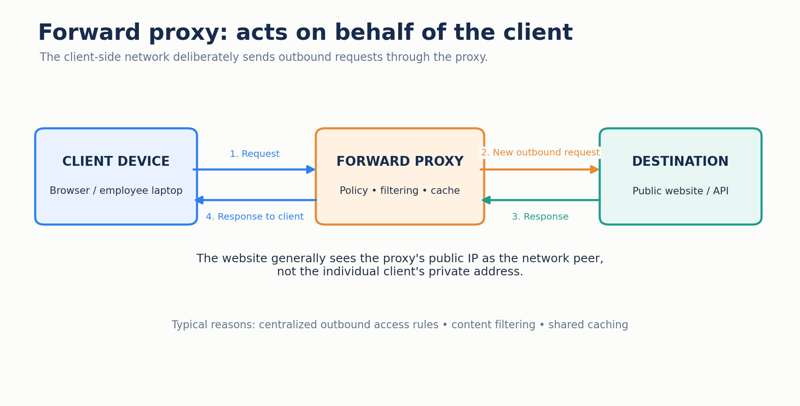
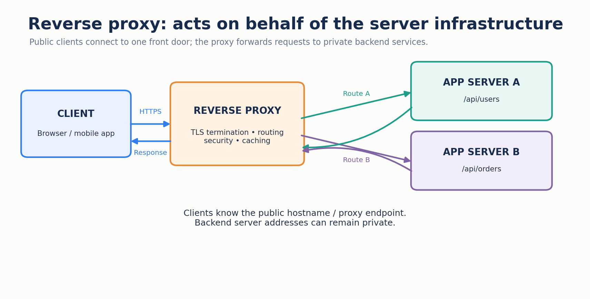
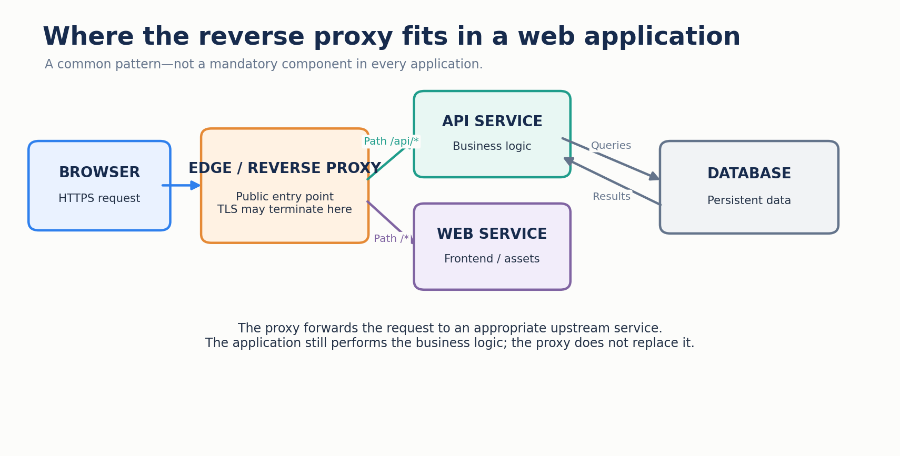
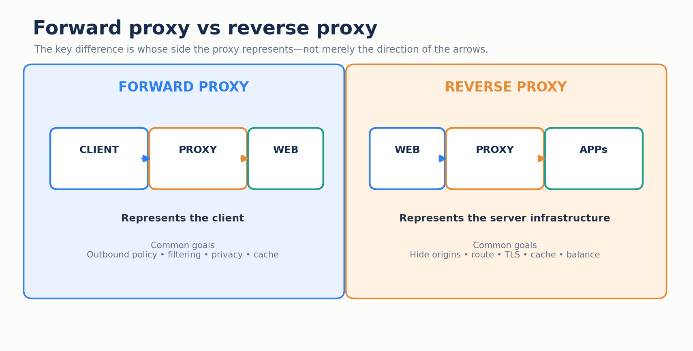

# Proxies and Reverse Proxies

**How intermediary servers sit between clients, the internet, and backend applications**

> [!NOTE]
> **Learning objective:** Understand what a proxy does, distinguish a forward proxy from a reverse proxy, trace request/response flow, and recognize why reverse proxies are common in web application architecture. This is a conceptual networking note—not an NGINX administration guide.

---

## 1. What is a proxy server?

A **proxy server** is an intermediary between two communicating systems. Instead of one side communicating directly with the final destination, it sends its request to the proxy. The proxy can forward the request, apply a policy, cache content, modify selected request information, or return a cached response.

A proxy is useful because it creates a controlled point between the two sides.

### The two main types

The distinction is based on **whose behalf the proxy acts**:

- **Forward proxy:** represents the **client**.
- **Reverse proxy:** represents the **server infrastructure**.

---

## 2. Forward proxy

A **forward proxy** sits between clients and external destinations. The client, browser, or organization configures its traffic to go through the proxy.

### How it works

1. A client wants to access an external website.
2. Instead of connecting directly to that website, the client sends the request to its configured forward proxy.
3. The proxy applies its configured policy—for example, allowing or blocking the destination.
4. If permitted, the proxy makes an outbound request to the destination.
5. The destination responds to the proxy.
6. The proxy returns the response to the client.

### Why organizations use forward proxies

| Use | What it means |
|---|---|
| **Outbound access control** | Apply organization-wide rules to users' internet access |
| **Content filtering** | Block or restrict selected destinations or categories |
| **Client IP masking** | The destination generally sees the proxy as the network peer |
| **Caching** | Reuse eligible cached content instead of fetching it repeatedly |

**Example:** A company routes employee web traffic through a forward proxy to enforce acceptable-use rules and centralize outbound access.

> [!IMPORTANT]
> A forward proxy does not automatically make a user anonymous or guarantee privacy. The proxy operator may be able to observe traffic metadata, and HTTPS content visibility depends on whether TLS inspection is configured.

### HTTPS and the `CONNECT` method — just the concept

For HTTPS, a browser can ask an HTTP proxy to establish a tunnel using the HTTP `CONNECT` method. The proxy creates a path for the TLS connection to the destination. In a basic tunnel, the proxy forwards encrypted bytes; it does not automatically decrypt the HTTPS content.

You only need to remember:
- `CONNECT` can establish an HTTP tunnel through a proxy.
- TLS still protects the client-to-destination traffic inside that tunnel unless an explicit TLS-inspection arrangement is used.

---

## 3. Reverse proxy

A **reverse proxy** sits in front of one or more backend servers. External clients connect to the reverse proxy as the public entry point. The reverse proxy then forwards each request to an appropriate internal server.

### How it works

1. A browser sends a request to the application's public hostname.
2. The request reaches the reverse proxy.
3. The reverse proxy applies its configured rules.
4. It forwards the request to an appropriate backend service.
5. The backend service processes the request and returns a response to the proxy.
6. The proxy sends the response back to the browser.

### Why applications use reverse proxies

| Responsibility | Explanation |
|---|---|
| **Hide backend topology** | Clients use one public entry point instead of connecting directly to individual backend servers |
| **Request routing** | Send requests to different services based on hostnames, paths, or other configured rules |
| **TLS termination** | Handle the public HTTPS/TLS connection at the proxy, when configured |
| **Caching** | Serve eligible cached responses without asking the backend every time |
| **Security controls** | Apply access rules, request limits, or other protective controls |
| **Load distribution** | Some reverse proxies distribute requests across multiple backend instances |

**Example:** An e-commerce application may expose one public domain. The reverse proxy routes `/products` to the product service and `/orders` to the order service.

### TLS termination

A reverse proxy can terminate the client's HTTPS/TLS connection:

- The browser establishes an HTTPS connection to the reverse proxy.
- The proxy decrypts the incoming request after the TLS session is established.
- The proxy forwards the request to the backend.
- The proxy may use plain HTTP or a separate encrypted connection to the backend, depending on configuration.

**Important:** TLS termination at the proxy does not mean the entire journey is automatically encrypted. Whether the proxy-to-backend connection is encrypted is a separate configuration decision.

---

## 4. Forward proxy vs reverse proxy

| Comparison | Forward proxy | Reverse proxy |
|---|---|---|
| Represents | Client(s) | Server(s) / backend infrastructure |
| Sits near | Client network | Server/application infrastructure |
| Main direction of use | Controls outbound client requests | Receives inbound requests for backend services |
| Common goals | Filtering, outbound policy, client-side caching | Routing, backend protection, TLS termination, caching |
| Who typically configures it? | Client or organization | Application/platform operator |

**Memory trick:**

- Forward proxy: *I am the client's representative.*
- Reverse proxy: *I am the server's representative.*

---

## 5. A reverse proxy is not the same as a load balancer

These concepts overlap, but they are not interchangeable.

- A **reverse proxy** is an intermediary that receives requests for backend services and forwards them.
- A **load balancer** distributes traffic across multiple available targets.
- A reverse proxy can also perform load balancing, but it does not have to.
- Load balancing can also happen at other layers and through other types of infrastructure.

For example, a reverse proxy might route `/login` to an authentication service and `/catalog` to a product service. If it has several instances of the product service, it may distribute requests among them.

> [!TIP]
> Learn this distinction now; study load-balancing algorithms in the separate **Load Balancers** topic. You do not need to learn those algorithms in depth here.

---

## 6. Headers that help preserve client information

A reverse proxy creates a separate connection to the backend. As a result, the backend may see the proxy's IP address as the immediate network peer rather than the original browser's IP address.

For HTTP applications, proxies commonly pass information using headers such as:

| Header | Purpose |
|---|---|
| `Forwarded` | Standardized header for information about the client-facing request as it passes through proxies |
| `X-Forwarded-For` | Commonly carries the originating client IP address |
| `X-Forwarded-Proto` | Carries the original client-facing scheme, such as `http` or `https` |
| `X-Forwarded-Host` | Carries the original host requested by the client |
| `Via` | Identifies intermediary proxies involved in the message path |

You do not need to memorize every header. Understand why they exist: **the backend may need information about the original client-facing request even though the proxy is the direct peer.**

> [!WARNING]
> Applications must not blindly trust client-supplied `X-Forwarded-*` headers. They should trust these values only when they are supplied by known, correctly configured proxy infrastructure. Otherwise, a client may forge them.

---

## 7. Where you will encounter proxies

| Technology / environment | How it relates |
|---|---|
| **NGINX** | Common web server and reverse proxy; can also load balance |
| **HAProxy** | Common proxy and load-balancing solution |
| **Cloud load balancers** | Often provide reverse-proxy-like entry-point and traffic-distribution capabilities, depending on the service |
| **API gateway** | A more specialized gateway that commonly builds on reverse-proxy behavior and adds API-focused capabilities such as authentication, quotas, and routing |

You only need to recognize these names and their broad roles at this stage. Do not start learning product-specific configuration yet.

---

## 8. What you should know — and what you can skip

### Must understand

- [x] What a proxy server is
- [x] Forward proxy vs reverse proxy
- [x] Request and response flow through each
- [x] Why organizations use forward proxies
- [x] Why applications use reverse proxies
- [x] Reverse proxy vs load balancer
- [x] Basic purpose of TLS termination
- [x] Why `X-Forwarded-For` exists and why forwarded headers must be trusted carefully

### Not required for your current learning goal

- Detailed NGINX configuration syntax
- Building a proxy server from scratch
- Squid administration
- SOCKS protocol internals
- Transparent proxy deployment
- Deep TLS interception architecture
- Service mesh internals
- Proxy performance tuning and advanced routing policies

**Stop here once you can explain the diagrams without reading the notes.** Your next topic should be **Load Balancers**, where you can build on the reverse-proxy concept.

---

## 9. References and learning sources

### Videos used as learning inputs

1. [Understanding Proxy Servers and Reverse Proxies — Antisyphon Training](https://youtu.be/2fsilBrlNsY)
2. [Understanding Proxy, Forward Proxy, and Reverse Proxy — Arpit Bhayani](https://youtu.be/HrG0MHkSsCA)

### Documentation

1. [MDN — Proxy servers and tunneling](https://developer.mozilla.org/en-US/docs/Web/HTTP/Guides/Proxy_servers_and_tunneling) — forward proxies, reverse proxies, forwarded headers, and HTTP `CONNECT`.
2. [MDN — Proxy server glossary](https://developer.mozilla.org/en-US/docs/Glossary/Proxy_server) — concise definition and distinction.
3. [NGINX — Reverse proxy](https://docs.nginx.com/nginx/admin-guide/web-server/reverse-proxy) — how NGINX forwards requests and responses.
4. [NGINX — HTTP load balancing](https://docs.nginx.com/nginx/admin-guide/load-balancer/http-load-balancer/) — optional preview for the next topic.
5. [Arpit Bhayani — Understanding Proxy, Forward Proxy, and Reverse Proxy](https://edge.arpitbhayani.me/videos/understanding-proxy-forward-proxy-and-reverse-proxy) — accompanying article.

---

**Networking → Proxies and Reverse Proxies**

[⬅ Back to Computer Networking Repository](../README.md)

