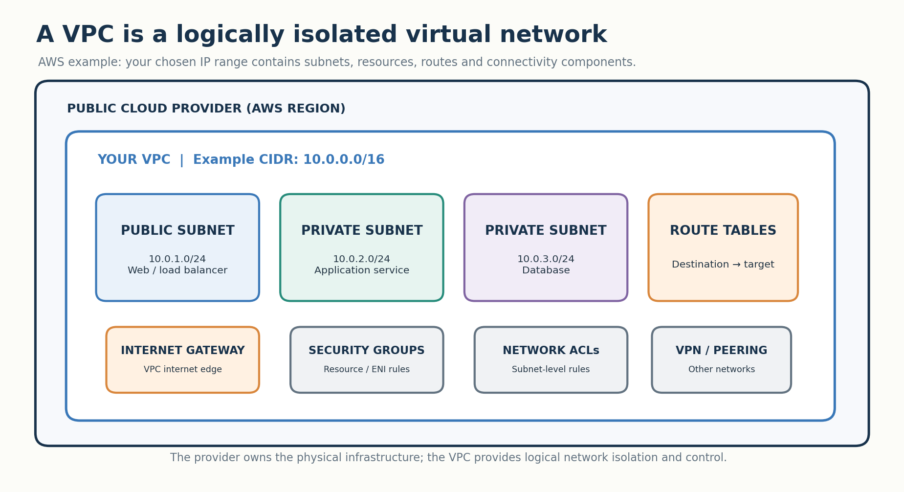
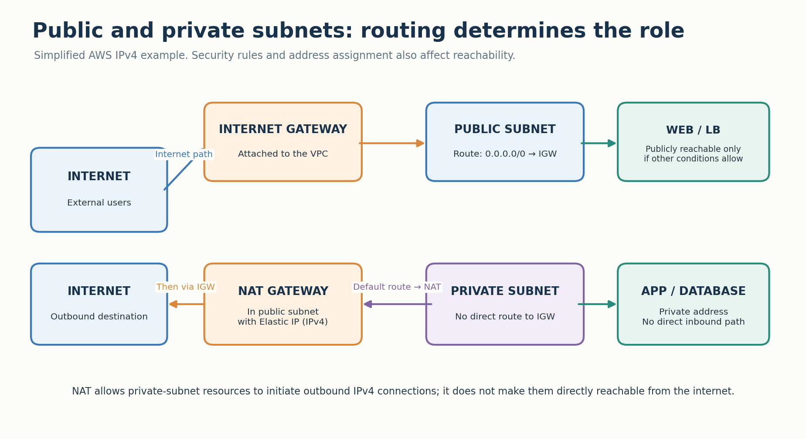
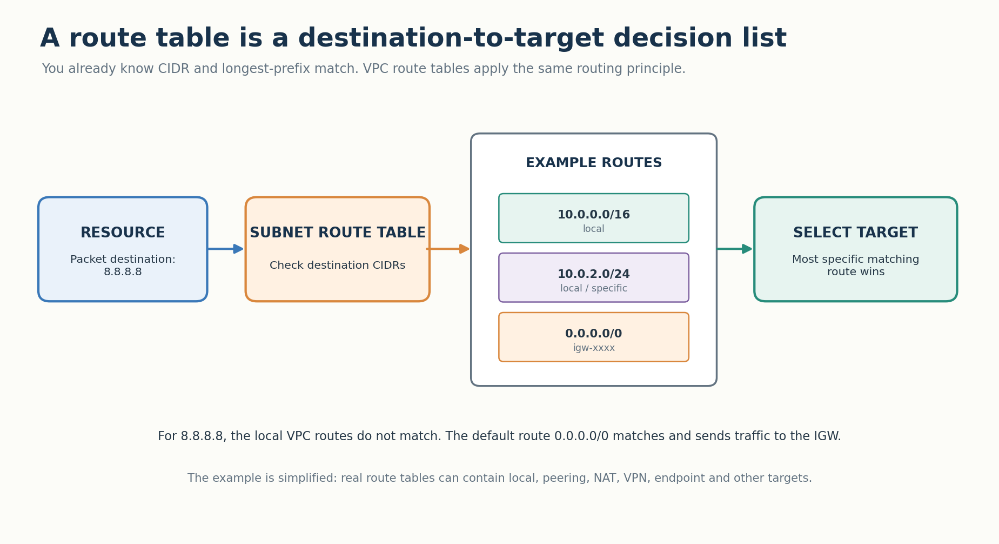
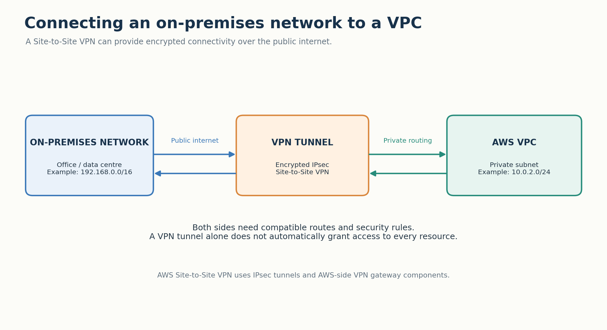

# Virtual Private Cloud (VPC), Subnets & Route Tables

> [!NOTE]
>
> **Section:** Computer Networking - [Source 1](https://youtu.be/2fPgKvDBfbs) , [Source 2](https://youtu.be/NbkPRn1mqlU)
> 
> **Learning objective:** Understand what a VPC is, how it relates to a public cloud, how subnets divide its IP space, how route tables direct traffic, and how internet/VPN connectivity is provided. The examples use AWS terminology because the reference documentation supplied for this topic is AWS documentation.

---

## 1. First, what is a public cloud?

A **public cloud** is a cloud-computing environment operated by a third-party provider—such as Amazon Web Services (AWS), Microsoft Azure or Google Cloud—that offers computing, storage, networking and managed services to customers.

A company has two broad options:

| Option | What it means |
|---|---|
| **On-premises** | The organization owns or operates the physical infrastructure in its own facilities or a colocation facility |
| **Public cloud** | The organization rents or provisions resources from a cloud provider |

For example, an organization can run its web application, application servers and database on its own hardware—or deploy those resources using cloud services.

> [!IMPORTANT]
> The cloud is not literally “just someone else's computer” from an architecture point of view. A cloud provider operates large physical data centres and exposes computing, storage and networking capabilities as services. Customers provision and manage resources through a console, CLI, API or infrastructure-as-code tools.

---

## 2. What is a Virtual Private Cloud (VPC)?

A **Virtual Private Cloud (VPC)** is a logically isolated virtual network that you define inside a public cloud. You choose an IP address range and control how resources in that network are segmented and connected.

In AWS, a VPC is a virtual network dedicated to your AWS account and logically isolated from other virtual networks in AWS Cloud.



### What does “logically isolated” mean?

Imagine an apartment building:

- The **public cloud provider** operates the building and its shared physical infrastructure.
- Different **customers** use the provider's infrastructure.
- Each customer's **VPC** is like a logically separated private space with its own network boundaries and configuration.

The analogy is about separation, not physical ownership. A VPC does **not** mean that a customer receives a separate physical data centre or dedicated physical network hardware.

### Why use a VPC?

A VPC lets an organization:

- Define its own private IP address space.
- Separate application components into subnets.
- Control how traffic moves between subnets and external networks.
- Apply network security controls.
- Connect cloud resources to the internet, other VPCs or on-premises networks.
- Scale its network alongside its applications.

---

## 3. Connect this to what you already learned

You have already studied IP addresses, network and host portions, CIDR, subnet masks, subnetting, routing tables, default gateways, NAT, firewalls and VPNs.

A VPC brings those concepts together in a cloud environment.

| Previously learned concept | Where it appears in a VPC |
|---|---|
| **IP address** | Cloud resources use IP addresses for network communication |
| **CIDR** | Defines the VPC's IP range and each subnet's range |
| **Subnetting** | Divides the VPC address space into smaller network segments |
| **Routing table** | Determines where traffic from a subnet or gateway is directed |
| **Default route** | Often sends traffic for destinations outside known internal ranges |
| **Gateway** | Connects a VPC to another network |
| **NAT** | Allows private-subnet resources to initiate outbound IPv4 connections |
| **Firewall / access rules** | Restrict which traffic can reach resources or subnets |
| **VPN** | Connects an on-premises network to the cloud over an encrypted tunnel |

**Do not relearn subnetting here.** You need to understand how your existing subnetting and routing knowledge is applied when you create a cloud network.

---

## 4. VPC, CIDR and subnets

When creating a VPC, you specify an IP address range using CIDR notation.

For a simple example, imagine this VPC:

```text
VPC CIDR: 10.0.0.0/16
```

You can divide that range into smaller subnet ranges:

```text
VPC: 10.0.0.0/16
│
├── Public subnet:  10.0.1.0/24
│
├── Private subnet: 10.0.2.0/24
│
└── Private subnet: 10.0.3.0/24
```

The exact ranges here are illustrative. The important relationship is:

- The **VPC CIDR** defines the overall IP address space.
- A **subnet CIDR** defines a smaller range inside that VPC.
- Cloud resources, such as virtual machines, are launched into subnets and use IP addresses from the relevant subnet.

### AWS-specific point: Availability Zones

In AWS, each subnet must reside entirely within one Availability Zone (AZ). A subnet cannot span multiple AZs.

You can create separate subnets in different AZs to distribute application resources and reduce dependence on a single AZ.

> [!IMPORTANT]
> A VPC is associated with a Region, while an individual AWS subnet belongs to one Availability Zone within that Region. Do not confuse a Region with an AZ.

---

## 5. Public subnet vs private subnet

This is one of the most important VPC concepts.

A subnet is considered **public or private based on its routing configuration**—not simply because its CIDR range is public or private.



### Public subnet

In AWS, a subnet is public when its associated route table has a route to an **Internet Gateway (IGW)**.

Example route:

| Destination | Target |
|---|---|
| `10.0.0.0/16` | `local` |
| `0.0.0.0/0` | Internet Gateway |

- `10.0.0.0/16` keeps traffic for the VPC's address range inside the VPC.
- `0.0.0.0/0` is the default IPv4 route: it matches destinations not matched by a more specific route.
- The Internet Gateway is the route target for that default route.

A resource still needs suitable IP addressing and security permissions to be directly reachable from the internet. **A route to an Internet Gateway alone does not make every resource publicly accessible.**

### Private subnet

A private subnet does not have a direct route to an Internet Gateway.

It is commonly used for resources that should not accept direct internet-initiated connections, such as:

- Application servers
- Databases
- Internal services

A private subnet can still communicate with other permitted resources inside the VPC. It can also have controlled connectivity to external networks through other network components.

### Isolated subnet

AWS also describes an **isolated subnet**: it has no routes to destinations outside its VPC. Resources in it can communicate only with permitted resources inside the VPC.

---

## 6. Internet Gateway (IGW)

An **Internet Gateway** is an AWS VPC component that enables communication between the VPC and the internet.

For an IPv4 resource to communicate directly with the internet, the required configuration generally includes:

1. An Internet Gateway attached to the VPC.
2. A route from the subnet's route table to that Internet Gateway.
3. A suitable public IPv4 address on the resource.
4. Security rules that permit the intended traffic.
5. An application/service listening on the relevant port.

For example:

```text
Destination: 0.0.0.0/0
Target:      igw-xxxxxxxx
```

This route directs unmatched IPv4 destinations towards the Internet Gateway.

> [!NOTE]
> IPv4 and IPv6 routing are separate. An IPv4 default route (`0.0.0.0/0`) does not automatically provide an IPv6 default route (`::/0`).

---

## 7. NAT Gateway: private subnet outbound internet access

You have already learned the general concept of **Network Address Translation (NAT)**. In AWS, a **NAT Gateway** is a managed networking component that allows resources in a private subnet to initiate outbound IPv4 connections to the internet without allowing unsolicited internet-initiated connections back to those resources.

A common layout is:

```text
Private subnet
    |
    | Default route: 0.0.0.0/0
    v
NAT Gateway (in a public subnet)
    |
    v
Internet Gateway
    |
    v
Internet
```

### Example

An application server in a private subnet needs to download software updates from an external repository.

1. The application server sends an outbound request.
2. Its subnet route table directs the traffic to the NAT Gateway.
3. The NAT Gateway performs address translation.
4. The traffic proceeds through the Internet Gateway.
5. The response returns through the NAT Gateway to the initiating resource.

### Remember the difference

| Component | Main purpose |
|---|---|
| **Internet Gateway** | Provides the VPC's connection to the internet |
| **NAT Gateway** | Allows private-subnet resources to initiate outbound IPv4 internet connections |
| **Route table** | Chooses the target through which traffic should travel |

NAT is not a replacement for security groups or network ACLs.

---

## 8. Route tables in a VPC

You already know what a routing table does: it maps a destination network to a next hop or target.

AWS VPC route tables work on the same principle.



Each route contains:

- **Destination:** the IP range the route matches.
- **Target:** where traffic matching that destination should be sent.

### Example route table

| Destination | Target | Meaning |
|---|---|---|
| `10.0.0.0/16` | `local` | Keep traffic for the VPC's CIDR inside the VPC |
| `0.0.0.0/0` | `igw-xxxx` | Send other IPv4 destinations to the Internet Gateway |

A route table can also contain routes to NAT Gateways, VPN connections, VPC peering connections and other supported targets.

### Main route table and subnet association

- Every VPC has a **main route table**.
- Every subnet is associated with one route table at a time.
- A subnet uses the main route table by default unless you explicitly associate it with another route table.
- Multiple subnets can use the same route table.

### Longest-prefix match - connect it to your earlier lesson

If multiple routes match a destination, AWS selects the most specific matching route: the **longest-prefix match**.

You have already learned this routing principle. You do not need to study it from scratch here; just recognize that it applies to VPC route tables too.

---

## 9. Connecting an on-premises network to a VPC using VPN

A VPC does not have to be isolated from every other network forever. You can deliberately connect it to an organization's on-premises network.



A common option is a **Site-to-Site VPN**:

- It connects an on-premises network to a VPC.
- It uses encrypted VPN tunnels across the internet.
- Routing must be configured on both sides.
- Security rules must permit the intended communication.

For example, an application running in AWS may need to retrieve data from a database hosted in the company's own data centre.

> [!IMPORTANT]
> Creating a VPN tunnel does not automatically give every system access to every other system. Routing and security policies still control what can communicate.

---

## 10. Security inside a VPC - how the pieces fit

You have already studied firewalls and have a separate topic for security groups and network ACLs. Here is their place in the VPC picture:

| Component | Scope / responsibility |
|---|---|
| **Security Group (SG)** | Controls allowed inbound and outbound traffic for associated resources/network interfaces; stateful |
| **Network ACL (NACL)** | Controls allowed and denied inbound/outbound traffic at the subnet boundary; stateless |
| **Route table** | Determines the next target for traffic; it is not itself a firewall |
| **Internet Gateway** | Provides internet connectivity; it does not replace security rules |
| **NAT Gateway** | Provides outbound IPv4 translation for private resources; it is not a general-purpose firewall |

Do not mix up routing and filtering:

- **Routing asks:** Where should this packet go?
- **Security rules ask:** Is this traffic permitted?

---

## References

- [What is Amazon VPC?](https://docs.aws.amazon.com/vpc/latest/userguide/what-is-amazon-vpc.html)
- [How Amazon VPC works](https://docs.aws.amazon.com/vpc/latest/userguide/how-it-works.html)
- [Subnets for your VPC](https://docs.aws.amazon.com/vpc/latest/userguide/configure-subnets.html)
- [Subnet route tables](https://docs.aws.amazon.com/vpc/latest/userguide/subnet-route-tables.html)
- [Enable internet access for a VPC using an Internet Gateway](https://docs.aws.amazon.com/vpc/latest/userguide/VPC_Internet_Gateway.html)
- [Connect to the internet or other networks using NAT devices](https://docs.aws.amazon.com/vpc/latest/userguide/vpc-nat.html)
- [AWS Site-to-Site VPN](https://docs.aws.amazon.com/vpn/latest/s2svpn/VPC_VPN.html)
- [Compare security groups and network ACLs](https://docs.aws.amazon.com/vpc/latest/userguide/infrastructure-security.html)

</div>

