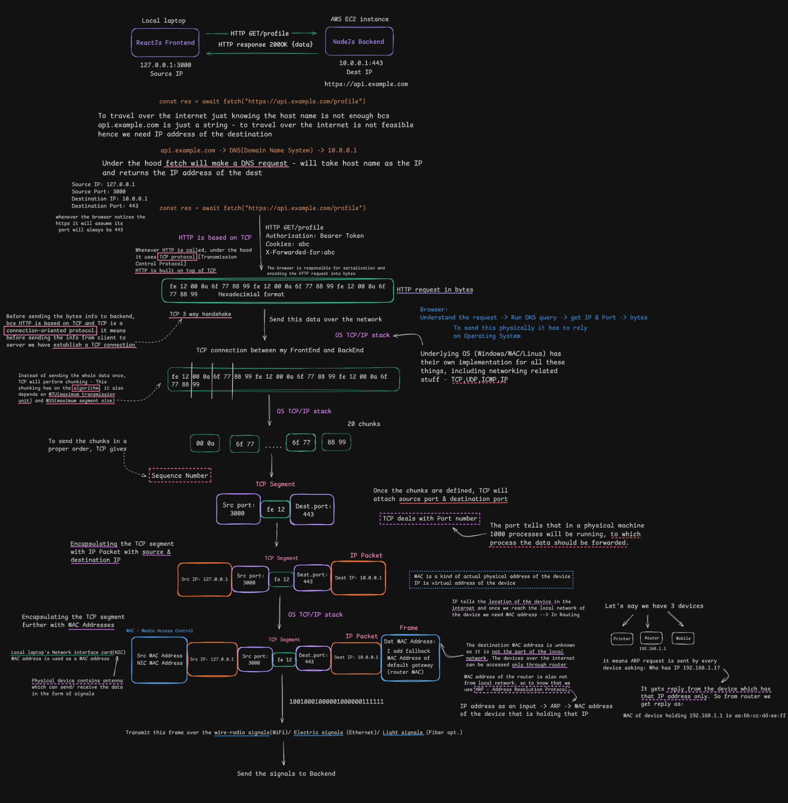

# What Really Happens When You Make an HTTP Request?

> [!NOTE]
> **Section:** Computer Networking — [Chai aur Networking](https://www.youtube.com/watch?v=_dCmQCiQmPE&list=PLd1s-PEC5Pio&index=2)
> 
> **Purpose:** Build an end-to-end mental model of how a browser request travels from application code through the operating system and network, reaches a server, and returns a response.

[← Back to Computer Networking Repository](https://github.com/Priya200227/computer-networking) 

---

## Overview

When an application makes an HTTP request, several networking components work together to deliver it to a server and return the response. This video introduces the overall journey from a frontend API call through DNS lookup and the operating system's networking stack, to transport and network addressing, local-network delivery, and transmission to the backend.

The diagram below brings these pieces together. It is an **overview**, not a detailed explanation of every protocol; each concept will be covered in its own topic.

## Complete Workflow Diagram

## Workflow at a Glance

> [!🌐 Application & Resolution Layers]
> 1. **Frontend API call** — The browser starts a request, for example with a JavaScript `fetch()` function call.
> 2. **DNS lookup** — The target domain hostname is resolved into a machine-readable IP address using a Domain Name System query.

> [!IMPORTANT]
> ### 📦 OS & Encapsulation Stack
> 3. **Transport connection** — The network request initiates transport configurations, utilizing TCP (HTTP/1.1 or HTTP/2) or QUIC over UDP (HTTP/3).
> 4. **Operating-system networking stack** — The browser hands off raw network data processing down to the platform's kernel-level TCP/IP networking implementation.
> 5. **Encapsulation and addressing** — Application data is broken into transport segments, wrapped in IP packets (network layer), and framed for local link interfaces (data link layer). Ports map application processes, while IP/MAC addresses route endpoints.

> [!WARNING]
> ### 📡 Routing & Local Link Delivery
> 6. **Local-network delivery** — The device handles internal link routing to forward data frames out towards the default gateway router, using ARP to map local destination hardware tokens.
> 7. **Transmission and server processing** — The binary streams bounce across inter-network routers until they land on the server network card, running up the reverse stack into server backend processing software.

---

> [!NOTE]
> **Accuracy note:** The concrete addresses, ports, byte values, and chunk count in the diagram are illustrative. In real networks, DNS answers and routes vary; client source ports are usually ephemeral; connections may be reused; and the number and size of TCP segments are not fixed. With HTTPS, HTTP content is encrypted in transit after TLS is established. The exact transport also depends on the HTTP version.

## Key Takeaway

An HTTP request is not sent directly from frontend code to a backend as one indivisible object. Browser networking, the operating system, transport protocols, IP routing, and local-link delivery each contribute to moving the request across the network.

These are the building blocks for the next topics. DNS, TCP/UDP, ports, IP addressing, routing, MAC addresses, ARP, TLS, and HTTP versions will be explored separately rather than explained in depth here.

---
**Next:** [Network-Host-CIDR](../02-network-host-cidr/)
