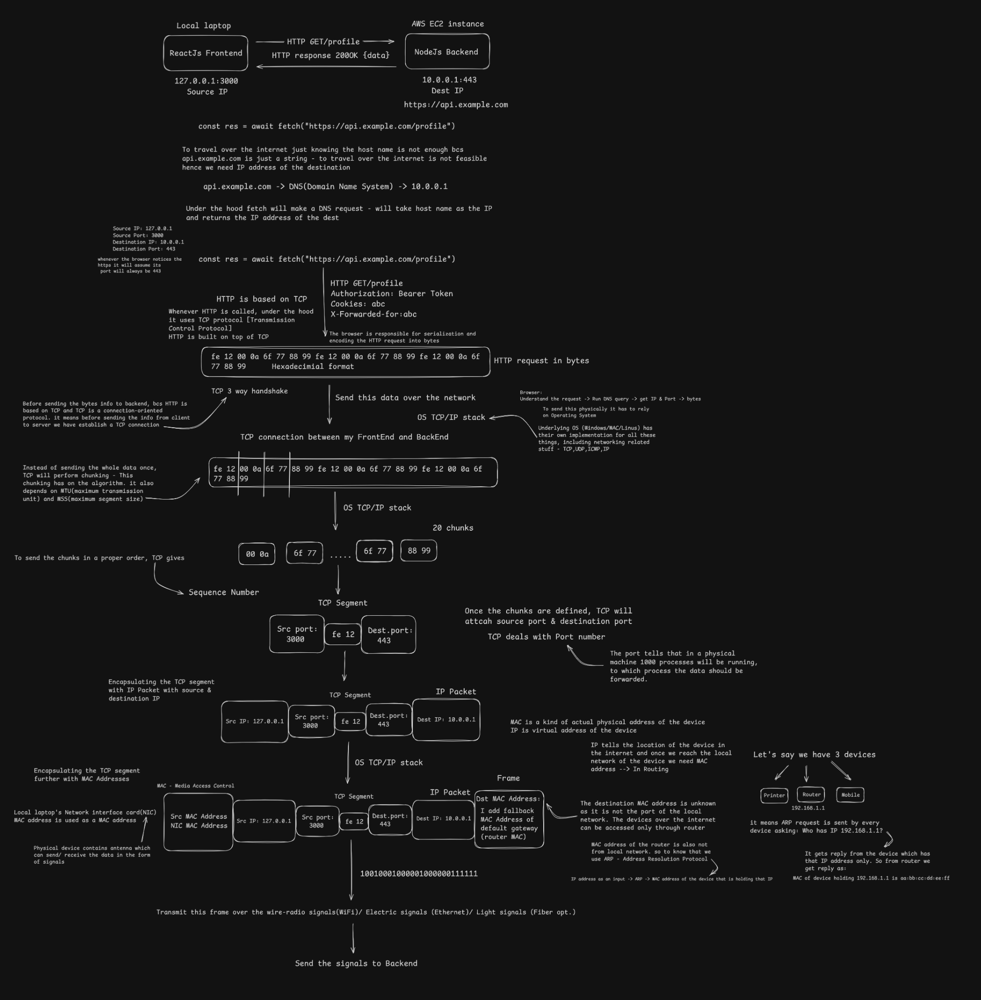

# What Really Happens When You Make an HTTP Request?

> **Section:** Computer Networking — [Chai aur Networking](https://www.youtube.com/watch?v=_dCmQCiQmPE&list=PLd1s-PEC5Pio&index=2)
> 
> **Purpose:** Build an end-to-end mental model of how a browser request travels from application code through the operating system and network, reaches a server, and returns a response.

[← Back to Computer Networking Repository](https://github.com/Priya200227/computer-networking) 

---

## Overview

When an application makes an HTTP request, several networking components work together to deliver it to a server and return the response. This video introduces the overall journey—from a frontend API call through DNS lookup and the operating system's networking stack, to transport and network addressing, local-network delivery, and transmission to the backend.

The diagram below brings these pieces together. It is an **overview**, not a detailed explanation of every protocol; each concept will be covered in its own topic.

## Complete Workflow Diagram

## Workflow at a Glance

1. **Frontend API call** — the browser starts a request, for example with `fetch()`.
2. **DNS lookup** — the hostname is resolved to an IP address when a usable cached result is not already available.
3. **Transport connection** — the request uses the appropriate transport, commonly TCP for HTTP/1.1 or HTTP/2 over HTTPS; HTTP/3 uses QUIC over UDP.
4. **Operating-system networking stack** — the browser hands network communication to the platform's networking implementation.
5. **Encapsulation and addressing** — transport data is carried in IP packets and local-link frames. Ports identify transport endpoints; IP and MAC addresses serve different purposes.
6. **Local-network delivery** — the device sends the frame to the next hop, often the default gateway, and uses ARP when it needs to resolve a local IPv4 next-hop address.
7. **Transmission and server processing** — the data crosses the network to the server, where the backend processes the request and sends a response back.

> **Accuracy note:** The concrete addresses, ports, byte values, and chunk count in the diagram are illustrative. In real networks, DNS answers and routes vary; client source ports are usually ephemeral; connections may be reused; and the number and size of TCP segments are not fixed. With HTTPS, HTTP content is encrypted in transit after TLS is established. The exact transport also depends on the HTTP version.

## Key Takeaway

An HTTP request is not sent directly from frontend code to a backend as one indivisible object. Browser networking, the operating system, transport protocols, IP routing, and local-link delivery each contribute to moving the request across the network.

These are the building blocks for the next topics. DNS, TCP/UDP, ports, IP addressing, routing, MAC addresses, ARP, TLS, and HTTP versions will be explored separately rather than explained in depth here.

---

[← Back to Computer Networking Repository](https://github.com/Priya200227/computer-networking) · **Next topic:** [DNS — Domain Name System](../03-dns/)

