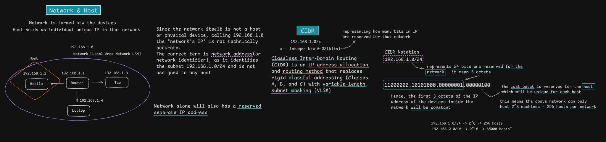

# Network, Host, and CIDR

> **Section:** Computer Networking — [Chai aur Networking](https://www.youtube.com/watch?v=8QJ8k7jd-K0&list=PLd1s-PEC5Pio&index=4)
> 
> **Purpose:** Build an end-to-end mental model of how a browser request travels from application code through the operating system and network, reaches a server, and returns a response.

[← Back to Computer Networking Repository](https://github.com/Priya200227/computer-networking) 

---

## Overview

An IPv4 address is a 32-bit address commonly written as four decimal octets. To understand how an address fits into a network, distinguish the **network prefix** from the **host portion**. CIDR notation expresses the length of that prefix.

This page is a concise overview of the concepts shown in the diagram. Detailed IPv4 addressing and subnet-mask calculations are covered in the following sections.

## Concept Diagram

## Key Ideas

- **IPv4 address:** A 32-bit address written as four decimal octets, such as `192.168.1.4`. Each octet represents 8 bits and ranges from `0` to `255`.
- **Network address:** Identifies the subnet itself. For example, `192.168.1.0/24` identifies a subnet; `192.168.1.0` is its network address.
- **Host portion:** The bits outside the network prefix distinguish addresses within that subnet.
- **CIDR notation:** A suffix such as `/24` means the first 24 bits form the network prefix. The remaining 8 bits form the host-address portion.
- **Devices in the same subnet:** Devices configured in the same subnet can generally communicate directly over the local link, subject to network configuration and security controls.

## Example: `192.168.1.0/24`

For a typical IPv4 `/24` subnet:

| Item | Value |
|---|---|
| Network address | `192.168.1.0` |
| Prefix length | `/24` |
| Network bits | 24 |
| Host bits | 8 |
| Total IPv4 addresses | 256|  
| Typical usable host addresses | `192.168.1.1`–`192.168.1.254` |
| Broadcast address | `192.168.1.255` |
         
  > The broadcast address is a special IP address used to send a message to all devices in a particular network at once. Imagine you have a network with 254 usable devices: `192.168.1.1` to `192.168.1.254`. If one device wants to send a message to every device in that network, it can send it to the broadcast address.

The common total of 256 addresses and 254 usable host addresses applies to a conventional IPv4 subnet where the network and broadcast addresses are reserved. Special-purpose subnet sizes and point-to-point configurations can differ.

## *What does 256 total addresses but only 254 usable mean?*

An IPv4 address has 32 bits. A /24 means 24 bits = Network portion & 8 bits = Host portion.
Each host bit can either be 0 or 1. So, 2^8 = 256 total addresses.

But in a conventional IPv4 subnet, 2 addresses have special purposes:
| Address | Purpose |
|---|---|
| 192.168.1.0 | Identifies the network itself (host bits are all 0) |
| 192.168.1.255 |	Broadcast address  (host bits are all 1) |
| 192.168.1.1 – 192.168.1.254 | Usable host addresses |

So: 256 - 2 = 254 usable addresses

## *What does the special-purpose subnet sizes statement mean?*

The 256 total and 254 usable rule is the conventional calculation for a normal IPv4 subnet such as /24.

| Prefix | Total addresses | Typical usable hosts |
|---|---|---|
| /24 | 256 | 254 |
| /30 | 4 | 2 |
| /31 | 2 | 2 (point-to-point links) |
| /32 | 1 | 1 (single host route) |

A `/31` is a special case used for point-to-point links between two devices. Both addresses can be used as endpoint addresses, so the usual network/broadcast subtraction does not apply.

---
## Key Takeaway

**CIDR tells us how many leading bits identify the network prefix; the remaining bits form the host-address space.** This distinction is foundational to IPv4 addressing, subnet masks, and routing decisions.
1. For conventional IPv4 subnets, reserve one address for the network and one for broadcast. But special configurations, such as /31 point-to-point links, work differently.

---
## **Note:**
Explanation of the terms used in the image: 

*1. Classful addressing:* Earlier, IPv4 addresses were divided into pre-defined classes:

 | Class | Default network size |
   |-------|----------------------|
   | A     | `/8`                 |
   | B     | `/16`                |
   | C     | `/24`                |

   For example, Class C traditionally used `/24`, meaning 24 bits for the network and 8 bits for hosts.

> *The problem:* You couldn't easily choose a different network size to match your requirements. This could waste IP addresses.

 *2. Classless addressing:* Removes those fixed class boundaries. We can choose how many bits belong to the network using CIDR notation.

For example:
   - `192.168.1.0/24`
   - `192.168.1.0/26`
   - `192.168.1.0/28`

   The network size can be adjusted according to the need.

*3. VLSM (Variable Length Subnet Masking):* It means dividing a network into smaller subnets with different sizes, depending on how many hosts each subnet needs.

Example:

   Suppose you have a network and need:
   - Department A: 100 devices
   - Department B: 50 devices
   - Department C: 10 devices

   Instead of giving every department an equally sized subnet, VLSM lets you allocate different subnet sizes to each.

---
## References
- [Master Networking Basics: Network, Host, and CIDR Demystified](https://www.youtube.com/watch?v=8QJ8k7jd-K0&list=PLd1s-PEC5Pio&index=5)

---
**Next:** [IPv4 Addressing](../03-ipv4-addressing/)
