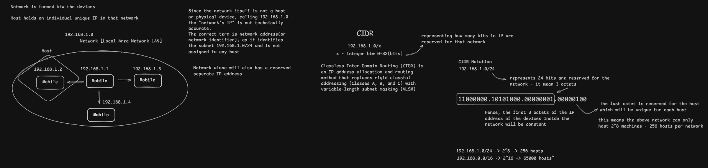

# Network, Host, and CIDR

[← Back to Repository](https://github.com/Priya200227/computer-networking) 

---

## Overview

An IPv4 address is a 32-bit address commonly written as four decimal octets. To understand how an address fits into a network, distinguish the **network prefix** from the **host portion**. CIDR notation expresses the length of that prefix.

This page is a concise overview of the concepts shown in the diagram. Detailed IPv4 addressing and subnet-mask calculations are covered in the following sections.

## Concept Diagram

## Key Ideas

- **IPv4 address:** A 32-bit address written as four decimal octets, such as `192.168.1.4`. Each octet represents 8 bits and ranges from `0` to `255`.
- **Network address:** Identifies the subnet itself. For example, `192.168.1.0/24` identifies a subnet; `192.168.1.0` is its network address.
- **Host portion:** The bits outside the network prefix distinguish addresses within that subnet.
- **CIDR notation:** A suffix such as `/24` means the first 24 bits form the network prefix. The remaining 8 bits form the host-address portion.
- **Devices in the same subnet:** Devices configured in the same subnet can generally communicate directly over the local link, subject to network configuration and security controls.

## Example: `192.168.1.0/24`

For a typical IPv4 `/24` subnet:

| Item | Value |
|---|---|
| Network address | `192.168.1.0` |
| Prefix length | `/24` |
| Network bits | 24 |
| Host bits | 8 |
| Total IPv4 addresses | 256 |
| Typical usable host addresses | `192.168.1.1`–`192.168.1.254` |
| Broadcast address | `192.168.1.255` |

The common total of 256 addresses and 254 usable host addresses applies to a conventional IPv4 subnet where the network and broadcast addresses are reserved. Special-purpose subnet sizes and point-to-point configurations can differ.

## Key Takeaway

**CIDR tells us how many leading bits identify the network prefix; the remaining bits form the host-address space.** This distinction is foundational to IPv4 addressing, subnet masks, and routing decisions.

---

[←**Next:** [IPv4 Addressing](../03-ipv4-addressing/)
