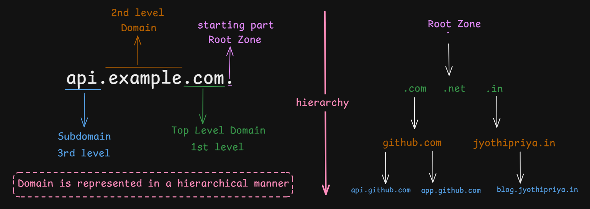
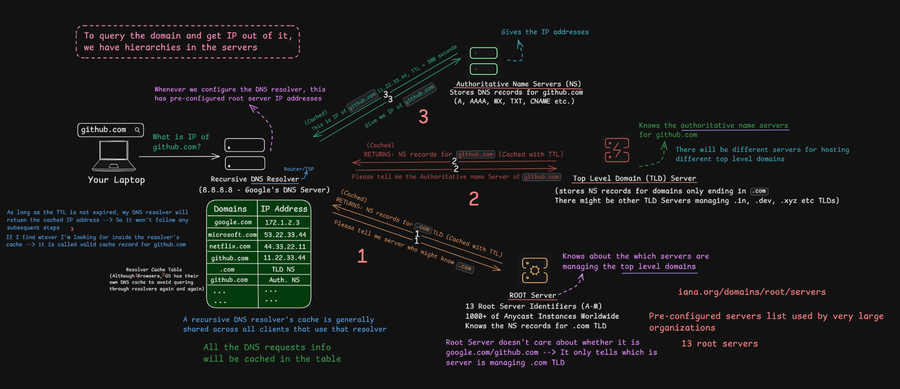
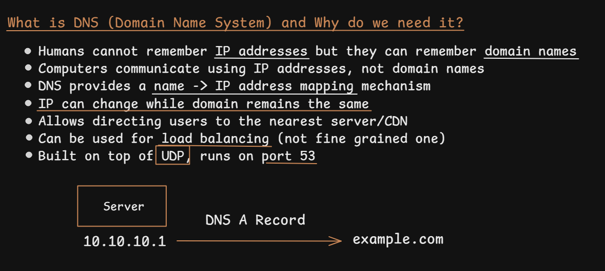
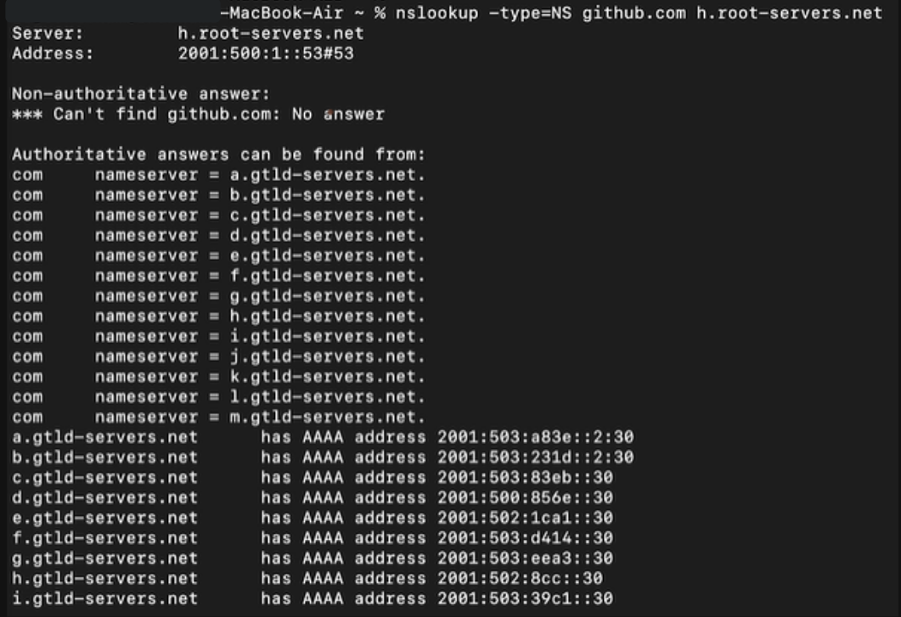
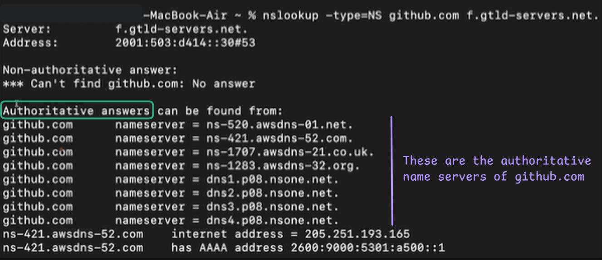
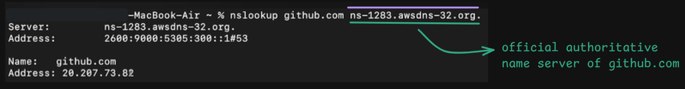
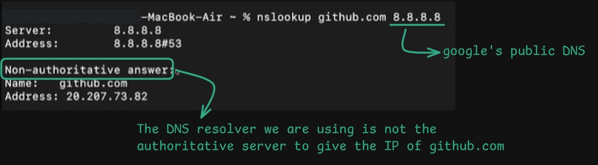
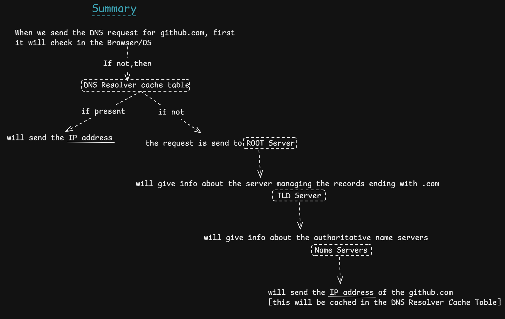

# DNS Fundamentals — Domain Name System

> **Section:** Computer Networking — [Chai aur Networking](https://youtu.be/pNfNTgEVvQg?si=olhb5VJzPM0588k6)
>
> **Learning objective:** Understand why DNS exists, how domain names are structured, how a recursive resolver follows the DNS hierarchy, how authoritative name servers provide records, and how caching and common DNS record types affect name resolution.

[← Back to Computer Networking repository](https://github.com/Priya200227/computer-networking)

---

## 1. What is DNS?

The **Domain Name System (DNS)** is a distributed, hierarchical naming system. It stores and retrieves information associated with domain names.

People usually use names such as `github.com`, while network communication ultimately relies on IP addresses. DNS provides a mechanism for discovering the relevant address records for a name.

For example, an IPv4 **A record** can associate:

```text
github.com  →  20.207.73.82
```

The address above is an illustrative value from the supplied demonstration screenshot, not a permanent address. Real DNS answers can change by time, resolver, location, CDN policy, and other factors.

### Why DNS is needed

- **Human-friendly naming:** Names are easier to remember and use than numeric IP addresses.
- **Address indirection:** A service can keep its domain name while its IP address or hosting infrastructure changes.
- **Service discovery:** DNS can publish more than IP addresses, including mail-routing and service-related information.
- **Traffic distribution:** DNS-based techniques such as geo-aware answers and multiple address records can help distribute clients across infrastructure. DNS is not, by itself, a precise real-time load balancer.
- **Caching:** Resolvers can reuse valid answers until their time-to-live (TTL) expires, reducing repeated queries and latency.

> **Important correction:** DNS does not mean that computers never use domain names. Applications commonly pass hostnames to a resolver, but the resolver obtains address information that the application/network stack can use to establish a connection.

## 2. Domain-name hierarchy



DNS names are organized as a tree, not as a flat list.

Consider:

```text
api.example.com.
```

Read the hierarchy from right to left:

| Part | Meaning |
|---|---|
| `.` | Root of the DNS namespace |
| `com` | Top-level domain (TLD) |
| `example` | Name directly beneath `.com`, commonly called a second-level domain |
| `api` | A label beneath `example.com`; commonly a subdomain or host label |

The final dot represents the root. It is often omitted in everyday writing, so `api.example.com` is commonly understood as the fully qualified name `api.example.com.`.

### Root, TLD, and authoritative zones

- **Root zone:** Contains delegations to top-level domains such as `.com`, `.net`, and `.in`.
- **TLD zone:** Contains delegations for names registered beneath that TLD, such as `github.com`.
- **Authoritative zone:** Contains the DNS data for a domain or delegated part of the namespace.

A domain name's label count does not, by itself, tell you where administrative zone boundaries exist. For example, a subdomain can be delegated into its own separate authoritative zone.

### DNS hierarchy is distributed

There is no single server containing every DNS record for every domain. Different organizations operate authoritative servers for different zones. Delegations connect these parts of the hierarchy.

## 3. The main DNS components



| Component | Responsibility |
|---|---|
| Stub resolver | The client-side resolver component that sends a query to a recursive resolver |
| Recursive resolver | Performs resolution on behalf of the client, follows referrals, caches results, and returns an answer or error |
| Root name server | Refers the resolver toward the appropriate TLD name servers |
| TLD name server | Refers the resolver toward the domain's authoritative name servers |
| Authoritative name server | Provides DNS data for the zone it serves |

A **recursive resolver** and an **authoritative name server** are different roles, even though both are often casually called a “DNS server”.

## 4. How DNS resolution works



Assume a client wants to resolve `github.com` and does not already have a usable cached answer.

```text
Application
    |
    v
Stub resolver
    |
    | recursive query
    v
Recursive resolver
    |
    | iterative query
    v
Root name server
    |
    | referral: .com name servers
    v
.com TLD name server
    |
    | referral: github.com authoritative name servers
    v
Authoritative name server for github.com
    |
    | answer: requested record (for example, A or AAAA)
    v
Recursive resolver
    |
    | returns answer and caches it according to TTL
    v
Stub resolver / application
```

### Step-by-step

1. **Application requests a name.** A browser or another application needs address information for `github.com`.
2. **Stub resolver contacts a recursive resolver.** The resolver may be configured by the operating system, router, organization, VPN, or a public DNS provider.
3. **Cache lookup happens.** If the recursive resolver has a valid cached answer, it can return it immediately. It may also use cached delegations or other records to reduce work.
4. **Root referral.** If it needs to continue, the recursive resolver asks a root server. The root server does not normally know GitHub's host address; it refers the resolver to the `.com` TLD name servers.
5. **TLD referral.** The resolver asks a `.com` name server, which refers it to the authoritative name servers delegated for `github.com`.
6. **Authoritative answer.** The resolver asks an authoritative server for the requested record, such as an A record (IPv4) or AAAA record (IPv6).
7. **Answer returned and cached.** The recursive resolver returns the result to the client and caches eligible records for their TTL.

The resolver does not necessarily contact all three levels for every lookup. Cached answers and cached delegation information can shorten the process.

## 5. Recursive versus iterative queries

These terms describe different query-resolution behaviours.

### Recursive query

The client asks a DNS server to obtain the final answer on its behalf, or return an error. A client commonly sends a recursive query to its configured recursive resolver.

### Iterative query

The queried server returns the best information it has. If it cannot provide the requested final answer, it can return a **referral** to another server that is closer to the requested name in the DNS hierarchy.

The recursive resolver typically performs iterative queries as it follows the DNS tree.

| Recursive | Iterative |
|---|---|
| The server is asked to pursue resolution for the client | The client/resolver follows referrals itself |
| Common between a stub resolver and recursive resolver | Common between recursive resolvers and DNS hierarchy servers |
| Usually returns an answer or an error | Can return a referral to another name server |

**Do not confuse recursion with authority.** Recursion describes a service/query behaviour. Authoritative describes whether a server is serving data from a zone for which it has authority.

## 6. Authoritative and non-authoritative answers

- An **authoritative answer** is supplied from authoritative zone data by a server authoritative for that name.
- A **non-authoritative answer** is commonly supplied from a recursive resolver's cache or other non-authoritative information.

A recursive resolver can return a non-authoritative answer even though it originally obtained that record from an authoritative server.

The `AA` (Authoritative Answer) flag in a DNS response indicates whether the responding server is authoritative for the answer, subject to DNS message semantics. A command-line tool's printed labels are presentation choices; inspect the actual DNS flags and sections when diagnosing a response.

## 7. DNS caching and TTL

DNS records commonly carry a **Time To Live (TTL)** value, measured in seconds. TTL tells a cache how long it may retain that record before it should be considered expired.

Example:

```text
github.com.  300  IN  A  20.207.73.82
```

Here, `300` is the TTL in seconds.

Caching may exist at multiple layers, including:

- Browser or application
- Operating system / local resolver
- Home router or network DNS forwarder
- Recursive DNS resolver

When a cached record is still valid, the resolver can return it without querying the authoritative server again.

**TTL is not a guarantee that an address will remain unchanged for that duration.** It is a cache lifetime for that particular record. Different records in one response can have different TTLs.

## 8. Common DNS record types

| Record | Purpose |
|---|---|
| `A` | Maps a name to an IPv4 address |
| `AAAA` | Maps a name to an IPv6 address |
| `NS` | Identifies name servers for a zone or delegation |
| `CNAME` | Alias from one DNS name to another canonical name |
| `MX` | Identifies mail exchangers for a domain |
| `TXT` | Stores text data, commonly used for domain verification and email security policies |
| `PTR` | Reverse-DNS mapping from an address in the reverse namespace to a domain name |
| `SOA` | Provides administrative information about a DNS zone |

An A record maps **name → IPv4 address**. It does not map IP address → name; reverse lookups use PTR records.

## 9. DNS transport: UDP and TCP

DNS is **not UDP-only**.

- Traditional DNS queries commonly use **UDP port 53**.
- DNS also uses **TCP port 53**, including for zone transfers and when TCP is needed for DNS message transport.
- Modern DNS can also be carried over encrypted transports, including DNS over TLS (DoT), DNS over HTTPS (DoH), and DNS over QUIC (DoQ), each with its own transport and port conventions.

The original DNS specification describes both UDP and TCP on port 53. Therefore, “DNS runs on UDP port 53” is an incomplete simplification.

## 10. DNS commands used in the demonstration









The screenshots show `nslookup` commands to inspect the DNS hierarchy.

### Query a root server for GitHub's NS records

```bash
nslookup -type=NS github.com h.root-servers.net
```

The root server is expected to direct the resolver toward the `.com` TLD name servers. It does not normally provide GitHub's final A/AAAA address.

### Query the `.com` TLD server for GitHub's NS records

```bash
nslookup -type=NS github.com a.gtld-servers.net
```

This asks a `.com` TLD name server about the name servers delegated for `github.com`.

### Query one of GitHub's authoritative name servers

```bash
nslookup github.com ns-1283.awsdns-32.org
```

This asks a server listed as authoritative for `github.com` to resolve the name. The returned address can vary over time and by DNS configuration.

### Query Google's public recursive resolver

```bash
nslookup github.com 8.8.8.8
```

This asks Google's public recursive DNS service. The returned answer is normally non-authoritative from the client's perspective because Google is acting as a recursive resolver rather than as GitHub's authoritative server.

### Useful `dig` commands (if installed)

```bash
# Ask a root server without requesting recursion
dig @198.97.190.53 github.com NS +norecurse

# Ask a .com TLD server
dig @192.5.6.30 github.com NS +norecurse

# Ask a recursive resolver
dig @8.8.8.8 github.com A

# Display the answer, authority, and additional sections
dig @198.97.190.53 github.com NS +norecurse
```

`+norecurse` clears the Recursion Desired (RD) bit in the query. It is useful when examining referrals from root and TLD servers.

## 11. Understanding the supplied command outputs

The screenshots demonstrate the following progression:

1. A query to a root server shows the `.com` nameserver delegation.
2. A query to a `.com` TLD server shows the name servers delegated for `github.com`.
3. A query to one of those authoritative name servers returns an address for `github.com`.
4. A query to `8.8.8.8` returns an answer from a recursive resolver.

### Why `nslookup` output can look confusing

`nslookup` formats DNS responses for readability. Phrases such as **“Non-authoritative answer”** and **“Authoritative answers can be found from”** are not substitutes for inspecting the DNS response flags and sections.

In the Windows debug output supplied alongside these notes, the response to a query directed at `198.97.190.53` included the `RD` and `RA` flags and returned GitHub NS records in the Answer section. That differs from the usual non-recursive root referral expected in an iterative walk.

Do not conclude from that output alone that Windows DNS is broken or that the root server itself is performing recursion. Possible causes include a DNS proxy, network interception, a resolver/network configuration difference, or a query/response path that needs further verification.

To investigate, compare a non-recursive query using `dig`:

```bash
dig @198.97.190.53 github.com NS +norecurse
```

Then inspect:
- `status` / RCODE
- `flags` (`rd`, `ra`, `aa`)
- `ANSWER SECTION`
- `AUTHORITY SECTION`
- `ADDITIONAL SECTION`

A root referral should direct the resolver toward `.com` name servers. The precise output format differs between `dig`, `nslookup`, operating systems, and versions.

## 12. Important corrections and misconceptions

1. **DNS is not just a name-to-IP lookup database.** It is a distributed database with many record types and a hierarchical delegation system.
2. **The root server does not normally know every domain's IP address.** It refers queries to TLD name servers.
3. **The TLD server does not normally return the final host address.** It usually provides a delegation to authoritative name servers for the domain.
4. **An authoritative name server is not the same as a recursive resolver.** Their responsibilities differ.
5. **DNS does not always query root → TLD → authoritative.** Caches can avoid some or all of these queries.
6. **DNS is not UDP-only.** Classic DNS uses both UDP and TCP port 53; encrypted DNS transports also exist.
7. **DNS-based traffic distribution is not fine-grained load balancing.** It can steer or distribute clients, but it does not continuously observe the health/load of every application server in the way a dedicated load balancer can.
8. **An IP address can change while a domain name remains stable**, but clients and caches may continue using an older record until its TTL expires or the cache is otherwise refreshed.

## 13. End-to-end resolution summary

The final diagram condenses the resolution path into two branches:

- **Cache hit:** if a valid answer is already available in the browser/OS or recursive resolver cache, the client can receive the cached address without starting a new root-to-authoritative lookup.
- **Cache miss:** the recursive resolver follows DNS referrals: root server → relevant TLD server → authoritative name server. The authoritative server returns the requested record, and the recursive resolver can cache it according to the record's TTL before returning it to the client.

This is a conceptual learning flow, not a literal packet trace. In practice, browser and operating-system caching behaviour varies, and the recursive resolver may already have cached useful delegations or related records. A lookup therefore does not necessarily contact every level on every request.



## 14. Quick revision

- DNS = Domain Name System.
- DNS is hierarchical and distributed.
- Domain labels are read from right to left: root → TLD → registered domain → subdomain.
- Stub resolvers typically ask recursive resolvers for answers.
- Recursive resolvers follow referrals using iterative queries.
- Root servers refer to TLD servers.
- TLD servers refer to authoritative name servers.
- Authoritative servers publish records for their zones.
- TTL controls how long records may be cached.
- A = IPv4; AAAA = IPv6; NS = name server; CNAME = alias; MX = mail exchanger; PTR = reverse lookup.
- Classic DNS uses UDP and TCP port 53.

---

## References

- [RFC 1034 — Domain Names: Concepts and Facilities](https://www.rfc-editor.org/rfc/rfc1034.html)
- [RFC 1035 — Domain Names: Implementation and Specification](https://www.rfc-editor.org/rfc/rfc1035.html)
- [RFC 8499 — DNS Terminology](https://www.rfc-editor.org/rfc/rfc8499.html)
- [Microsoft Learn — DNS Queries and Lookups](https://learn.microsoft.com/en-us/windows-server/networking/dns/queries-lookups)
- [IANA — Root Servers](https://www.iana.org/domains/root/servers)

---
**Next: ** [Major DNS Records](../19-major-dns-records/README.md)
