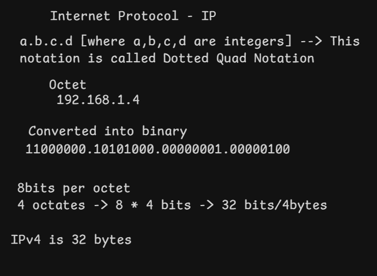

# IPv4 Addressing

[← Back to Repository](https://github.com/Priya200227/computer-networking)

---

## Overview

**Internet Protocol version 4 (IPv4)** uses 32-bit addresses to identify network interfaces and support the delivery of packets between networks.

An IPv4 address is commonly written in **dotted-decimal notation**: four decimal numbers, called *octets*, separated by periods.

## Concept Diagram

## IPv4 Address Structure

Example: `192.168.1.4`

| Octet | Decimal | 8-bit binary |
|---|---:|---|
| 1 | `192` | `11000000` |
| 2 | `168` | `10101000` |
| 3 | `1` | `00000001` |
| 4 | `4` | `00000100` |

Each octet contains **8 bits** and can represent a value from `0` to `255`.

**4 octets × 8 bits = 32 bits**

## Network Prefix and Host Portion

An IPv4 address is interpreted alongside a **network prefix** or subnet mask. The prefix indicates which leading bits identify the network; the remaining bits form the host portion.

For example, `192.168.1.4/24` belongs to the subnet `192.168.1.0/24`:

- **Network address:** `192.168.1.0`
- **Example host address:** `192.168.1.4`
- **Prefix length:** `/24` — the first 24 bits are the network prefix.

The address alone does not specify where the network portion ends; the prefix length or subnet mask is also needed.

## Private IPv4 Address Ranges

The following ranges are reserved for private networks and are not globally routable on the public internet:

| Range | CIDR notation |
|---|---|
| `10.0.0.0` – `10.255.255.255` | `10.0.0.0/8` |
| `172.16.0.0` – `172.31.255.255` | `172.16.0.0/12` |
| `192.168.0.0` – `192.168.255.255` | `192.168.0.0/16` |

Private IPv4 addresses are commonly used in home networks, offices, and cloud private networks. Devices accessing the public internet often do so through a gateway, commonly using Network Address Translation (NAT).

## Key Takeaway

IPv4 addresses are **32-bit values represented as four octets**. The network prefix or subnet mask tells us which bits identify the network and which belong to the host portion.

---

**Next:** [Subnet Masks](../04-subnet-masks/)
