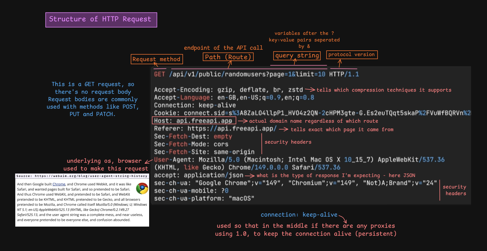
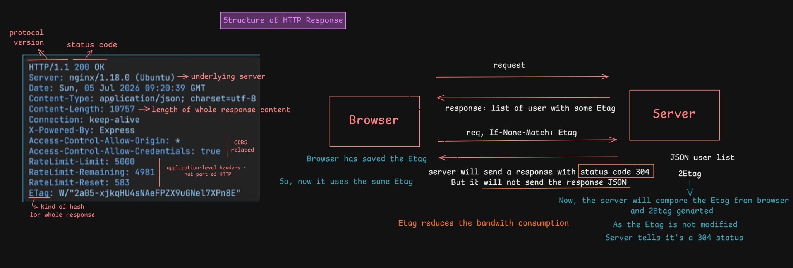

# HTTP Request and Response Structure

> [!NOTE]
> **Section:** Computer Networking - [HTTP RR Structure ](https://youtu.be/rZNdo9UjF94?si=dIrhuhB6NJmPgxTN)
>
> **Learning objective:** Understand the structure of HTTP requests and responses, the purpose of commonly used headers, and how ETags support conditional requests and caching.

[← Back to Computer Networking Repository](https://github.com/Priya200227/computer-networking)

---

## 1. HTTP Request Structure

An **HTTP request** is a message sent by a client (such as a browser or application) to a server to request a resource or perform an operation.

An HTTP/1.1 request consists of:

1. Request line
2. Request headers
3. Blank line
4. Optional request body



### 1.1 Request Line

The request line contains three parts:

```http
GET /api/v1/public/randomusers?page=1&limit=10 HTTP/1.1
```

| Component | Example | Purpose |
|---|---|---|
| Method | `GET` | Defines the operation requested |
| Request target | `/api/v1/public/randomusers?page=1&limit=10` | Identifies the requested resource and query parameters |
| HTTP version | `HTTP/1.1` | Specifies the HTTP protocol version |

**Understanding the request target:**

- **Path:** `/api/v1/public/randomusers` — identifies the API endpoint.
- **Query string:** `?page=1&limit=10` — passes additional parameters as key-value pairs separated by `&`.

For example:

```text
?page=1&limit=10
```

Here, `page` is `1` and `limit` is `10`.

### 1.2 Request Headers

Headers provide additional information about the request, the client, and the communication preferences.

| Header | Purpose |
|---|---|
| `Host` | Identifies the target host name |
| `Accept` | Specifies the response media types the client can accept |
| `Accept-Encoding` | Lists supported content encodings, such as gzip and br |
| `Accept-Language` | Indicates preferred response languages |
| `User-Agent` | Identifies information about the client software |
| `Referer` | Indicates the referring page, when provided |
| `Cookie` | Sends cookies associated with the request |
| `Connection` | Controls connection-specific behaviour in HTTP/1.x |
| `Sec-Fetch-*` | Provides browser context about the request |
| `Sec-CH-UA-*` | Provides browser client hints |

**Examples:**

```http
Host: api.example.com
Accept: application/json
Accept-Encoding: gzip, deflate, br
Accept-Language: en-US,en;q=0.9
Connection: keep-alive
User-Agent: Mozilla/5.0 ...
```

> [!IMPORTANT]
> - `Host` identifies the target host, not the specific API route.
> - `Referer` can indicate the page that initiated navigation or a request, but browser policies may restrict or omit it.
> - `User-Agent` is not guaranteed to identify the actual device or operating system accurately.

### 1.3 Request Body

The request body carries data sent by the client to the server.

It is commonly used with methods such as:

- `POST` — submit data or create a resource.
- `PUT` — create or replace a resource.
- `PATCH` — partially update a resource.

Example:

```http
POST /api/users HTTP/1.1
Host: api.example.com
Content-Type: application/json

{
  "name": "Priya",
  "role": "Data Analyst"
}
```

> [!NOTE]
> A typical `GET` request does not contain a request body. The requested data is usually specified through the path and query parameters.

---

## 2. HTTP Response Structure

An **HTTP response** is the message returned by the server after processing a client's request.

An HTTP/1.1 response consists of:

1. Status line
2. Response headers
3. Blank line
4. Optional response body



### 2.1 Status Line

Example:

```http
HTTP/1.1 200 OK
```

| Component | Example | Purpose |
|---|---|---|
| HTTP version | `HTTP/1.1` | Protocol version |
| Status code | `200` | Indicates the result of the request |
| Reason phrase | `OK` | Human-readable description |

Common status codes:

| Status code | Meaning |
|---|---|
| `200 OK` | Request succeeded |
| `201 Created` | Resource created successfully |
| `301 Moved Permanently` | Resource has a permanent new location |
| `304 Not Modified` | Cached representation can be reused |
| `400 Bad Request` | Invalid or malformed request |
| `401 Unauthorized` | Authentication is required or invalid |
| `403 Forbidden` | Server refuses the request |
| `404 Not Found` | Resource not found |
| `500 Internal Server Error` | Server encountered an error |

### 2.2 Response Headers

Response headers provide information about the server's response, its content, caching, and other behaviour.

| Header | Purpose |
|---|---|
| `Content-Type` | Specifies the media type of the response body |
| `Content-Length` | Specifies the message content length in bytes (octets) |
| `Date` | Indicates when the response was generated |
| `Server` | Identifies information about the server software |
| `Connection` | Controls connection-specific behaviour in HTTP/1.x |
| `ETag` | Provides a validator for a resource representation |
| `Access-Control-Allow-Origin` | Indicates permitted origins for CORS |
| `Access-Control-Allow-Credentials` | Indicates whether credentials are permitted for CORS |

Example:

```http
HTTP/1.1 200 OK
Content-Type: application/json
Content-Length: 1057
ETag: "a1b2c3"
```

> [!NOTE]
> Headers such as `X-Powered-By` and `RateLimit-*` may be added by applications, frameworks, or servers. They are not all core HTTP protocol requirements.

### 2.3 Response Body

The response body contains the actual content returned by the server, when one is present.

Example:

```http
HTTP/1.1 200 OK
Content-Type: application/json

{
  "id": 101,
  "name": "Priya",
  "role": "Data Analyst"
}
```

The body may contain JSON, HTML, images, files, or other supported content.

---

## 3. ETag and Conditional Requests

An **ETag (Entity Tag)** is an HTTP response header used as a validator for a resource representation.

It helps clients determine whether a cached representation is still valid, reducing unnecessary data transfer.

### How ETag works

Consider a browser requesting a user list.

**Step 1 — Initial request**

The client requests the resource:

```http
GET /api/users HTTP/1.1
Host: example.com
```

**Step 2 — Server response**

The server returns the resource with an ETag:

```http
HTTP/1.1 200 OK
Content-Type: application/json
ETag: "users-v1"

{"users": ["A", "B", "C"]}
```

The browser stores the response and its ETag.

**Step 3 — Conditional request**

When the client requests the same resource again, it can send the saved ETag:

```http
GET /api/users HTTP/1.1
Host: example.com
If-None-Match: "users-v1"
```

**Step 4 — Server validation**

The server compares the supplied validator with the current representation's ETag.

If the representation has not changed, the server responds:

```http
HTTP/1.1 304 Not Modified
ETag: "users-v1"
```

The browser reuses its cached response instead of downloading the resource again.

If the representation has changed, the server returns a new response, typically with `200 OK`, the updated body, and a new ETag.

> [!IMPORTANT]
> **304 Not Modified does not return the resource body.**
>
> It tells the client that its cached representation can be reused.

### Why use ETags?

- Reduces unnecessary response-body transfers.
- Saves bandwidth.
- Improves efficiency when resources have not changed.
- Helps validate cached representations.

> [!NOTE]
> An ETag is an opaque validator generated by the server. It may be based on a hash, version, or another validation strategy. It is not necessarily a hash of the entire response.

---

## 4. Important Distinctions

| Concept | Remember |
|---|---|
| Request line | Method + request target + HTTP version |
| Request headers | Additional information sent by the client |
| Request body | Data sent with the request, when applicable |
| Status line | HTTP version + status code + reason phrase |
| Response headers | Metadata about the server response |
| Response body | Content returned by the server, when applicable |
| ETag | Validator for a resource representation |
| If-None-Match | Sends a previously stored ETag for validation |
| 304 Not Modified | Allows reuse of a valid cached representation |

> [!TIP]
> **Remember the message structure:**
>
> **Request:** Request Line → Headers → Blank Line → Optional Body
>
> **Response:** Status Line → Headers → Blank Line → Optional Body

---

## References

- [RFC 9110 — HTTP Semantics](https://www.rfc-editor.org/rfc/rfc9110.html)
- [RFC 9112 — HTTP/1.1](https://www.rfc-editor.org/rfc/rfc9112.html)
- [MDN — HTTP Messages](https://developer.mozilla.org/en-US/docs/Web/HTTP/Messages)
- [MDN — HTTP Headers](https://developer.mozilla.org/en-US/docs/Web/HTTP/Headers)
- [MDN — ETag](https://developer.mozilla.org/en-US/docs/Web/HTTP/Headers/ETag)
- [MDN — If-None-Match](https://developer.mozilla.org/en-US/docs/Web/HTTP/Headers/If-None-Match)

---

**Next:** [HTTP 1.1 in action](../22-http1.1-connection-reuse-and-blocking-in-action/README.md)
