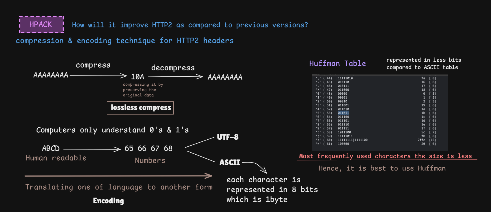
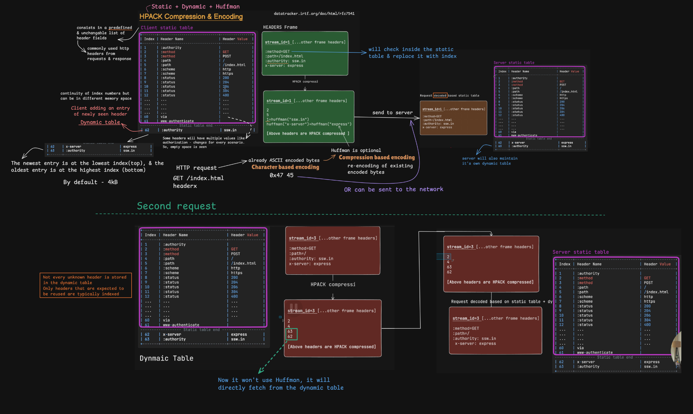
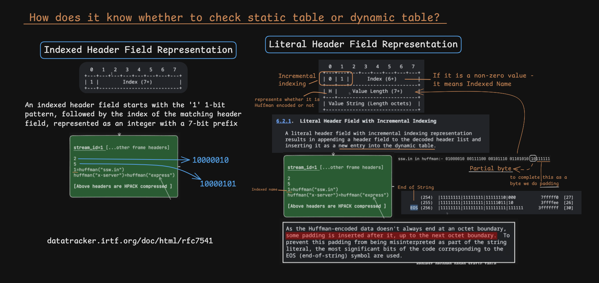

# HPACK - HTTP/2 Header Compression

> [!NOTE]
> **Section:** Computer Networking - [HTTP/2 - HPACK Header Compression](https://youtu.be/M5ecS9oPRtk?si=opC6x84Wg3kF6zJd)  
> **Learning objective:** Understand why HPACK exists, how it reduces HTTP/2 header overhead, and how its static table, dynamic table, and header representations work.

[← Back to Computer Networking Repository](https://github.com/Priya200227/computer-networking)

---

## 1. What Is HPACK?

**HPACK (Header Compression for HTTP/2)** is a compression format designed to reduce the overhead of HTTP headers.

HTTP requests and responses often contain repeated headers, such as:

- `:method`
- `:path`
- `:authority`
- `content-type`
- `accept`
- `user-agent`

Sending these header names and values repeatedly increases the amount of data transmitted.

HPACK reduces this overhead by using:

- A predefined **static table**.
- A connection-specific **dynamic table**.
- Compact integer and string representations.
- Optional **Huffman encoding**.

<blockquote>
  **Important:** HPACK compresses HTTP/2 header fields. It does not compress the request or response body.
</blockquote>

## 2. Compression and Encoding Fundamentals

Before understanding HPACK, distinguish between compression and encoding.

| Concept | Meaning |
|---|---|
| **Encoding** | Converts information into a particular representation. |
| **Compression** | Reduces the number of bits or bytes needed to represent information. |
| **Lossless compression** | Reduces size while preserving the original information exactly. |
| **Huffman encoding** | Assigns shorter bit sequences to more frequent symbols and longer sequences to less frequent symbols. |

### Huffman encoding

In ordinary fixed-width ASCII, each character is represented using 7 bits (often stored in an 8-bit byte).

Huffman encoding uses variable-length codes based on symbol frequency.

Frequently occurring symbols can receive shorter codes, potentially reducing the encoded size.



> [!NOTE]
> HPACK uses a predefined Huffman code specifically designed for HTTP header compression. Huffman encoding is optional; a string can also be represented without it.

## 3. How HPACK Works

HPACK combines three important mechanisms:

1. **Static table:** A predefined collection of commonly used HTTP header fields.
2. **Dynamic table:** A collection of header fields learned during the connection.
3. **Huffman encoding:** An optional way to encode header names and values more compactly.

The sender encodes header fields into a compressed representation. The receiver decodes them using the corresponding table state.



### 3.1 Static Table

The HPACK static table contains **61 predefined entries**.

It includes commonly used HTTP header names and some frequently used name-value combinations.

For example:

- `:method: GET`
- `:method: POST`
- `:path: /`
- `:scheme: https`
- `:status: 200`

Because both endpoints know this table in advance, the sender can refer to an entry by its index instead of transmitting the complete name and value.

**Key point:** The static table is predefined and does not change during communication.

### 3.2 Dynamic Table

The dynamic table stores header fields that are encountered during communication and may be reused later.

For example, imagine the first request contains:

```http
x-server: express
```

If the encoder chooses to add this field to the dynamic table, a later request can refer to its table index instead of transmitting the complete field again.

Important characteristics:

- Entries are added dynamically.
- The newest entry is placed at the beginning of the dynamic table.
- Older entries are evicted when the table exceeds its configured size.
- Both endpoints maintain synchronized compression state.

> [!IMPORTANT]
> Not every header field is automatically stored in the dynamic table. The encoder chooses the appropriate representation.

The default dynamic table size is **4,096 octets**, but it can be changed through HTTP/2 settings.

## 4. HPACK Header Field Representations

HPACK provides different ways to represent header fields.

The encoder chooses a representation based on whether the header already exists in a table and whether it should be stored for future reuse.



### 4.1 Indexed Header Field Representation

Used when the complete header field already exists in the static or dynamic table.

Instead of sending the entire header again, HPACK sends its index.

**Example concept:**

```text
:method: GET
       ↓
Existing table entry
       ↓
Send index
```

This is an efficient way to reuse previously known header fields.

### 4.2 Literal Header Field Representation

Used when a header field needs to be transmitted as a literal value rather than referenced entirely through an existing table entry.

There are three important literal forms:

| Representation | Behaviour |
|---|---|
| **Incremental indexing** | Sends the literal field and adds it to the dynamic table. |
| **Without indexing** | Sends the literal field without adding it to the dynamic table. |
| **Never indexed** | Sends the literal field with an instruction that it must not be indexed. |

For example, a newly encountered custom header may be sent as a literal and added to the dynamic table if the encoder chooses incremental indexing.

Sensitive values, such as credentials, should not be placed in a reusable compression context. The never-indexed representation can help prevent indexing, although it is not encryption and does not replace TLS.

### 4.3 How Does HPACK Know Which Representation Is Being Used?

Each representation begins with a specific bit pattern.

The decoder examines the leading bits to determine how to interpret the remaining data.

At a conceptual level:

- **Indexed representation:** References an existing table entry.
- **Literal with incremental indexing:** Transmits a field and adds it to the dynamic table.
- **Literal without indexing:** Transmits a field without adding it to the table.
- **Literal never indexed:** Transmits a field that must not be indexed.

HPACK also defines a table-size update representation.

You do not need to memorize the binary patterns. Understand what each representation does.

## 5. How HPACK Reduces Repeated Header Data

Consider two requests sent over the same HTTP/2 connection.

**First request:**

```http
GET /index.html
Host: example.com
X-Server: express
```

The encoder can use existing static-table entries and encode new fields as literals. It may add reusable fields to the dynamic table.

**Second request:**

```http
GET /about.html
Host: example.com
X-Server: express
```

The encoder can reuse existing table entries for repeated fields rather than sending their complete values again.

The path may need to be transmitted as a new literal because it differs from the previous request.

**Result:** Less repeated header information needs to be transmitted.

> [!TIP]
> The biggest benefit appears when requests repeatedly contain the same header names and values over a connection.

## 6. HPACK and HTTP/3

Do not confuse HPACK with QPACK.

| Feature | HPACK | QPACK |
|---|---|---|
| Used by | HTTP/2 | HTTP/3 |
| Transport | TCP | QUIC over UDP |
| Header compression | Static and dynamic tables | Static and dynamic tables |
| Compression coordination | Ordered HTTP/2 connection | Designed for QUIC's independent streams |

HTTP/2 uses HPACK. HTTP/3 uses **QPACK**, which was designed to avoid the blocking problems that HPACK's connection-level synchronization could create when used with independently progressing QUIC streams.

See [RFC 9204 — QPACK](https://www.rfc-editor.org/rfc/rfc9204.html).

---

## Key Takeaways

| Concept | Remember |
|---|---|
| HPACK | Header compression format used by HTTP/2 |
| Purpose | Reduce repeated HTTP header data |
| Static table | 61 predefined entries |
| Dynamic table | Stores reusable header fields |
| Huffman encoding | Optional variable-length string encoding |
| Indexed representation | References an existing table entry |
| Literal representation | Transmits a header field directly |
| Incremental indexing | Adds a field to the dynamic table |
| Never indexed | Prevents a field from being added to the dynamic table |
| HTTP/3 | Uses QPACK instead of HPACK |

> [!IMPORTANT]
> **Core idea:** HPACK reduces HTTP/2 header overhead by referencing predefined and previously learned header fields instead of repeatedly transmitting the same information.

## References

- [RFC 7541 — HPACK: Header Compression for HTTP/2](https://www.rfc-editor.org/rfc/rfc7541.html)
- [RFC 9113 — HTTP/2](https://www.rfc-editor.org/rfc/rfc9113.html)
- [RFC 9204 — QPACK: Field Compression for HTTP/3](https://www.rfc-editor.org/rfc/rfc9204.html)
- [MDN — HTTP Headers](https://developer.mozilla.org/en-US/docs/Web/HTTP/Headers)

---

**Next:** [HTTP/2 Head-of-Line Blocking](../26-http-2-head-line-blocking/README.md)

