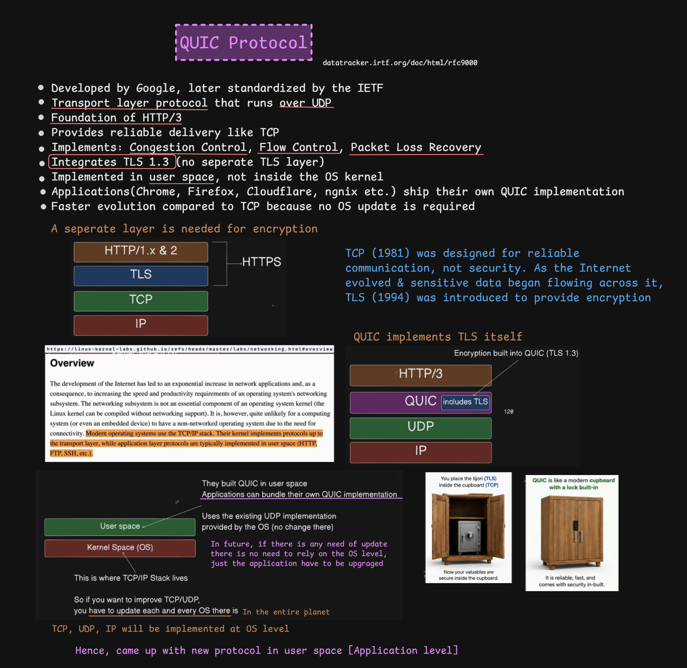
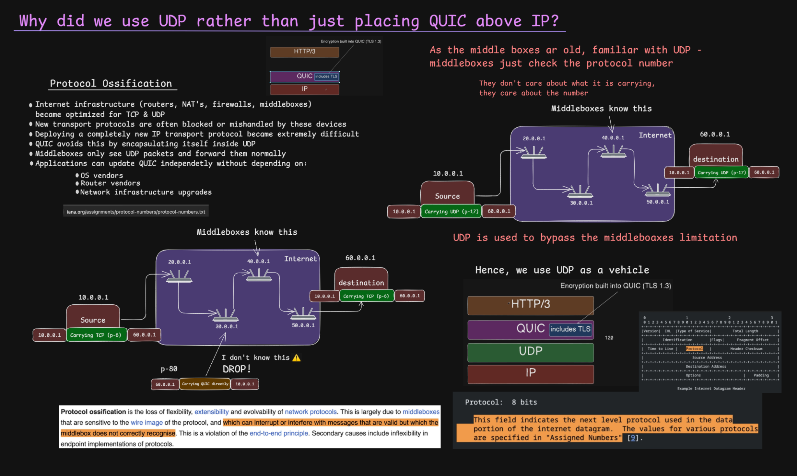
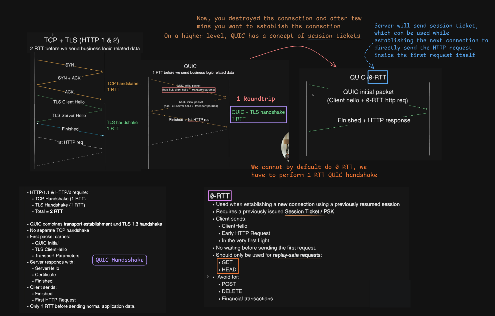
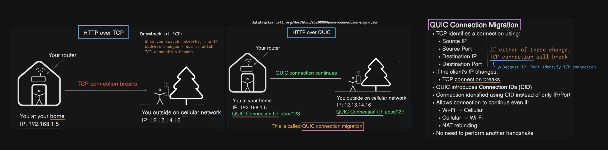

# QUIC Protocol Overview

> [!NOTE]
> **Section:** Computer Networking - [QUIC Protocol](https://youtu.be/ZAJVKmZ-dh4?si=LAKHD-NTw6_mELT_)
> 
> **Learning objective:** Understand why QUIC was developed, why it uses UDP, how it integrates TLS 1.3, how it reduces connection-establishment latency, and how connection migration works.

[← Back to Computer Networking Repository](https://github.com/Priya200227/computer-networking)

---

## 1. What Is QUIC?

**QUIC** is a modern, secure transport protocol originally developed by Google and later standardized by the IETF.

It provides transport functionality such as:

- Reliable data delivery
- Multiple independent streams
- Flow control
- Congestion control
- Packet loss detection and recovery
- Low-latency connection establishment
- Connection migration
- Integrated encryption using TLS 1.3

QUIC is the transport protocol used by **HTTP/3**.

Unlike HTTP/1.1 and HTTP/2, which traditionally use TCP, HTTP/3 uses QUIC over UDP.

> [!IMPORTANT]
> QUIC is not an acronym. It is the name of the protocol.

## 2. QUIC Architecture

The protocol stack looks like this:

```text
HTTP/3
   |
 QUIC
   |
 UDP
   |
  IP
```

QUIC runs over UDP but provides transport capabilities that applications would otherwise commonly obtain from TCP.

### Why does QUIC use UDP?

TCP is implemented as part of the operating system's networking stack. Historically, introducing a new transport protocol directly over IP would require changes across operating systems and network infrastructure.

QUIC takes a different approach:

- It runs over UDP, which is already widely supported.
- QUIC implementations can be deployed and updated by applications.
- It does not require replacing the existing TCP implementation.
- It can evolve independently of operating-system TCP updates.

QUIC implementations commonly run in user space, although implementations can also exist elsewhere.



### QUIC vs TCP and TLS

With traditional HTTPS over TCP:

```text
HTTP/1.1 or HTTP/2
        |
       TLS
        |
       TCP
        |
        IP
```

With HTTP/3:

```text
      HTTP/3
        |
       QUIC
   (TLS 1.3 integrated)
        |
       UDP
        |
        IP
```

TCP was designed to provide reliable communication, not encryption. TLS was introduced separately to provide confidentiality, integrity, and authentication.

QUIC integrates the TLS 1.3 handshake into its connection-establishment process. There is no separate TLS layer above QUIC.



## 3. Protocol Ossification

**Protocol ossification** occurs when network infrastructure becomes so dependent on existing protocol behaviour that introducing or modifying protocols becomes difficult.

Examples of network infrastructure include:

- Routers
- Firewalls
- NAT devices
- Middleboxes

Many middleboxes recognize and handle familiar protocols such as TCP and UDP. They may block, interfere with, or mishandle unfamiliar transport protocols.

Deploying a completely new transport protocol directly over IP can therefore be difficult.

### How QUIC addresses this

QUIC encapsulates its packets inside UDP datagrams.

This allows existing network infrastructure to forward the traffic using familiar UDP handling.

The middleboxes generally see UDP at the transport layer rather than needing to understand QUIC's internal transport mechanisms.

> [!IMPORTANT]
> QUIC does not eliminate every middlebox compatibility problem. UDP traffic can still be blocked, filtered, or rate-limited. Using UDP makes deployment easier; it does not guarantee universal connectivity.

## 4. QUIC Features

### 4.1 Reliable delivery

UDP itself does not guarantee reliable delivery.

QUIC implements reliability mechanisms, including acknowledgments, packet loss detection, and recovery.

This means QUIC can provide reliable transport even though it uses UDP underneath.

### 4.2 Flow control and congestion control

QUIC provides both mechanisms, but they solve different problems.

| Mechanism | Purpose |
|---|---|
| Flow control | Prevents a sender from overwhelming the receiver |
| Congestion control | Prevents a sender from overwhelming the network |

QUIC also uses loss detection and recovery mechanisms to handle packet loss.

### 4.3 Multiple independent streams

A QUIC connection can carry multiple streams simultaneously.

Streams can be unidirectional or bidirectional.

This is important because loss affecting one stream does not prevent independent streams from delivering their data.

This helps avoid the TCP-level cross-stream head-of-line blocking associated with HTTP/2.

## 5. QUIC Handshake and Connection Establishment

One of QUIC's major advantages is reducing the time required to establish a secure connection.

### Traditional TCP + TLS

With a new TCP connection using TLS 1.3, the simplified process is:

1. TCP three-way handshake — approximately 1 RTT.
2. TLS 1.3 handshake — approximately 1 additional RTT.
3. Application data can then be exchanged.

This is approximately **2 RTTs** before normal application data in the simplified full-handshake case.

### QUIC handshake

QUIC combines transport and cryptographic negotiation.

For a new connection:

1. Client sends a QUIC Initial packet containing TLS ClientHello and transport parameters.
2. Server responds with handshake information, including its TLS ServerHello and other required messages.
3. Client and server complete the handshake.
4. Application data can be exchanged.

A typical new QUIC connection can establish secure communication in approximately **1 RTT**.



### 5.1 What is RTT?

**RTT (Round-Trip Time)** is the time taken for a packet to travel from the sender to the receiver and for the corresponding response to return.

Reducing the number of required round trips can reduce connection-establishment latency.

### 5.2 What is 0-RTT?

QUIC supports **0-RTT data** when resuming a previously established session.

The client can send early application data along with its initial connection flight, without waiting for the new handshake to finish.

This requires previously established session information, such as a valid resumption ticket and associated parameters.

Important limitations:

- 0-RTT is not available for every new connection.
- Early data can be replayed by an attacker.
- Applications should restrict early data to operations that are safe to replay.
- A server can reject early data.

Examples of commonly replay-safe methods include GET and HEAD, provided the application follows their expected semantics.

> [!WARNING]
> Do not use 0-RTT for non-idempotent operations such as payments, purchases, or other actions where replaying a request could cause duplicate effects.

**Remember:**

| Connection type | Approximate application-data timing |
|---|---|
| New TCP + TLS 1.3 connection | 2 RTTs |
| New QUIC connection | 1 RTT |
| Resumed QUIC connection with accepted 0-RTT | Early data can be sent in the first flight |

These are simplified handshake comparisons; actual timing depends on network conditions and handshake configuration.

## 6. QUIC Connection Migration

A traditional TCP connection is identified using a four-tuple:

```text
Source IP
Source Port
Destination IP
Destination Port
```

If the client's network changes and its IP address changes, the TCP connection generally cannot continue as the same connection.

For example:

```text
At home:
IP address = 192.168.1.5
       |
       | Switch from Wi-Fi to cellular
       v
On cellular:
IP address = 12.13.14.16
```

The network path changes, so the original TCP connection is no longer valid.

### How QUIC handles this

QUIC uses **Connection IDs (CIDs)** to identify connections independently of the network path's IP address and UDP port tuple.

This allows a QUIC connection to continue across certain network changes.

For example:

```text
Before network change:
Client IP = 192.168.1.5
QUIC Connection ID = abc123

After network change:
Client IP = 12.13.14.16
QUIC Connection ID = abc123
```

The connection can continue using the same logical QUIC connection, subject to path validation and the protocol's migration rules.

This is called **QUIC connection migration**.



### Where is this useful?

- Switching from Wi-Fi to cellular data
- Switching from cellular to Wi-Fi
- Certain NAT rebinding scenarios
- Network path changes while a connection is active

> [!NOTE]
> Connection migration is not an unconditional guarantee. QUIC uses path validation and other security checks before accepting a new path. QUIC connection IDs are also not simply permanent identifiers that must remain unchanged forever.

## 7. TCP vs QUIC

| Feature | TCP | QUIC |
|---|---|---|
| Runs over | IP | UDP over IP |
| Reliability | Built in | Implemented by QUIC |
| Congestion control | Built in | Implemented by QUIC |
| Flow control | Built in | Implemented per connection and stream |
| Encryption | Requires TLS separately | TLS 1.3 integrated |
| Multiplexed streams | Not natively provided | Supported |
| Cross-stream HOL from transport | Can occur | Avoided between independent streams |
| Connection migration | Not supported as a normal TCP feature | Supported using Connection IDs and path validation |
| Typical new secure connection setup | TCP + TLS handshakes | Combined QUIC + TLS handshake |

## Key Takeaways

> [!IMPORTANT]
> QUIC is a secure transport protocol that runs over UDP. It combines transport functionality with TLS 1.3 integration, supports independent streams, reduces handshake latency, and enables connection migration.

| Concept | Remember |
|---|---|
| QUIC | Secure, general-purpose transport protocol |
| UDP | Underlying datagram transport |
| TLS 1.3 | Integrated into QUIC's handshake |
| Protocol ossification | Middleboxes can make new protocols difficult to deploy |
| Reliability | QUIC implements loss detection and recovery |
| 1-RTT | Typical new QUIC connection establishment |
| 0-RTT | Early data during eligible session resumption |
| Connection ID | Identifies a QUIC connection independently of its current network path |
| Connection migration | Allows a connection to move between network paths |

**Core idea:** QUIC uses UDP as a deployment-friendly foundation while implementing modern transport features itself. This is why HTTP/3 can achieve lower connection-establishment latency, avoid TCP-level cross-stream head-of-line blocking, and support connection migration.

## References

- [RFC 9000 — QUIC: A UDP-Based Multiplexed and Secure Transport](https://www.rfc-editor.org/rfc/rfc9000.html)
- [RFC 9001 — Using TLS to Secure QUIC](https://www.rfc-editor.org/rfc/rfc9001.html)
- [RFC 9002 — QUIC Loss Detection and Congestion Control](https://www.rfc-editor.org/rfc/rfc9002.html)
- [RFC 9114 — HTTP/3](https://www.rfc-editor.org/rfc/rfc9114.html)

---

**Next:** [HTTP/3 - QUIC](../28-http-3/README.md) 
