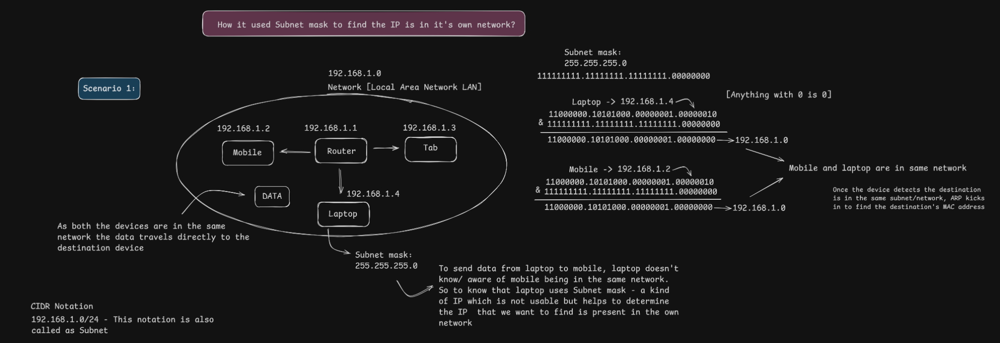
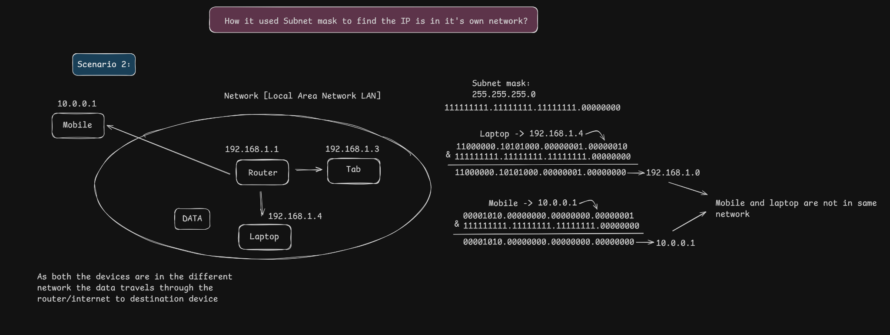

# Subnet Masks

[← Back to Repository](https://github.com/Priya200227/computer-networking) 

---

## Overview

A **subnet mask** helps a device determine which part of an IP address identifies the network and which part identifies the host. A device uses its IP address together with its subnet mask to calculate the network address.

This distinction helps the device decide whether a destination is on its **local subnet** or whether it should send the traffic to a router (typically its default gateway).

## 1. How a Subnet Mask Works

A common example is:

- **IP address:** `192.168.1.4`
- **Subnet mask:** `255.255.255.0`
- **CIDR prefix:** `/24`
- **Calculated network address:** `192.168.1.0`

In binary, `255.255.255.0` is:

```text
11111111.11111111.11111111.00000000
```

A device performs a **bitwise AND** between the IPv4 address and the subnet mask to calculate the network address. Where the mask has `1` bits, the corresponding address bits are retained; where the mask has `0` bits, the result is `0`.

```text
IP address:    192.168.1.4     11000000.10101000.00000001.00000100
Subnet mask:   255.255.255.0   11111111.11111111.11111111.00000000
               ---------------------------------------------------
Network:       192.168.1.0     11000000.10101000.00000001.00000000
```

The `/24` prefix means that the first 24 bits identify the network prefix and the remaining 8 bits are available for the host portion.

## 2. Scenario 1 — Devices on the Same Subnet



Assume both devices use the subnet mask `255.255.255.0` (`/24`).

| Device | IPv4 address | Calculated network |
|---|---|---|
| Laptop | `192.168.1.4/24` | `192.168.1.0` |
| Mobile | `192.168.1.2/24` | `192.168.1.0` |

Both devices calculate the same network address: **`192.168.1.0`**. They are therefore considered to be on the same IPv4 subnet.

When the laptop sends traffic to the mobile, it can send the traffic directly over the local network. It uses ARP to discover the mobile's MAC address if that mapping is not already known.

## 3. Scenario 2 — Devices on Different Subnets



Assume the laptop and mobile both use a `/24` prefix.

| Device | IPv4 address | Calculated network |
|---|---|---|
| Laptop | `192.168.1.4/24` | `192.168.1.0` |
| Mobile | `10.0.0.1/24` | `10.0.0.0` |

The calculated network addresses differ: **`192.168.1.0`** and **`10.0.0.0`**. The devices are on different IPv4 subnets.

The laptop therefore sends the packet to its configured next hop—typically its **default gateway**—rather than trying to resolve the remote mobile's MAC address directly. The routers along the path forward the packet according to their routing tables. Successful communication depends on suitable routing and network configuration.

## 4. The Decision in One View

```text
Destination IP + local subnet mask
                 |
                 v
       Calculate network address
                 |
                 v
 Compare with the local network address
          /               \
         /                 \
     Same subnet        Different subnet
         |                   |
         v                   v
 Resolve destination    Send to the configured
 MAC with ARP           next hop (usually the
 and send locally       default gateway)
```

## Key Takeaway

A subnet mask does not identify a device by itself. It lets a host calculate the network prefix for an IP address and compare that result with the destination's network.

- **Same subnet:** send locally, resolving the destination's MAC address when needed.
- **Different subnet:** send to a router/next hop, usually the default gateway.

---

**Next:** [Default Gateway](../05-default-gateway/)
