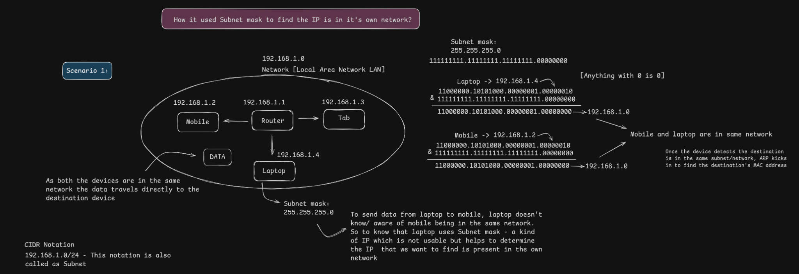
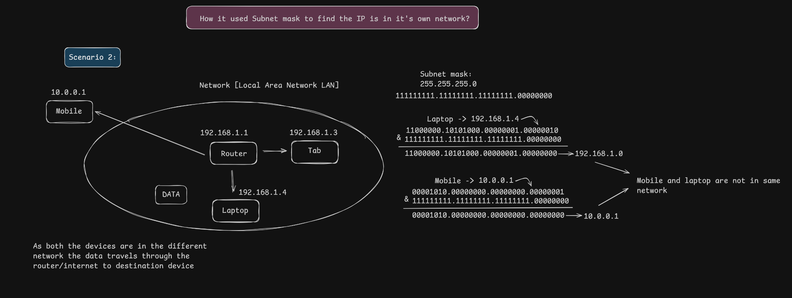

# Subnet Masks

> [!NOTE]
> **Section:** Computer Networking — [Chai aur Networking](https://www.youtube.com/watch?v=KVujI1fsQQo&list=PLd1s-PEC5Pio&index=6)
>
> **Purpose:** Understand how subnet masks and CIDR prefixes divide an IPv4 address into network and host portions, how to calculate a network address, and how a device determines whether a destination belongs to its local subnet or requires forwarding through a router.

[← Back to Computer Networking Repository](https://github.com/Priya200227/computer-networking)

---

## Overview

A **subnet mask** helps a device determine which part of an IP address identifies the network and which part identifies the host.

A device uses its IP address together with its subnet mask to calculate the **network address**.

This distinction helps the device decide whether a destination is on its **local subnet** or whether it should send the traffic to a router (typically its **default gateway**).

> [!IMPORTANT]
> A subnet mask determines the boundary between the network portion and the host portion of an IPv4 address.

## 1. How a Subnet Mask Works

Consider the following example:

| Component | Value |
|---|---|
| **IP address** | `192.168.1.4` |
| **Subnet mask** | `255.255.255.0` |
| **CIDR prefix** | `/24` |
| **Calculated network address** | `192.168.1.0` |

In binary, `255.255.255.0` is:

```text
11111111.11111111.11111111.00000000
```

A device performs a **bitwise AND** between the IPv4 address and the subnet mask to calculate the network address.

- Where the mask has `1` bits, the corresponding address bits are retained.
- Where the mask has `0` bits, the result is `0`.

### Bitwise AND Example

```text
IP address:    192.168.1.4     11000000.10101000.00000001.00000100
Subnet mask:   255.255.255.0   11111111.11111111.11111111.00000000
               ---------------------------------------------------
Network:       192.168.1.0     11000000.10101000.00000001.00000000
```

> [!NOTE]
> The `/24` prefix means:
> - **24 bits** identify the network prefix.
> - **8 bits** form the host portion.

## 2. Scenario 1 — Devices on the Same Subnet



Assume both devices use the subnet mask `255.255.255.0` (`/24`).

| Device | IPv4 address | Calculated network |
|---|---|---|
| Laptop | `192.168.1.4/24` | `192.168.1.0` |
| Mobile | `192.168.1.2/24` | `192.168.1.0` |

Both devices calculate the same network address: **`192.168.1.0`**.

Therefore, they belong to the same IPv4 subnet.

### How communication happens

1. The laptop determines that the mobile belongs to its local subnet.
2. It checks its ARP cache for the mobile's MAC address.
3. If the mapping is unavailable, it uses **ARP (Address Resolution Protocol)** to discover the MAC address.
4. The laptop sends the Ethernet frame directly to the mobile over the local network.

> [!TIP]
> **Same subnet → Resolve the destination's MAC address → Send locally.**

## 3. Scenario 2 — Devices on Different Subnets



Assume both devices use a `/24` prefix.

| Device | IPv4 address | Calculated network |
|---|---|---|
| Laptop | `192.168.1.4/24` | `192.168.1.0` |
| Mobile | `10.0.0.1/24` | `10.0.0.0` |

The calculated network addresses differ:

- Laptop: **`192.168.1.0`**
- Mobile: **`10.0.0.0`**

Therefore, the devices belong to different IPv4 subnets.

### How communication happens

1. The laptop determines that the destination is outside its local subnet.
2. It sends the packet to its configured next hop, typically the **default gateway**.
3. The laptop resolves the gateway's MAC address using ARP if necessary.
4. The router examines its routing table and forwards the packet towards the destination network.

Successful communication depends on suitable routing and network configuration.

> [!TIP]
> **Different subnet → Send the packet to the next hop (usually the default gateway).**

## 4. The Decision in One View

The following flowchart summarizes how a device decides whether to send traffic locally or through a router.

```text
       Destination IP + Local Subnet Mask
                       |
                       v
            Calculate Network Address
                       |
                       v
          Compare Destination Network
             with the Local Network
                       |
               +-------+-------+
               |               |
               v               v
          Same Subnet     Different Subnet
               |               |
               v               v
        Resolve Destination   Send Packet to
        MAC using ARP         Configured Next Hop
               |              (Usually Gateway)
               |               |
               v               v
        Send Frame Locally   Router Forwards Packet
```

---

## Key Takeaway

> [!IMPORTANT]
> **A subnet mask helps a host determine which IP addresses belong to its local subnet and which destinations require routing.**

Remember the two fundamental decisions:

| Destination | What the device does |
|---|---|
| **Same subnet** | Resolves the destination's MAC address and sends the frame locally. |
| **Different subnet** | Sends the packet to the configured next hop, usually the default gateway. |

Understanding subnet masks is essential for learning **default gateways, routing, ARP, and subnetting**.

---

**Next:** [Default Gateway](../05-default-gateway/)
