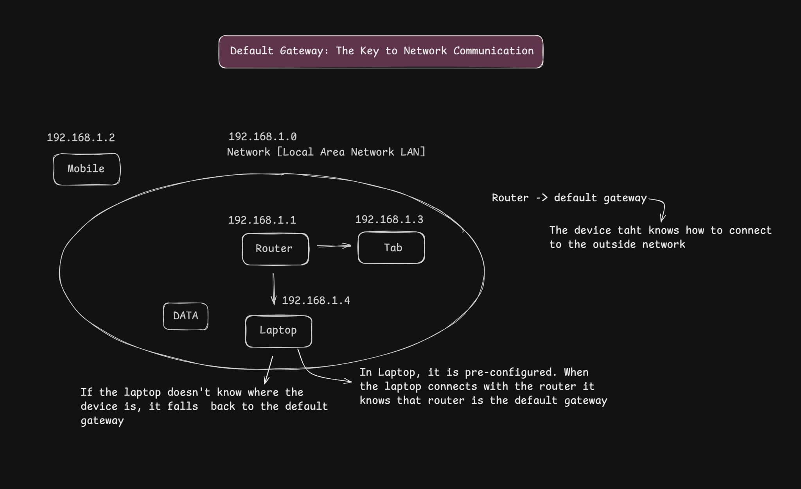
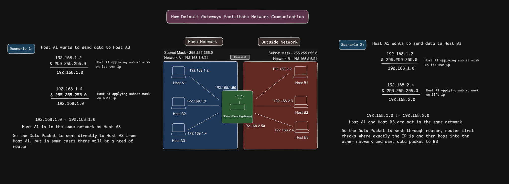

# Default Gateway

> **Section:** Computer Networking — [Chai aur Networking](https://www.youtube.com/watch?v=Ik-buVzjW3s&list=PLd1s-PEC5Pio&index=6)
>
> **Purpose:** Understand how a host uses its IP address and subnet mask to determine whether a destination is local or remote, why traffic destined for another network is sent to a default gateway, and how routers forward packets between different IP networks.

[← Back to Computer Networking Repository](https://github.com/Priya200227/computer-networking)

---

## 1. What Is a Default Gateway?

A **default gateway** is the next-hop router a host uses when it needs to send traffic to a destination outside its directly connected local network and no more-specific route applies.

In a typical home network, the router's local interface is configured as the default gateway for devices such as laptops and phones.

### Example Network Configuration

| Component | Example value |
|---|---|
| Laptop IP address | `192.168.1.4` |
| Subnet mask | `255.255.255.0` (`/24`) |
| Default gateway | `192.168.1.1` |

The gateway address must be reachable on the host's local link.

The host does not send an Ethernet frame directly to a remote host's MAC address. Instead:

- The **IP packet** contains the final destination IP address.
- The **Ethernet frame** is addressed to the gateway's MAC address for the next hop.

> [!IMPORTANT]
> **The default gateway is not used for every packet.**
>
> If the destination belongs to the same local subnet, the host normally sends the traffic directly over the local link without routing it through the default gateway.

## 2. Overview: Default Gateway in a Local Network



In this illustration, all devices belong to the `192.168.1.0/24` network.

| Device | Example IPv4 address |
|---|---|
| Router's local interface | `192.168.1.1` |
| Mobile | `192.168.1.2` |
| Tablet | `192.168.1.3` |
| Laptop | `192.168.1.4` |

The router can serve as the laptop's default gateway.

When the laptop needs to reach a destination outside its local subnet, it forwards the traffic to the router.

> [!NOTE]
> The default-gateway setting is usually supplied through network configuration, often using **DHCP** on a home network. It is not discovered simply because a device connects to a router.

## 3. Scenario 1 — Destination Is in the Same Network

Suppose **Host A1** (`192.168.1.2`) wants to send data to **Host A3** (`192.168.1.4`).

Both devices use the subnet mask `255.255.255.0` (`/24`).

### Calculate the Network Address

Applying the subnet mask:

```text
Host A1: 192.168.1.2  AND  255.255.255.0  =  192.168.1.0

Host A3: 192.168.1.4  AND  255.255.255.0  =  192.168.1.0
```

Both results are `192.168.1.0`.

Therefore, both hosts belong to the **same IPv4 subnet**.

### What Happens?

1. Host A1 compares the destination address with its own subnet.
2. It determines that Host A3 belongs to the local network.
3. It checks its ARP cache for Host A3's MAC address.
4. If the mapping is unavailable, it uses **ARP (Address Resolution Protocol)** to discover the MAC address.
5. It sends the Ethernet frame locally towards Host A3.



The switch or wireless access point may forward the frame across the local network, depending on the network setup.

> [!TIP]
> **Same subnet → Resolve the destination's MAC address → Send locally.**
>
> The default gateway is not needed for this communication.

Here, "directly" means that the host does not route the packet through its default gateway. It does not necessarily mean there is a dedicated physical cable between the two devices.

## 4. Scenario 2 — Destination Is in a Different Network

Now suppose Host A1 wants to send data to **Host B3**.

### Network Configuration

| Device or network | Address |
|---|---|
| Host A1 | `192.168.1.2` |
| Home Network A | `192.168.1.0/24` |
| Router interface on Network A | `192.168.1.50` |
| Host B3 | `192.168.2.4` |
| Outside Network B | `192.168.2.0/24` |
| Router interface on Network B | `192.168.2.50` |

Both networks use the subnet mask `255.255.255.0` (`/24`).

### Calculate the Network Addresses

```text
Host A1: 192.168.1.2  AND  255.255.255.0  =  192.168.1.0

Host B3: 192.168.2.4  AND  255.255.255.0  =  192.168.2.0
```

The calculated network addresses are different:

- Host A1 → `192.168.1.0`
- Host B3 → `192.168.2.0`

Therefore, the devices belong to **different IPv4 subnets**.

### What Happens?

1. Host A1 determines that `192.168.2.4` is outside its local `/24` subnet.
2. It sends the packet to its next hop — the default gateway at `192.168.1.50`.
3. If necessary, Host A1 uses ARP to resolve the gateway's MAC address.
4. The router examines the destination IP address and consults its routing table.
5. If a valid route exists and forwarding is permitted, the router forwards the packet through the interface leading to Network B.
6. Host B3 receives the traffic on the destination network.

> [!IMPORTANT]
> **The router forwards the IP packet, but rebuilds the link-layer frame for the outgoing network.**
>
> During ordinary routing, the packet's destination IP remains `192.168.2.4`. NAT, if configured, can modify IP addresses, but NAT is not required simply because a router forwards traffic between two networks.

## 5. The Key Decision — Local or Remote?

A host uses its IP configuration, particularly its IP address and subnet mask, to determine whether a destination is local.

### Communication Decision Flow

```text
        Destination IP Address
                  |
                  v
       Check Local Routing Table
                  |
                  v
       Determine the Next Hop
                  |
           +------+------+
           |             |
           v             v
      Same Subnet    Different Subnet
           |             |
           v             v
   Resolve Destination  Send Frame to
   MAC Address via ARP  Default Gateway's
           |            MAC Address
           v             |
    Send Frame Locally   v
                   Router Checks
                   Routing Table
                         |
                         v
                  Forward Packet
                  to Next Network
```

> [!NOTE]
> This is a simplified explanation of the usual IPv4 routing decision. A host's routing table can contain more-specific routes that take precedence over the default route.

---

## Key Takeaways

> [!IMPORTANT]
> **A default gateway provides the next hop for traffic that needs to leave the local network when no more-specific route applies.**

Remember these fundamental concepts:

- **Default gateway:** Normally a router interface on the host's local network.
- **Subnet mask:** Helps a host determine whether an IPv4 destination is local or remote.
- **Same-subnet communication:** Traffic is normally delivered over the local link without passing through the default gateway.
- **Different-subnet communication:** Traffic is sent to an appropriate next hop, usually the default gateway when no more-specific route applies.
- **Routing:** Routers forward packets between networks according to their routing tables.
- **IP addressing:** Determines the source and destination at the network layer.
- **MAC addressing:** Delivers frames over each local link.

**Remember the distinction:**

| Layer | Main responsibility |
|---|---|
| Network Layer (IP) | Determines where the packet needs to go. |
| Data Link Layer (MAC) | Delivers the frame to the next hop on the local link. |

---

## References

- [Understanding Default Gateway: The Key to Network Communication — Video](https://www.youtube.com/watch?v=Ik-buVzjW3s&list=PLd1s-PEC5Pio&index=6)
- [How Default Gateways Facilitate Network Communication — Video](https://www.youtube.com/watch?v=PqdrgoYb3Vc&list=PLd1s-PEC5Pio&index=7)

---

**Next:** [MAC Address](../06-mac-address/README.md)
