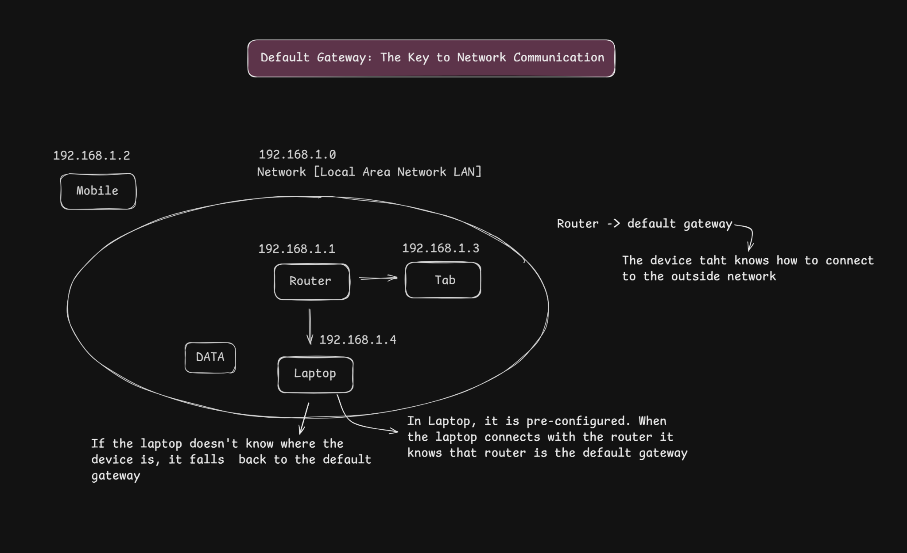
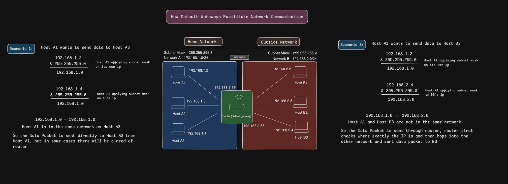

# 05 — Default Gateway

**How devices communicate with hosts inside and outside their local network**

[← Back to Repository](../README.md)

---

## Learning objectives

By the end of this section, you should be able to explain:

- What a **default gateway** is.
- How a host uses its IP address and subnet mask to decide whether a destination is local or remote.
- Why two hosts in the same subnet can communicate directly at the network layer.
- Why traffic destined for another subnet is sent to a router.
- The role of a router's interfaces in connecting different IP networks.

## 1. What is a default gateway?

A **default gateway** is the next-hop router a host uses when it needs to send traffic to a destination that is not on its directly connected local network and no more specific route applies.

In a typical home network, the router's local interface is configured as the default gateway for devices such as laptops and phones. For example:

- Laptop: `192.168.1.4`
- Subnet mask: `255.255.255.0` (`/24`)
- Default gateway: `192.168.1.1`

The gateway address must be reachable on the host's local link. The host does not send an Ethernet frame directly to a remote host's MAC address; it sends the frame to the gateway's link-layer address, while the IP packet is addressed to the final destination.

> **Remember:** The default gateway is not used for every packet. If the destination is on the same local subnet, the host normally sends it directly on the local link.

## 2. Overview: the default gateway in a local network



In this illustration, the devices are shown in the `192.168.1.0/24` network:

| Device | Example IPv4 address |
|---|---|
| Router's local interface | `192.168.1.1` |
| Mobile | `192.168.1.2` |
| Tablet | `192.168.1.3` |
| Laptop | `192.168.1.4` |

The router can serve as the laptop's default gateway. When the laptop needs to reach a destination outside its local subnet, it forwards the traffic to the router.

The exact default-gateway setting is usually supplied through network configuration, often by DHCP on a home network. It is not discovered simply because a device connects to a router.

## 3. Scenario 1 — The destination is in the same network

Suppose **Host A1** (`192.168.1.2`) wants to send data to **Host A3** (`192.168.1.4`). Both use the subnet mask `255.255.255.0` (`/24`).

Applying the subnet mask gives both hosts the same network address:

```text
Host A1: 192.168.1.2  AND  255.255.255.0  =  192.168.1.0
Host A3: 192.168.1.4  AND  255.255.255.0  =  192.168.1.0
```

Both results are `192.168.1.0`, so the hosts are in the same IPv4 subnet.

**What happens?**

1. Host A1 compares the destination address with its own subnet.
2. It determines that Host A3 is on the local network.
3. It resolves Host A3's link-layer address if it does not already have it cached (using ARP for IPv4 on a typical Ethernet/Wi-Fi LAN).
4. It sends the frame locally toward Host A3. The default gateway is not needed for this communication.

The switch or wireless access point may forward the frame across the local network, depending on the network setup. “Direct” here means that the host does not route the packet through its default gateway; it does not necessarily mean there is a dedicated physical cable between the two devices.

## 4. Scenario 2 — The destination is in a different network



In the second scenario, Host A1 wants to send data to Host B3.

| Device or network | Address |
|---|---|
| Host A1 | `192.168.1.2` |
| Home Network A | `192.168.1.0/24` |
| Router interface on Network A | `192.168.1.50` |
| Host B3 | `192.168.2.4` |
| Outside Network B | `192.168.2.0/24` |
| Router interface on Network B | `192.168.2.50` |

The diagram uses `255.255.255.0` (`/24`) for both networks.

Applying the subnet mask produces different network addresses:

```text
Host A1: 192.168.1.2  AND  255.255.255.0  =  192.168.1.0
Host B3: 192.168.2.4  AND  255.255.255.0  =  192.168.2.0
```

Because `192.168.1.0` and `192.168.2.0` are different networks, Host A1 sends the traffic to its configured default gateway rather than trying to deliver it directly to Host B3 on the local link.

**The simplified flow is:**

1. Host A1 determines that `192.168.2.4` is outside its local `/24` subnet.
2. It sends the packet to its next hop—the default gateway at `192.168.1.50` in this example.
3. The router examines the destination IP address and consults its routing table.
4. If it has a valid route and forwarding is permitted, the router forwards the packet through the interface leading to Network B.
5. Host B3 receives the traffic on the destination network.

The router uses its interface on each network to communicate on that network. The IP packet's destination remains `192.168.2.4` during ordinary routing; the router rebuilds the link-layer frame for each link. NAT, if configured, can change IP addresses, but it is not required merely because a router forwards between these two networks.

## 5. The key decision: local or remote?

A host uses its IP configuration—especially its IP address and subnet mask—to determine whether a destination is local.

```text
Destination is in the local subnet
    → Resolve the destination's local link-layer address
    → Send locally; do not use the default gateway for this destination

Destination is outside the local subnet
    → Send the frame to the default gateway's link-layer address
    → The router routes the packet toward the destination network
```

This is a simplified explanation of the usual IPv4 routing decision. A host's routing table can contain more-specific routes that take precedence over the default route.

## Key takeaways

- A default gateway is normally a router interface on the host's local network.
- A subnet mask helps a host determine whether an IPv4 destination is local or remote.
- Same-subnet traffic is normally delivered on the local link without passing through the default gateway.
- Traffic for a different subnet is sent to an appropriate next hop, usually the default gateway when no more-specific route applies.
- A router forwards packets between networks according to its routing table.
- IP addressing and subnet masks help determine **where to route**; link-layer addresses are used to deliver frames over each local link.

## References

- [RFC 1122 — Requirements for Internet Hosts: Communication Layers](https://www.rfc-editor.org/rfc/rfc1122)
- [RFC 1812 — Requirements for IP Version 4 Routers](https://www.rfc-editor.org/rfc/rfc1812)
- [RFC 826 — An Ethernet Address Resolution Protocol (ARP)](https://www.rfc-editor.org/rfc/rfc826)

---

[Next: MAC Address](../06-mac-address/README.md)
