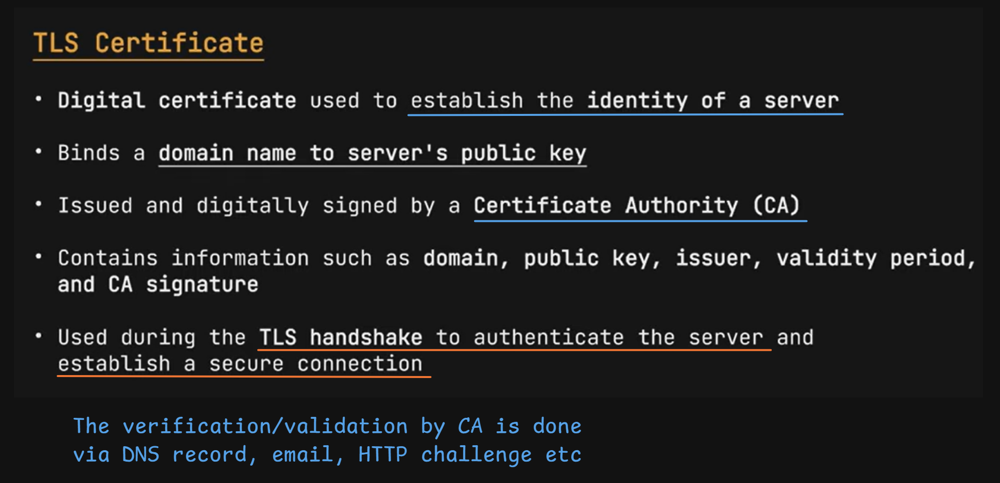
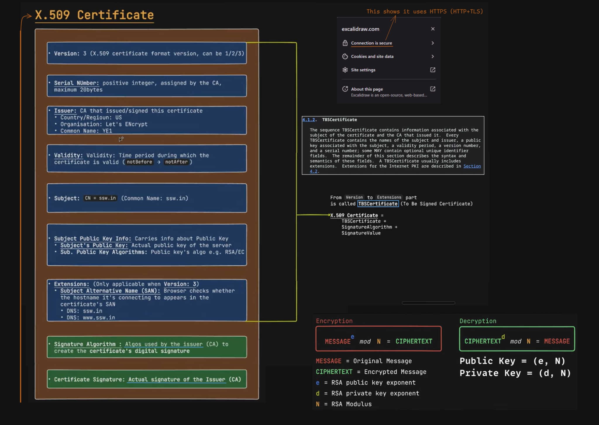
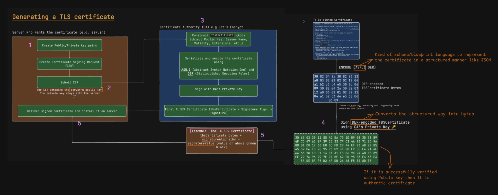
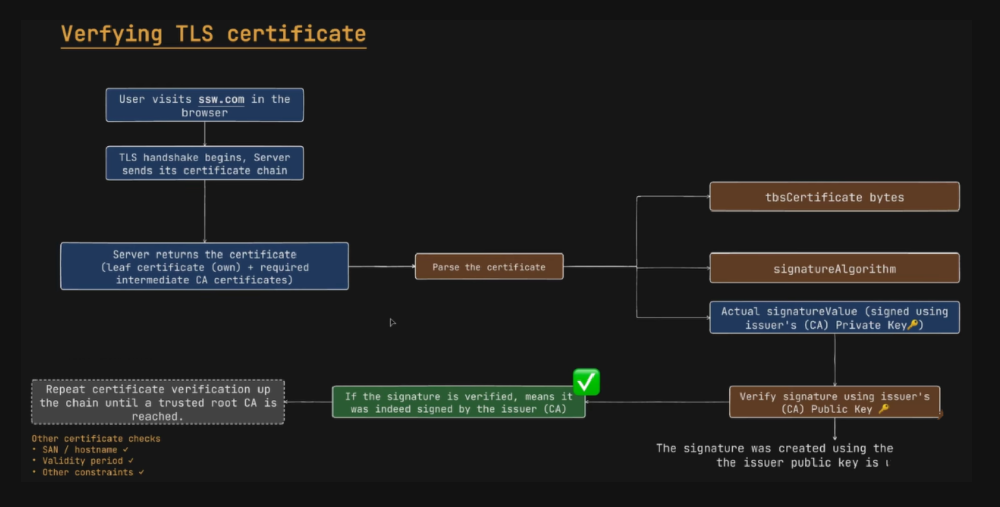
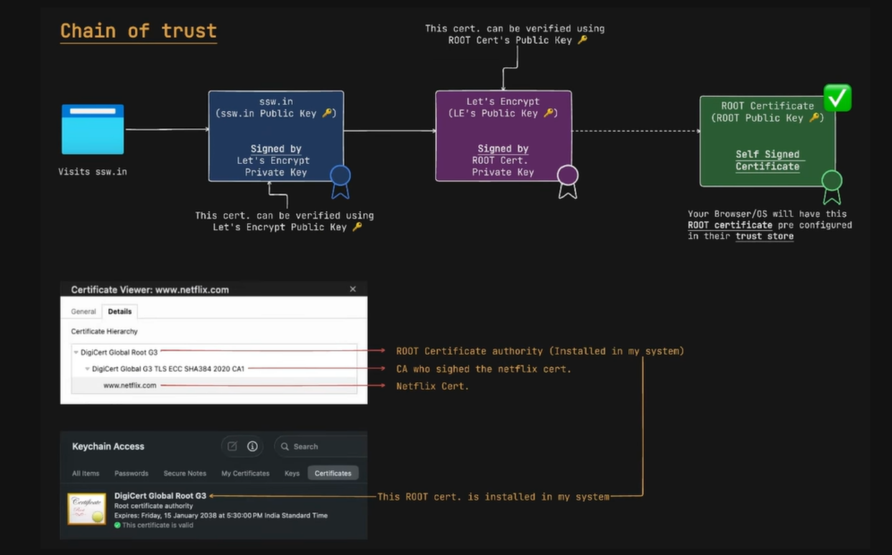

# TLS Certificates

## Purpose

Understand how TLS certificates establish a server's identity, how Certificate Authorities (CAs) issue them, and how browsers verify them before trusting a secure connection.

## 1. What is a TLS certificate?

A **TLS certificate** is a digitally signed document that binds an identity (usually a domain name) to a public key.

It helps a client verify that it is communicating with the server for the intended domain, rather than an impersonator.

A certificate typically contains:

- **Subject:** The identity the certificate represents.
- **Subject Alternative Name (SAN):** The DNS names or IP addresses covered by the certificate.
- **Subject Public Key Info:** The public key and its algorithm.
- **Issuer:** The CA that issued the certificate.
- **Validity period:** The `notBefore` and `notAfter` dates.
- **Serial number:** A unique identifier assigned by the issuing CA.
- **Signature algorithm:** The algorithm used by the issuer to sign the certificate.
- **Certificate signature:** The issuer's digital signature over the certificate data.

> [!IMPORTANT]
> A certificate does not contain the server's private key. The private key must remain secret and under the server operator's control. The certificate contains the corresponding public key.



## 2. X.509 certificate format

TLS certificates commonly use the **X.509 v3** certificate format.

At a high level, an X.509 certificate consists of three main parts:

1. **TBSCertificate (To Be Signed Certificate):** The certificate information that the issuer signs.
2. **Signature Algorithm:** Identifies the algorithm used to create the signature.
3. **Signature Value:** The CA's digital signature over the encoded TBSCertificate.

The TBSCertificate contains fields such as:

| Field | Purpose |
|---|---|
| Version | Identifies the X.509 certificate version |
| Serial Number | Unique number assigned by the issuer |
| Issuer | Identifies the issuing CA |
| Validity | Defines the certificate's validity period |
| Subject | Identifies the certificate's subject |
| Subject Public Key Info | Contains the public key and its algorithm |
| Extensions | Adds information such as SAN and key usage |

### Important extension: Subject Alternative Name (SAN)

The SAN extension specifies the hostnames or IP addresses for which the certificate is valid.

For example, a certificate might cover:

- `example.com`
- `www.example.com`

When a browser connects to `www.example.com`, it checks whether that hostname is covered by the certificate.

> [!NOTE]
> Modern hostname verification relies on the SAN extension. Do not assume that the Common Name (CN) alone is sufficient.



## 3. How is a TLS certificate issued?

A server operator cannot simply create a certificate and expect browsers to trust it. The certificate must be issued through a trusted CA, or another trust arrangement must be configured.

A simplified issuance process:

1. **Generate a key pair:** The server operator creates a public key and private key.
2. **Create a CSR:** A Certificate Signing Request contains the public key and requested certificate information.
3. **Submit the CSR:** The request is sent to a Certificate Authority.
4. **Validate domain control:** The CA verifies that the applicant controls the domain.
5. **Issue and sign the certificate:** The CA creates the certificate and signs its TBSCertificate using the CA's private key.
6. **Install the certificate:** The server configures the issued certificate and the required intermediate certificates.

### How does the CA verify domain control?

Common methods include:

- **DNS challenge:** The applicant publishes a specific DNS record.
- **HTTP challenge:** The applicant serves a specific token at a required URL.
- **Email-based validation:** Some certificate validation processes use approved domain-related email addresses.

These are examples of domain-control validation methods. The exact methods available depend on the CA and its issuance rules.

> [!IMPORTANT]
> The CSR contains the server's public key, not its private key. The private key stays with the server operator and must never be sent to the CA.



## 4. How does a browser verify a TLS certificate?

Suppose you visit:

`https://example.com`

During the TLS handshake, the server sends its certificate and, when needed, intermediate certificates.

The browser or client then performs certificate validation.

### Simplified validation workflow

1. **Receive the certificate chain:** The server provides its leaf certificate and the intermediate certificates needed to build a chain.
2. **Parse the certificate:** The client reads the certificate fields, extensions and signature information.
3. **Verify the issuer's signature:** The client uses the issuer's public key to verify the certificate's signature.
4. **Build the chain:** It repeats the process through the intermediate CA certificates until it reaches a trusted root CA.
5. **Check the hostname:** The requested domain must match a name in the certificate's SAN extension.
6. **Check validity and constraints:** The client checks the validity period, certificate constraints, key usage and other applicable requirements.

If the required checks succeed, the certificate can be accepted for that connection, subject to the client's validation policy.



> [!WARNING]
> A valid CA signature alone does not make a certificate trustworthy for every website. Hostname matching, validity, chain building and other validation requirements also matter.

## 5. Certificate Chain of Trust

Browsers and operating systems maintain a collection of trusted root certificates called a **trust store**.

A typical certificate chain looks like this:

```text
Trusted Root CA
      |
      | Signs
      v
Intermediate CA
      |
      | Signs
      v
Leaf Certificate
(example.com)
```

### 1. Root CA

- The top-level trust anchor in the certificate chain.
- Its certificate is generally self-signed.
- It is trusted because it is included in the client's configured trust store, not merely because it is self-signed.

### 2. Intermediate CA

- Issued and signed by a root CA or another CA above it in the chain.
- Used to issue leaf certificates.
- Helps keep the root CA's private key less exposed to routine certificate issuance.

### 3. Leaf Certificate

- The certificate presented for the website or service.
- Contains the website's identity and public key.
- Is generally issued by an intermediate CA.



### Example

When a browser visits `www.netflix.com`, it may build a chain similar to:

```text
DigiCert Root CA
       |
       v
DigiCert Intermediate CA
       |
       v
www.netflix.com Certificate
```

The exact chain can vary depending on the certificate, server configuration and client trust store.

> [!NOTE]
> Servers normally send the leaf certificate and the necessary intermediate certificates. The trusted root certificate is generally already available in the browser or operating system's trust store, so the server usually does not need to send it.

## 6. What does the certificate actually prove?

A certificate provides a CA-backed binding between an identity and a public key.

However, the certificate alone does not prove that the server currently possesses the corresponding private key.

During the TLS handshake, the server demonstrates possession of that private key through the protocol's authentication mechanism. For example, TLS 1.3 uses a `CertificateVerify` message to provide proof of possession.

The handshake also establishes the cryptographic keys used to protect application data.

This is how certificates contribute to secure HTTPS communication:

- **Authentication:** Helps the client verify the server's identity.
- **Key association:** Connects that identity to a public key.
- **Secure key establishment:** The TLS handshake establishes shared traffic keys.
- **Confidentiality and integrity:** TLS uses those traffic keys to protect data in transit.

## 7. Practical: Inspect a website's certificate

You can inspect a real website's certificate using OpenSSL.

### View the certificate chain

```bash
openssl s_client -connect example.com:443 -servername example.com -showcerts
```

### Inspect certificate details

```bash
openssl s_client -connect example.com:443 -servername example.com </dev/null 2>/dev/null | openssl x509 -noout -subject -issuer -dates -ext subjectAltName
```

Look for:

- `subject` — certificate subject
- `issuer` — issuing CA
- `notBefore` and `notAfter` — validity dates
- `X509v3 Subject Alternative Name` — covered hostnames

Try replacing `example.com` with another HTTPS website and compare the certificate details.

## Key Takeaways

- A TLS certificate binds a domain identity to a public key.
- X.509 v3 is the commonly used certificate format.
- A Certificate Authority validates domain control and signs certificates.
- The private key stays with the server; it is never included in the certificate.
- Browsers validate the certificate chain, hostname, validity period and other requirements.
- A chain of trust typically contains a leaf certificate, intermediate CA certificate(s), and a trusted root CA.
- The TLS handshake uses the certificate to authenticate the server and establish secure communication.

## References

1. [RFC 5280 — Internet X.509 Public Key Infrastructure Certificate and CRL Profile](https://datatracker.ietf.org/doc/html/rfc5280)
2. [RFC 8555 — Automatic Certificate Management Environment (ACME)](https://datatracker.ietf.org/doc/html/rfc8555)
3. [RFC 8446 — The Transport Layer Security (TLS) Protocol Version 1.3](https://datatracker.ietf.org/doc/html/rfc8446)
4. [OpenSSL Documentation — s_client](https://docs.openssl.org/master/man1/openssl-s_client/)
5. [OpenSSL Documentation — x509](https://docs.openssl.org/master/man1/openssl-x509/)

---

**Next topic:** [TLS 1.2 Handshake](./29-tls/tls-1.2-handshake/README.md)
