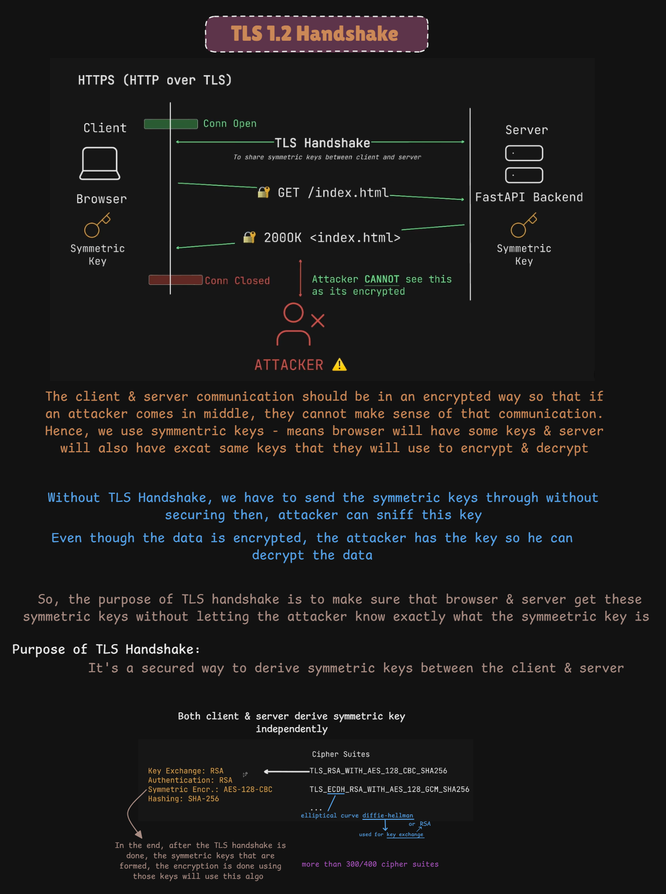
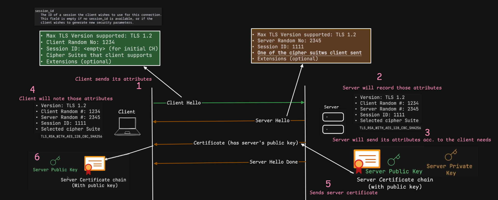
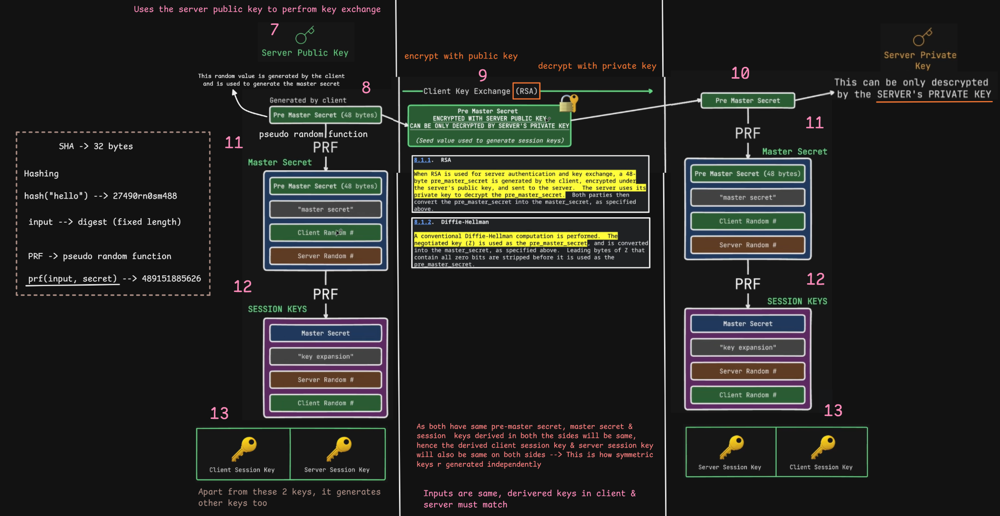
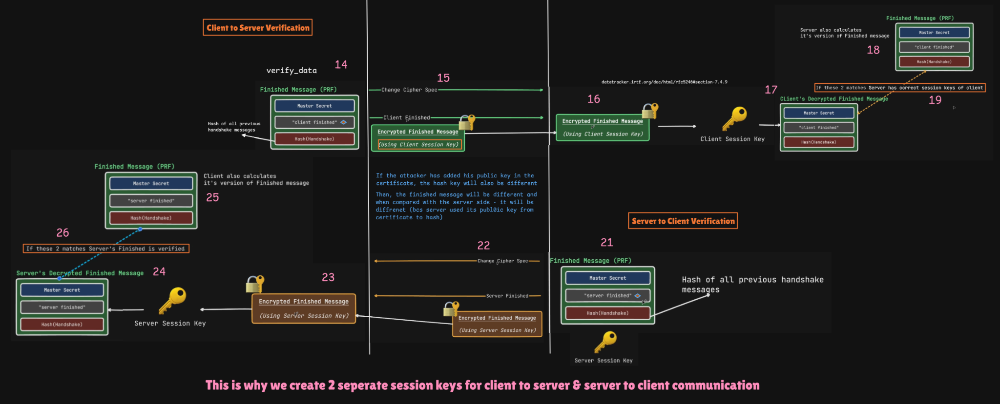

# TLS 1.2 Handshake

> **Section:** Computer Networking - [TLS and Security](https://youtu.be/x1AY140_JXE?si=nYh8SNW87cef-S_a)
>   
> **Learning objective:** Understand how a client and server negotiate TLS 1.2 parameters, authenticate the server, derive shared traffic keys, and verify that the handshake has not been tampered with.

[← Back to TLS](../README.md) · [← Back to Computer Networking Repository](../../../README.md)

---

## 1. Why does TLS need a handshake?

HTTPS is HTTP carried over a TLS-protected connection. Before the browser and server exchange protected application data, they need to establish security parameters.

The handshake is responsible for:

- **Negotiation:** agree on the TLS version and a mutually supported cipher suite.
- **Authentication:** normally authenticate the server using its certificate.
- **Key establishment:** establish shared secret material from which traffic keys are derived.
- **Handshake integrity:** verify that both sides have the same view of the handshake.

After the handshake, symmetric cryptography protects application data because it is much more efficient than public-key operations.

> [!IMPORTANT]
> The handshake does not simply send a symmetric key from the server to the browser. It establishes shared secret material securely; both sides derive matching traffic keys from it.

## 2. The high-level picture

The client and server must arrive at matching key material without exposing it to an on-path attacker. The exact key-establishment steps depend on the negotiated key-exchange method.

## 3. TLS 1.2 full handshake: message flow

The following is a simplified full handshake. It illustrates the common certificate-authenticated flow; optional messages and exact message order can vary with the cipher suite and extensions.

### Step 1 — ClientHello

The client starts the handshake and sends information such as:

- Supported TLS versions (in TLS 1.2, the client indicates its supported version).
- Client random value.
- Session ID or session-resumption information.
- Supported cipher suites.
- Extensions, such as Server Name Indication (SNI), supported groups and signature algorithms.

### Step 2 — ServerHello

The server selects parameters for the connection and responds with:

- The negotiated TLS version.
- Server random value.
- Session ID.
- The selected cipher suite.
- Any negotiated extensions.

The client checks that the selected parameters are acceptable and were among the options it offered.

### Step 3 — Certificate

The server sends its certificate chain. The leaf certificate identifies the server's hostname and contains the server's public key.

The client validates the certificate chain and checks, among other things:

- The requested hostname matches a name in the certificate's Subject Alternative Name (SAN).
- The certificate is within its validity period.
- The chain leads to a trusted root CA.
- The certificate's usage and signature constraints are acceptable.

A certificate is not itself the symmetric session key. It supports authentication and, depending on the key-exchange method, may provide a public key used in the handshake.

### Step 4 — Key-exchange messages

The messages depend on the negotiated cipher suite.

- With **ECDHE**, the server sends ephemeral Diffie–Hellman parameters and signs them; the client sends its own ephemeral key share in `ClientKeyExchange`. Both sides independently calculate the same shared secret.
- With **legacy RSA key exchange**, the client generates a pre-master secret and encrypts it with the server's certificate public key. The server decrypts it with its private key. This is the older RSA key-transport flow shown in the supplied diagram.

The server may send `ServerKeyExchange` when the selected key-exchange method requires it, followed by `ServerHelloDone` in the classic full handshake.

> [!WARNING]
> Do not treat the RSA key-exchange example as the modern default. `TLS_RSA_*` cipher suites do not provide forward secrecy and are obsolete for modern deployments. TLS 1.2 deployments should use ephemeral key exchange such as ECDHE.

## 4. From shared secret to traffic keys

TLS 1.2 uses the negotiated cipher suite's key-establishment method and the TLS pseudo-random function (PRF) to derive key material.

In the classic TLS 1.2 key schedule:

1. The client and server obtain the same **pre-master secret** (or equivalent shared secret from the key-exchange method).
2. They combine it with the client and server random values through the TLS PRF to derive the **master secret**.
3. They use the master secret and random values to derive the **key block**.
4. The key block supplies the required client/server write keys and, depending on the cipher suite, IV or other keying material.

Both sides perform the derivation independently. Matching inputs and the same negotiated parameters produce matching traffic keys.

The client-to-server and server-to-client traffic keys are separate. This prevents both directions from reusing the same traffic key.

## 5. ChangeCipherSpec and Finished

After deriving the keys:

1. The client sends `ChangeCipherSpec` to signal that subsequent records will use the negotiated protection state.
2. The client sends an encrypted `Finished` message.
3. The server verifies the client's Finished message.
4. The server sends its own `ChangeCipherSpec`.
5. The server sends its encrypted `Finished` message.
6. The client verifies the server's Finished message.

The Finished message contains verification data derived from the master secret and a hash of the handshake transcript. It confirms that the peer derived the expected key material and that the handshake messages have not been altered unnoticed.

Once the handshake completes successfully, the parties can exchange protected application data, such as HTTP requests and responses.

## 6. Cipher suites: read the name correctly

A TLS 1.2 cipher-suite name describes a set of cryptographic choices. For example:

`TLS_ECDHE_RSA_WITH_AES_128_GCM_SHA256`

- `ECDHE` — ephemeral elliptic-curve Diffie–Hellman key exchange.
- `RSA` — RSA is used for server authentication/signatures.
- `AES_128_GCM` — authenticated symmetric encryption for record data.
- `SHA256` — hash function used by the suite's TLS 1.2 PRF construction.

The exact interpretation depends on the suite. In particular, `RSA` in an ECDHE-RSA suite means RSA authentication; it does **not** mean RSA encrypts the pre-master secret.

The screenshot also shows `TLS_RSA_WITH_AES_128_CBC_SHA256`. This is a legacy RSA key-transport suite using CBC-mode encryption. It is useful to recognize historically, but it should not be presented as a recommended modern configuration.

## 7. Important distinctions

| Concept | What it does |
|---|---|
| Certificate | Binds a server identity (such as a hostname) to a public key and is signed by an issuer |
| Public/private key pair | Supports authentication and/or key establishment, depending on the algorithm |
| Key exchange | Establishes shared secret material |
| Master secret | Root secret used by the TLS 1.2 key schedule |
| Traffic/session keys | Symmetric keys used to protect records in each direction |
| PRF | Derives key material from the secret and handshake random values |
| Finished | Verifies the handshake transcript and possession of the negotiated secret |

## 8. TLS 1.2 vs TLS 1.3 — preview

TLS 1.3 simplifies the handshake, removes several legacy algorithms and uses ephemeral (EC)DHE or PSK-based key establishment. It does not use the TLS 1.2 RSA key-transport mechanism. TLS 1.3 also encrypts more of the handshake after the ServerHello.

Study TLS 1.3 separately rather than assuming the TLS 1.2 message sequence applies unchanged.

## 9. Key takeaways

- TLS protects application traffic after a handshake establishes security parameters and traffic keys.
- The client and server negotiate a cipher suite and exchange random values.
- The server certificate authenticates the server; the client validates the certificate chain and hostname.
- Key establishment varies by cipher suite. ECDHE is the modern TLS 1.2 choice; RSA key transport is legacy.
- Both endpoints derive traffic keys independently.
- `ChangeCipherSpec` and `Finished` mark and verify the transition to protected communication.
- Separate traffic keys protect client-to-server and server-to-client data.

## References

- [RFC 5246 — The Transport Layer Security (TLS) Protocol Version 1.2](https://datatracker.ietf.org/doc/html/rfc5246)
  - [Section 7.4 — Handshake Protocol](https://datatracker.ietf.org/doc/html/rfc5246#section-7.4)
  - [Section 7.4.9 — Finished](https://datatracker.ietf.org/doc/html/rfc5246#section-7.4.9)
  - [Section 6.3 — Key Calculation](https://datatracker.ietf.org/doc/html/rfc5246#section-6.3)
- [RFC 8446 — The Transport Layer Security (TLS) Protocol Version 1.3](https://www.rfc-editor.org/rfc/rfc8446)

## Next topic

[ TLS 1.3 Handshake ](../tls-1.3-handshake/README.md)

