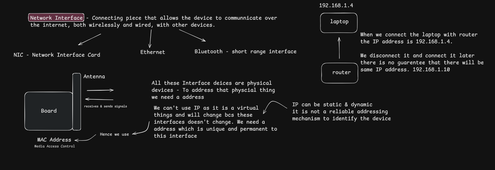
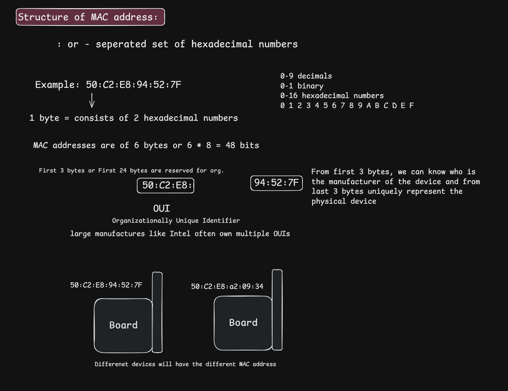
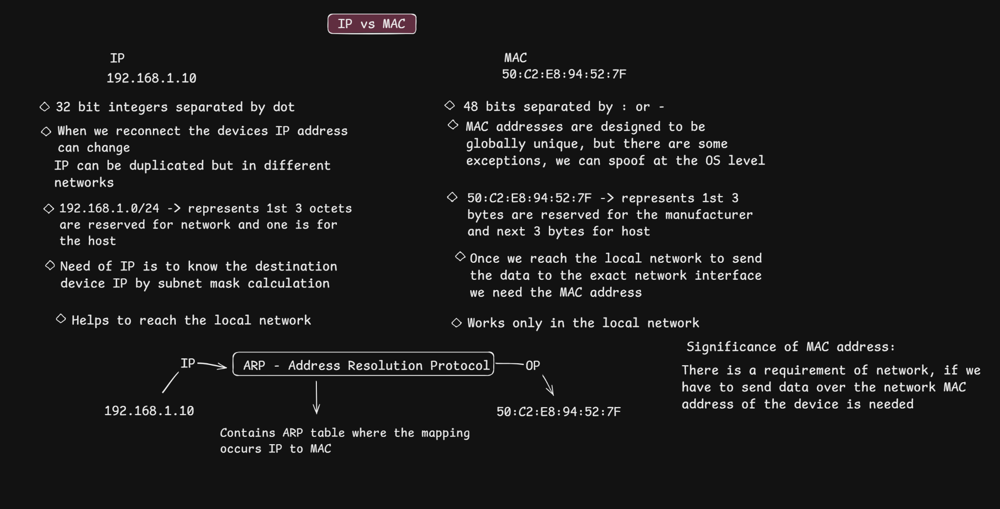

# Network Inference, MAC Addresses - Structure and IP vs. MAC

> [!NOTE]
> **Section:** Computer Networking — [Chai aur Networking](https://youtu.be/jKWlJPpkp9o?si=OfX5f-Y3lhJOMpIT)
>
> **Learning objective:** Understand what a MAC address identifies, how it is structured, how it differs from an IP address, and how both work together during network communication.

[← Back to Computer Networking Repository](https://github.com/Priya200227/computer-networking)

---

## 1. Network Interfaces

A **network interface** is the point through which a device connects to and communicates with a network.

Examples:
- Wi-Fi
- Ethernet
- Virtual network interfaces

A device can have multiple network interfaces, and each interface can have its own MAC address.



> [!NOTE]
> A MAC address identifies a network interface on a local link, not necessarily the entire physical device. It can also be changed or randomized.

## 2. What Is a MAC Address?

A **Media Access Control (MAC) address** is a link-layer address used to identify a network interface for communication over a local network, such as Ethernet or Wi-Fi.

A common Ethernet/Wi-Fi MAC address is **48 bits (6 bytes)** long.

Example:

```text
50:C2:E8:94:52:7F
```

Each pair of hexadecimal digits represents one byte (8 bits).

> [!IMPORTANT]
> A MAC address is used for **local-link frame delivery**. It is not normally carried unchanged from the source device to the final destination across routed networks.

## 3. Structure of a MAC Address

A conventional 48-bit MAC address consists of six hexadecimal groups:

```text
50:C2:E8:94:52:7F
```

| Property | Value |
|---|---|
| Total length | 48 bits |
| Number of bytes | 6 |
| Hexadecimal digits per group | 2 |
| Bits per group | 8 |

### OUI and Interface-Specific Portion

A commonly used representation divides a globally administered MAC address into two parts:

```text
50:C2:E8 : 94:52:7F
└── OUI ──┘ └ Interface-specific portion 
```

- **First 24 bits — OUI:** Organizationally Unique Identifier, associated with an organization.
- **Remaining 24 bits:** Used to distinguish addresses within that allocation.



> [!NOTE]
> This is a conventional allocation model. Locally administered or randomized MAC addresses may not identify the device manufacturer.

## 4. IP Address vs. MAC Address

IP addresses and MAC addresses operate at different networking layers and serve different purposes.

| Feature | IP Address | MAC Address |
|---|---|---|
| Layer | Network (Layer 3) | Data Link (Layer 2) |
| Purpose | Identifies IP destinations and supports routing | Delivers frames over a local link |
| Size | IPv4: 32 bits; IPv6: 128 bits | Commonly 48 bits |
| Example | `192.168.1.10` | `50:C2:E8:94:52:7F` |
| Scope | Used across routed networks | Used on the current local link |
| Can change? | Yes | Yes |

### Remember the Difference

- **IP address:** Where should the packet go?
- **MAC address:** Which interface should receive the frame on the current local link?

> [!IMPORTANT]
> Routers use destination IP addresses to forward packets. They use link-layer addresses to deliver frames to the next hop. MAC addresses normally change at each routed link, while IP addresses generally remain the same during ordinary routing.

## 5. How IP and MAC Addresses Work Together

Consider a laptop with IPv4 address `192.168.1.4/24` communicating with another device.

### Case A: Destination on the Same Subnet

Destination IP: `192.168.1.2`

1. The laptop checks whether the destination belongs to its local subnet.
2. It determines that both devices are on the same subnet.
3. It needs the destination device's MAC address.
4. If the mapping is not cached, it uses **ARP (Address Resolution Protocol)** to discover the MAC address.
5. It sends the frame over the local network to the destination interface.

### Case B: Destination on a Different Subnet

Destination IP: `192.168.2.4`

1. The laptop determines that the destination is outside its local subnet.
2. It selects a route, typically through the default gateway.
3. If necessary, it uses ARP to discover the gateway's MAC address.
4. It sends the frame to the gateway's MAC address.
5. The router forwards the IP packet toward the destination network, creating a new link-layer frame for the next link.



> [!IMPORTANT]
> For a remote destination, the laptop does **not** ARP for the remote device's MAC address. It resolves the MAC address of its local next hop, usually the default gateway.
>
> The IP packet retains its final destination IP during ordinary routing, while the link-layer addresses change from one routed link to the next.

## 6. ARP: Address Resolution Protocol

**ARP** discovers the MAC address associated with an IPv4 address on the local network.

Example:

```text
Known:  IPv4 address = 192.168.1.2
Need:   Corresponding MAC address

ARP:    Who has 192.168.1.2?

Reply:  The device responds with its MAC address.
```

The discovered mapping can be stored temporarily in the ARP cache.

> [!TIP]
> **IPv4 uses ARP** for local-link address resolution. **IPv6 uses Neighbor Discovery Protocol (NDP)** instead.

---

## Key Takeaways

| Concept | Remember |
|---|---|
| Network interface | A device's connection point to a network |
| MAC address | Link-layer address used for local frame delivery |
| IP address | Network-layer address used for routing |
| Same subnet | Resolve the destination's MAC address and send locally |
| Different subnet | Resolve the next-hop MAC address and send the frame to the router |
| ARP | Resolves IPv4 addresses to link-layer addresses on the local link |

**Core idea:** IP addressing helps determine where a packet needs to go; MAC addressing helps deliver the frame over the current local link.

## References

- [What Is a MAC Address? Understanding Its Structure and Purpose](https://youtu.be/jKWlJPpkp9o?si=OfX5f-Y3lhJOMpIT)
- [IP vs. MAC Addresses](https://youtu.be/sMDYh-II22Q?si=v8xHmElJn6yng7PP)

---

**Next:** [ARP](../07-arp/README.md)
