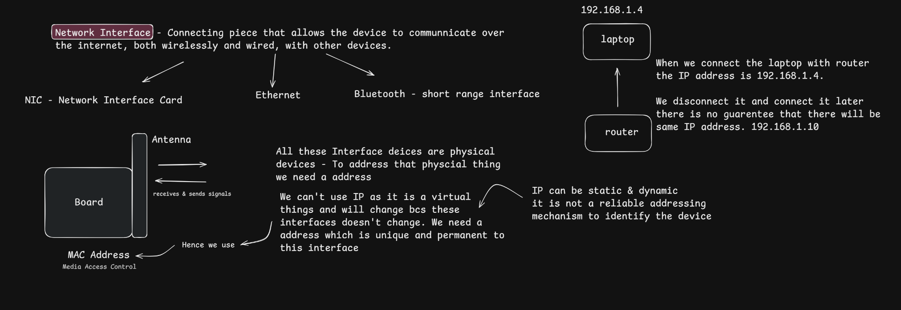
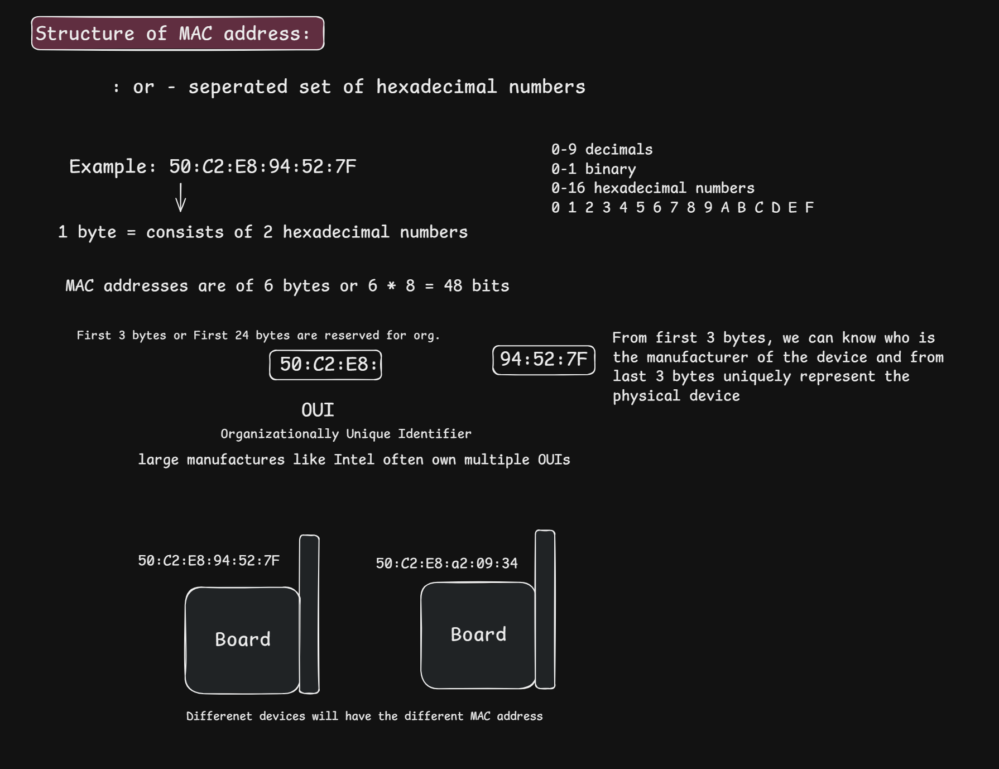
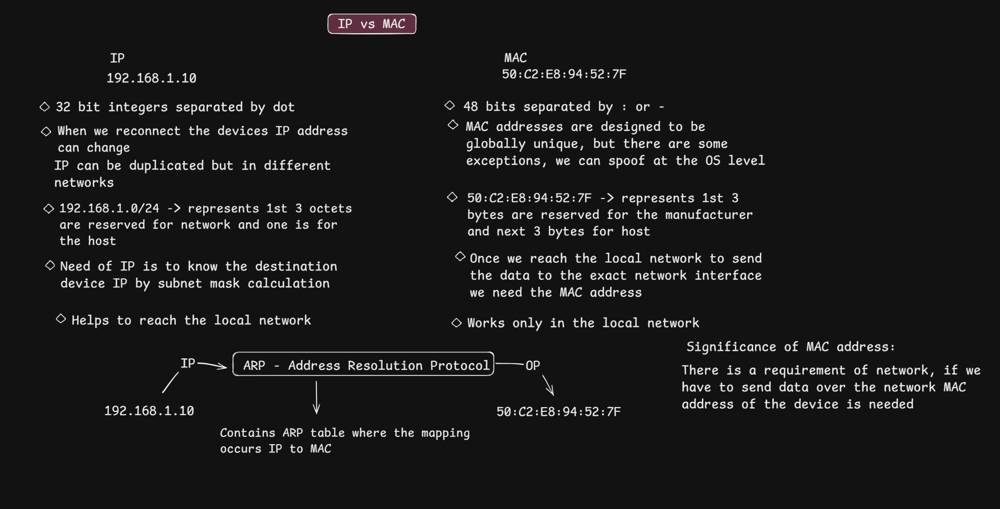

# MAC Addresses: Structure, Purpose, and IP vs. MAC

> **Learning goal:** Understand what a MAC address identifies, how it is written, how it differs from an IP address, and why local-network delivery often needs both IP and MAC addressing.

## Contents

- [1. What is a network interface?](#1-what-is-a-network-interface)
- [2. What is a MAC address?](#2-what-is-a-mac-address)
- [3. Structure of a 48-bit MAC address](#3-structure-of-a-48-bit-mac-address)
- [4. IP address vs. MAC address](#4-ip-address-vs-mac-address)
- [5. How IP and MAC work together](#5-how-ip-and-mac-work-together)
- [6. Where ARP fits in](#6-where-arp-fits-in)
- [7. Important corrections and nuances](#7-important-corrections-and-nuances)
- [8. Practical commands](#8-practical-commands)
- [9. Quick revision](#9-quick-revision)
- [10. Knowledge check](#10-knowledge-check)
- [References](#references)

---

## 1. What is a network interface?

A **network interface** is the point through which a device or virtual system connects to a network. Examples include:

- A Wi-Fi interface
- An Ethernet interface
- A virtual network interface used by a virtual machine or container

A **network interface card (NIC)** is hardware that provides network connectivity. In everyday usage, “NIC” can refer to the physical adapter, while *network interface* can also refer to the logical interface exposed by the operating system.

A laptop can have several interfaces—for example, Wi-Fi, Ethernet, VPN, and virtual interfaces. Each interface may have its own link-layer address. Therefore, it is more accurate to say that a MAC address identifies a **network interface on a local link**, rather than treating it as a permanent identity for the entire device.

### Diagram from the study notes



The diagram introduces an important distinction: a device's IP address can change when it reconnects to a network, while its interface's MAC address is normally configured independently of that IP address. However, MAC addresses are not guaranteed to be permanent or unchangeable; see [Important corrections and nuances](#7-important-corrections-and-nuances).

---

## 2. What is a MAC address?

A **Media Access Control (MAC) address** is a link-layer address used to identify a network interface for communication on a local network segment, such as an Ethernet LAN or Wi-Fi network.

A common Ethernet/Wi-Fi MAC address format is **48 bits (6 bytes)**, usually displayed as six two-digit hexadecimal groups, for example:

```text
50:C2:E8:94:52:7F
```

The same address may be written with hyphens:

```text
50-C2-E8-94-52-7F
```

The colon- and hyphen-separated forms are two common textual representations of the same 48-bit value.

### Why is it needed?

When two devices communicate over a local link, the sender needs link-layer addressing to deliver a frame to the appropriate interface. For IPv4 over Ethernet, the sender commonly uses ARP to discover the MAC address associated with the relevant local IPv4 next hop.

**Key distinction:** An IP address helps identify the destination at the network layer and supports routing between networks. A MAC address is used for delivery over the current local link. A MAC address is not normally carried unchanged end-to-end across the Internet.

---

## 3. Structure of a 48-bit MAC address

### 3.1 Hexadecimal representation

Hexadecimal (base 16) uses these symbols:

```text
0 1 2 3 4 5 6 7 8 9 A B C D E F
```

One hexadecimal digit represents 4 bits. Two hexadecimal digits represent 8 bits, or **one byte**.

For the example address:

```text
50:C2:E8:94:52:7F
```

- There are 6 groups.
- Each group contains 2 hexadecimal digits (1 byte).
- Total length: 6 bytes × 8 bits = **48 bits**.

### 3.2 OUI and interface-specific portion

For a conventional globally administered 48-bit MAC address, the address is commonly described as:

```text
50:C2:E8 : 94:52:7F
└── OUI ──┘ └ interface-specific portion ┘
```

- The first 24 bits are commonly associated with an organizational assignment, historically called the **Organizationally Unique Identifier (OUI)**.
- The remaining 24 bits are assigned/managed to distinguish addresses within that allocation.

This is a useful introductory model, but it is not a universal guarantee that the first three bytes always reveal the manufacturer. Address allocation formats vary, and locally administered or randomized addresses may not map to a vendor in that way.

### Diagram from the study notes



### 3.3 Two address bits worth knowing

The first octet contains two meaningful bits:

- **I/G bit (Individual/Group):** distinguishes an individual address from a group address, such as multicast.
- **U/L bit (Universal/Local):** indicates whether the address is universally or locally administered.

This matters because a MAC address may be **locally administered** by an operating system or administrator. Wi-Fi devices may use MAC randomization for privacy, so the address seen by a network can differ from the hardware-assigned address or from the address used on another network.

---

## 4. IP address vs. MAC address

An IP address and a MAC address solve different problems. They are not interchangeable.

| Feature | IP address | MAC address |
|---|---|---|
| Main role | Network-layer addressing and routing | Link-layer delivery on the local network segment |
| Common version/size | IPv4: 32 bits; IPv6: 128 bits | Common Ethernet/Wi-Fi address: 48 bits |
| Example | `192.168.1.10` | `50:C2:E8:94:52:7F` |
| Layer | Internet/network layer (Layer 3 in the common OSI model) | Data-link layer (Layer 2 in the common OSI model) |
| Scope | Used to identify an IP endpoint/interface in an IP network and route packets toward it | Used to deliver a frame on a local link; routers use link-layer addressing separately on each link |
| Can it change? | Yes. It may be assigned statically or dynamically and can change when network configuration changes | Yes. It can be changed, overridden, virtualized, or randomized; do not assume it is permanent |
| Used by routers? | Routers examine the destination IP to decide where to forward a packet | A router uses a link-layer destination address for the next hop on each directly connected link |
| Usually visible end-to-end? | The source and destination IPs generally remain in the packet across routed hops, though NAT or other mechanisms can alter them | No. The frame's source and destination MAC addresses are normally rewritten for each link/hop |

### Mental model

- **IP address:** Which IP destination should this packet reach, and how can routers forward it toward that network?
- **MAC address:** Which interface should receive this frame on the current local link?

An IP address is not merely “virtual,” and a MAC address is not guaranteed to be a permanent hardware identity. Both are addresses used by different networking layers, with different scopes and purposes.

---

## 5. How IP and MAC work together

Consider a laptop with IPv4 address `192.168.1.4` that wants to send data to a mobile device at `192.168.1.2`. Suppose both devices use the subnet mask `255.255.255.0` (`/24`).

### Case A: The destination is on the same subnet

1. The laptop compares the destination IP with its own network configuration using the subnet mask.
2. It determines that `192.168.1.2` is on the same IPv4 subnet as `192.168.1.4`.
3. To send an Ethernet/Wi-Fi frame, it needs the destination interface's MAC address.
4. If the mapping is not already cached, it uses **ARP** to resolve `192.168.1.2` to a MAC address.
5. It sends the frame on the local link. The IP packet inside it is addressed to `192.168.1.2`.

### Case B: The destination is on another subnet

Suppose the laptop wants to reach `192.168.2.4` instead. With a local configuration of `192.168.1.4/24`, that destination is outside its local subnet.

1. The laptop determines that the destination IP is not on its directly connected subnet.
2. It selects a route—typically the **default gateway** when no more-specific route applies.
3. It resolves the gateway's local interface MAC address (using ARP for IPv4 on Ethernet/Wi-Fi, if needed).
4. It sends a frame addressed to the gateway's MAC address. The IP packet's destination remains `192.168.2.4`.
5. The router examines the destination IP and forwards the packet toward the next network. On the next link, the router creates a new link-layer frame using the appropriate next-hop MAC address.

**Important:** For a remote destination, the laptop does not ARP for the remote host's MAC address across the Internet. ARP is local-link resolution.

### Diagram from the study notes



---

## 6. Where ARP fits in

**Address Resolution Protocol (ARP)** is used on IPv4 local networks to discover the link-layer address associated with an IPv4 address on the local link.

A simplified example:

```text
Known:   destination IPv4 address = 192.168.1.2
Needed:  destination MAC address
Action:  ARP asks on the local network, in effect,
         “Who has 192.168.1.2?”
Result:  the device using that IPv4 address can reply with its MAC address
Cache:   the mapping may be stored temporarily in an ARP cache
```

ARP does **not** translate every IP address anywhere on the Internet into a MAC address. It resolves IPv4-to-link-layer mappings on the local link. When the destination is remote, a host generally resolves the MAC address of its next hop (often the default gateway), not the remote destination.

For IPv6, address resolution uses **Neighbor Discovery Protocol (NDP)** rather than ARP.

---

## 7. Important corrections and nuances

These distinctions make the notes technically more precise:

1. **A MAC address does not necessarily identify the entire physical device.** It is associated with a network interface; one device can have multiple interfaces and multiple addresses.
2. **A MAC address is not guaranteed to be permanent.** Administrators and software can override it, virtual interfaces can have configured addresses, and Wi-Fi MAC randomization is common.
3. **The first three bytes do not always reliably identify a manufacturer.** Vendor lookup is most meaningful for appropriate globally administered addresses and registered assignments.
4. **IP addresses are not simply “virtual.”** They are logical network-layer addresses assigned to interfaces or endpoints. Their assignment can be static, dynamic, or otherwise configured.
5. **A router does not normally forward an Ethernet frame unchanged end-to-end.** It removes the incoming link-layer encapsulation and forwards the IP packet in a new frame appropriate for the next link. Layer-2 addresses are hop-by-hop; IP addressing is generally end-to-end, subject to mechanisms such as NAT.
6. **Same subnet does not mean “no network equipment is involved.”** Devices may communicate through a switch or wireless access point. The key point is that they do not need to route the packet through a Layer-3 gateway when the destination is on the same subnet and directly reachable.
7. **ARP is for IPv4.** IPv6 uses Neighbor Discovery.

---

## 8. Practical commands

Use these commands on your own machine to inspect network interfaces and addresses. Output varies by operating system.

### Windows

```powershell
ipconfig /all
getmac /v
arp -a
```

### Linux

```bash
ip addr
ip link
ip neigh
```

### macOS

```bash
ifconfig
arp -a
networksetup -listallhardwareports
```

What to look for:

- The interface name (Wi-Fi, Ethernet, etc.)
- Its IP address and subnet prefix/mask
- Its link-layer address (often labelled `Physical Address`, `ether`, or `Wi-Fi Address`)
- Neighbor/ARP cache entries, when available

Avoid publishing your network details unnecessarily; these commands can reveal local network configuration.

---

## 9. Quick revision

- A **network interface** connects a device or virtual system to a network.
- A common Ethernet/Wi-Fi **MAC address** is 48 bits, displayed as six hexadecimal bytes.
- The first 24 bits of many globally administered MAC addresses correspond to an organizational assignment, but local/randomized addresses complicate vendor identification.
- **IP addresses** support network-layer addressing and routing.
- **MAC addresses** support link-layer delivery on the current local network segment.
- On the same subnet, a host generally resolves the destination's MAC address.
- For a destination on another subnet, a host typically sends the frame to its default gateway's MAC address while retaining the remote destination IP in the IP packet.
- **ARP** resolves IPv4-to-link-layer mappings on a local link; **IPv6 uses NDP**.
- MAC addresses can change or be randomized; they are not guaranteed permanent device identifiers.

---

## 10. Knowledge check

Try to answer these without looking at the notes:

1. Why does a laptop need both an IP address and a MAC address?
2. How many bits and bytes are in a common 48-bit MAC address?
3. What does one hexadecimal digit represent in binary?
4. What is the difference between an IP packet's destination address and an Ethernet frame's destination address?
5. If a laptop sends data to a host on another subnet, whose MAC address does it normally need for the first local frame?
6. Does ARP discover the MAC address of a server anywhere on the Internet? Why or why not?
7. Why is it inaccurate to say that a MAC address is always permanent and uniquely identifies a physical device?
8. What protocol performs the corresponding neighbor address resolution for IPv6?

<details>
<summary><strong>Show concise answers</strong></summary>

1. IP supports logical addressing/routing; MAC supports delivery over the current local link.
2. 48 bits = 6 bytes.
3. Four bits.
4. The IP destination identifies the IP destination; the frame destination identifies the next interface on the current link.
5. Usually the default gateway's local interface MAC address, assuming the normal route through that gateway.
6. No. ARP is local-link IPv4 resolution; for a remote destination the host resolves the next hop.
7. Addresses can be overridden, randomized, virtualized, and multiple interfaces can exist on one device.
8. Neighbor Discovery Protocol (NDP).

</details>

---

## References

- **RFC 826 — An Ethernet Address Resolution Protocol:** https://www.rfc-editor.org/rfc/rfc826.html
- **RFC 894 — A Standard for the Transmission of IP Datagrams over Ethernet Networks:** https://www.rfc-editor.org/rfc/rfc894.html
- **RFC 791 — Internet Protocol (IPv4):** https://www.rfc-editor.org/rfc/rfc791.html
- **RFC 4861 — Neighbor Discovery for IP version 6 (IPv6):** https://www.rfc-editor.org/rfc/rfc4861.html
- **IEEE Registration Authority — MAC address blocks and identifiers:** https://standards.ieee.org/products-programs/regauth/
- **Apple Platform Security — Private Wi-Fi addresses:** https://support.apple.com/en-us/102509

---

## Next topic

Continue with **IP vs. MAC addressing and ARP in more depth**. Focus on tracing what happens to the IP packet and the link-layer frame when a device communicates locally versus across a router.

