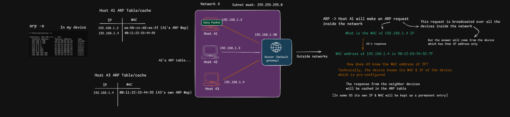

# Address Resolution Protocol (ARP)

> **Purpose:** Understand how a device on an IPv4 local network discovers the link-layer (MAC) address associated with a local IPv4 address, and how that mapping is temporarily stored in an ARP cache.

[← Back to Repository](https://github.com/Priya200227/computer-networking) 

---

## 1. Why ARP Is Needed

IPv4 and MAC addresses solve different addressing problems:

- **IPv4 address:** identifies the IP endpoint used for network-layer delivery.
- **MAC address:** identifies a network interface on the local link for link-layer delivery, such as Ethernet or Wi-Fi LAN communication.
- **ARP (Address Resolution Protocol):** lets a host discover the MAC address associated with an IPv4 address on the local link.

For example, suppose Host A1 wants to send an IP packet to Host A3:

| Device | IPv4 address | Example MAC address |
|---|---|---|
| Host A1 | `192.168.1.2` | `AA:BB:CC:DD:EE:02` |
| Host A2 | `192.168.1.3` | `AA:BB:CC:DD:EE:03` |
| Host A3 | `192.168.1.4` | `50:C2:E8:94:52:7F` |
| Router's LAN interface | `192.168.1.1` | `AA:BB:CC:DD:EE:01` |

The MAC addresses above are illustrative except for the Host A3 value shown in the lesson notes. A device may already have the required mapping in its ARP cache. If it does not, it can use ARP to ask the local network.

**Key idea:** ARP does not discover an IP address from a MAC address. In ordinary IPv4 ARP resolution, the host already knows the target IPv4 address and is trying to learn its link-layer address.

## 2. What the Diagram Shows



The lesson diagram illustrates these ideas:

1. Host A1 (`192.168.1.2`) wants to send data to Host A3 (`192.168.1.4`).
2. Host A1 needs a destination MAC address to construct the local link-layer frame.
3. If the mapping is not already cached, Host A1 broadcasts an ARP request on the local network asking who owns `192.168.1.4`.
4. Host A3 recognizes its own IPv4 address and sends an ARP reply containing its MAC address.
5. Host A1 can cache the mapping and use it to send the frame to Host A3.
6. Other hosts may receive the broadcast request, but the host whose IPv4 address matches the target is the one expected to answer.

The diagram also shows an `arp -a` command and example ARP-cache tables. These are examples of how a host can display IP-to-MAC mappings it has learned.

> **Important:** An ARP request is broadcast only on the relevant local Layer 2 broadcast domain; routers do not forward ordinary ARP broadcasts to other IP networks.

## 3. How ARP Works: Step by Step

Assume Host A1 (`192.168.1.2/24`) wants to send an IP packet to Host A3 (`192.168.1.4/24`).

### Step 1 — Check the ARP cache

Host A1 checks its local ARP cache for an entry mapping `192.168.1.4` to a MAC address.

- **Entry exists and is usable:** the host can use the cached mapping.
- **Entry is missing or needs refreshing:** the host needs to resolve the address.

### Step 2 — Broadcast an ARP request

Host A1 sends an ARP request asking, in effect:

> “Who has IPv4 address `192.168.1.4`? Tell `192.168.1.2`.”

For Ethernet, the request is carried in a broadcast frame addressed to `FF:FF:FF:FF:FF:FF`. Devices in that Layer 2 broadcast domain can receive it.

The request includes the sender's protocol and hardware addresses and the target protocol address being queried.

### Step 3 — The target host replies

Host A3 sees that the requested IPv4 address is its own. It sends an ARP reply that communicates:

> “`192.168.1.4` is at `50:C2:E8:94:52:7F`.”

The ARP reply is normally unicast to the requester, Host A1, rather than broadcast to every device.

### Step 4 — Cache the mapping

Host A1 records the learned IPv4-to-MAC mapping in its ARP cache, subject to the operating system's cache rules and aging behavior.

### Step 5 — Send the data frame

Host A1 can now encapsulate the IP packet in a link-layer frame addressed to Host A3's MAC address.

Conceptually:

```text
Ethernet/Wi-Fi link-layer frame
┌──────────────────────────────────────────────────────────────┐
│ Destination MAC: Host A3's MAC address                        │
│ Source MAC:      Host A1's MAC address                        │
│ Payload:         IP packet (source 192.168.1.2,               │
│                  destination 192.168.1.4)                     │
└──────────────────────────────────────────────────────────────┘
```

The MAC addresses belong to the local link-layer delivery. The IP packet retains its source and destination IP addresses during ordinary local delivery.

## 4. ARP Request vs. ARP Reply

| Property | ARP request | ARP reply |
|---|---|---|
| Purpose | Ask which link-layer address corresponds to an IPv4 address | Provide the mapping |
| Typical Ethernet destination | Broadcast `FF:FF:FF:FF:FF:FF` | Unicast to the requester |
| Who receives it? | Devices in the local Layer 2 broadcast domain can receive it | Normally the requesting host |
| Example | “Who has `192.168.1.4`?” | “`192.168.1.4` is at `50:C2:E8:94:52:7F`.” |

This is the typical exchange for ordinary ARP resolution. ARP also has other message uses and implementation details, but the request/reply flow is the core concept to learn first.

## 5. The ARP Cache

An **ARP cache** is a temporary table of IPv4-to-link-layer address mappings maintained by a host. It avoids sending an ARP request every time the host needs to communicate with the same local IPv4 destination.

Example (illustrative):

| IPv4 address | MAC address | Meaning |
|---|---|---|
| `192.168.1.2` | `AA:BB:CC:DD:EE:02` | Host A1's own interface information may be represented by the OS in other tables; not necessarily learned through ARP |
| `192.168.1.4` | `50:C2:E8:94:52:7F` | Learned mapping for Host A3 |

Do not assume every operating system displays the same entries or labels. Cache entries can be dynamic, expire, be refreshed, or be configured statically. The exact cache behavior depends on the OS and network stack.

### View the ARP cache

**Windows (Command Prompt):**

```powershell
arp -a
```

**Linux:**

```bash
ip neigh
```

**macOS:**

```bash
arp -a
```

These commands display neighbor/ARP information available to the operating system. Their output format and the types of entries shown differ by platform.

## 6. What Happens When the Destination Is Outside the Local Network?

ARP does **not** resolve the remote server's MAC address across the internet.

Suppose Host A1 is `192.168.1.2/24` and wants to send to `192.168.2.4`. With a `/24` subnet, the source host determines that the destination is on a different IP subnet.

The host then sends the packet toward its configured default gateway, for example `192.168.1.1`:

1. Host A1 determines that `192.168.2.4` is not on its local subnet.
2. It checks its ARP cache for the MAC address corresponding to the **gateway's local IPv4 address**, `192.168.1.1`.
3. If needed, it ARPs for `192.168.1.1`.
4. Host A1 sends a frame addressed to the gateway's MAC address. The IP packet's destination remains `192.168.2.4`.
5. The router examines the destination IP and forwards the packet toward the next network. On the next link, it uses a new link-layer frame appropriate to that link.

```text
Host A1                 Default gateway                 Remote host
192.168.1.2              192.168.1.1                    192.168.2.4
    |                         |                              |
    | ARP for gateway MAC     |                              |
    |------------------------>|                              |
    |                         |                              |
    | Frame destination MAC = gateway MAC                    |
    | IP destination = 192.168.2.4                            |
    |------------------------>| routes packet onward          |
```

The exact forwarding path depends on the routing environment. The essential rule is that **ARP is local-link resolution**, while IP routing carries packets between IP networks.

## 7. Useful Commands

### Windows

```powershell
# Display the ARP cache
arp -a

# Delete the ARP cache (run only when you understand the impact;
# administrative privileges may be required)
arp -d *
```

### Linux

```bash
# Display IPv4/IPv6 neighbor-cache entries
ip neigh

# Display entries for a particular interface
ip neigh show dev eth0
```

Use cache-clearing commands only for troubleshooting or learning. Clearing entries can temporarily trigger fresh address-resolution traffic and may interrupt or delay communication while mappings are relearned.

## 8. Important Clarifications

### ARP does not assign IP addresses

ARP resolves a known IPv4 address to a link-layer address. **DHCP** is commonly used to provide hosts with IP configuration, such as an IP address, subnet mask/prefix, default gateway, and DNS servers.

### A MAC address is not guaranteed to be permanent or unchangeable

MAC addresses are commonly assigned to network interfaces, but they can be changed or randomized by software and operating-system settings. Virtual machines, containers, and other virtual interfaces also have MAC addresses. Therefore, avoid treating a MAC address as an infallible, permanent identity for a physical device.

### ARP operates on the local link

A host does not send an ARP broadcast through routers to find the MAC address of an internet server. For off-subnet traffic, it resolves the local next-hop router's MAC address instead.

### A device can have multiple interfaces and addresses

A laptop may have separate Wi-Fi, Ethernet, VPN, and virtual interfaces, each with its own network configuration. ARP resolution occurs on the relevant IPv4 local link/interface, not as one universal mapping for the entire device.

### IPv6 does not use ARP

IPv6 uses **Neighbor Discovery Protocol (NDP)**, which relies on ICMPv6, for related local-link neighbor discovery functions. ARP is associated with IPv4.

## 9. How ARP Fits with IP, MAC, and the Default Gateway

| Concept | Main question it answers |
|---|---|
| IPv4 address | Which IP endpoint is the packet intended to reach? |
| Subnet mask / prefix | Is the destination considered local or off-subnet? |
| Routing table | Which next hop/interface should be used for the destination? |
| Default gateway | Where should traffic be sent when no more-specific route applies, commonly for off-subnet destinations? |
| MAC address | Which interface should receive the frame on the current local link? |
| ARP | What MAC address corresponds to a needed local IPv4 next hop? |

Typical decision flow:

```text
Application creates data
        |
        v
IP destination is known
        |
        v
Use local IP configuration and routing table
        |
        +---- Destination is on-link?
        |          |
        |          +---- Yes: resolve destination IPv4 -> MAC (if needed)
        |
        +---- No: select a route/next hop, often the default gateway
                   |
                   +---- Resolve next-hop IPv4 -> MAC (if needed)
        |
        v
Encapsulate the IP packet in a link-layer frame and transmit
```

## 10. Key Takeaways

- ARP maps a known **IPv4 address** to a **local link-layer address**.
- A host checks its ARP cache before sending a new request.
- An ordinary ARP request is broadcast on the local Layer 2 network.
- The device that owns the requested IPv4 address normally sends a unicast ARP reply.
- The learned mapping can be cached, so ARP does not need to run for every packet.
- For off-subnet destinations, a host resolves the **next-hop gateway's MAC address**, not the remote destination's MAC address.
- ARP is for IPv4; IPv6 uses Neighbor Discovery.
- ARP itself does not assign IP addresses, choose internet routes, or carry application data.

---

## References
- [How does ARP Work in Your Network](https://youtu.be/kDAnEyg9nCg?si=sgF39bBdRmovp-Am)

---
**Next:** [08_OSI_TCP_Ecapsulation](08_OSI_TCP_Ecapsulation/README.md)
