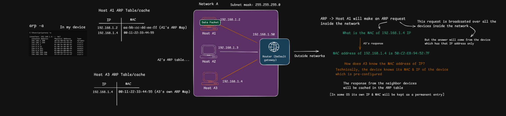

# Address Resolution Protocol (ARP)

> [!NOTE]
> **Section:** Computer Networking — [Chai aur Networking](https://youtu.be/kDAnEyg9nCg?si=sgF39bBdRmovp-Am)
>
> **Learning objective:** Understand how ARP resolves an IPv4 address to a MAC address on a local network, how ARP requests and replies work, and how the ARP cache stores discovered mappings.

[← Back to Computer Networking Repository](https://github.com/Priya200227/computer-networking)

---

## 1. What Is ARP and Why Is It Needed?

**Address Resolution Protocol (ARP)** is used in IPv4 networks to discover the MAC address associated with an IPv4 address on the local network.

IP and MAC addresses serve different purposes:

- **IP address:** Identifies the destination at the network layer.
- **MAC address:** Enables frame delivery over the local link.
- **ARP:** Resolves a known local IPv4 address into its corresponding MAC address.

Consider the following network:

| Device | IPv4 address | Example MAC address |
|---|---|---|
| Host A1 | `192.168.1.2` | `AA:BB:CC:DD:EE:02` |
| Host A2 | `192.168.1.3` | `AA:BB:CC:DD:EE:03` |
| Host A3 | `192.168.1.4` | `50:C2:E8:94:52:7F` |
| Router | `192.168.1.1` | `AA:BB:CC:DD:EE:01` |

Suppose Host A1 wants to communicate with Host A3. It knows the destination IPv4 address (`192.168.1.4`), but it needs the destination MAC address to construct the local network frame.

> [!IMPORTANT]
> ARP resolves **IPv4 address → MAC address**. It does not discover an IP address from a MAC address.

## 2. How ARP Works



Suppose Host A1 (`192.168.1.2/24`) wants to send data to Host A3 (`192.168.1.4/24`).

### Step 1 — Check the ARP Cache

Host A1 first checks its ARP cache for an existing mapping of `192.168.1.4` to a MAC address.

- If a valid entry exists, it can use that mapping.
- If the entry is missing, it needs to perform ARP resolution.

### Step 2 — Send an ARP Request

Host A1 broadcasts an ARP request asking:

> "Who has `192.168.1.4`? Tell `192.168.1.2`."

For Ethernet, the request is sent to the broadcast MAC address:

```text
FF:FF:FF:FF:FF:FF
```

All devices in the same Layer 2 broadcast domain can receive the request.

### Step 3 — Receive an ARP Reply

Host A3 recognizes its own IPv4 address and responds with its MAC address.

```text
192.168.1.4 is at 50:C2:E8:94:52:7F
```

The reply is normally sent directly (unicast) to Host A1.

### Step 4 — Store the Mapping

Host A1 stores the discovered IPv4-to-MAC mapping in its ARP cache.

### Step 5 — Send the Data Frame

Host A1 can now send the IP packet inside a link-layer frame addressed to Host A3's MAC address.

```text
Source MAC:      Host A1's MAC
Destination MAC: Host A3's MAC

Source IP:       192.168.1.2
Destination IP:  192.168.1.4
```

> [!NOTE]
> ARP requests are broadcast within the local Layer 2 broadcast domain. Routers do not forward ordinary ARP broadcasts to other networks.

## 3. ARP Request vs. ARP Reply

| Feature | ARP Request | ARP Reply |
|---|---|---|
| Purpose | Requests a MAC address | Provides the MAC address |
| Ethernet destination | Broadcast | Normally unicast |
| Message | "Who has this IP?" | "This IP is at this MAC address." |
| Recipient | Devices in the local broadcast domain | Normally the requesting host |

**Remember:** The request is generally broadcast, while the reply is normally unicast.

## 4. What Is an ARP Cache?

An **ARP cache** is a temporary table maintained by a host that stores discovered IPv4-to-MAC address mappings.

It helps avoid sending an ARP request every time the host communicates with the same local destination.

Example:

| IPv4 address | MAC address |
|---|---|
| `192.168.1.4` | `50:C2:E8:94:52:7F` |
| `192.168.1.1` | `AA:BB:CC:DD:EE:01` |

ARP cache entries can expire or be refreshed depending on the operating system and network configuration.

### View the ARP Cache

**Windows**

```powershell
arp -a
```

**Linux**

```bash
ip neigh
```

**macOS**

```bash
arp -a
```

## 5. What Happens When the Destination Is on Another Network?

ARP does not resolve the MAC address of a remote server across the Internet.

Suppose Host A1 (`192.168.1.2/24`) wants to communicate with a remote host (`192.168.2.4`).

Because the destination is outside its local subnet, Host A1 sends the packet to its default gateway (`192.168.1.1`).

The process is:

1. Host A1 determines that `192.168.2.4` is outside its local subnet.
2. It checks its ARP cache for the gateway's MAC address.
3. If necessary, it sends an ARP request for `192.168.1.1`.
4. It sends the frame to the gateway's MAC address.
5. The router forwards the IP packet toward the destination network.

```text
Host A1                 Default Gateway             Remote Host
192.168.1.2              192.168.1.1                192.168.2.4
    |                         |                          |
    | ARP for gateway MAC     |                          |
    |------------------------>|                          |
    |                         |                          |
    | Frame to gateway MAC   |                          |
    | IP destination: 192.168.2.4                       |
    |------------------------>|                          |
    |                         |---- Routes packet ------>|
```

> [!IMPORTANT]
> For remote communication, the host resolves the **next-hop router's MAC address**, not the remote destination's MAC address.
>
> ARP handles local-link resolution; IP routing handles communication between networks.

## 6. Key Takeaways

> [!IMPORTANT]
> ARP allows an IPv4 host to discover the MAC address needed for local-link communication.

| Concept | Key point |
|---|---|
| ARP | Resolves a known IPv4 address to a MAC address |
| ARP request | Broadcast to the local Layer 2 network |
| ARP reply | Normally unicast to the requester |
| ARP cache | Temporarily stores discovered mappings |
| Same subnet | Resolve the destination's MAC address |
| Different subnet | Resolve the next-hop gateway's MAC address |
| IPv6 | Uses Neighbor Discovery Protocol (NDP), not ARP |

**Core idea:** ARP connects network-layer IPv4 addressing with link-layer MAC addressing so that devices can deliver frames over a local network.

> [!TIP]
> Remember the sequence:
>
> **Check ARP cache → Broadcast ARP request → Receive ARP reply → Cache mapping → Send frame**

## References

- [How Does ARP Work in Your Network?](https://youtu.be/kDAnEyg9nCg?si=sgF39bBdRmovp-Am)

---

**Next:** [OSI and TCP Encapsulation](../08-osi_tcp_encapsulation/README.md)
