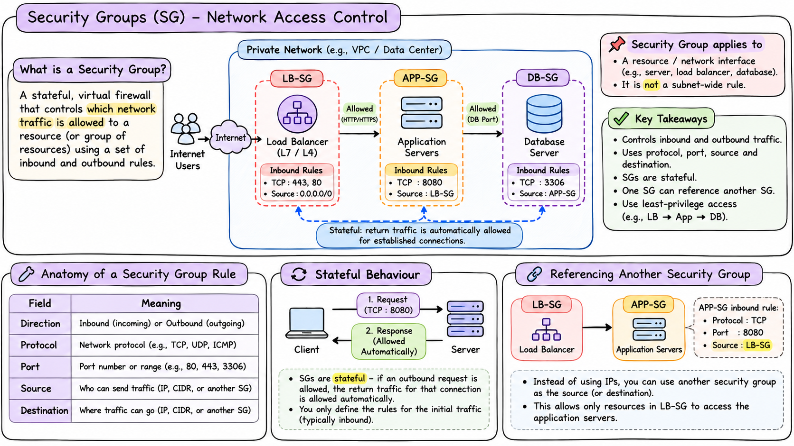

# Security Groups and Resource-Level Network Access Control

>[!NOTE]
>
>**Purpose:** Understand how security-group-style policies restrict communication between systems, how inbound and outbound rules work, what stateful filtering means, and how to apply least-privilege access between application tiers.

[← Back to Cloud Networking Repository](https://github.com/Priya200227/computer-networking/tree/main/07-cloud-networking)

---

## 1. What is a Security Group?

A **security group** is a named set of network access rules associated with a resource, network interface, or group of resources. It controls which network traffic is permitted to reach or leave the associated resource.

The term **Security Group** is commonly used by cloud platforms. It is not a universal networking protocol or a single standardized firewall technology. Different platforms implement similar ideas with different attachment points, defaults, rule syntax, and capabilities.

For vendor-neutral learning, think of a security group as:

>[!NOTE]
> A resource-associated, usually stateful, allow-list policy that defines permitted network communication.

It is a form of network access control. It does not replace every other security control, and it should not be confused with a subnet-level access-control list.

### Where is it applied?

Depending on the platform, a security-group-style policy may be associated with:

- A virtual network interface attached to a compute instance.
- A virtual machine or workload.
- A managed service endpoint.
- A collection of resources that share a policy.

The important idea is that the policy is enforced at or for the protected resource/interface, not necessarily as one perimeter firewall for the entire network.

---

## 2. Inbound vs. outbound rules

Rules are described from the perspective of the protected resource.

| Rule direction | Meaning | Example |
|---|---|---|
| **Inbound** | Traffic attempting to enter the protected resource | Permit TCP traffic to port `443` from an approved client range |
| **Outbound** | Traffic initiated by the protected resource toward another destination | Permit the application to connect to a database on TCP port `5432` |

A direction is not the same as a source or destination:

- For an **inbound** rule, the source is the system sending traffic toward the protected resource.
- For an **outbound** rule, the destination is the system the protected resource is trying to reach.

Some platforms have default outbound permissions; others allow more restrictive configuration. Never assume the defaults are identical across products.

---

## 3. Anatomy of a rule

A network access rule commonly describes these fields:

| Field | What it identifies | Example |
|---|---|---|
| Direction | Inbound or outbound | Inbound |
| Protocol | Network/transport protocol | TCP |
| Port or port range | Destination service port, where applicable | `443` |
| Source | Where inbound traffic may originate | `203.0.113.0/24` |
| Destination | Where outbound traffic may go | `10.20.2.15/32` |
| Action | What to do with matching traffic | Allow |

A rule such as:

```text
Direction: Inbound
Protocol:  TCP
Port:      443
Source:    203.0.113.0/24
Action:    Allow
```

means: permit TCP traffic arriving at the protected resource's port 443 when it comes from the specified source range.

**Port numbers identify services at the transport layer.** For example, TCP port 443 is conventionally used for HTTPS. A port number alone does not prove that the application is secure or even that it is actually speaking HTTPS.

### Source and destination can be more than IP addresses

Depending on the implementation, rules may support:

- A single IP address or CIDR range.
- A predefined network range.
- A reference to another security group or resource group.
- A service identity or managed prefix/list.

A group reference is an abstraction: instead of maintaining a changing list of instance IP addresses, a rule can allow traffic from resources associated with a specified group. The exact meaning and supported direction are platform-specific.

---

## 4. Stateful behaviour

Many security-group implementations are **stateful**.

Stateful filtering tracks permitted connections. When an inbound connection is allowed, the corresponding response traffic is generally allowed automatically, without writing a separate reverse-direction rule for every response packet.

Example:

1. A client opens a TCP connection to a service on port `443`.
2. The inbound policy permits that connection.
3. The filtering system tracks the connection state.
4. The service sends response packets back to the client.
5. The related response traffic is permitted as part of that tracked connection.

This does **not** mean that all outbound traffic is automatically allowed. It means the return traffic associated with a permitted connection is treated differently from an unrelated, newly initiated connection.

### Stateful vs. stateless

| Stateful filtering | Stateless filtering |
|---|---|
| Tracks connection state | Evaluates packets independently |
| Related return traffic is generally permitted automatically | Rules must account for both directions |
| Often simpler to express for application flows | Requires careful reverse-path rule design |
| Common in security-group-style controls | Common in network ACLs and traditional packet-filtering designs |

The precise implementation varies. For example, connection tracking may have limits, timeouts, and protocol-specific behaviour.

---

## 5. Referencing one security group from another

Some platforms allow a rule to reference another security group rather than an IP range.

Conceptually:

- The application tier permits inbound traffic from resources belonging to the load-balancer group.
- The database tier permits inbound database traffic from resources belonging to the application group.

Why this is useful:

- Resource addresses can change as workloads scale or are replaced.
- The policy expresses *which workload group* is trusted, rather than relying on manually maintained IP lists.
- It makes the intended architecture easier to understand.

This capability is **implementation-specific**. Do not assume every firewall or access-control system supports group-to-group references.

---

## 6. Practical example: protect a three-tier application

Consider a web application with three logical tiers:

1. **Load balancer:** Public entry point for client requests.
2. **Application servers:** Run application code and business logic.
3. **Database:** Stores persistent application data.

The intended access path is:

```text
Internet client
      |
      | HTTPS (TCP 443)
      v
Load balancer
      |
      | Application service port
      v
Application servers
      |
      | Database service port
      v
Database
```

The policy should be narrow:

| Protected tier | Example inbound permission | Should not be allowed |
|---|---|---|
| Load balancer | HTTPS from approved public/client ranges | Unneeded management ports from the internet |
| Application | Application traffic from the load-balancer group | Direct public access |
| Database | Database port from the application group | Direct internet access or arbitrary client access |

Example database ports include TCP `5432` for PostgreSQL and TCP `3306` for MySQL. Use the port actually configured for the service.



### Why not allow everything inside the private network?

A private address does not automatically mean a workload is trusted. If every internal system can connect to every other system, a compromised workload may have too many paths to sensitive services.

Use **least privilege**:

- Permit only the required protocol.
- Permit only the required port or port range.
- Permit only the required source or destination.
- Avoid broad network ranges when a narrower resource/group reference is available.
- Review rules when application architecture changes.

---

## 7. Security groups vs. firewalls vs. ACLs

These terms overlap, but they are not interchangeable.

| Term | General meaning |
|---|---|
| **Firewall** | A security mechanism that inspects and filters network traffic according to policy |
| **Security group** | A resource-associated collection of network permissions; often stateful in cloud environments |
| **ACL (Access Control List)** | An ordered or unordered set of allow/deny rules applied to a network or resource, depending on the system |
| **Network ACL** | A subnet/network-bound filtering mechanism in some cloud architectures; commonly stateless in those implementations |

A security group is best understood as one kind of network access-control mechanism, not as a replacement name for every firewall or ACL.

---

## 8. What security groups do not do

Security groups are only one layer of defense. They do not, by themselves:

- Authenticate a user or prove that a request is legitimate.
- Replace application authorization (for example, whether a user may read a record).
- Encrypt application data; use TLS for transport encryption.
- Guarantee protection against vulnerabilities in an application.
- Replace monitoring, logging, patching, endpoint protection, or DDoS protection.
- Automatically make a resource safe just because it has a private IP address.

Network access control answers: **Can this network traffic reach the resource?**

Application authorization answers: **Is this authenticated identity allowed to perform this action or access this data?**

Both are needed.

---

## Key takeaways

- A security group is a resource-associated network access policy; the exact implementation is platform-dependent.
- Inbound rules control traffic entering the protected resource; outbound rules control traffic leaving it.
- Rules commonly match direction, protocol, port, and source/destination.
- Stateful filtering tracks connections and generally permits related response traffic.
- Some implementations support references between security groups.
- In a three-tier design, allow client traffic to the public entry point, entry-point traffic to the application, and application traffic to the database.
- Apply least privilege. Do not expose internal application or database services unnecessarily.
- Security groups control network reachability; they do not replace identity, application authorization, or TLS.

---

## References

The following are useful for the underlying concepts. Product documentation is included as an example of how one platform implements the broader idea - not as a requirement to learn that platform.

- [NIST SP 800-41 Rev. 1 - Guidelines on Firewalls and Firewall Policy](https://csrc.nist.gov/pubs/sp/800/41/r1/final)
- [NIST SP 800-207 - Zero Trust Architecture](https://csrc.nist.gov/pubs/sp/800/207/final)
- [RFC 2979 — Behaviour of and Requirements for Internet Firewalls](https://www.rfc-editor.org/rfc/rfc2979)
- [RFC 9293 - Transmission Control Protocol (TCP)](https://www.rfc-editor.org/rfc/rfc9293)
- [Cloud Security Alliance - Security Guidance](https://cloudsecurityalliance.org/research/guidance)
- [AWS documentation - Security groups](https://docs.aws.amazon.com/vpc/latest/userguide/vpc-security-groups.html) - optional vendor-specific example of stateful resource-level filtering.
