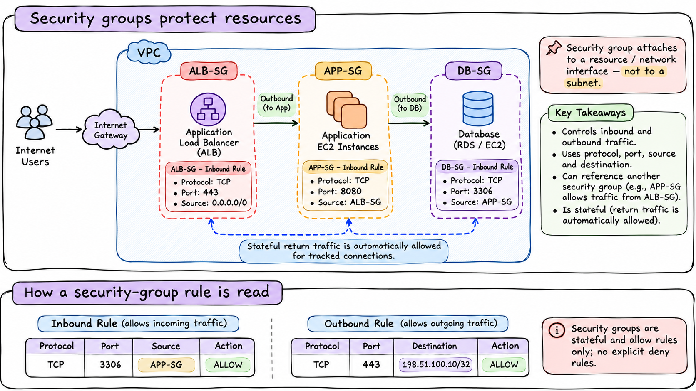
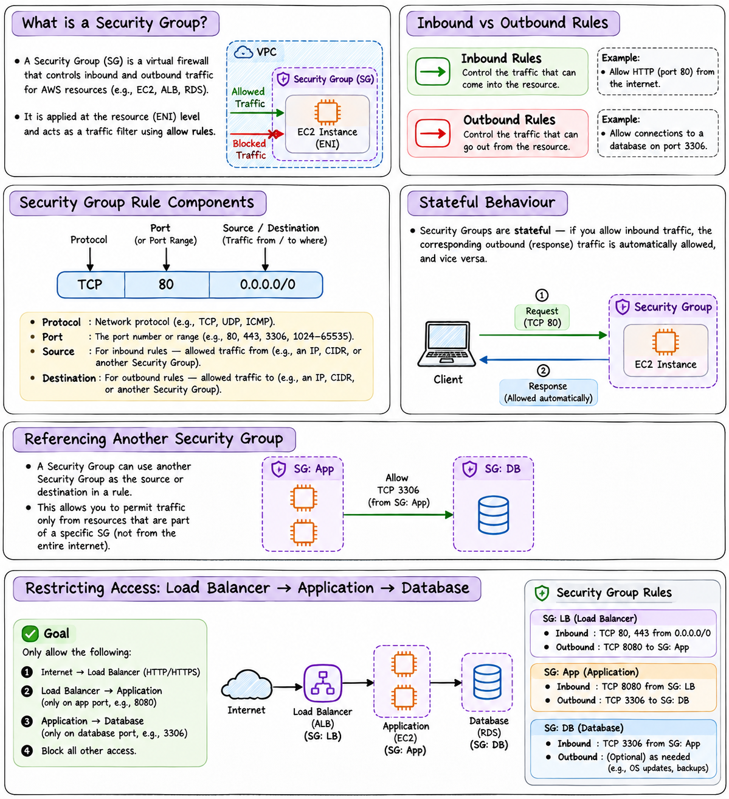

# AWS Security Groups

> **Learning objective:** Understand how AWS Security Groups control inbound and outbound traffic to cloud resources, how stateful filtering works, and how to restrict communication between a load balancer, application servers, and a database.

[← Back to Cloud Networking Repository](https://github.com/Priya200227/computer-networking/tree/main/07-cloud-networking)

---

## 1. What Is a Security Group?

An **AWS Security Group (SG)** is a virtual, stateful firewall that controls the network traffic allowed to reach and leave supported resources in an Amazon VPC.

A Security Group is associated with a resource's **network interface (ENI)**. For example, it can be associated with:

- An EC2 instance (through its network interface).
- An Application Load Balancer.
- An Amazon RDS database.
- Other supported resources that use VPC network interfaces.

A Security Group is not attached to a subnet. This is an important distinction:

- **Security Group:** controls traffic at the resource/network-interface level.
- **Network ACL (NACL):** controls traffic at the subnet boundary.

Think of a Security Group as a set of rules describing which connections a resource is allowed to accept and initiate.

### Important characteristics

- Security Groups contain **allow rules only**; they do not have explicit deny rules.
- They are **stateful**: response traffic for an allowed, tracked connection is automatically permitted.
- Rules specify protocol, port or port range, and a source (inbound) or destination (outbound).
- Multiple Security Groups can be associated with a resource. Their rules are aggregated.
- Security Groups are associated with resources in a VPC; they are not a replacement for route tables, an Internet Gateway, or network ACLs.

---

## 2. Where Security Groups Fit in a VPC

A VPC provides an isolated virtual network. Subnets divide its IP address space, route tables determine where packets can go, and Security Groups control which traffic is allowed to reach or leave a resource.

A route being available does not mean a connection is automatically permitted. The relevant network path and security controls must all allow the traffic.

### Resource-level placement



In a typical web application, separate Security Groups can protect the load balancer, application servers, and database.

---

## 3. Inbound vs Outbound Rules

Security Group rules are directional.

### Inbound rules (ingress)

Inbound rules control traffic that is attempting to enter the resource associated with the Security Group.

Example: allow users on the internet to connect to an Application Load Balancer over HTTPS.

| Protocol | Port | Source | Meaning |
|---|---:|---|---|
| TCP | 443 | `0.0.0.0/0` | Allow HTTPS from IPv4 internet clients |
| TCP | 443 | `198.51.100.25/32` | Allow HTTPS from one specific IPv4 address |

`0.0.0.0/0` means every IPv4 address. It is broad; use it only when the service is intentionally public. For IPv6, the equivalent all-address range is `::/0`.

### Outbound rules (egress)

Outbound rules control traffic initiated by the resource toward another destination.

Example: allow an application server to connect to a database on TCP port 3306.

| Protocol | Port | Destination | Meaning |
|---|---:|---|---|
| TCP | 3306 | `sg-database` | Allow database connections to resources associated with `sg-database` |
| TCP | 443 | `0.0.0.0/0` | Allow HTTPS connections to IPv4 destinations |

For an outbound rule, the target is called the **destination**, not the source.

### How to read a rule

A rule can be understood through four main fields:

| Field | What it specifies | Example |
|---|---|---|
| Protocol | Network protocol | TCP, UDP, ICMP |
| Port / port range | Destination service port for TCP/UDP | `443`, `3306`, `8000-8100` |
| Source (inbound) | Where incoming traffic may originate | CIDR, prefix list, another SG |
| Destination (outbound) | Where outgoing traffic may go | CIDR, prefix list, another SG |

A port identifies the service endpoint on the destination side of a TCP or UDP connection. Security Group rules do not mean that a client must use the same source port.

---

## 4. Stateful Behaviour

Security Groups are **stateful**.

This means that when a connection is allowed in one direction, the response traffic for that tracked connection is automatically allowed in the opposite direction. You do not need to add a separate rule just to permit the response packets.

Example:

1. A client sends an HTTPS request to an application.
2. The Security Group allows the inbound TCP connection on port 443.
3. The server sends response packets back through that tracked connection.
4. The response traffic is automatically allowed by the Security Group's stateful behaviour.



**Do not misunderstand statefulness:** it does not mean that all outbound traffic is allowed. It means response traffic associated with a tracked connection is automatically permitted. A resource still needs an outbound rule to initiate a new connection.

---

## 5. Referencing Another Security Group

One Security Group can reference another Security Group as the source of an inbound rule or the destination of an outbound rule.

This is more maintainable than hard-coding private IP addresses for a group of application resources.

For example:

- `App-SG` allows inbound application traffic from `ALB-SG`.
- `DB-SG` allows inbound database traffic from `App-SG`.

The reference means: allow traffic from network interfaces associated with the referenced Security Group, subject to the rule's protocol and port.

It does **not** copy the referenced Security Group's rules into the receiving group.

### Example

Suppose:

- The load balancer has `ALB-SG`.
- Application instances have `App-SG`.
- The database has `DB-SG`.

The database rule can use `App-SG` as its inbound source. When application instances are added to or removed from `App-SG`, the rule continues to refer to the group rather than requiring you to update a list of instance IP addresses.

**Scope note:** Security Group references have supported VPC connectivity requirements. The straightforward case is groups in the same VPC. Cross-VPC references depend on supported connectivity such as VPC peering or Transit Gateway and have additional limitations. Check the AWS documentation for the exact topology.

---

## 6. Practical Example: Load Balancer → Application → Database

Consider a three-tier web application:

1. **Load balancer:** public entry point for user requests.
2. **Application servers:** run business logic and are not directly exposed to the internet.
3. **Database:** stores application data and should accept connections only from the application tier.

Create a separate Security Group for each tier.

### Recommended rule design

The port numbers below are examples. Use the actual listener, target and database ports configured in your application.

#### A. `ALB-SG` — Load Balancer

| Direction | Protocol | Port | Source / Destination | Purpose |
|---|---|---:|---|---|
| Inbound | TCP | 443 | `0.0.0.0/0` | Allow public HTTPS requests |
| Outbound | TCP | 8080 | `App-SG` | Forward requests to application targets |

If the load balancer also listens on HTTP, add TCP port 80 and normally redirect clients to HTTPS. Configure the outbound rule for the target and health-check ports actually used.

#### B. `App-SG` — Application Servers

| Direction | Protocol | Port | Source / Destination | Purpose |
|---|---|---:|---|---|
| Inbound | TCP | 8080 | `ALB-SG` | Accept application traffic only from the load balancer |
| Outbound | TCP | 3306 | `DB-SG` | Initiate MySQL database connections |

The application servers do not need public inbound access for normal user requests. The load balancer is their permitted entry point.

#### C. `DB-SG` — Database

| Direction | Protocol | Port | Source / Destination | Purpose |
|---|---|---:|---|---|
| Inbound | TCP | 3306 | `App-SG` | Accept MySQL connections only from the application tier |

For PostgreSQL, the typical port is TCP 5432. Use the port configured for the database engine.

Outbound database rules should be restricted according to actual requirements, such as maintenance, backup, monitoring, or other required connections. Stateful response traffic for allowed tracked connections does not require a broad outbound rule merely to return the database response.

### Traffic path

```text
Internet user
     |
     | HTTPS / TCP 443
     v
Application Load Balancer
     |
     | HTTP / TCP 8080
     v
Application server
     |
     | MySQL / TCP 3306
     v
Database
```

The key security design is:

- The internet can reach the load balancer.
- Only the load balancer can reach the application listener.
- Only the application tier can reach the database listener.
- The database is not exposed directly to the internet.

This is an example of **least privilege**: permit only the traffic each tier needs.

---

## 7. Security Groups vs Network ACLs

Both are VPC security controls, but they operate at different levels.

| Characteristic | Security Group | Network ACL |
|---|---|---|
| Applied at | Resource / network interface | Subnet |
| Rule types | Allow only | Allow and deny |
| Behaviour | Stateful | Stateless |
| Rule evaluation | All applicable rules are considered together | Rules are evaluated in ascending rule-number order until a match |
| Return traffic | Automatically allowed for tracked connections | Must be explicitly allowed |
| Typical role | Fine-grained resource access | Additional subnet-level traffic control |

For your current learning goal, understand Security Groups first. You only need the distinction above to avoid confusing SGs with NACLs.

---

## 8. Common Misunderstandings

- **“A Security Group is attached to a subnet.”** No. It is associated with resources/network interfaces. NACLs are associated with subnets.
- **“Security Groups have allow and deny rules.”** No. Security Groups support allow rules only.
- **“Stateful means all outbound traffic is allowed.”** No. It automatically permits response traffic for tracked connections; new outbound connections still need to be allowed.
- **“Referencing an SG copies all its rules.”** No. The reference matches resources associated with that SG for the specified protocol and port.
- **“Opening port 443 on the load balancer makes the database public.”** No. Each tier has its own rules, and the database should accept traffic only from the application tier.
- **“A route to an Internet Gateway makes every resource public.”** No. Routing, public addressing, and security rules all matter.

---

## 9. Quick Revision

| Question | Short answer |
|---|---|
| What is an SG? | A stateful, resource-level virtual firewall in a VPC |
| Inbound? | Traffic entering the associated resource |
| Outbound? | Traffic leaving the associated resource |
| What does a rule define? | Protocol, port, and source or destination |
| Stateful? | Response traffic for tracked connections is automatically allowed |
| Can an SG reference another SG? | Yes, as an inbound source or outbound destination where supported |
| Can an SG explicitly deny traffic? | No |
| SG vs NACL? | Resource-level and stateful vs subnet-level and stateless |

**Remember this flow:**

`Internet → ALB-SG → App-SG → DB-SG`

The internet reaches the load balancer; the load balancer reaches the app; the app reaches the database. Each tier trusts only the tier that needs to communicate with it.

---

## 10. References & Further Learning

### Official AWS documentation

- [Control traffic to your AWS resources using Security Groups](https://docs.aws.amazon.com/vpc/latest/userguide/vpc-security-groups.html)
- [Security Group rules](https://docs.aws.amazon.com/vpc/latest/userguide/security-group-rules.html)
- [Security Group referencing](https://docs.aws.amazon.com/vpc/latest/userguide/security-group-rules.html#security-group-referencing)
- [Create a Security Group for your VPC](https://docs.aws.amazon.com/vpc/latest/userguide/creating-security-groups.html)
- [Example: VPC for web and database servers](https://docs.aws.amazon.com/vpc/latest/userguide/vpc-example-web-database-servers.html)
- [Security Groups and Network ACLs](https://docs.aws.amazon.com/vpc/latest/userguide/infrastructure-security.html)

### Suggested learning sequence

1. Understand this README and redraw the three-tier rule design.
2. Open the AWS documentation and inspect the inbound/outbound rule examples.
3. Practise identifying which tier should be the source of each rule.
4. Move on to Load Balancers and how they route requests to healthy application targets.

---

[⬅ Back to Computer Networking Repository](../../README.md)
