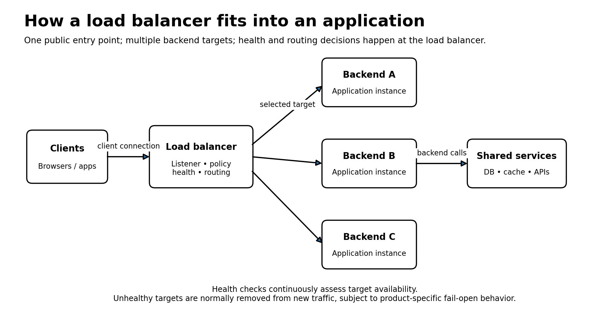
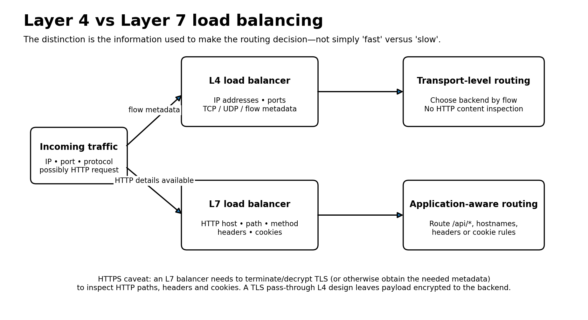
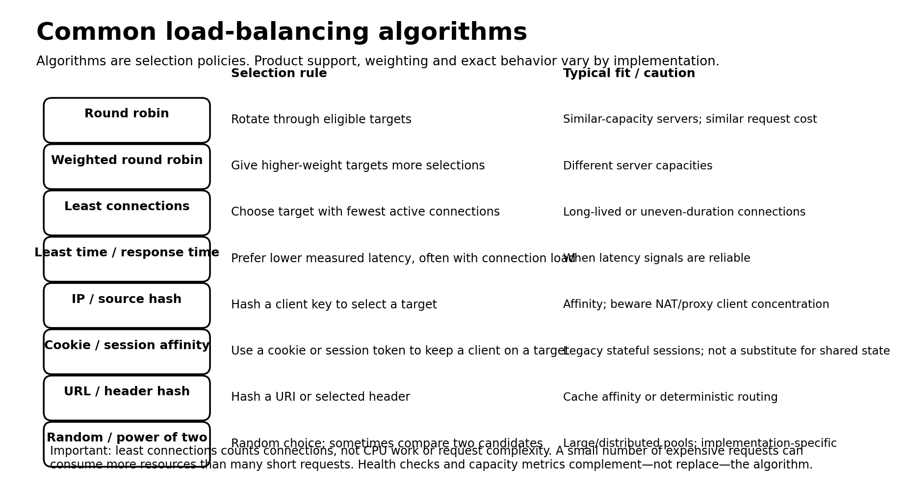
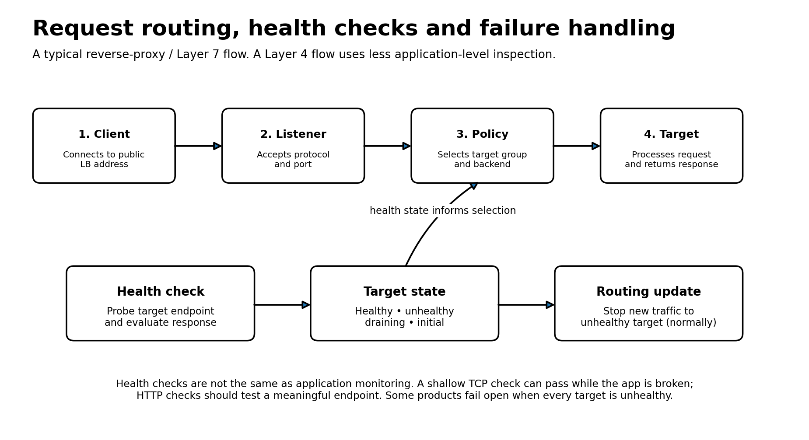
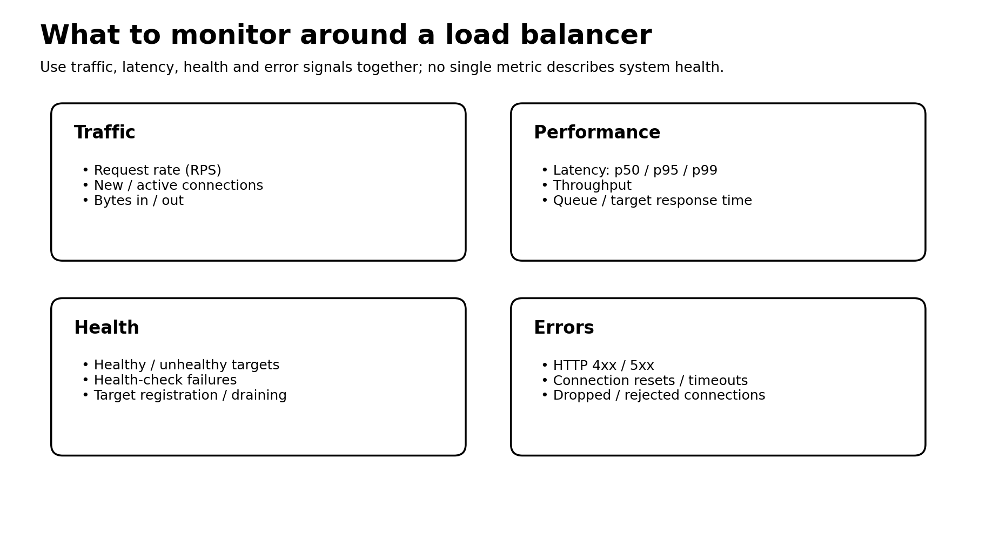

# Load Balancers

> A load balancer is an entry point that distributes incoming connections or requests across a pool of backend targets according to a routing policy, while helping applications scale and remain available.

**Module:** [08 — Application Traffic & Reliability](../README.md)  
**Topic:** Load balancing  
**Learning objective:** Understand why load balancers exist, how they select backend targets, what Layer 4 and Layer 7 mean, and how health checks, TLS, proxies and observability fit into a production application.

---

## 1. Why do we need a load balancer?

Imagine a web application initially runs on one application server.

```text
Clients  ───────────────>  Application Server
```

As traffic increases, the server may become a bottleneck. CPU, memory, connection capacity, thread pools, database access or downstream dependencies may become saturated. The result can be higher latency, timeouts or failed requests.

There are two broad scaling approaches:

- **Vertical scaling:** Give one machine more resources (for example, more CPU or RAM). It is operationally simple, but has hardware, cost and practical limits.
- **Horizontal scaling:** Run multiple application instances and distribute traffic among them. This provides a path to scale out and tolerate individual instance failures, provided the application and its dependencies are designed for it.

A load balancer provides a stable entry point in front of those instances:



*Figure 1 — A client reaches a load balancer, which selects a backend target. The backend pool can grow or shrink without requiring clients to know each server address.*

### What a load balancer does

1. Accepts incoming traffic on a configured **listener** (protocol and port).
2. Selects an eligible backend target using a configured policy.
3. Forwards the connection or request to that target.
4. Returns or forwards the response to the client, depending on its operating mode.
5. Uses health information to avoid sending new traffic to targets considered unhealthy (subject to product-specific behavior).

A load balancer does **not** guarantee that every server receives exactly the same number of requests. Its job is to apply a selection policy across eligible targets.

---

## 2. Vertical scaling vs horizontal scaling

| Aspect | Vertical scaling | Horizontal scaling |
|---|---|---|
| What changes? | Resources of one machine | Number of application instances |
| Example | 4 vCPU → 8 vCPU | 1 server → 3 servers |
| Main advantage | Simple deployment model | More capacity and instance-level redundancy |
| Main limitation | Machine size and cost ceiling | Requires traffic distribution and application design |
| Typical role of a load balancer | Not necessarily needed | Commonly used as a stable traffic entry point |

Horizontal scaling is not automatically achieved by adding servers. The application must be able to run across instances. In particular, local in-memory sessions, local file state, singleton background jobs and shared mutable state can complicate scaling.

A common design is to keep application instances stateless and store shared state in external systems such as a database, distributed cache or object store.

---

## 3. How a load balancer routes traffic

A simplified request flow:

1. A client connects to the load balancer's public or private address.
2. A listener accepts traffic on a configured protocol and port.
3. The load balancer evaluates its routing and target-selection rules.
4. It chooses a healthy, eligible target.
5. The backend processes the request and returns a response.
6. The load balancer forwards the response to the client.

The exact mechanics depend on the load balancer:

- A **Layer 4** load balancer commonly makes decisions using connection/flow metadata such as source and destination IP addresses, ports and transport protocol.
- A **Layer 7** load balancer can inspect application information such as HTTP host, path, method, headers and cookies.

### Important: connection is not the same as request

A browser may reuse one TCP connection for multiple HTTP requests (for example, HTTP keep-alive or HTTP/2 multiplexing). Therefore, a Layer 4 decision is often made per connection or flow, while a Layer 7 proxy can make decisions at the HTTP request/stream level. Exact behavior varies by implementation and protocol.

---

## 4. Layer 4 vs Layer 7 load balancers



| Feature | Layer 4 (Transport) | Layer 7 (Application) |
|---|---|---|
| OSI layer | Transport | Application |
| Typical protocols | TCP, UDP | HTTP, HTTPS, WebSocket and other application-aware protocols supported by the product |
| Information used | IP addresses, ports, transport protocol, connection/flow metadata | HTTP host, URL path, method, headers, cookies and other application metadata |
| Payload inspection | Does not need to inspect application payload | Can inspect application data when available |
| Routing example | Send TCP traffic for `203.0.113.10:443` to a backend pool | Send `/api/*` to API services and `/images/*` to an image service |
| Common use | High-throughput TCP/UDP distribution, non-HTTP services | Web applications, APIs, host/path-based routing |
| Trade-off | Less application context; often lower processing overhead | More routing flexibility; more processing and configuration complexity |

### Layer 4 example

A client opens a TCP connection to a service on port 443. The Layer 4 load balancer can use the connection's IP/port/protocol information to select a backend. It does not need to understand the HTTP method or URL path.

### Layer 7 example

A client sends:

```http
GET /api/orders HTTP/1.1
Host: shop.example.com
Cookie: session_id=abc123
```

A Layer 7 load balancer can use the host, path, headers or cookie to select a target group or backend service.

### HTTPS and TLS termination

HTTP content inside HTTPS is encrypted on the wire. To route based on HTTP paths, headers or cookies, a Layer 7 component generally needs to terminate TLS and decrypt the request, or receive equivalent application metadata through another trusted mechanism.

With **TLS termination at the load balancer**:

```text
Client ── HTTPS/TLS ──> Load Balancer ── HTTP or HTTPS ──> Backend
```

The load balancer handles the client-side TLS session. The connection from the load balancer to the backend is a separate leg and should be secured according to the threat model.

With **TLS pass-through**:

```text
Client ── encrypted TLS stream ──> L4 Load Balancer ──> Backend
```

The backend terminates TLS. The load balancer forwards encrypted traffic without inspecting the HTTP payload.

> **Terminology:** SSL is obsolete. Modern deployments use TLS. Some products and older material still use “SSL termination” as a legacy label for TLS termination.

---

## 5. Load-balancing algorithms

A load-balancing algorithm is the policy used to choose a backend. There is no universally best algorithm. The right choice depends on connection duration, request cost, target capacity, session design and the information the load balancer can observe.



### 5.1 Round robin

The load balancer cycles through eligible servers in sequence.

```text
Request 1 → A
Request 2 → B
Request 3 → C
Request 4 → A
Request 5 → B
Request 6 → C
```

**Works well when:** Servers have similar capacity and requests have broadly similar cost.

**Limitation:** It does not account for current server load or request complexity. Equal request counts do not necessarily mean equal work.

### 5.2 Weighted round robin

Each server receives a configured weight. A server with a larger weight receives a larger share of selections over time.

Example:

| Server | Weight | Approximate share |
|---|---:|---:|
| A | 8 | 80% |
| B | 1 | 10% |
| C | 1 | 10% |

Weights can represent relative capacity or a deliberate traffic split. A weight is not necessarily a live CPU measurement; whether weights can change dynamically depends on the implementation.

**Works well when:** Backend instances have different capacities, or a team wants to send a controlled fraction of traffic to a new version.

### 5.3 Least connections

The next connection is sent to the server with the fewest active connections.

**Works well when:** Connections have significantly different lifetimes, such as long-lived TCP sessions or persistent connections.

**Limitation:** A connection count is only a proxy for work. Seven expensive requests may consume more resources than twenty lightweight requests. Also, for short-lived HTTP requests, least-connections may not always improve distribution.

### 5.4 Least response time / least time

The load balancer prefers a server with lower measured response time or latency, sometimes combined with active connection count.

**Works well when:** Response-time measurements are meaningful and the implementation has enough reliable observations.

**Caution:** “Least time” is product-specific. For example, a product may measure time to first response byte, full response time, or a combination of latency and connection count. Do not assume all products calculate it identically.

### 5.5 IP hash / source hash

A hash function uses a client key—often the source IP address—to select a backend.

Conceptually:

```text
backend_index = hash(client_ip) % number_of_backends
```

Requests from the same source IP tend to map to the same backend while the backend pool remains stable.

**Use case:** Affinity when an application still stores session state locally.

**Limitations:**
- Many users may appear behind one NAT gateway or corporate proxy, concentrating traffic on one backend.
- A changing client IP can change the selected backend.
- Adding or removing backends can remap clients unless consistent hashing or another affinity mechanism is used.
- It is not a replacement for a properly shared session store.

### 5.6 Sticky sessions / session affinity

Sticky sessions attempt to keep a client associated with the same backend across multiple requests. Implementations may use a cookie, source IP or another session key.

**Important distinction:** Sticky sessions are a persistence feature, not one single universal algorithm. A cookie-based affinity mechanism and IP hashing are related in purpose but are not the same implementation.

**Trade-off:** Affinity can simplify legacy stateful applications, but it can create uneven load and makes backend replacement or failure more complicated. Prefer shared session state where practical.

### 5.7 URL or header hash

A hash is calculated from a URL, URI, or selected HTTP header. Requests with the same key can be mapped to the same backend.

**Use case:** Cache affinity or deterministic routing.

This requires application-level information, so it is generally associated with Layer 7 load balancing.

### 5.8 Random and “power of two choices”

A random policy selects a backend randomly. Some implementations choose two candidates and then select the less-loaded of the pair.

This can be useful in large or distributed environments, but the exact algorithm and available variants depend on the product.

---

## 6. Static vs dynamic selection policies

This is a useful conceptual distinction, but vendors do not all classify algorithms in exactly the same way.

| Broad category | Examples | What the policy considers |
|---|---|---|
| Predetermined / non-load-aware | Basic round robin, configured weighted round robin, hash-based selection | Sequence, configured weights or a key |
| Load-aware / measurement-based | Least connections, least time, resource-based selection | Current connections, measured latency or resource signals |

**Do not overgeneralise:** Weighted round robin can use configured static weights, while some products support changing weights at runtime. A hash policy is deterministic for a given key and backend pool, but remapping behavior depends on the hashing strategy.

### Resource-based selection

A resource-aware design can use signals such as CPU utilization, memory pressure or application queue depth to choose a target. Some implementations require agents or an external metrics/control plane.

This is not a universal built-in algorithm in every load balancer. It is a capability that depends on the product and architecture.

---

## 7. Health checks and backend failure

A load balancer needs a way to determine whether a backend should receive new traffic.

Common health-check types include:

- **TCP check:** Can a TCP connection be established to the target port?
- **HTTP check:** Does an HTTP endpoint return an expected status code?
- **HTTPS check:** Can the endpoint be reached over TLS and return an expected response?
- **Application-specific check:** Does a meaningful health endpoint confirm that the service is able to do useful work?



### Example

Suppose a target group contains three application instances:

| Target | Health status | New traffic |
|---|---|---|
| A | Healthy | Eligible |
| B | Unhealthy | Normally excluded |
| C | Healthy | Eligible |

The load balancer continues routing new traffic to eligible healthy targets while the failed target is investigated or recovered.

### Health check configuration concepts

- **Interval:** How often a probe is sent.
- **Timeout:** How long to wait for a probe response.
- **Healthy threshold:** Number of successful checks needed to mark a target healthy.
- **Unhealthy threshold:** Number of consecutive failures needed to mark a target unhealthy.
- **Health-check path:** The endpoint used for HTTP/HTTPS checks.
- **Draining / deregistration delay:** Gives existing connections or requests time to finish when a target is removed.

A TCP check can succeed even when the application is returning errors. An HTTP check against a meaningful readiness endpoint can provide a better signal, but it must be designed carefully.

### Important fail-open behavior

Do not assume that every load balancer always sends zero traffic when all targets are unhealthy. Some managed products have a **fail-open** behavior: if every registered target is unhealthy, they may send traffic to all registered targets rather than blackholing every request. This is product- and configuration-specific.

### Load balancer failure is a separate problem

Backend health checks protect against unhealthy backend targets. They do not, by themselves, protect against failure of the load balancer itself.

Production load-balancing services commonly address this with redundant load-balancer nodes, multiple availability zones, health monitoring and provider-managed failover. A self-managed deployment needs its own high-availability design—for example, redundant instances and a mechanism to move or advertise the service address.

---

## 8. Types of load balancers

Load balancers can be classified along different, independent dimensions. Do not mix these categories.

### By deployment model

| Type | Description | Examples |
|---|---|---|
| Hardware appliance | Dedicated physical device | Enterprise ADC appliances |
| Software | Software running on general-purpose infrastructure | HAProxy, NGINX, Envoy |
| Cloud-managed | Provider-operated load-balancing service | AWS Elastic Load Balancing, Azure Load Balancer, Google Cloud Load Balancing |

### By operating layer / function

| Type | Typical role |
|---|---|
| Layer 4 / network load balancer | Distributes TCP/UDP flows using transport-level information |
| Layer 7 / application load balancer | Routes application requests using HTTP-aware rules |
| Global server load balancing (GSLB) | Directs users across regions or data centres using DNS, anycast or provider-specific mechanisms |

These are not mutually exclusive categories. A cloud-managed load balancer can be Layer 4 or Layer 7. A software load balancer can also operate at Layer 4 or Layer 7.

---

## 9. Load balancer vs reverse proxy vs forward proxy

These concepts overlap, but they are not synonyms.

| Component | Represents | Typical direction | Common purposes |
|---|---|---|---|
| Forward proxy | Client | Client → Internet/service | Egress control, filtering, caching, policy enforcement |
| Reverse proxy | Backend service | Internet/client → backend | Entry point, TLS termination, routing, caching, access control |
| Load balancer | A pool of backends | Incoming traffic → selected target | Distribution, availability and scaling |

A reverse proxy can perform load balancing, but load balancing is only one of its possible functions. A load balancer may also be a reverse proxy, depending on its operating mode.

A common layered architecture is:

```text
Client
  │
  ▼
Cloud Load Balancer
  │
  ▼
Reverse Proxy / API Gateway
  │
  ├── /users   ──> User Service
  ├── /orders  ──> Order Service
  └── /billing ──> Billing Service
```

This can provide a public entry point at the edge and more fine-grained application routing inside the private network. It is an architectural option, not a mandatory requirement; avoid adding multiple layers without a clear need.

---

## 10. Layer 4 forwarding: pass-through vs proxy mode

These terms describe how a Layer 4 load balancer handles connections. The precise implementation differs among products.

### Pass-through / packet-forwarding mode

The load balancer forwards packets or flows toward a selected backend, often using address translation or direct-server-return techniques. It does not behave like a full application proxy that terminates and re-originates the client connection.

### Proxy mode

The load balancer terminates the client-side transport connection and establishes a separate connection to the backend:

```text
Client ── TCP connection 1 ──> Load Balancer
Load Balancer ── TCP connection 2 ──> Backend
```

The load balancer is now an endpoint for two transport connections. This can provide more control over connection handling, but it also changes source-address visibility, connection accounting and resource usage.

> Do not assume every Layer 4 load balancer uses the same mode. Check the specific product's documentation.

---

## 11. Performance, availability and security benefits

### Performance
- Distributes traffic across multiple backend instances.
- Helps prevent one backend from becoming a bottleneck.
- Can reduce queueing and latency when the policy matches the workload.
- Supports scaling out as demand changes.

### Availability
- Can stop sending new traffic to unhealthy targets.
- Allows healthy instances to continue serving traffic when another instance fails.
- Supports redundancy across instances and, in managed cloud architectures, availability zones.

### Operational flexibility
- Backend instances can be added, removed or replaced behind a stable entry point.
- Weighted routing can support gradual rollouts or controlled traffic splits.
- Centralises some routing, TLS and access-control configuration.

### Security
A load balancer can provide a controlled entry point and may integrate with TLS policies, access controls, rate limits or web application firewalls.

**DDoS caveat:** A load balancer is not, by itself, a complete DDoS defence. It can distribute traffic and use provider capacity, but effective protection may require upstream DDoS mitigation, WAF rules, rate limiting, filtering and capacity planning. Distributing malicious traffic across servers does not make the attack harmless.

---

## 12. Monitoring and observability

A load balancer should be monitored as part of the full request path—not in isolation.



| Metric group | Useful signals | Why it matters |
|---|---|---|
| Traffic | Request rate, new connections, active connections, bytes in/out | Shows demand and traffic patterns |
| Performance | Response time, latency percentiles, throughput, queue depth | Reveals slowdowns and bottlenecks |
| Health | Healthy/unhealthy targets, health-check failures, draining targets | Shows backend availability |
| Errors | HTTP 4xx/5xx, connection resets, dropped connections, timeouts | Helps locate failures in the request path |

### Practical interpretation

- **High request rate + rising p95/p99 latency:** Capacity may be insufficient or a dependency may be slowing down.
- **One target has much higher traffic:** Check weights, affinity, hashing, target capacity and client-IP concentration.
- **Health-check failures across all targets:** Investigate the application, network rules, health-check path and shared dependencies.
- **High 5xx rate with healthy targets:** The health endpoint may be too shallow, or the application may fail only for real requests.
- **High connection count but low request rate:** Long-lived connections, idle keep-alive connections or a connection-management issue may be involved.

Correlate load-balancer metrics with application logs, traces, database metrics and infrastructure telemetry.

---

## 13. Practical example: a web application

Consider a shopping application with three backend instances.

```text
Browser
   │
   │ HTTPS :443
   ▼
Layer 7 Load Balancer
   │
   ├── /api/products  ──> Product API instances
   ├── /api/orders    ──> Order API instances
   └── /static/*      ──> Static content service
```

The load balancer can:
- Terminate client TLS.
- Route requests using host or path rules.
- Select a healthy backend using a configured algorithm.
- Apply target-group weights for a controlled rollout.
- Export metrics for traffic, latency, health and errors.

The application services can then call databases, caches and other services. The load balancer does not replace application-level reliability, database connection pooling, timeouts, retries or circuit breakers.

---

## 14. Common misconceptions

| Misconception | Correct understanding |
|---|---|
| A load balancer sends exactly the same number of requests to every server. | It applies a selection policy; equal counts are not guaranteed and equal counts do not imply equal work. |
| Least connections always chooses the server with the most free CPU. | It compares connection counts, not necessarily CPU or actual request cost. |
| IP hash and sticky cookies are identical. | Both can provide affinity, but they use different keys and mechanisms. |
| Every load balancer is Layer 7. | Layer 4 load balancers can distribute traffic without inspecting HTTP payloads. |
| Every reverse proxy is a load balancer. | A reverse proxy can load balance, but it can also serve other roles without distributing across multiple backends. |
| Health checks guarantee the whole application works. | A probe only tests the configured signal; a shallow check can miss application failures. |
| A load balancer alone prevents DDoS attacks. | DDoS protection requires additional controls and upstream capacity. |
| A public load balancer makes every backend public. | Backends can remain private; network and security configuration determine reachability. |

---

## 15. Quick revision

- **Load balancer:** Distributes incoming connections or requests across backend targets.
- **Vertical scaling:** Increase resources of one machine.
- **Horizontal scaling:** Add more application instances.
- **L4:** Selects using transport/network flow metadata such as IP, port and TCP/UDP.
- **L7:** Can select using HTTP host, path, method, headers and cookies.
- **Round robin:** Rotate among eligible targets.
- **Weighted round robin:** Allocate selections according to configured weights.
- **Least connections:** Prefer the target with fewer active connections.
- **Least time:** Prefer targets with better measured latency, depending on implementation.
- **IP hash:** Use a source-IP-derived key for deterministic selection.
- **Sticky session:** Keep a client associated with a backend.
- **Health check:** Probe whether a target is eligible to receive traffic.
- **TLS termination:** End the client TLS session at the load balancer or proxy.
- **GSLB:** Direct users across geographically separated locations.

---

## 16. References and further reading

### Official technical documentation

1. [AWS Elastic Load Balancing — Overview and API concepts](https://docs.aws.amazon.com/elasticloadbalancing/latest/APIReference/Welcome.html)
2. [AWS — Health checks for Application Load Balancer target groups](https://docs.aws.amazon.com/elasticloadbalancing/latest/application/target-group-health-checks.html)
3. [AWS — Network Load Balancer listeners and TLS behavior](https://docs.aws.amazon.com/elasticloadbalancing/latest/network/load-balancer-listeners.html)
4. [NGINX — HTTP Load Balancing](https://docs.nginx.com/nginx/admin-guide/load-balancer/http-load-balancer/)
5. [NGINX — TCP and UDP Load Balancing](https://docs.nginx.com/nginx/admin-guide/load-balancer/tcp-udp-load-balancer/)
6. [HAProxy — Backends and load-balancing algorithms](https://www.haproxy.com/documentation/haproxy-configuration-tutorials/proxying-essentials/configuration-basics/backends/)

### Video learning sources

The following videos informed the initial learning notes. The README distinguishes their teaching explanations from implementation-specific details verified against official documentation.

1. [Load Balancer Explained — PowerCert Animated Videos](https://youtu.be/1fN2UDbtGDQ)
2. [What is a Load Balancer? — Rohit Negi](https://youtu.be/88vl3BfLqUY)
3. [What is a Load Balancer Really About? — ByteByteGo](https://youtu.be/LQuuoHTyYz8)
4. [What are L4 Load Balancers and How Do They Work? — Arpit Bhayani](https://www.youtube.com/@AsliEngineering)
5. [Layer 4 vs Layer 7 Load Balancer — IT k Funde](https://www.youtube.com/@ITkFunde)
6. [Proxy vs Reverse Proxy vs Load Balancer — TechWorld with Nana](https://www.youtube.com/@TechWorldwithNana)
7. [Load Balancers Explained in 16 Minutes — Coding for All](https://www.youtube.com/@codingforallnewtonschool)

---

[← Back to Application Traffic & Reliability](../README.md)  
[← Back to Computer Networking Repository](../../README.md)

**Understand the traffic. Choose the target. Keep the application available.**
