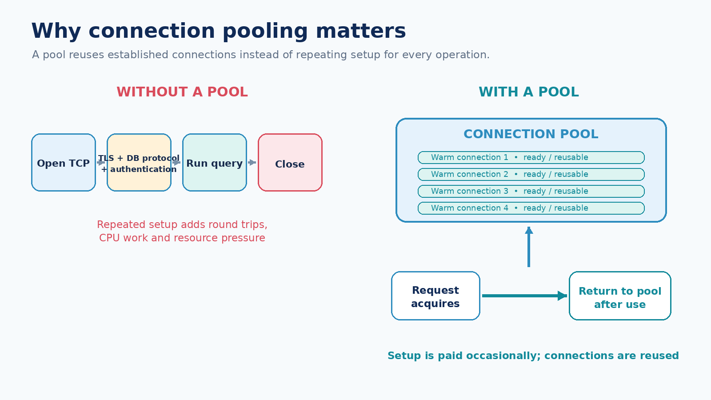
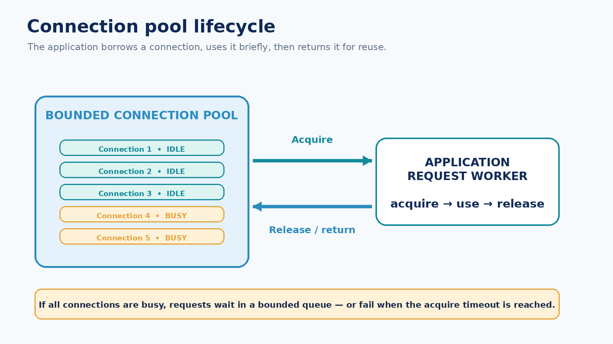
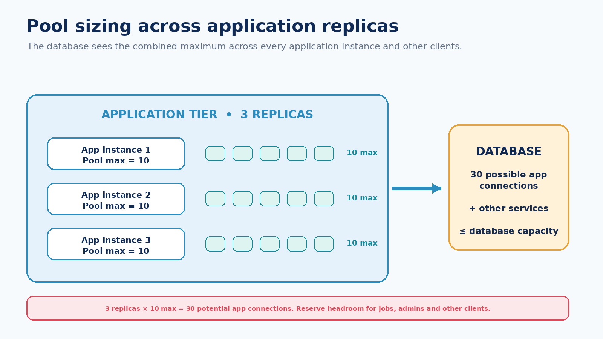
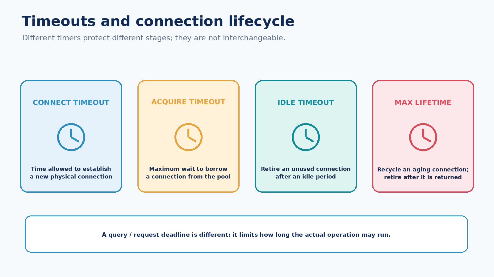
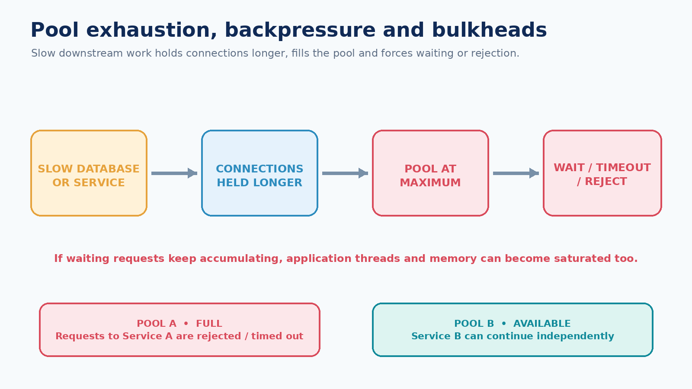
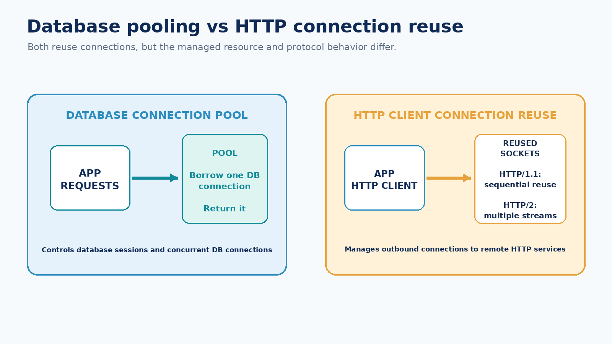

# Database Connection Pooling

> [!NOTE]
>
> **Section:** Computer Networking - [Source 1](https://youtu.be/bMUaTc1LZAg) , [Source 2](https://youtu.be/vhepBDb_F8M)
> 
>**Purpose:** Understand why opening database connections repeatedly is expensive, how a connection pool reuses them, how pool sizing and timeouts work, and how pooling protects an application and its database under load.

[← Back to Application Traffic & Reliability Repository](https://github.com/Priya200227/computer-networking/tree/main/08-application-traffic-and-reliability)

---

## 1. What is connection pooling?

A **connection pool** is a managed collection of already-established database connections that an application can reuse.

An application does not need to create a brand-new database connection for every query or incoming request. Instead, it:

1. **Acquires** an available connection from the pool.
2. Uses that connection to execute database work.
3. **Returns** the connection to the pool when the work is complete.
4. Allows another request to reuse it.

The important distinction: returning a connection to the pool is not the same as closing the underlying network connection. The pool keeps a healthy connection available for reuse.



### Why not create a new connection every time?

Establishing a database connection can involve several steps, depending on the database, driver and configuration:

- A TCP connection is established.
- TLS negotiation may take place when encryption is enabled.
- The database-specific startup/protocol exchange occurs.
- The client is authenticated and a session is initialized.

These steps consume time and resources. Repeating them for every small query can add more overhead than the query itself.

A live database connection also consumes server-side resources. Databases impose limits on concurrent connections, and a large number of idle connections can still consume memory and other resources.

**Connection pooling reduces repeated setup work and places a limit on how many connections an application can use concurrently.**

---

## 2. How a connection pool works

Think of the pool as a shared inventory of reusable connections.



### The lifecycle

| Step | What happens |
|---|---|
| 1. Pool initialization | The pool is configured with connection limits. Connections may be created on demand or maintained according to the pool implementation. |
| 2. Acquire / checkout | A request asks the pool for an available connection. |
| 3. Use | The application executes SQL statements and completes its database work. |
| 4. Release / check-in | The application returns the connection to the pool. |
| 5. Reuse | Another request can acquire that connection. |

### What if every connection is busy?

The pool has a configured capacity. If all connections are checked out:

- A new request may wait in a queue for a connection to be returned.
- If it waits longer than the configured **acquire timeout**, the pool fails the acquisition instead of waiting indefinitely.
- Some pool implementations also support a bounded overflow above the regular pool size. That overflow must be included when calculating the true maximum.

This is intentional. A bounded pool prevents an application from creating unlimited database connections during a traffic spike.

---

## 3. Why pool sizing matters

A pool is not sized in isolation. The database receives connections from **all application instances and other clients**, not just one application process.



### A simple capacity calculation

Suppose an application runs three replicas:

- Replica 1: maximum pool size = 10
- Replica 2: maximum pool size = 10
- Replica 3: maximum pool size = 10

Then:

\[
3 \times 10 = 30
\]

The application tier could open up to **30 database connections** (assuming no additional overflow).

The database may also need connections for:

- Background jobs and scheduled tasks
- Data pipelines or other services
- Monitoring and administration
- Migrations and maintenance

So the total connection budget must stay within the database's usable capacity, with headroom reserved for other clients and operational needs.

> [!IMPORTANT]
> A pool size of 10 in one application replica does not mean the whole system uses only 10 connections. Multiply the per-instance maximum by the maximum number of replicas, and include overflow if the pool supports it.


### Too small vs. too large

| Pool configuration | Likely consequence |
|---|---|
| Too small | Requests spend more time waiting to acquire a connection. Throughput may be limited. |
| Too large | Too many concurrent connections can consume database resources, increase contention and reduce overall stability. |
| Sensibly bounded | Controls concurrency and helps protect downstream database capacity. |

A larger pool is **not automatically faster**. If the database is already saturated, adding more concurrent connections can make the situation worse.

---

## 4. Pooling and timeouts

Timeouts put limits on how long an application waits at different stages. They are related, but they do not mean the same thing. Exact names and semantics vary by driver and pool implementation.



| Timeout | What it limits | Why it matters |
|---|---|---|
| **Connect timeout** | Time allowed to establish a new physical connection to the database | Prevents connection establishment from hanging indefinitely |
| **Acquire / pool timeout** | Time a request waits to borrow a connection from the pool | Prevents application workers from waiting forever when the pool is full |
| **Idle timeout** | How long an unused connection may remain idle before being retired | Avoids keeping unnecessary idle connections indefinitely |
| **Maximum lifetime** | How long a connection may exist before the pool retires and replaces it | Helps rotate aging connections and avoid stale connections |

**Do not confuse a pool-acquire timeout with a query timeout.** A query timeout or request deadline limits how long the database operation itself may run. It is a separate control.

For example, HikariCP uses `connectionTimeout` for the maximum time a caller waits to obtain a connection from the pool. Other libraries may use different names. Always check the documentation for the specific driver or pool you use.

---

## 5. What can go wrong?

Pooling helps, but a poorly managed pool can become a bottleneck.



### Common failure modes

| Problem | What happens | Typical prevention / response |
|---|---|---|
| **Connection leak** | Code checks out a connection but does not return it, so the pool gradually loses available connections | Use context managers or `try/finally`; close/release connections reliably |
| **Oversized pool** | Too many application instances each open too many connections, overwhelming the database | Calculate the total connection budget across replicas and other clients |
| **Stale connection** | A database restart, network interruption or idle-connection policy makes a pooled connection unusable | Validate connections when appropriate; configure recycling / maximum lifetime |
| **Pool exhaustion** | All connections remain busy, so new requests queue and eventually time out | Investigate long-held connections, slow queries, leaks and pool capacity |
| **Serverless connection surge** | Many short-lived instances create connections at the same time | Consider a suitable external pooler or proxy, and control concurrency |

### Pool exhaustion: the failure chain

1. A database query or downstream operation becomes slow.
2. Requests hold their borrowed connections for longer.
3. All pool connections become busy.
4. New requests wait for a connection.
5. The waiting queue and application worker usage grow.
6. Acquire timeouts occur; if not contained, the slowdown can spread through the application.

The database may be the original slow component, but the application can also become unhealthy because its workers are stuck waiting.

### Backpressure and bulkheads

- **Backpressure:** When the pool reaches its limit, it makes callers wait only for a bounded period or rejects work. This prevents unlimited requests from piling up.
- **Bulkhead isolation:** Separate pools or concurrency limits for different downstream services can stop one failing dependency from consuming every shared connection.

For example, if Service A's pool is full, a separate pool for Service B may still have capacity. This is not automatic: the application must actually isolate the resources.

---

## 6. Database pooling vs. HTTP connection reuse

The same broad idea - reusing established connections - appears in HTTP clients, but the resources and protocol behavior are different.



| Database connection pool | HTTP client connection reuse |
|---|---|
| Reuses connections from an application to a database | Reuses outbound connections from an application to remote HTTP services |
| Manages database sessions and concurrent DB connections | Manages network connections/sockets to remote hosts |
| A request borrows a connection, performs DB work, then returns it | An HTTP client can reuse a connection for later requests to the same origin |
| Pool limits protect database connection capacity | Connection limits and reuse reduce setup overhead and manage outbound traffic |

You have already studied HTTP/1.1, HTTP/2 and HTTP/3 in the HTTP module. The useful connection to remember is:

- **HTTP/1.1:** Persistent connections can be reused for multiple request/response exchanges.
- **HTTP/2:** Multiple concurrent streams can share one TCP connection (multiplexing).
- **HTTP/3:** Uses QUIC streams over UDP rather than TCP.

HTTP keep-alive / persistence and a database connection pool are related ideas, but they are **not interchangeable concepts**.

---

## 7. Where connection pooling appears in real systems

A typical backend request may look like this:

```text
Client
  |
  v
Load Balancer
  |
  v
Application Instance
  |
  v
Connection Pool
  |
  v
Database
```

The load balancer distributes incoming traffic across application instances. Each application instance may maintain its own database connection pool. The pool then controls how many database connections that instance can use.

This is why load balancing and connection pooling solve different problems:

- **Load balancer:** distributes incoming requests across application servers.
- **Connection pool:** manages reusable connections from an application to a database or another downstream service.

For data applications, this matters in API backends, dashboards, ETL jobs, scheduled pipelines and services that repeatedly query a database.

---

## 8. Python example: SQLAlchemy

SQLAlchemy includes connection pooling for common engine configurations. You do not normally need to build a pool manually.

```python
from sqlalchemy import create_engine, text

engine = create_engine(
    DATABASE_URL,
    pool_size=5,
    max_overflow=2,
    pool_timeout=30,
    pool_recycle=1800,
    pool_pre_ping=True,
)

with engine.connect() as connection:
    result = connection.execute(text("SELECT 1"))
    print(result.scalar())
```

What these settings mean in this example:

| Setting | Meaning |
|---|---|
| `pool_size=5` | Maintain a pool of up to five persistent connections |
| `max_overflow=2` | Permit up to two additional concurrent connections beyond the pool size |
| `pool_timeout=30` | Wait up to 30 seconds to obtain a connection before raising an error |
| `pool_recycle=1800` | Recycle connections older than the configured age when they are next checked out |
| `pool_pre_ping=True` | Test a connection when checking it out so stale connections can be detected |

With these settings, the maximum simultaneous connections managed by this pool can reach **7** (`pool_size + max_overflow`). These are example values for explaining the parameters, **not production recommendations**.

The `with` block ensures the connection is returned to the pool when the block exits, including when an exception occurs. It does not mean the underlying database connection is necessarily closed after every block.

---

## 9. What to remember

> [!IMPORTANT]
> Connection pooling = reuse + bounded concurrency + lifecycle management.

- Creating a database connection has setup cost; pooling avoids repeating that work for every operation.
- A request **acquires → uses → releases** a connection.
- A released connection is returned to the pool for reuse.
- Pool size must be calculated across all application replicas, overflow and other database clients.
- Too-small pools create waiting; too-large pools can overload the database.
- Connect, acquire, idle and maximum-lifetime timeouts protect different stages.
- Leaks, stale connections and slow queries can exhaust a pool.
- Backpressure and separate resource pools can help contain failures.
- Database pooling and HTTP connection reuse are related, but they manage different resources.

---

## References

- [SQLAlchemy - Connection Pooling (2.1)](https://docs.sqlalchemy.org/en/21/core/pooling.html) - Python-oriented reference for pool size, overflow, timeouts, recycling and connection invalidation.
- [PgBouncer - Usage](https://www.pgbouncer.org/usage) - External PostgreSQL connection pooler and its pooling modes.
- [PgBouncer - Features and pooling modes](https://www.pgbouncer.org/features) - Differences between session, transaction and statement pooling.
- [HikariCP - Project documentation](https://github.com/brettwooldridge/HikariCP) - Common Java JDBC connection pool and its configuration options.
- [MDN - Overview of HTTP](https://developer.mozilla.org/en-US/docs/Web/HTTP/Guides/Overview) - HTTP connection management and persistent connections.
- [RFC 9113 - HTTP/2](https://www.rfc-editor.org/rfc/rfc9113.html) - Standard defining HTTP/2 connection and stream behavior.
