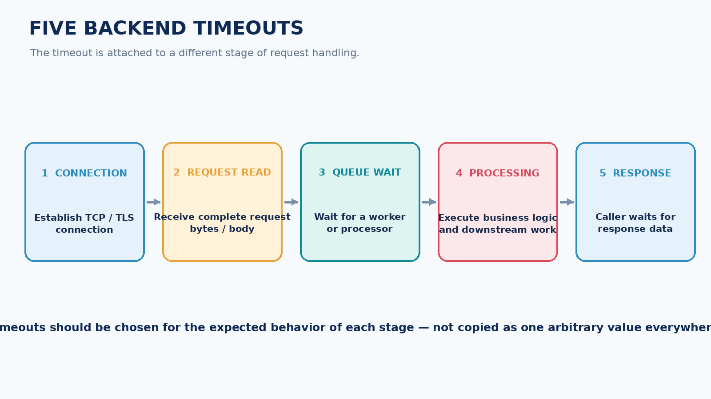
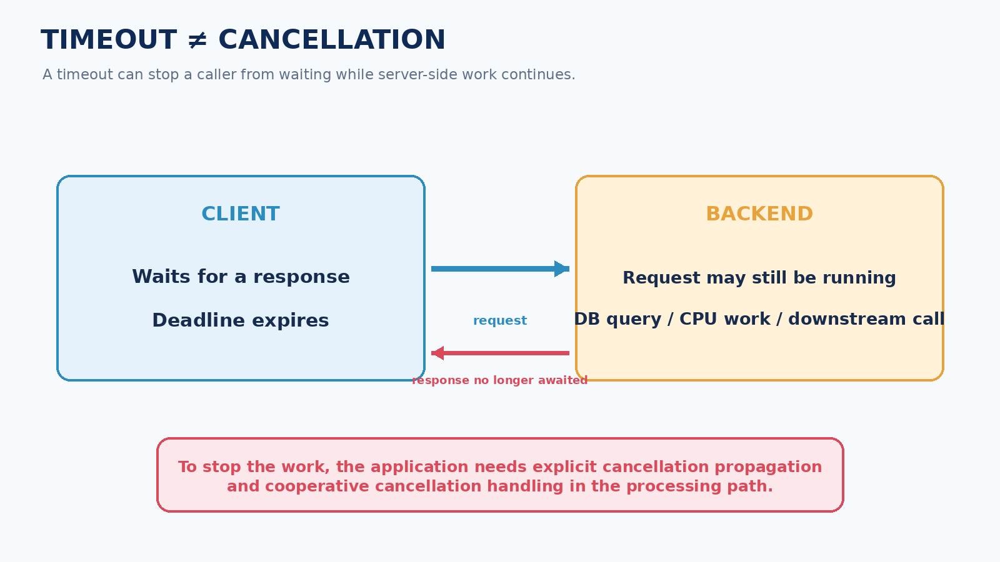
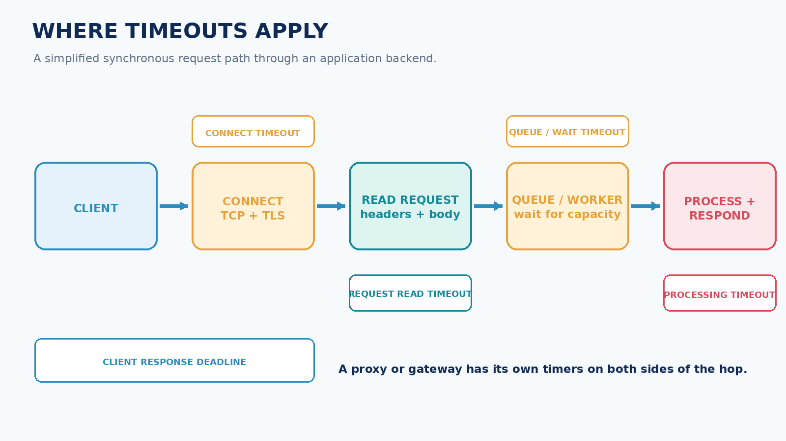
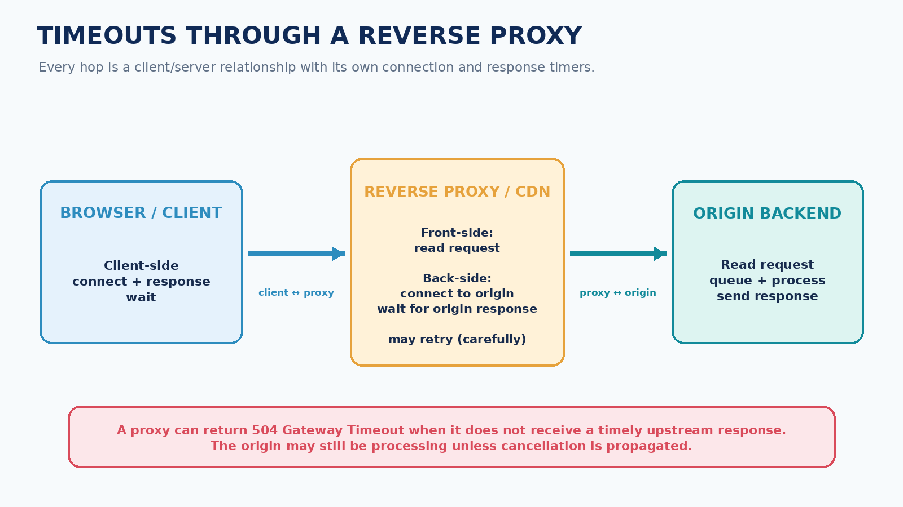
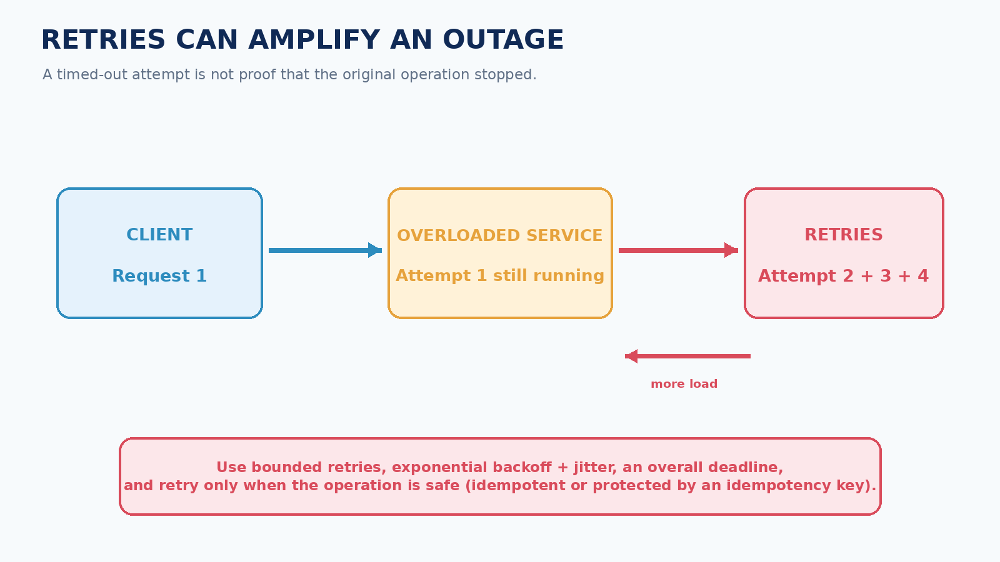
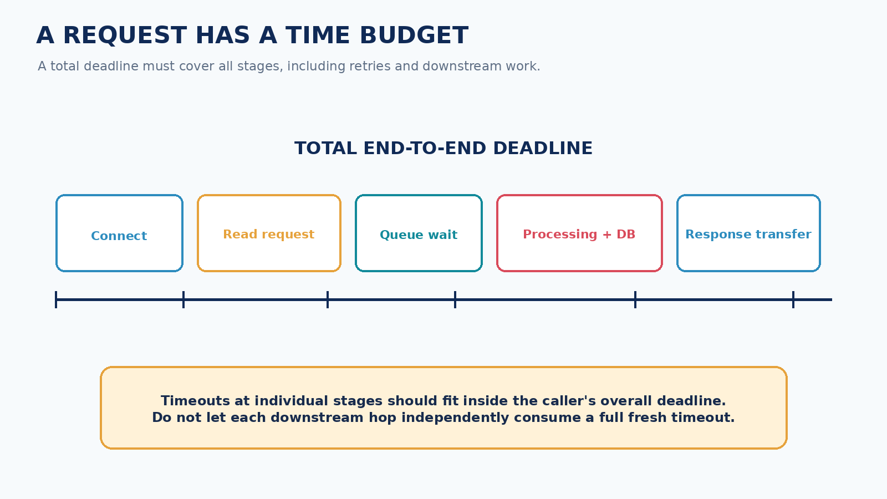

# Backend Timeouts

> [!NOTE]
>
> **Section:** Computer Networking - [Frontend & Backend Timeouts](https://youtu.be/2GAQVXGT_Zw?si=TsVf7OOf-1BrEINc)
> 
> **Learning objective:** Understand where timeouts belong in a backend request lifecycle, what each timeout protects, why a timeout does not necessarily cancel server-side work, and how proxies and retries can amplify failures.

[← Back to Application Traffic & Reliability Repository](https://github.com/Priya200227/computer-networking/tree/main/08-application-traffic-and-reliability)

---

## 1. What is a timeout?

A **timeout** is a limit on how long a component is willing to wait for a resource, event or operation.

When the limit expires, the waiting component stops waiting and takes a configured action: return an error, close a connection, release a resource, retry (if safe), or report a failure.

Timeouts are essential because they:

- Stop requests from holding resources indefinitely.
- Bound how long application workers, sockets and memory remain occupied.
- Help contain slow or unresponsive dependencies.
- Protect services from certain resource-exhaustion and denial-of-service patterns.
- Make unusually slow operations visible for diagnosis and service-level objectives (SLOs).

### The most important distinction: timeout vs cancellation

A timeout does **not** automatically mean that the underlying operation has stopped.

For example:

1. A browser sends a request to an API.
2. The API starts a database query.
3. The browser's response deadline expires.
4. The browser stops waiting.
5. The database query may continue running unless the application and database driver propagate cancellation.

There are therefore two separate questions:

- **Waiting:** How long will this caller wait?
- **Execution:** Should the work itself be stopped?

Cancellation requires an explicit mechanism and cooperation from the processing path. It may need to reach a worker, database query, downstream HTTP call or queued job.

> [!IMPORTANT]
> A caller giving up is not proof that the server stopped working. This distinction matters when requests are expensive, mutate data, or call other services.

---

## 2. The five timeout types

The video organizes backend timeouts into five main categories:

1. Connection timeout
2. Request-read timeout
3. Wait / queue timeout
4. Usage / processing timeout
5. Response timeout

They apply at different stages. Do not treat them as five names for the same timer.

### 2.1 Connection timeout

**Question:** How long should a client wait while establishing a connection to the next server?

Before a client can send application data, it may need to establish a transport connection and, when encryption is used, a TLS session.

For a typical HTTPS connection, this can include:

- DNS resolution (often handled separately by the client or resolver).
- TCP connection establishment, including the TCP three-way handshake.
- TLS negotiation.

The connection timeout bounds the time spent trying to establish the connection. If it expires, the client may fail the attempt or retry later according to its policy.

**Where it applies:**

- Browser / API client → application server
- Application server → database
- Application server → another API
- Reverse proxy / CDN → origin server

A reverse proxy is a client when it connects to the origin. The same timeout concepts apply at every hop.

### 2.2 Request-read timeout

**Question:** How long will the backend allow the client to take to send a complete request?

Once a connection exists, the backend must read enough bytes to identify and receive the request. This can include:

- Request line or protocol equivalent
- Headers
- Cookies and metadata
- Request body, such as JSON or an uploaded file

The backend may receive data gradually. If it waits too long for the request to arrive, it can keep sockets, buffers and worker resources occupied.

A request-read timeout bounds that waiting period.

**Why it matters - slow-client attacks:** A malicious or malfunctioning client can send a request extremely slowly, perhaps one small piece at a time, trying to keep server resources occupied. This pattern is commonly associated with Slowloris-style attacks.

The timeout should reflect the application's real request sizes and upload behavior. A small JSON API request and a large file upload may need different limits.

**Important:** Some servers expose separate header-read and body-read timers, or use an inactivity timeout (maximum gap between bytes) rather than one total request-read deadline. Check the specific server's semantics.

### 2.3 Wait / queue timeout

**Question:** How long may a request wait before a worker or processor starts executing it?

A backend does not have to execute every request immediately on the same thread or process that reads it. It may place work into a queue and let a worker pool process it.

A queue can make execution more manageable because the system can observe queue depth, waiting time and worker capacity. But a queue must be bounded.

A wait timeout limits how long a request can remain queued before it is rejected or reported as timed out.

This is especially relevant when:

- Worker threads or processes are busy.
- The service receives more requests than it can process.
- Long-running work is separated from short synchronous requests.
- Requests have different priorities or service classes.

If the queue wait limit is exceeded, the request may be rejected before business logic begins.

**Connection to connection pooling:** A database pool has a similar acquire-wait concept. When every pooled connection is busy, a caller waits for a connection to become available. The pool's acquire timeout limits that wait. It is a resource-acquisition timeout, not the same thing as a database query timeout.

### 2.4 Usage / processing timeout

**Question:** How long may the backend spend executing the operation?

After the request is accepted and a worker begins processing, the application may:

- Run business logic.
- Perform CPU-intensive calculations.
- Query or update a database.
- Call other services.
- Read or transform large amounts of data.

A processing timeout bounds the time the system permits for that work.

The appropriate limit depends on the operation. A lightweight profile lookup should not have the same execution budget as a report-generation job.

For example:

| Operation | Typical design consideration |
|---|---|
| Read a small profile | Short execution budget |
| Search or dashboard query | Depends on query complexity and user experience |
| Generate a large report | May need asynchronous job processing |
| Data import / ETL task | Often better represented as a background job with its own lifecycle |

A processing timeout should be connected to actual cancellation where possible. Merely returning an error to the caller while CPU work or database queries continue can leave the expensive work running.

**HTTP nuance:** HTTP does not define one universal status code meaning “the origin's internal processing-time limit expired.” The application or gateway chooses an appropriate response according to the failure and its API contract.

### 2.5 Response timeout

**Question:** After sending a request, how long will the client wait for the response?

This is commonly a client-side limit for synchronous request/response interactions.

The client sends a request and waits for the server to respond. If the configured response deadline expires, the client may report a timeout or abort its local request.

But remember:

- The client may stop waiting.
- The server may not know that the client has stopped waiting.
- The server may continue processing.
- A retry may create another attempt while the first one is still running.

Response-timeout behavior varies across client libraries. Some APIs define a total request deadline; others expose a timeout for waiting for the first response byte or for inactivity while reading response data. Read the library documentation rather than assuming all “read” or “response” timeouts mean the same thing.

---

## 3. How the five timeouts fit into one request

The simplified lifecycle below shows where the timeout categories apply.

| Stage | Timeout | What is being bounded? |
|---|---|---|
| Establish connection | Connection timeout | Time to connect to the next hop |
| Receive request | Request-read timeout | Time allowed to receive the request |
| Wait for capacity | Queue / wait timeout | Time before a worker starts processing |
| Execute operation | Usage / processing timeout | Time spent doing the work |
| Wait for result | Response timeout | Time the caller waits for a response |

In a real system, some stages overlap or are implemented differently. For example, a server may read a request and dispatch it directly to a worker without a separate queue. A database call may have its own acquisition, connection and query timeouts.

---

## 4. Timeouts across proxies and multiple backends

A critical point from the video: **client and backend are relative roles**.

A browser is a client to an API server. But that API server becomes a client when it calls a database or another service. A CDN or reverse proxy is a server to the browser and a client to the origin.

Every hop can have its own connection, read, processing and response limits.

### Example: browser → CDN / reverse proxy → origin

1. The browser connects to the CDN.
2. The CDN reads the browser's request.
3. The CDN connects to the origin backend.
4. The CDN forwards the request.
5. The origin processes it and returns a response.
6. The CDN forwards the response to the browser.

The CDN may have:
- A client-facing connection timeout and request-read timeout.
- An origin-facing connection timeout.
- An origin response timeout.
- A retry policy for selected failures.

The origin has its own request-read, queue and processing limits.

### Gateway Timeout (HTTP 504)

A `504 Gateway Timeout` means a server acting as a gateway or proxy did not receive a timely response from an upstream server needed to complete the request.

For example, the CDN connected to the origin and forwarded the request, but the origin did not respond within the CDN's configured upstream response window.

A 504 does **not** prove that the origin stopped processing. The origin may still be executing the request after the proxy has given up waiting.

### Do not confuse these HTTP status codes

| Status | Meaning | Timeout connection |
|---|---|---|
| `408 Request Timeout` | The server did not receive a complete request message within the time it was prepared to wait | Often associated with request-read timeout |
| `504 Gateway Timeout` | A gateway / proxy did not receive a timely upstream response | Often associated with an upstream connection or response timeout |
| `503 Service Unavailable` | The server is currently unable to handle the request | May be used for overload or temporary unavailability |
| `403 Forbidden` | The server understood the request but refuses to fulfill it | **Not a timeout status** |

The exact response code depends on which component timed out and the API or proxy's behavior. `408` and `504` are not interchangeable.

---

## 5. Why retries can make an outage worse

A timeout is often interpreted as “the operation failed.” That assumption is unsafe.

Consider this sequence:

1. A client sends Request A.
2. The backend starts processing Request A.
3. The client reaches its response timeout and gives up.
4. The backend continues processing Request A.
5. The client retries, sending Request B.
6. The backend now processes both attempts.

If many clients do this at once, the service receives extra work precisely when it is already struggling.

This can contribute to a **retry storm** or **thundering herd**:

- A dependency slows down.
- Requests time out.
- Many callers retry at nearly the same time.
- The retries add more load to the struggling dependency.
- The dependency becomes even slower or fails completely.

### Safer retry design

- **Bound the number of retries.** Never retry indefinitely.
- **Use exponential backoff.** Increase the delay between attempts.
- **Add jitter.** Randomize retry delays so clients do not all retry simultaneously.
- **Respect an overall deadline.** Do not start a retry when there is not enough time left to complete it.
- **Retry only appropriate failures.** A timeout does not always mean retrying is safe.
- **Consider idempotency.** Retrying a read is often safer than retrying a payment, order creation or other mutation.
- **Use idempotency keys where appropriate.** The server can recognize duplicate attempts and avoid applying the same logical operation more than once.

> [!NOTE]
> A retry policy is part of overload control, not just error handling. Unbounded or synchronized retries can turn a partial outage into a larger outage.

---

## 6. Timeouts, connection pooling and resource protection

Timeouts and connection pools complement each other.

| Mechanism | Resource or wait it controls |
|---|---|
| Connection timeout | Establishing a new connection |
| Pool acquire timeout | Waiting to borrow a pooled connection |
| Query / processing timeout | Time spent executing database or application work |
| Idle timeout | How long an unused pooled connection remains idle |
| Maximum connection lifetime | How long a connection is retained before recycling |
| Request / response deadline | Overall time budget for a client interaction |

A pool can be correctly bounded and still become exhausted if requests hold connections for too long. Conversely, a query timeout does not help if requests are stuck waiting to acquire a connection before the query even starts.

When investigating a slow API, identify **which stage is consuming the time**:

- Waiting to connect?
- Waiting to read the request?
- Waiting in a queue?
- Waiting to acquire a database connection?
- Executing a slow query?
- Waiting on another backend?
- Waiting for the response to reach the caller?

This breakdown is more useful than simply increasing every timeout.

---

## 7. End-to-end timeout budgets

A distributed request often passes through several components. Each component should not independently consume the entire caller timeout.

For example, suppose a caller has a 5-second overall deadline. The request might spend time connecting, waiting for a worker, querying a database and calling another service. If every downstream operation is allowed to wait for a fresh 5 seconds, the overall request can exceed the caller's deadline substantially.

A robust design uses an **overall deadline** and allocates smaller budgets to individual stages.

Conceptually:

\[
T_{\text{total}} \geq
T_{\text{connect}} +
T_{\text{queue}} +
T_{\text{processing}} +
T_{\text{response}}
\]

This is a planning model, not a universal exact equation: stages can overlap, request-read time may be separate, and retries consume additional time.

As a request travels downstream, propagate the remaining deadline or an equivalent time budget where the platform supports it. Do not let each hop reset the clock without considering the original caller's deadline.

---

## 8. Quick revision

| Concept | Remember |
|---|---|
| Connection timeout | Time allowed to establish a connection |
| Request-read timeout | Time allowed to receive a complete request |
| Wait / queue timeout | Time allowed for a worker to pick up queued work |
| Usage / processing timeout | Time allowed to execute the operation |
| Response timeout | Time the caller waits for the response |
| Timeout vs cancellation | Giving up waiting does not necessarily stop execution |
| 408 | Server did not receive a complete request in time |
| 504 | Gateway / proxy did not get a timely upstream response |
| Retry storm | Retries add load while the original attempts may still be running |
| Deadline | Overall time budget across the request path |

---

## References

- [RFC 9110 - HTTP Semantics](https://www.rfc-editor.org/rfc/rfc9110.html) - HTTP status-code semantics, including `408`, `403` and `504`.
- [MDN - 408 Request Timeout](https://developer.mozilla.org/en-US/docs/Web/HTTP/Status/408)
- [MDN - 504 Gateway Timeout](https://developer.mozilla.org/en-US/docs/Web/HTTP/Status/504)
- [Google SRE Book - Addressing Cascading Failures](https://sre.google/sre-book/addressing-cascading-failures/) - overload, retries and cascading failure patterns.
- [AWS Builders' Library - Timeouts, retries, and backoff with jitter](https://aws.amazon.com/builders-library/timeouts-retries-and-backoff-with-jitter/) - useful general distributed-systems guidance; the concepts are not limited to AWS.

**Related topic:** [Connection Pooling](../connection-pooling/README.md) - understand how acquire waits, pool limits and connection lifecycles interact with backend timeouts.
