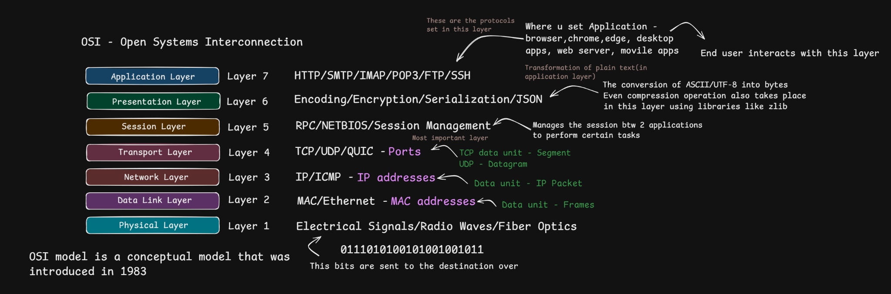
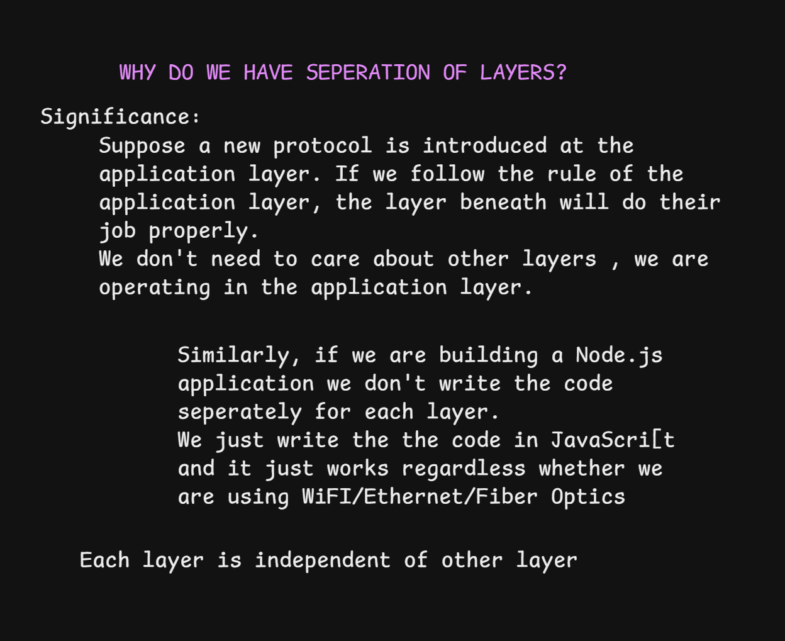
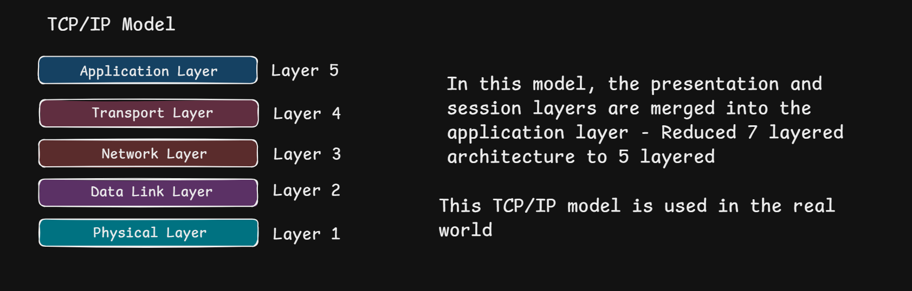
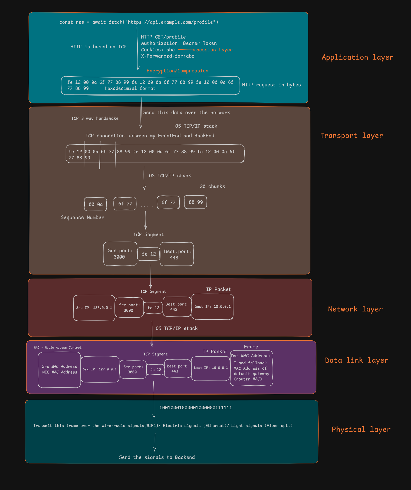
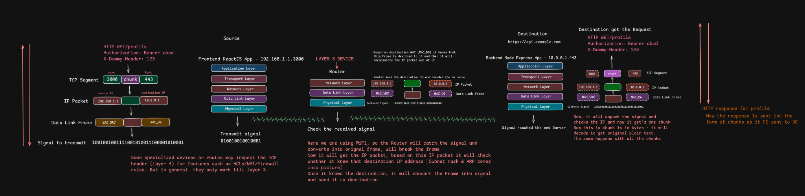

# OSI Model, TCP/IP Model, and Data Encapsulation

> **Learning objective:** Understand why networking is described in layers, how the seven-layer OSI reference model relates to the TCP/IP model, and how data moves from an application on one host to an application on another host.

[← Back to Repository](https://github.com/Priya200227/computer-networking) 

---

These notes combine the lesson diagrams with clarifications needed to use them accurately. The diagrams are conceptual learning aids—not packet captures or a guarantee that every application follows the same sequence.

---

## 1. Why do we use layers?

Networking involves several different jobs: applications define what messages mean; transport protocols support communication between processes; IP moves packets between networks; link technologies deliver data across one local link; and physical media carry signals.

A **layered model** organizes these responsibilities into conceptual groups. Each layer offers services to the layer above and relies on services from the layer below.

### Why layering is useful
- **Abstraction:** An application can use a network API without needing to manage radio waves, Ethernet signalling, or every router along the route.
- **Modularity:** Different implementations can interoperate when they follow shared protocol specifications and interfaces.
- **Replaceability:** A device can switch between Wi-Fi and Ethernet without requiring the application protocol to be rewritten.
- **Troubleshooting:** Layering helps narrow down where a failure may be occurring—for example, DNS resolution, TCP connectivity, IP routing, or Wi-Fi association.
- **Independent evolution:** Improvements at one layer often do not require redesigning every other layer, although layers are not completely independent in every practical situation.

**Important nuance:** Layers are a model for organizing responsibilities, not seven separate programs or physical components that every device must implement as isolated modules.

### Image 1 — The OSI model at a glance

**How to read it:** Start at Layer 7 when thinking about the application's meaning and move down toward Layer 1 to think about transmission. The protocols and examples shown beside each layer are illustrative; the exact mapping of a technology to an OSI layer can depend on which function is being discussed.

---

## 2. The seven-layer OSI model

The **Open Systems Interconnection (OSI) reference model** describes networking using seven layers. It is especially useful as a shared vocabulary for learning, design discussions, and troubleshooting.

| Layer | Name | Main responsibility | Common examples / concepts |
|---:|---|---|---|
| 7 | Application | Network services and message semantics used by applications | HTTP, DNS, SMTP, SSH |
| 6 | Presentation | Data representation, format translation, serialization, and conceptual encryption/compression functions | Character encoding, data formats, serialization; TLS does not map perfectly to one OSI layer |
| 5 | Session | Establishing, managing, and coordinating communication sessions | Session/dialog control concepts; some RPC/session mechanisms |
| 4 | Transport | Communication between processes; ports; transport-specific reliability, ordering, and flow control | TCP, UDP; QUIC is commonly discussed at the transport layer, though it runs over UDP |
| 3 | Network | Logical addressing and forwarding across interconnected networks | IPv4, IPv6, IP routing; ICMP is associated with the IP layer |
| 2 | Data Link | Delivery over a local link, framing, and link-layer addressing | Ethernet, Wi-Fi MAC; MAC addresses |
| 1 | Physical | Representing and transmitting bits as signals over a medium | Copper/electrical signalling, fiber-optic light, radio signals |

### Layer-by-layer mental model
- **Layer 7 — Application:** What request or message does the application want to send? For example, an HTTP request for a profile.
- **Layer 6 — Presentation:** How is the data represented or transformed? Think of encoding and serialization. Real protocol stacks do not always implement a distinct, separately visible “presentation layer.”
- **Layer 5 — Session:** How is an ongoing exchange coordinated? The OSI session layer is a useful concept, but its functions are not always a separate layer in modern Internet implementations.
- **Layer 4 — Transport:** Which process/service is involved, and what transport behavior is needed? TCP uses ports and provides a reliable ordered byte stream; UDP provides datagrams without TCP's built-in delivery guarantees.
- **Layer 3 — Network:** What is the destination IP address, and which next hop should receive the packet?
- **Layer 2 — Data Link:** How should data be delivered over this particular local link? On Ethernet and Wi-Fi, link-layer frames use link-layer addressing.
- **Layer 1 — Physical:** How are the bits represented on the chosen medium?

### Image 2 — Why separation of layers matters

The key idea in this diagram is **separation of responsibilities**. For example, application code can call a networking API while the operating system and network interface handle lower-level work. The same application may communicate over Wi-Fi, Ethernet, or a cellular network without application code having to manually encode radio or electrical signals.

Do not interpret “each layer is independent” as absolute independence. Layers interact, and real systems include cross-layer configuration, optimization, security controls, and implementation details.

---

## 3. The TCP/IP model

The **TCP/IP model** describes the protocol architecture used by the Internet. Teaching materials commonly show either a **four-layer** or **five-layer** version. Both are useful if the chosen convention is stated clearly.

This repository uses the **five-layer teaching model**, which separates the link and physical responsibilities for learning:

| Teaching layer | Responsibilities | Examples |
|---|---|---|
| Application | Application-level network protocols and data semantics | HTTP, DNS, SMTP, SSH |
| Transport | Process-to-process communication | TCP, UDP; QUIC is built over UDP |
| Network / Internet | IP addressing and routing between networks | IPv4, IPv6, ICMP |
| Data Link | Local-link framing and delivery | Ethernet, Wi-Fi link layer |
| Physical | Transmission of bits as signals | Radio, copper, fiber |

In the common **four-layer TCP/IP model**, the Data Link and Physical layers are combined into a single **Link / Network Access** layer. The Internet architecture does not define separate Presentation and Session layers in the same way as the OSI model; many such functions are handled within application protocols, libraries, or security protocols.

### Image 3 — TCP/IP model

**How to use this diagram:** Map the OSI model to the TCP/IP model by responsibility, not by assuming a perfect one-to-one correspondence. The five-layer version is a teaching convention. A source may instead show four layers by combining Link and Physical.

---

## 4. OSI vs. TCP/IP

| OSI model | Five-layer TCP/IP teaching model | Practical interpretation |
|---|---|---|
| Layer 7 — Application | Application | Application protocols such as HTTP and DNS |
| Layer 6 — Presentation | Usually included in Application | Representation, serialization, and related functions |
| Layer 5 — Session | Usually included in Application | Session/dialog functions where required |
| Layer 4 — Transport | Transport | TCP, UDP; QUIC is built over UDP |
| Layer 3 — Network | Network / Internet | IP addressing and routing |
| Layer 2 — Data Link | Data Link | Local-link frames and link-layer addressing |
| Layer 1 — Physical | Physical | Signals and transmission medium |

The OSI model is a **reference model**; the TCP/IP model is more closely tied to the Internet protocol suite. Neither table nor diagram means every real-world protocol neatly belongs to exactly one layer in all contexts.

### Why the distinction matters
When debugging a request, you might ask:
1. Is the application forming the correct request?
2. Can the name resolve to an address?
3. Can the required transport connection be established?
4. Is IP routing working?
5. Is the local link connected and functioning?

This layered checklist helps structure the investigation. It does not guarantee that a failure belongs exclusively to one layer.

---

## 5. Encapsulation: following data from source to destination

**Encapsulation** is the process of adding protocol-specific information as data passes down the sender's networking stack. At the receiver, the relevant headers (and any trailers) are processed as the data moves up the stack. This is often called **decapsulation**.

Consider an application making a request to a remote server. A simplified path is:

1. **Application data:** The application creates data according to its protocol—for example, an HTTP request.
2. **Transport:** If using TCP, TCP treats application data as a byte stream and sends it using TCP segments. Source and destination port numbers identify the transport endpoints. If using HTTP/3, QUIC runs over UDP instead of TCP.
3. **Network:** IP adds source and destination IP addresses and creates an IP packet (often called an IP datagram).
4. **Data Link:** The local network technology wraps the IP packet in a link-layer frame suitable for the next link. On an Ethernet/Wi-Fi network, this includes link-layer source and destination addresses.
5. **Physical:** The frame is represented as signals and transmitted over the medium.
6. **At a router:** The router receives a frame, processes the enclosed IP packet, chooses a next hop, and sends the packet using a new link-layer frame on the outgoing interface.
7. **At the destination:** The destination processes the incoming frame, IP packet, and transport data, then delivers the data to the appropriate application.

### Image 4 — Encapsulation through the layers

This image illustrates the idea of a message moving through the stack and gaining lower-layer protocol information. The byte values and the number/size of illustrated pieces are examples, not a literal encoding of a real HTTP request.

### Data-unit vocabulary

| Layer / context | Common term | What it means |
|---|---|---|
| Application | Message / application data | Data defined by the application protocol |
| TCP transport | TCP segment | TCP header plus a portion of the TCP byte stream |
| UDP transport | UDP datagram | UDP header plus its payload |
| IP network | IP packet / IP datagram | IP header plus its payload, which may contain a TCP segment or UDP datagram |
| Link | Frame | Link-layer header/trailer plus payload, commonly carrying an IP packet |
| Physical | Bits/signals | Representation transmitted across the medium |

Terminology varies by protocol and context. “Chunk” is a generic word and should not be treated as a precise synonym for TCP segment, IP packet, or Ethernet frame.

### One important TCP detail

TCP provides an ordered byte stream. It does **not** preserve a one-to-one relationship between application writes and TCP segments. The operating system and TCP implementation choose segmentation based on multiple factors, and one application message may span multiple segments—or data from multiple writes may be combined. The receiver reconstructs the byte stream for the application. See [RFC 9293, TCP](https://www.rfc-editor.org/rfc/rfc9293.html).

---

## 6. What happens at a router?

### Image 5 — Source, router, and destination

This diagram follows a request from a frontend host, through a router, to a backend host. It highlights the distinction between information used for end-to-end delivery and information used for delivery on an individual link.

At a high level:
1. The source host decides that the destination is outside its local subnet and sends the packet to its configured next hop, commonly the default gateway.
2. The source host needs the **link-layer address of that next hop** to send the first local frame. For IPv4 on Ethernet/Wi-Fi, ARP may be used to resolve the next-hop IPv4 address to a MAC address if the mapping is not already known.
3. The router receives the frame and removes the incoming link-layer framing.
4. It examines the destination IP address and consults its routing information to choose an outgoing interface/next hop.
5. It encapsulates the IP packet in a new link-layer frame for the next link and forwards it.
6. This repeats across routed hops until the packet reaches the destination network.

### What usually changes at each hop?
- **Link-layer frame and MAC addresses:** The frame is specific to a link and is replaced for the next link. The destination MAC on the source's first frame is usually the local router/default gateway—not the remote server's MAC address.
- **IP packet:** The source and destination IP addresses generally remain the same across routed hops, except when mechanisms such as Network Address Translation (NAT) alter them. Other IP-header fields can change as packets are forwarded.
- **Transport data:** The TCP segment or UDP datagram is carried inside the IP packet. Ordinary routers forward based primarily on network-layer information, although firewalls, NAT devices, load balancers, and other middleboxes may also inspect or modify transport-layer information.

**Correction to a common oversimplification:** A router does not simply “convert the frame into a signal and send it to the destination.” It receives a frame on one link, processes the enclosed network-layer packet, selects a next hop, and builds an appropriate outgoing frame on another link. The physical interface then transmits that outgoing frame as signals.

---

## 7. Important corrections and nuances

Use these points to avoid memorizing simplified diagrams too literally.

### 7.1 The OSI model is conceptual
The OSI model has seven named layers, but a modern operating system does not necessarily implement seven distinct software modules that match those boundaries exactly. It is a reference framework for describing functions.

### 7.2 TCP/IP is shown with different layer counts
A four-layer TCP/IP model combines the link and physical responsibilities. A five-layer version separates them for teaching. State which version you are using rather than treating one diagram as the only valid one.

### 7.3 HTTP does not always use TCP
- HTTP/1.1 and HTTP/2 are commonly used over TCP (with TLS for HTTPS in typical deployments).
- HTTP/3 maps HTTP semantics over QUIC, which uses UDP.

Therefore, “HTTP is always based on TCP” is inaccurate. See [RFC 9114, HTTP/3](https://www.rfc-editor.org/rfc/rfc9114.html).

### 7.4 HTTPS changes what is visible on the wire
With HTTPS, HTTP contents are protected by TLS or, for HTTP/3, by QUIC's integrated TLS-based security. A packet capture may show network and transport metadata, but it ordinarily will not expose the encrypted HTTP headers and body as readable plaintext without suitable decryption context.

### 7.5 TCP segments are not fixed-size “chunks”
A diagram may show a stream split into several pieces to explain segmentation. It should not imply that TCP always creates a fixed number of chunks or that each application-level message maps to one segment. TCP segmentation depends on implementation and network conditions; application write boundaries are not preserved as TCP segment boundaries.

### 7.6 Layer boundaries are useful, not absolute
For example, TLS is commonly described as sitting between application protocols and transport, but its mapping to the OSI presentation/session layers is not exact. Similarly, QUIC implements transport-like functionality over UDP and includes security features. Treat layer labels as a way to reason about responsibilities, not as rigid boxes for every technology.

---

## 8. Quick reference table

| Question | Short answer |
|---|---|
| Why have layers? | To separate responsibilities, enable interoperability, and make systems easier to reason about and troubleshoot. |
| What is the OSI model? | A seven-layer reference model for describing networking functions. |
| What is the TCP/IP model? | A model of the Internet protocol architecture, commonly taught as four or five layers. |
| What does encapsulation mean? | Adding protocol information as data moves down the sender's stack. |
| What does decapsulation mean? | Processing/removing relevant protocol information as data moves up the receiver's stack. |
| What does TCP provide? | A reliable, ordered byte stream between transport endpoints. |
| Is a TCP segment the same as an IP packet? | No. A TCP segment is carried inside an IP packet. |
| Is an IP packet the same as a link-layer frame? | No. A link-layer frame carries an IP packet on a particular link. |
| What does a router do? | Forwards IP packets between networks and uses link-layer framing appropriate to each outgoing link. |
| Does HTTP always use TCP? | No. HTTP/3 uses QUIC over UDP; HTTP/1.1 and HTTP/2 commonly use TCP. |

---
## Key takeaway

**The OSI model helps you organize networking concepts; the TCP/IP stack implements the protocols used in Internet communication.** When data travels between hosts, each layer has a responsibility, and encapsulation connects those responsibilities into an end-to-end communication process.

---

## References

Primary standards and reliable technical references:
- **RFC 1122 — Requirements for Internet Hosts: Communication Layers**  
   https://www.rfc-editor.org/rfc/rfc1122.html  
   Describes Internet host communication layers, including link, IP, and transport responsibilities.

- **RFC 9293 — Transmission Control Protocol (TCP)**  
   https://www.rfc-editor.org/rfc/rfc9293.html  
   Defines TCP and explains its reliable byte-stream service and segmentation behavior.

- **RFC 9114 — HTTP/3**  
   https://www.rfc-editor.org/rfc/rfc9114.html  
   Specifies HTTP semantics mapped over QUIC and clarifies that HTTP/3 does not use TCP as its transport.

- **ISO 7498-1 — OSI Basic Reference Model**  
   https://www.iso.org/standard/20269.html  
   ISO reference for the OSI basic reference model. Access to the full standard may require purchase.

- **Cisco — TCP/IP Overview (PDF)**  
   https://www.cisco.com/c/en/us/support/docs/ip/routing-information-protocol-rip/13769-5.pdf  
   A networking reference showing how the TCP/IP protocol suite relates to the OSI model.

- **Reference Video**: [What makes OSI and TCP/IP models Different](https://youtu.be/ZOLkWBVMcwU?si=WOa1_I2GkCjnJL8a)

---
**Next:** [Routing](../09-routing-and-packet-travel/README.md)
