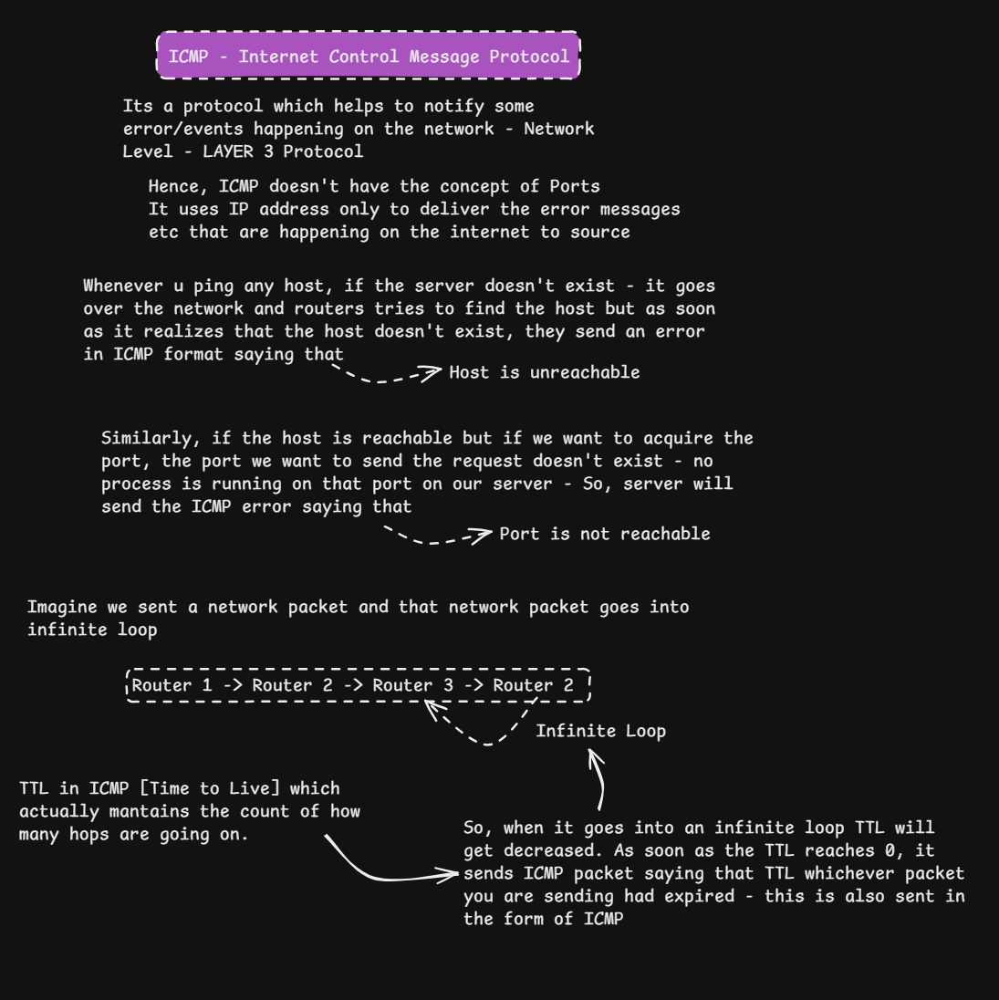
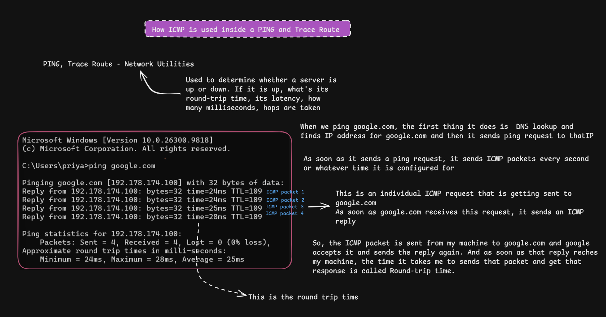
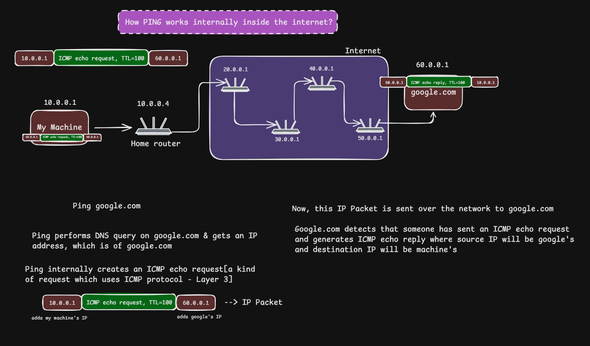
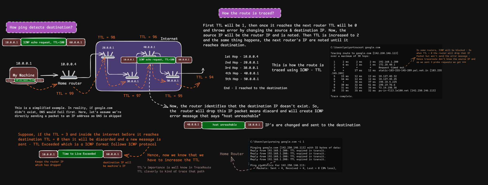

# ICMP, Ping, and Traceroute

> **Section:** Computer Networking — [Chai aur Networking](https://youtu.be/VzPFY40qAhQ?si=TZzJqRroCzU8ixEX)
>
> **Purpose:** Understand how ICMP communicates network-layer errors and diagnostic information, how `ping` uses ICMP Echo messages to test reachability and measure round-trip time, and how `traceroute`/`tracert` uses IP Time to Live (TTL) or Hop Limit values to discover responding routers along a network path.

[← Back to Computer Networking Repository](https://github.com/Priya200227/computer-networking)

---

## Overview

The **Internet Control Message Protocol (ICMP)** is a network-layer control and diagnostic protocol used with IP. It carries information about delivery problems and supports network troubleshooting.

Two familiar utilities use ICMP-related behaviour:

- **`ping`** sends ICMP Echo Request messages and looks for Echo Replies. It helps test whether a destination responds and measures round-trip time (RTT).
- **`traceroute`** (called **`tracert`** on Windows) sends probes with progressively increasing TTL/Hop Limit values. The responses help identify routers along the path.

ICMP does **not** use TCP or UDP port numbers. It is carried directly inside IP packets.

> **Important:** ICMP diagnostics are evidence about network behaviour, not absolute proof that a host or application is healthy. Firewalls, filtering, rate limiting, routing policies, and return-path problems can affect results.

## Learning objectives

By the end of this section, you should be able to:

- Explain the purpose of ICMP and why it does not use TCP/UDP ports.
- Distinguish ICMP Echo Request/Reply messages from ICMP error messages.
- Explain what `ping` tests and how RTT and packet loss are reported.
- Describe how IPv4 TTL limits packet lifetime and how routers generate ICMP Time Exceeded messages.
- Explain how traceroute uses probes with increasing TTL values to reveal responding hops.
- Interpret common traceroute output, including timeouts.
- Recognize the limitations of ping and traceroute when diagnosing real networks.

---

## 1. What is ICMP?

**ICMP** stands for **Internet Control Message Protocol**. Hosts and routers use it to communicate network-layer control information, including certain delivery errors and diagnostic responses.

ICMP is associated with the network layer (Layer 3 in the OSI teaching model). In IPv4, ICMP is identified in the IP header by protocol number **1**.

### Does ICMP use port numbers?

No. Port numbers belong to transport-layer protocols such as TCP and UDP. ICMP is encapsulated directly in an IP packet, so it has no TCP/UDP source or destination ports.

ICMP messages have their own **Type** and **Code** fields. The Type identifies the general message; the Code provides more specific information.

### Common ICMP messages

| ICMP message | What it indicates | Typical use |
|---|---|---|
| Echo Request (Type 8) | A request for an Echo Reply | `ping` |
| Echo Reply (Type 0) | A response to an Echo Request | `ping` |
| Destination Unreachable (Type 3) | A packet could not be delivered for a reported reason | Network troubleshooting |
| Time Exceeded (Type 11) | A packet's TTL expired in transit | `traceroute` |
| Redirect (Type 5) | A router informs a host about a potentially better next hop | Applicable IPv4 environments |

An IPv4 Destination Unreachable message has different Codes for different conditions, including network unreachable, host unreachable, and port unreachable.

### Image 1 — ICMP messages, errors, and packet lifetime



The diagram introduces three important ideas:

1. **ICMP reports network-layer conditions.** A router or destination host may send an ICMP error when it cannot forward or deliver a packet for a reason it can report.
2. **ICMP has no port numbers.** It is carried directly by IP rather than by TCP or UDP.
3. **TTL limits forwarding lifetime.** If an IPv4 packet's TTL expires while being forwarded, the router discards that packet and normally sends an ICMP Time Exceeded message, subject to applicable rules and filtering.

#### Clarifications about unreachable errors

The diagram uses an unreachable host as an example. In a real network, the sender may receive an ICMP Destination Unreachable message, but the packet may also be silently dropped or filtered. A timeout does not prove that the destination host does not exist.

Also, **Port Unreachable** is not a generic response to every closed port. It is commonly associated with an unreachable UDP destination port. A TCP connection attempt to a closed port normally receives a TCP RST instead.

---

## 2. How `ping` works

`ping` is a network diagnostic utility that commonly uses ICMP Echo Request and Echo Reply messages.

At a high level:

1. You run `ping` with a hostname or IP address.
2. If you provide a hostname, the system resolves it to an IP address using its configured name-resolution process (commonly DNS).
3. The utility sends an ICMP Echo Request to the destination IP address.
4. If the destination receives and permits the request, it may send an ICMP Echo Reply.
5. The sender measures the elapsed time between sending the request and receiving the reply.

### Image 2 — Reading ping output


The screenshot shows a Windows `ping` command and its output.

| Output field | Meaning |
|---|---|
| `bytes=32` | Size of the ICMP data payload reported by this Windows output; not the total IP packet size. |
| `time=24ms` | Measured round-trip time for that Echo exchange. |
| `TTL=109` | TTL value in the received reply when it reached the local machine. It is not the number of hops. |
| `Sent` | Number of Echo Requests transmitted. |
| `Received` | Number of Echo Replies received. |
| `Lost` | Requests for which no matching reply arrived before timeout. |
| `Minimum / Maximum / Average` | Summary statistics for successful replies. |

### What is round-trip time (RTT)?

**Round-trip time (RTT)** is the elapsed time from sending a probe until its response returns to the sender. It includes the forward journey, destination processing, and the return journey.

RTT is not necessarily twice the one-way network delay: the forward and return paths and processing times may differ.

### Does a successful ping prove that a website is working?

No. A successful ping indicates that ICMP Echo traffic received a response from the IP address. It does **not** prove that:

- the website's HTTP/HTTPS service is running;
- TCP port 80 or 443 is reachable;
- the application is healthy;
- every user can reach the service.

A server or firewall may block ICMP while allowing HTTPS. Conversely, a host may answer ping while its web application is down.

---

## 3. How an ICMP Echo request travels

Consider the simplified example in the diagram: a machine sends an Echo Request to a destination represented as `google.com`.

### Image 3 — Ping across multiple routers



The conceptual flow is:

1. **Name resolution:** The hostname is resolved to an IP address before the Echo Request is sent. The exact resolver path depends on the operating system and its configuration.
2. **Echo Request creation:** `ping` creates an ICMP Echo Request message.
3. **IP encapsulation:** The ICMP message is carried inside an IP packet with source and destination IP addresses.
4. **Forwarding:** The packet is forwarded through the local network and routers toward the destination. Each IPv4 router that forwards it decreases the TTL by at least one.
5. **Destination response:** If the destination receives and permits the request, it can generate an ICMP Echo Reply.
6. **Return journey:** The Echo Reply travels back to the source. Its route may differ from the request's route.
7. **RTT calculation:** The source measures the time until the reply arrives.

The router addresses in the illustration are teaching placeholders. The public Internet does not normally expose a fixed, simple chain of routers; real paths can change.

### IP addresses versus MAC addresses

- **IP addresses** identify source and destination at the network layer. They generally remain the same across ordinary routed hops, except when mechanisms such as Network Address Translation (NAT) modify them.
- **MAC addresses** are used for delivery on an individual local link. At each routed hop, the outgoing link-layer frame is rebuilt with the appropriate next-hop MAC addresses.

ICMP is an IP-layer message; Ethernet or Wi-Fi frames carry it across individual links.

---

## 4. What is TTL?

**Time to Live (TTL)** is an 8-bit field in the IPv4 header. Despite its name, it is used in practice as a hop limit: every router that forwards the packet decreases the TTL by at least one.

- If the TTL remains above zero, the router may continue forwarding the packet.
- If forwarding would reduce the TTL to zero, the router discards the packet.
- The router normally sends an ICMP **Time Exceeded** message (Type 11, Code 0) back to the source, unless the response is suppressed or filtered.

TTL prevents packets from circulating indefinitely if a routing loop occurs.

For IPv6, the equivalent field is called **Hop Limit**. Routers decrement it in the same general way; an expired IPv6 Hop Limit is reported using ICMPv6 Time Exceeded.

> TTL is not a counter that starts at zero and records the number of routers. The sender chooses an initial TTL, and routers decrement it as they forward the packet. The received TTL alone does not reliably reveal the exact hop count because the initial value may be unknown.

---

## 5. How traceroute discovers the path

**Traceroute** is a diagnostic technique that attempts to identify routers along the path to a destination. It sends probes with increasing TTL values (IPv4) or Hop Limit values (IPv6).

### Core mechanism

1. The first probe is sent with TTL **1**.
2. The first router decrements the TTL. It expires at that router, which may return ICMP Time Exceeded.
3. The traceroute tool records the source address of that response as the first hop.
4. The next probe is sent with TTL **2**. It can pass through the first router and expire at the second router.
5. The tool continues increasing the TTL, recording responses from successive hops.
6. When a probe reaches the destination, the destination may respond in a way that lets the tool identify that it has been reached.

### Image 4 — TTL expiry and route discovery




The diagram illustrates the increasing-TTL technique:

| Probe | Initial TTL | Where it normally expires |
|---|---:|---|
| 1 | 1 | First router |
| 2 | 2 | Second router |
| 3 | 3 | Third router |
| 4 | 4 | Fourth router |
| 5 | 5 | Fifth router |

Each intermediate router where the probe expires can return an ICMP Time Exceeded message. Traceroute uses the response's source IP address to display the responding hop.

### What does traceroute send?

The probe type depends on the operating system and implementation:

- Traditional Unix/Linux `traceroute` commonly sends UDP probes by default.
- Windows `tracert` uses ICMP Echo Request probes.
- Other implementations can use TCP, ICMP, or configurable probe types.

The **TTL/Hop Limit mechanism** is the key idea; traceroute is not one single packet format or one universal probe protocol.

### Why does the final hop respond differently?

When a probe reaches its destination, it does not expire at an intermediate router. The destination's response depends on the probe type:

- With UDP-based traceroute, the destination commonly returns ICMP Destination Unreachable with the Port Unreachable Code when the probe reaches an unused UDP port.
- With ICMP Echo-based tracing, the destination may return an ICMP Echo Reply.
- With TCP-based tracing, the destination may respond with a TCP message such as SYN-ACK or RST, depending on the port and service.

Traceroute recognizes the destination response according to the probe method it uses.

---

## 6. Interpreting traceroute output

A typical traceroute output lists hop numbers, responding router addresses or names, and probe times.

```text
tracert example.com

  1     2 ms     2 ms     1 ms  192.168.1.1
  2    10 ms    11 ms    10 ms  10.10.0.1
  3     *        *        *      Request timed out.
  4    25 ms    24 ms    26 ms  203.0.113.1
```

This is illustrative output, not a measurement from your network.

| Output | Interpretation |
|---|---|
| Hop number | Probe TTL/Hop Limit level being tested. |
| IP address or hostname | Address of the device that responded to that probe. |
| Multiple times | RTT measurements for multiple probes at that hop. |
| `*` or timeout | No usable response arrived before the timeout. It does not prove that a router is absent. |

### Why might a hop show `* * *`?

A router may forward the probe but not send an ICMP Time Exceeded response. Possible reasons include:

- ICMP is filtered by an access-control list or firewall.
- The router rate-limits diagnostic responses.
- The response is lost on the return path.
- The router or network deprioritizes control-plane traffic.
- The probe or response is blocked by network policy.

A missing hop response does not necessarily mean traffic stops there. Later hops may still respond.

### Why can hop addresses or timings change?

Internet routing is dynamic. Different probes may take different paths because of load balancing, routing changes, policy, or network conditions. RTT also includes response processing and return-path delay; it is not simply the time spent forwarding at that router.

---

## 7. `ping` versus `traceroute`

| Feature | `ping` | `traceroute` / `tracert` |
|---|---|---|
| Main purpose | Test whether a destination responds to Echo probes and measure RTT | Discover responding hops along a path |
| Main mechanism | ICMP Echo Request and Echo Reply | Probes with progressively increasing TTL/Hop Limit |
| Uses TTL/Hop Limit to discover hops? | Not normally | Yes |
| Typical output | Replies, RTT, packet-loss summary | Hop numbers, responding addresses, probe times |
| Useful for | Basic IP reachability and delay/loss to the destination | Identifying where along a path responses stop or change |
| Key limitation | Does not test a specific application or TCP/UDP port | Some hops may not respond; the displayed path may be incomplete |

---

## 8. Practical commands

### Windows

```powershell
# Send ICMP Echo Requests
ping example.com

# Send four Echo Requests
ping -n 4 example.com

# Trace the route using ICMP Echo probes
tracert example.com

# Skip hostname resolution for intermediate hops
tracert -d example.com
```

Options vary by operating system and installed implementation. Check local manual pages or built-in help before relying on a particular option.

---

## 9. Using these tools in real troubleshooting

| Symptom | What to investigate next |
|---|---|
| Ping fails, website works | ICMP filtering or policy; application traffic may still be allowed. |
| Ping works, website fails | DNS result, TCP connection, port 80/443, TLS, reverse proxy, web server, and application health. |
| Traceroute stops at one hop | ICMP filtering/rate limiting, return path, and whether later hops respond. |
| RTT suddenly increases | Congestion, path changes, queueing, or return-path differences; validate with repeated measurements. |
| Packet loss appears at one intermediate hop but not later hops | The intermediate router may be limiting diagnostic responses rather than dropping forwarded traffic. |
| All later hops also show loss | Investigate the path beyond that point and compare from another vantage point. |

For application-level diagnosis, use tools appropriate to the service—for example, a TCP connection test to a specific port, an HTTP request, or application health checks. Ping is not a substitute for those tests.

---

## 10. Quick revision

- **ICMP:** Network-layer control and diagnostic protocol used with IP.
- **Echo Request / Echo Reply:** ICMP messages commonly used by `ping`.
- **RTT:** Time from sending a probe until its response returns.
- **TTL:** IPv4 field decremented by routers; prevents packets from circulating indefinitely.
- **Time Exceeded:** ICMP error commonly returned when a probe's TTL expires.
- **Traceroute:** Uses probes with increasing TTL/Hop Limit values to discover responding hops.
- **Timeout (`*`):** No response was received in time; it does not automatically mean the router is down.
- **No ports:** ICMP does not use TCP/UDP port numbers.

---

## References

These are primary standards or official technical documentation.

1. **RFC 792 — Internet Control Message Protocol (ICMP).** Defines ICMP for IPv4, including Echo, Destination Unreachable, and Time Exceeded messages.  
   https://www.rfc-editor.org/rfc/rfc792

2. **RFC 1122 — Requirements for Internet Hosts: Communication Layers.** Specifies host requirements for the Internet protocol suite, including ICMP behaviour.  
   https://www.rfc-editor.org/rfc/rfc1122

3. **RFC 1812 — Requirements for IP Version 4 Routers.** Defines IPv4 router behaviour, including forwarding and ICMP error generation.  
   https://www.rfc-editor.org/rfc/rfc1812

4. **RFC 8200 — Internet Protocol, Version 6 (IPv6) Specification.** Defines IPv6 and its Hop Limit field.  
   https://www.rfc-editor.org/rfc/rfc8200

5. **RFC 4443 — Internet Control Message Protocol (ICMPv6).** Defines ICMP for IPv6, including Echo and error messages.  
   https://www.rfc-editor.org/rfc/rfc4443

6. **Microsoft Learn — `ping` command.** Official Windows command reference.  
   https://learn.microsoft.com/en-us/windows-server/administration/windows-commands/ping

7. **Microsoft Learn — `tracert` command.** Official Windows route-tracing command reference.  
   https://learn.microsoft.com/en-us/windows-server/administration/windows-commands/tracert

8. **Linux man-pages — `ping(8)`.** Reference for the Linux ping utility.  
   https://man7.org/linux/man-pages/man8/ping.8.html

9. **Linux man-pages — `traceroute(8)`.** Reference for the traceroute utility where provided by the relevant package.  
   https://man7.org/linux/man-pages/man8/traceroute.8.html

### Video reference

- [What Happens When You PING Google?](https://youtu.be/VzPFY40qAhQ?si=TZzJqRroCzU8ixEX)

---

## Key takeaway

**ICMP helps devices report network-layer errors and perform diagnostics. `ping` uses Echo messages to test responsiveness and measure round-trip time. Traceroute uses progressively increasing TTL/Hop Limit values to identify routers that respond along a path.** These tools provide useful evidence, but filtering and policy mean that missing ICMP responses do not automatically indicate a failed host or broken route.

