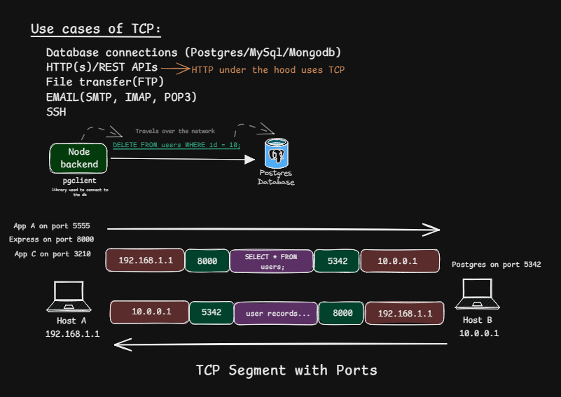
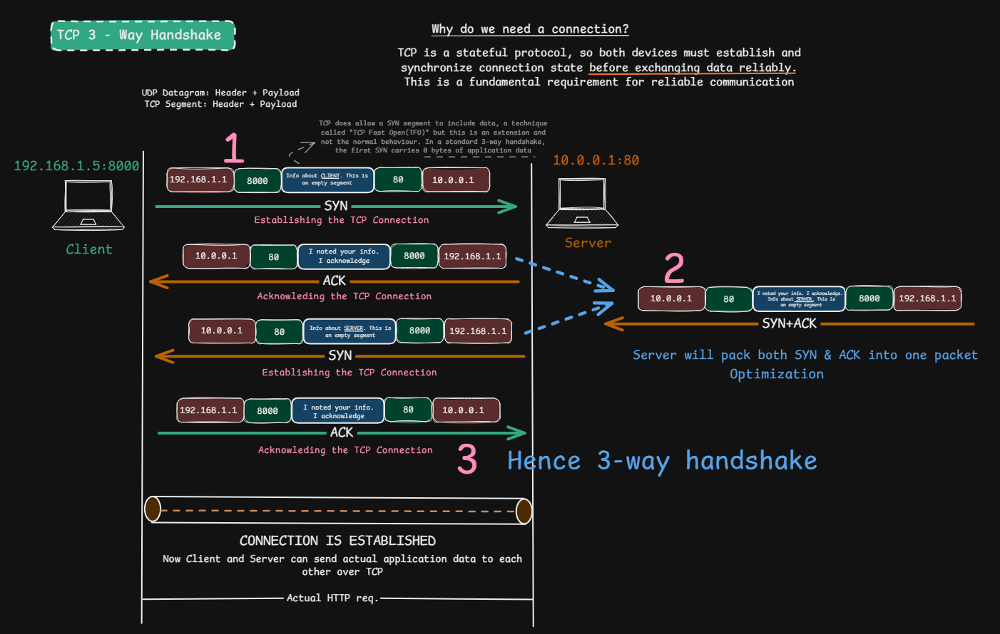
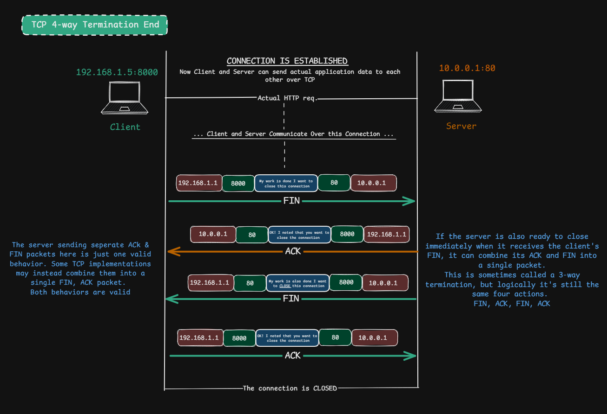

# TCP — Transmission Control Protocol

> **Section:** Computer Networking — [Chai aur Networking](https://youtu.be/ly6ixTfKpjM?si=aNttAkR9W902eMUn)
>
> **Learning objective:** Understand TCP as a connection-oriented transport-layer protocol, explain how TCP establishes and terminates connections, interpret TCP segments and port numbers, and identify how TCP provides a reliable, ordered byte stream.

[← Back to Computer Networking](https://github.com/Priya200227/computer-networking)

---

## 1. Overview

**Transmission Control Protocol (TCP)** is a transport-layer protocol in the Internet protocol suite. It provides applications with a reliable, ordered, bidirectional **byte stream** between two endpoints.

TCP runs over IP. IP provides host-to-host packet delivery on a best-effort basis; TCP adds mechanisms that let applications exchange a reliable stream of bytes despite packet loss, duplication, or reordering in the network.

TCP is:

- **Connection-oriented:** endpoints establish connection state before normal data transfer.
- **Reliable:** sequence numbers, acknowledgments, checksums, and retransmission help recover from loss or corruption.
- **Ordered:** the receiving TCP implementation presents bytes to the application in sequence.
- **Full-duplex:** both endpoints can send and receive data simultaneously.
- **Byte-stream based:** TCP does not preserve application message boundaries. An application must define its own framing or message format.
- **Stateful:** each endpoint maintains connection state, including sequence-number and acknowledgment information.

TCP is defined by [RFC 9293 — Transmission Control Protocol](https://www.rfc-editor.org/rfc/rfc9293).

## 2. TCP at the transport layer

TCP is a **Layer 4 (Transport Layer)** protocol. It uses port numbers to identify the sending and receiving application endpoints on a host.

An endpoint is commonly described by an IP address and a port number. A TCP connection is identified by the pair of endpoints (often called the 4-tuple):

- Source IP address
- Source TCP port
- Destination IP address
- Destination TCP port

For example, a client at `192.168.1.5:8000` connecting to a server at `10.0.0.1:80` sends a segment with:

| TCP field | Value |
|---|---|
| Source port | `8000` |
| Destination port | `80` |

The reply travels in the opposite direction:

| TCP field | Value |
|---|---|
| Source port | `80` |
| Destination port | `8000` |

The IP addresses also reverse between the two directions. The port numbers identify transport-layer application endpoints; they are not IP addresses.

### Common TCP use cases

Examples include:

- HTTP/1.1 and HTTP/2 web traffic (HTTP/3 uses QUIC over UDP instead).
- Database client/server connections, such as PostgreSQL and MySQL.
- File transfer protocols such as FTP.
- Email protocols such as SMTP, IMAP, and POP3.
- SSH remote login.

The application protocol determines what data is exchanged; TCP transports it as a byte stream.

## 3. TCP segments and reliable byte-stream delivery

TCP divides the outgoing byte stream into manageable pieces for transmission. Each transmitted TCP unit is called a **segment**. A segment contains a TCP header and, when present, application data (payload).

Important mechanisms:

1. **Sequence numbers** identify positions in the byte stream. They allow the receiver to put data in order and identify missing bytes.
2. **Acknowledgments (ACKs)** communicate the next sequence number the receiver expects. A cumulative ACK can acknowledge all bytes up to (but not including) that sequence number.
3. **Retransmission** allows TCP to resend data that appears to have been lost.
4. **Checksum** helps detect corruption in the TCP segment.
5. **Flow control** uses the advertised receive window to avoid overwhelming the receiver.
6. **Congestion control** adjusts sending behavior in response to network congestion.

These mechanisms work together; reliability is not simply “send an ACK for every packet.” TCP acknowledgments, retransmission behavior, timers, flow control, and congestion control are part of a larger protocol.

### TCP does not preserve message boundaries

TCP provides a continuous byte stream, not a sequence of application messages. If an application writes two messages, the receiving application may read them in one read, several reads, or a different grouping. Applications need a framing strategy (for example, fixed-size records, length prefixes, or delimiters).

## 4. Why TCP establishes a connection

Before normal data exchange, TCP endpoints synchronize connection state. This is commonly done with the **three-way handshake**:

1. Client → Server: `SYN`
2. Server → Client: `SYN + ACK`
3. Client → Server: `ACK`

### Step-by-step

Assume a client `192.168.1.5:8000` connects to a server `10.0.0.1:80`.

| Step | Direction | Flags | Purpose |
|---|---|---|---|
| 1 | Client → Server | SYN | Requests a connection and communicates the client's initial sequence number (ISN). |
| 2 | Server → Client | SYN, ACK | Acknowledges the client's SYN and communicates the server's ISN. |
| 3 | Client → Server | ACK | Acknowledges the server's SYN. The connection is established when the handshake completes. |

**Important sequence-number detail:** if the client's initial sequence number is `x`, the server acknowledges `x + 1`. If the server's initial sequence number is `y`, the client acknowledges `y + 1`. A SYN consumes one sequence-number position even though it normally carries no application data.

The handshake helps both sides synchronize initial sequence numbers and confirm bidirectional reachability. TCP is stateful because both endpoints maintain state for the connection.

### Is the SYN always empty?

A conventional SYN carries no application data, but TCP can carry data on a SYN in certain defined extensions (for example, TCP Fast Open). Treat “SYN contains no data” as the usual introductory case, not an absolute rule.

### Why three messages?

The exchange lets each endpoint communicate its initial sequence number and acknowledge the peer's sequence number. It is not merely a generic “connection permission” exchange.

## 5. TCP connection termination: the four-way exchange

TCP is full-duplex: each direction of data flow can be closed independently. A typical orderly close therefore uses four control actions:

1. One endpoint sends `FIN` to say it has no more data to send.
2. The peer acknowledges that FIN with `ACK`.
3. The peer later sends its own `FIN` when it has finished sending.
4. The first endpoint acknowledges that FIN with `ACK`.

### Step-by-step

| Step | Direction | Flag | Meaning |
|---|---|---|---|
| 1 | Client → Server | FIN | Client has finished sending data. |
| 2 | Server → Client | ACK | Server acknowledges the client's FIN. |
| 3 | Server → Client | FIN | Server has finished sending data. |
| 4 | Client → Server | ACK | Client acknowledges the server's FIN. |

A FIN consumes one sequence-number position. The ACK number acknowledges the FIN's sequence number plus one.

### Why can termination sometimes look like three packets?

The peer may be ready to close its sending direction when it receives the first FIN. In that case, it can combine its acknowledgment and FIN into one `FIN, ACK` segment:

1. FIN
2. FIN + ACK
3. ACK

This is a valid packet-level optimization. Logically, the acknowledgment and the peer's close are still distinct protocol actions. Therefore, “four-way termination” describes the usual sequence of actions, not a guarantee that every capture must show exactly four separate packets.

### FIN versus RST

- **FIN** is used for an orderly close: the sender has no more data to send in that direction.
- **RST** resets/aborts a connection or rejects a segment in circumstances defined by TCP. It is not the normal graceful termination sequence.

### TIME-WAIT

The endpoint that performs the active close typically enters `TIME-WAIT` after sending the final ACK. This state helps ensure that the peer's FIN is acknowledged and that delayed segments from the old connection do not interfere with a later connection using the same connection identifiers. The duration is based on the TCP Maximum Segment Lifetime (MSL) rules.

## 6. TCP compared with UDP

| Property | TCP | UDP |
|---|---|---|
| Connection model | Connection-oriented | Connectionless |
| Application service | Reliable, ordered byte stream | Datagram/message-oriented, best effort |
| Setup handshake | Yes, normally three-way | No transport connection handshake |
| Acknowledgments and retransmission | Built into TCP | Not provided by UDP itself |
| Flow control | Yes | No |
| Congestion control | TCP has congestion-control mechanisms | Not provided by UDP itself; applications using UDP must behave responsibly |
| Message boundaries | Not preserved | Preserved as datagrams |
| Header size | Minimum 20 bytes | 8 bytes |
| Typical uses | Web, databases, SSH, email | DNS, real-time media, games, QUIC transport |

Neither protocol is universally “faster.” TCP's reliability mechanisms add overhead, while UDP gives applications more control but leaves reliability, ordering, and congestion behavior to the application or a higher-level protocol.

## 7. Corrections and important nuances

These distinctions are important when turning the diagrams into accurate technical notes:

- **TCP is a byte-stream protocol, not a message/segment delivery API.** Segments are transmission units; application write boundaries are not preserved.
- **TCP does not guarantee that every application write maps to one segment.** TCP may segment, combine, or retransmit data as needed.
- **ACKs do not necessarily correspond one-to-one with segments.** TCP commonly uses cumulative acknowledgments; delayed ACKs and other behaviors affect packet patterns.
- **Retransmission is not triggered only by an explicit “packet dropped” notification.** TCP infers loss using mechanisms such as retransmission timeouts and duplicate ACK/SACK information.
- **Flow control and congestion control are different.** Flow control protects the receiver; congestion control protects the network.
- **The handshake establishes TCP connection state; it does not itself prove that the application is ready or healthy.** The application protocol exchange happens after (or, in special cases, alongside extensions to) connection establishment.
- **A graceful close is directional.** A FIN closes one direction of the byte stream; the other endpoint may continue sending until it also closes.
- **Four-way termination is the usual conceptual sequence, not a strict packet count.** ACK and FIN may be combined.
- **TCP does not encrypt application data.** Use TLS or another security protocol when confidentiality and authentication are required.

## 8. Quick revision

- TCP = Transmission Control Protocol.
- TCP operates at Layer 4 (Transport Layer).
- TCP uses source and destination port numbers to identify application endpoints.
- TCP provides a reliable, ordered, full-duplex byte stream.
- TCP establishes a connection using `SYN → SYN-ACK → ACK`.
- TCP typically closes a connection using `FIN → ACK → FIN → ACK`.
- A peer can combine `FIN` and `ACK` into one segment.
- Sequence numbers track byte positions; ACK numbers identify the next byte expected.
- TCP includes retransmission, flow control, and congestion control.
- TCP does not preserve application message boundaries.

## References

### Primary standards and authoritative documentation

- [RFC 9293 — Transmission Control Protocol (TCP)](https://www.rfc-editor.org/rfc/rfc9293) — current TCP specification.
- [RFC 9293, Section 3.5 — Closing a Connection](https://www.rfc-editor.org/rfc/rfc9293#section-3.5) — connection closing behavior and states.
- [RFC 9293, Section 3.5.2 — Reset Generation](https://www.rfc-editor.org/rfc/rfc9293#section-3.5.2) — reset behavior.
- [RFC 5681 — TCP Congestion Control](https://www.rfc-editor.org/rfc/rfc5681) — congestion-control algorithms.
- [RFC 7323 — TCP Extensions for High Performance](https://www.rfc-editor.org/rfc/rfc7323) — window scaling and timestamp options.
- [RFC 7413 — TCP Fast Open](https://www.rfc-editor.org/rfc/rfc7413) — data on SYN segments in the TCP Fast Open extension.
- [Wireshark User's Guide](https://www.wireshark.org/docs/wsug_html_chunked/) — packet inspection and display filters.

### Learning visuals

The diagrams in `images/` are the supplied study screenshots, retained and embedded here. They are conceptual illustrations; the protocol details and corrections above follow the cited TCP standards.

