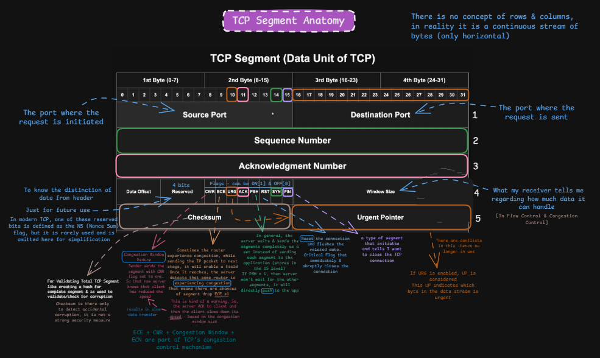
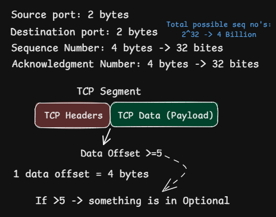
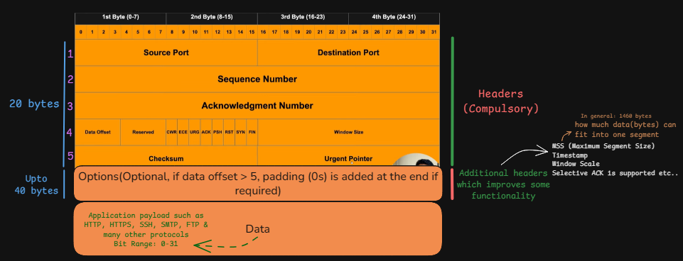
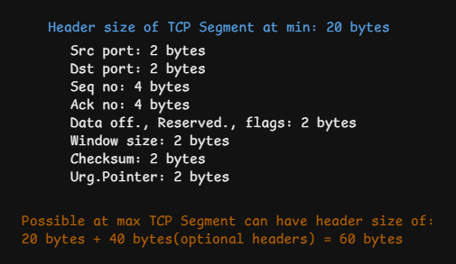
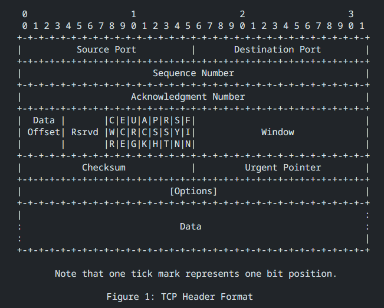

# TCP Segment Anatomy

> **Section:** Computer Networking — [Chai aur Networking](https://youtu.be/_d4_vkSQIEk?si=s3YnKpFmPkM1mjEQ)
>
> **Learning objective:** Understand the structure of a TCP segment, identify every field in the TCP header, calculate the minimum and maximum header sizes, and explain how options and control flags affect TCP communication.

[← Back to Computer Networking](https://github.com/Priya200227/computer-networking)

---

## 1. Overview

TCP (Transmission Control Protocol) operates at the transport layer. It carries application data between endpoints and adds transport-level information required for connection management, reliable byte-stream delivery, flow control, and other TCP functions.

A TCP segment consists of:

1. **TCP header** — control and metadata fields used by TCP.
2. **Data (payload)** — optional application data carried by the segment.

The TCP header is at least **20 bytes** long. When TCP options are present, the header can grow to a maximum of **60 bytes**.

The authoritative format and field definitions are specified in [RFC 9293, Section 3.1 — Header Format](https://www.rfc-editor.org/rfc/rfc9293#section-3.1).

## 2. TCP header layout

The TCP header is a continuous sequence of bits. The familiar rows and columns in protocol diagrams are only a visual convention for showing bit positions; they are not physical rows or columns transmitted over the network.

The header fields, in wire order, are:

| Field | Size | Purpose |
|---|---:|---|
| Source Port | 16 bits (2 bytes) | Identifies the sending application endpoint. |
| Destination Port | 16 bits (2 bytes) | Identifies the receiving application endpoint. |
| Sequence Number | 32 bits (4 bytes) | Identifies the sequence-space position of the first data byte, or the ISN when SYN is set. |
| Acknowledgment Number | 32 bits (4 bytes) | When ACK is set, identifies the next sequence number expected from the peer. |
| Data Offset | 4 bits | Specifies the TCP header length in 32-bit words. |
| Reserved | 4 bits | Reserved for future use; generated segments must set these bits to zero. |
| Control Flags | 8 bits | Carries TCP control information such as SYN, ACK, FIN, and RST. |
| Window | 16 bits (2 bytes) | Advertises the receive window: how much sequence space the sender is currently willing to accept. |
| Checksum | 16 bits (2 bytes) | Detects corruption in the TCP header and data, with IP pseudo-header protection. |
| Urgent Pointer | 16 bits (2 bytes) | Meaningful when URG is set; identifies the sequence-space position following urgent data. |
| Options + Padding | 0–40 bytes | Optional extensions and alignment padding. |
| Data | Variable | Application-protocol bytes carried by TCP. |

## 3. Mandatory header size: 20 bytes

The fixed portion of the TCP header contains these fields:

| Field | Size |
|---|---:|
| Source Port | 2 bytes |
| Destination Port | 2 bytes |
| Sequence Number | 4 bytes |
| Acknowledgment Number | 4 bytes |
| Data Offset + Reserved + Flags | 2 bytes |
| Window | 2 bytes |
| Checksum | 2 bytes |
| Urgent Pointer | 2 bytes |
| **Total** | **20 bytes** |

Calculation:

\[
2 + 2 + 4 + 4 + 2 + 2 + 2 + 2 = 20\text{ bytes}
\]

The Data Offset, Reserved, and Flags share a 16-bit region in the fixed header. Their individual sizes are 4 bits, 4 bits, and 8 bits, respectively.

## 4. Data Offset: where the payload begins

The **Data Offset** field is 4 bits wide. It specifies the TCP header length in units of 32-bit words (4-byte units), including options and padding.

- Minimum Data Offset: `5` words.
- Minimum header size: \(5 \times 4 = 20\) bytes.
- Maximum Data Offset: `15` words.
- Maximum header size: \(15 \times 4 = 60\) bytes.

Therefore:

\[
\text{TCP Header Length} = \text{Data Offset} \times 4
\]

Examples:

| Data Offset | Header length | Options and padding |
|---:|---:|---:|
| 5 | 20 bytes | 0 bytes |
| 6 | 24 bytes | 4 bytes |
| 10 | 40 bytes | 20 bytes |
| 15 | 60 bytes | 40 bytes |

The options area can therefore occupy at most 40 bytes. The Data Offset tells the receiver where the TCP payload starts; it does not directly state the payload length.

## 5. TCP options and padding

TCP options extend the base TCP header with additional capabilities. They are present only when the Data Offset is greater than 5.

Common examples include:

- **MSS (Maximum Segment Size):** communicates the maximum TCP data size a host is willing to receive in a single segment.
- **Window Scale:** allows larger effective receive windows than the 16-bit Window field alone can represent.
- **Timestamps:** support functions such as round-trip-time measurement and protection against wrapped sequence numbers.
- **Selective Acknowledgment (SACK) Permitted / SACK:** negotiates and communicates selective acknowledgment information.

Options are encoded as a sequence of option bytes. Padding may be added so the complete TCP header is a multiple of 4 bytes, as required by the Data Offset representation.

Do not confuse **MSS** with the total TCP segment size: MSS describes TCP data bytes, not the TCP header plus data.

## 6. TCP control flags

RFC 9293 defines eight control bits in the base header:

| Flag | Full name | Main purpose |
|---|---|---|
| CWR | Congestion Window Reduced | Indicates that the sender has reacted to an ECN congestion indication. |
| ECE | ECN-Echo | Used by Explicit Congestion Notification (ECN) mechanisms. |
| URG | Urgent | Indicates that the Urgent Pointer field is significant. |
| ACK | Acknowledgment | Indicates that the Acknowledgment Number field is significant. |
| PSH | Push | Requests push-style delivery of data to the receiving application. |
| RST | Reset | Resets a connection or rejects a segment in specified circumstances. |
| SYN | Synchronize | Synchronizes sequence numbers during connection establishment. |
| FIN | Finish | Indicates that the sender has no more data to send. |

A few important points:

- `SYN`, `FIN`, and `RST` affect connection state.
- `ACK` marks the acknowledgment field as valid.
- `URG` makes the Urgent Pointer meaningful.
- `CWR` and `ECE` participate in ECN signaling.
- Flags are independent bits and can be combined where TCP behavior permits (for example, `SYN + ACK` or `FIN + ACK`).

## 7. Window field: flow control

The Window field is 16 bits and advertises how many data octets, beginning with the sequence number identified by the acknowledgment field, the sender is currently willing to accept.

This is TCP's **receive-window advertisement**, a key part of receiver-side flow control.

Important distinction:

- **Flow control** prevents a sender from overwhelming the receiving endpoint.
- **Congestion control** controls sending behavior to avoid overloading the network.

The 16-bit field alone can represent values up to 65,535. When Window Scale is negotiated during connection setup, the advertised window is interpreted using the negotiated scale factor, allowing a larger effective receive window.

## 8. Checksum: error detection

The TCP Checksum field is 16 bits. It is computed over:

- the TCP header,
- the TCP data (payload), and
- an IP pseudo-header containing selected network-layer information.

The pseudo-header includes source and destination IP addresses, protocol/next-header information, and the TCP length. This helps detect certain cases where a segment is delivered to the wrong endpoint or protocol context.

The checksum uses a 16-bit one's-complement calculation. The sender must generate the checksum and the receiver must verify it. It is an error-detection mechanism, **not encryption or authentication**.

## 9. Urgent Pointer

The Urgent Pointer is a 16-bit field. It is interpreted only when the `URG` flag is set.

It communicates an offset in the TCP sequence space identifying the sequence number of the octet following the urgent data. The field is not a general-purpose priority value, and modern application protocols rarely rely on TCP urgent mode.

## 10. TCP payload

The payload contains bytes from the application protocol using TCP. Examples include:

- HTTP/1.1 and HTTP/2 data
- HTTPS application data carried inside TLS over TCP
- SSH
- SMTP, IMAP, and POP3
- Database protocol messages

TCP itself does not define the meaning or message boundaries of this payload. It transports a byte stream; the application protocol defines how the bytes are interpreted and where its messages begin and end.

The maximum payload in a particular segment depends on path MTU, IP and TCP headers, negotiated MSS, and other constraints. It is not a fixed value.

## 11. Reading the official RFC 9293 diagram

The final supplied image reproduces the TCP header format shown in RFC 9293. In that diagram:

- Each tick mark represents one bit position.
- The first 32-bit row contains Source Port and Destination Port.
- The next two 32-bit rows contain Sequence Number and Acknowledgment Number.
- The next row contains Data Offset, Reserved bits, control flags, and Window.
- The following row contains Checksum and Urgent Pointer.
- Options appear only when present; Data follows the complete TCP header.

**Reference:** [RFC 9293 — Section 3.1, Header Format](https://datatracker.ietf.org/doc/html/rfc9293#name-header-format).

## 12. Common misconceptions and corrections

| Misconception | Correct explanation |
|---|---|
| The TCP header is always 20 bytes. | 20 bytes is the minimum. Options can increase it to 60 bytes. |
| Data Offset gives the payload size. | It gives the TCP header length in 4-byte words and therefore identifies where payload begins. |
| TCP flags occupy 8 bytes. | The eight base control flags occupy 8 bits (one byte). |
| Window is the congestion window. | The TCP Window field advertises the receiver's window. The congestion window is a separate sender-side control variable. |
| Checksum encrypts or secures the segment. | It detects accidental corruption; it does not provide confidentiality or cryptographic authentication. |
| Urgent Pointer always has meaning. | It is interpreted only when URG is set. |
| MSS is the total segment size. | MSS is the maximum TCP data size, excluding TCP and IP headers. |
| Options are application payload. | Options are part of the TCP header and are included in the header length. |

## 13. Quick revision

- A TCP segment contains a TCP header and optional application data.
- The fixed TCP header is 20 bytes.
- TCP header length can range from 20 to 60 bytes.
- Data Offset is 4 bits and counts 32-bit words (4-byte units).
- TCP options and padding can occupy up to 40 bytes.
- The eight base control flags occupy 8 bits.
- Window advertises receive capacity; it is not the congestion window.
- TCP checksum covers the TCP header and data plus an IP pseudo-header.
- Urgent Pointer is meaningful only when URG is set.
- The payload is application data carried as part of TCP's byte stream.

## References

- [RFC 9293 — Transmission Control Protocol (TCP)](https://www.rfc-editor.org/rfc/rfc9293)
- [RFC 9293, Section 3.1 — Header Format](https://www.rfc-editor.org/rfc/rfc9293#section-3.1)
- [RFC 9293 — Data Offset, Control Bits, Window, Checksum, Urgent Pointer, and Options](https://datatracker.ietf.org/doc/html/rfc9293#name-header-format)
- [RFC 7323 — TCP Extensions for High Performance](https://www.rfc-editor.org/rfc/rfc7323) — timestamps and window scaling.
- [RFC 2018 — TCP Selective Acknowledgment Options](https://www.rfc-editor.org/rfc/rfc2018) — SACK option.
- [RFC 5681 — TCP Congestion Control](https://www.rfc-editor.org/rfc/rfc5681) — congestion-control behavior.
**Video Reference** - [Anatomy of a TCP Segment](https://youtu.be/_d4_vkSQIEk?si=SAah9ZQXfpgPaYnQ)
