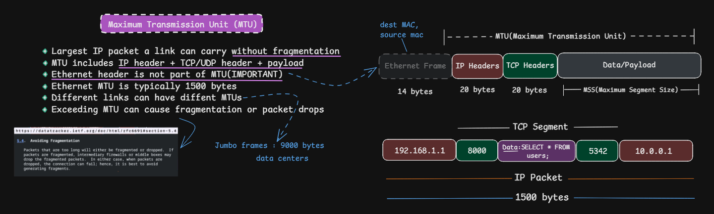
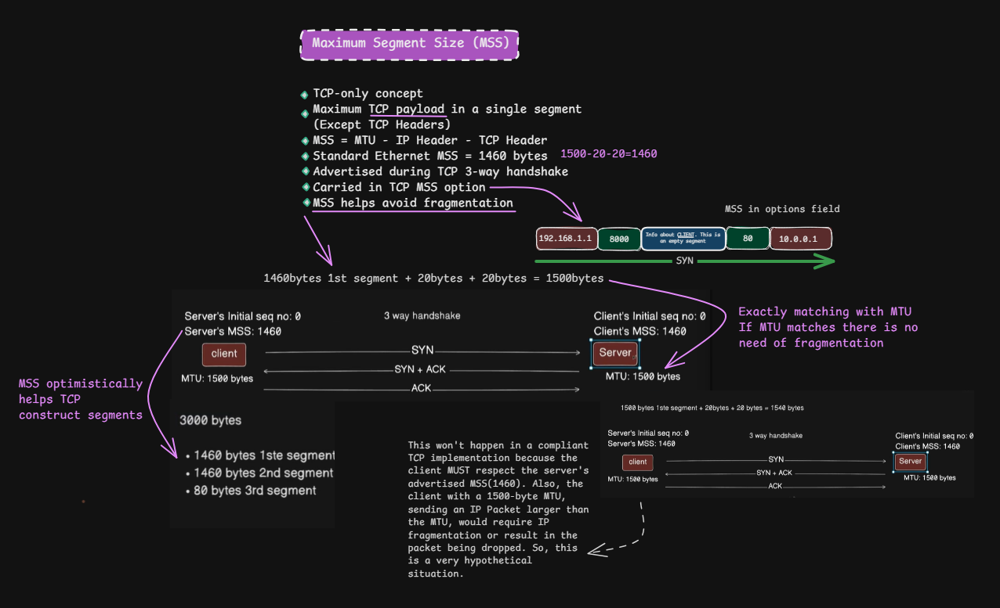
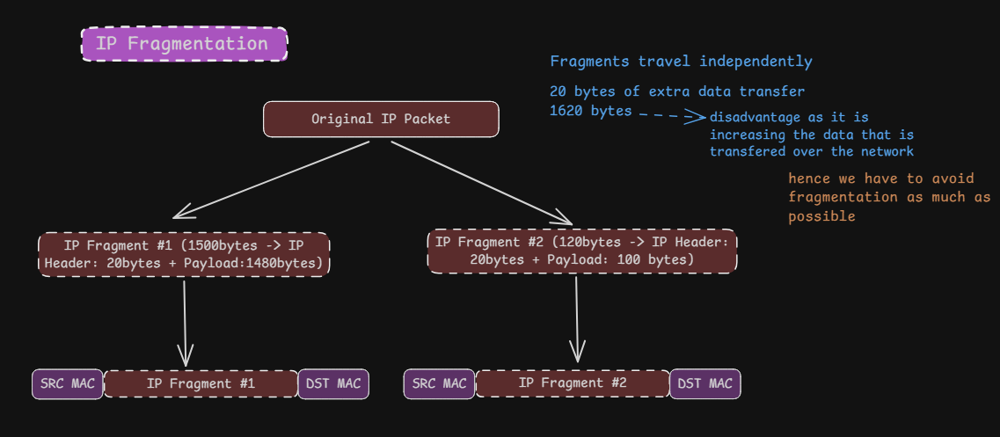
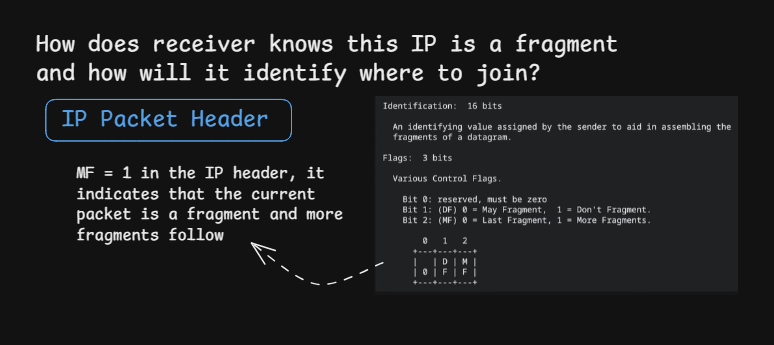
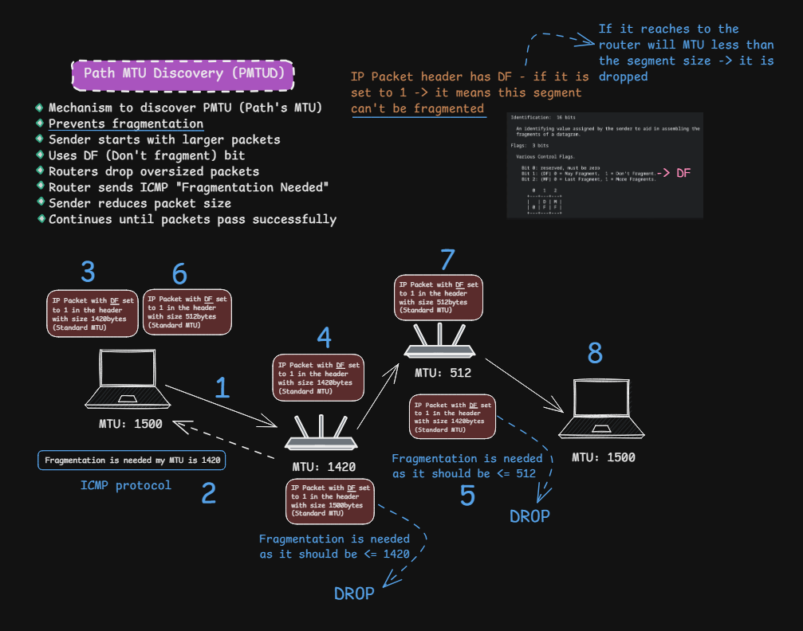
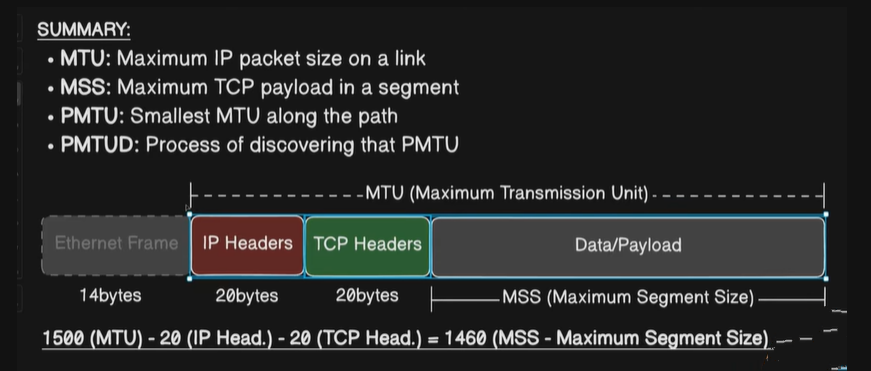

# MTU, MSS, and Path MTU Discovery (PMTUD)

> **Section:** Computer Networking — [Chai aur Networking](https://youtu.be/18-nbrEEU9o?si=mvScSP4egtOtgLux)
>
> **Learning objective:** Distinguish MTU, Path MTU, and TCP MSS; calculate the TCP payload size for a given MTU; understand IPv4 fragmentation and its header fields; and explain how Path MTU Discovery helps endpoints avoid packets that are too large for a network path.

[← Back to Computer Networking](https://github.com/Priya200227/computer-networking)

---

## 1. Overview

MTU, MSS, and PMTUD describe related but different limits and mechanisms:

- **MTU (Maximum Transmission Unit):** the maximum size of a network-layer packet that a particular link can carry as one unit, without link-layer fragmentation.
- **Path MTU (PMTU):** the smallest IP MTU across all links on the path from source to destination.
- **MSS (Maximum Segment Size):** the maximum amount of TCP application data (TCP payload) a TCP endpoint is willing to receive in one segment.
- **PMTUD (Path MTU Discovery):** a mechanism by which a host discovers the maximum IP packet size that can travel along a path without IP fragmentation.

These are not interchangeable. MTU and PMTU refer to IP packet size limits; MSS refers to TCP data size.

## 2. MTU — Maximum Transmission Unit

MTU is the largest IP packet that a link can carry in one frame without requiring fragmentation at the IP layer.

For a common Ethernet link, the IP MTU is typically **1500 bytes**. This means the Ethernet payload can carry an IP packet of up to 1500 bytes.

### What is included in a 1500-byte Ethernet MTU?

For a typical Ethernet II frame carrying IPv4:

| Component | Typical size | Included in the 1500-byte IP MTU? |
|---|---:|---|
| Ethernet header | 14 bytes | No |
| IPv4 header | 20 bytes (without options) | Yes |
| TCP header | 20 bytes (without options) | Yes |
| TCP payload | Variable | Yes |
| Ethernet FCS | 4 bytes | No |

The 1500-byte MTU is the Ethernet payload limit, which in this case is the complete IP packet. It does **not** include the Ethernet header or FCS. VLAN tags, preamble, inter-frame gap, and physical-layer overhead are also not counted as part of the conventional 1500-byte IP MTU.

An Ethernet frame with a 1500-byte IP packet is therefore larger than 1500 bytes on the wire.

### Jumbo frames

Some Ethernet networks support larger frame payloads, often around 9000 bytes, commonly called **jumbo frames**. This is not a universal Ethernet default or an automatic property of every data center. The devices and links along the relevant Layer 2 path must support compatible frame sizes.

## 3. Path MTU (PMTU)

The Path MTU is the minimum IP MTU of all links along a particular path between two IP endpoints.

For example:

| Link | IP MTU |
|---|---:|
| Source LAN | 1500 bytes |
| Intermediate link | 1420 bytes |
| Next link | 9000 bytes |
| Destination LAN | 1500 bytes |

The PMTU for this path is:

\[
PMTU = \min(1500, 1420, 9000, 1500) = 1420\text{ bytes}
\]

A packet larger than 1420 bytes cannot cross the entire path without fragmentation or another adaptation. A different route to the same destination may have a different PMTU.

## 4. MSS — Maximum Segment Size

MSS is a TCP concept. It is the maximum number of **TCP payload bytes** that a receiver is prepared to accept in one TCP segment. It excludes the TCP header and IP header.

For a typical path with:

- Ethernet IP MTU = 1500 bytes
- IPv4 header = 20 bytes
- TCP header = 20 bytes

the commonly used MSS calculation is:

\[
MSS = MTU - IP\ Header - TCP\ Header
\]

\[
MSS = 1500 - 20 - 20 = 1460\text{ bytes}
\]

<text color="secondary" size="xs">This 1460-byte example assumes a basic 20-byte IPv4 header and 20-byte TCP header, with no IP options or TCP options in the data segment.</text>

### Important MSS details

- The MSS option is exchanged during the TCP connection setup, in SYN segments.
- The MSS value advertised by a host describes the maximum TCP data size that host is prepared to receive.
- The peer uses the advertised value as an upper bound when sending TCP data to that host.
- MSS is not the total TCP segment size; TCP and IP headers are additional.
- TCP options can make the TCP header larger than 20 bytes, reducing the payload that fits within a given IP packet size.
- MSS and PMTU are related but not identical. MSS is advertised by the receiver; PMTU is a property of the path.

For more detail, see [RFC 9293, Section 3.7.1 — Maximum Segment Size Option](https://www.rfc-editor.org/rfc/rfc9293#section-3.7.1).

## 5. IP fragmentation

Fragmentation occurs when an IP packet is too large to be forwarded over a link and the applicable IP version and packet settings permit fragmentation.

### 5.1 IPv4 fragmentation

In IPv4, fragmentation may be performed by the source host or by an intermediate router, provided the packet's **Don't Fragment (DF)** flag is not set.

The receiving host uses fields in the IPv4 header to reassemble fragments:

- **Identification:** associates fragments that belong to the same original IPv4 datagram.
- **More Fragments (MF) flag:** set on fragments when more fragments of the original datagram follow; cleared on the final fragment.
- **Fragment Offset:** indicates where this fragment's payload belongs in the original datagram. The offset is measured in units of 8 bytes.
- **Don't Fragment (DF) flag:** when set, routers must not fragment the packet. If it cannot be forwarded due to a smaller next-hop MTU, it is dropped and an ICMP error is normally returned.

Fragments may travel independently and can arrive out of order. Reassembly is performed by the destination host, not by every intermediate router.

### 5.2 Worked IPv4 fragmentation example

Assume an original IPv4 datagram is 1620 bytes:

- IPv4 header: 20 bytes
- Original payload: 1600 bytes
- Outgoing link MTU: 1500 bytes

The maximum payload in a full-sized fragment is:

\[
1500 - 20 = 1480\text{ bytes}
\]

1480 is divisible by 8, as required for fragment offsets (except that the final fragment's payload need not be a multiple of 8 bytes).

The datagram can be divided as follows:

| Fragment | IP header | Fragment payload | Total IP packet size | Fragment offset |
|---|---:|---:|---:|---:|
| 1 | 20 bytes | 1480 bytes | 1500 bytes | 0 |
| 2 | 20 bytes | 120 bytes | 140 bytes | 185 |

The second fragment's offset is:

\[
1480 / 8 = 185
\]

The first fragment has MF = 1 because another fragment follows. The second (final) fragment has MF = 0. Both fragments carry the same Identification value.

This example assumes a 20-byte IPv4 header in each fragment and no IP options. Each fragment has its own IP header.

### 5.3 Disadvantages of fragmentation

Fragmentation can introduce costs and failure modes:

- Each fragment requires its own IP header.
- If one fragment is lost, the original datagram cannot be fully reassembled.
- Reassembly consumes receiver resources and memory.
- Fragments may be filtered or mishandled by firewalls, NAT devices, or other middleboxes.
- Fragmentation adds processing and operational complexity.

Avoiding fragmentation where practical is generally preferable.

### 5.4 IPv6 fragmentation is different

Do not apply IPv4 router-fragmentation behavior to IPv6:

- IPv6 routers do **not** fragment packets in transit.
- If an IPv6 packet is too large for the next link, the router drops it and sends an ICMPv6 **Packet Too Big** message.
- The source host can use the IPv6 Fragment extension header if it chooses to fragment.
- IPv6 fragmentation and reassembly are performed by the source and destination, respectively.

See [RFC 8200](https://www.rfc-editor.org/rfc/rfc8200) and [RFC 8201](https://www.rfc-editor.org/rfc/rfc8201).

## 6. PMTUD — Path MTU Discovery

A host usually knows the MTU of its directly connected link, but it does not automatically know the MTU of every link along an end-to-end route. PMTUD helps discover the PMTU for a path.

### 6.1 Traditional IPv4 PMTUD

A simplified IPv4 PMTUD process is:

1. The sender starts with an estimate of the path MTU.
2. It sends IP packets with the IPv4 DF (Don't Fragment) flag set.
3. If a router encounters a link whose MTU is smaller than the packet, it cannot fragment the packet because DF is set.
4. The router drops the packet and sends an ICMP Destination Unreachable message indicating that fragmentation is needed (often described as “Fragmentation Needed”).
5. The sender reduces its PMTU estimate and adjusts packetization.
6. It continues using a size that can traverse the path without fragmentation.

The key point: in traditional PMTUD, an oversized packet is **dropped**, not fragmented by the router, because DF is set. The ICMP feedback tells the sender to use smaller packets.

### 6.2 IPv6 PMTUD

IPv6 has no IPv4-style DF flag in its base header, and IPv6 routers do not fragment packets in transit.

If a packet is too large for a next-hop link, the router drops it and sends an ICMPv6 **Packet Too Big** message. The source uses this feedback to reduce the packet size.

### 6.3 PMTUD black holes

PMTUD depends on ICMP feedback being delivered. If a network blocks the relevant ICMP messages, the sender may keep transmitting packets that are too large. Small packets and the TCP handshake may succeed, while larger data transfers stall. This failure mode is commonly called a **PMTU black hole**.

Modern networks and implementations may also use **Packetization Layer Path MTU Discovery (PLPMTUD)**, which probes packet sizes at the transport or packetization layer and is designed to work more robustly when ICMP feedback is unreliable.

See [RFC 4821 — Packetization Layer Path MTU Discovery](https://www.rfc-editor.org/rfc/rfc4821) and [RFC 8899 — Datagram PLPMTUD](https://www.rfc-editor.org/rfc/rfc8899).

## 7. How MTU, PMTU, and MSS fit together

These values work at different layers:

| Concept | Layer / scope | What it limits or describes |
|---|---|---|
| Link MTU | Link / IP interface | Largest IP packet carried over that link |
| Path MTU | End-to-end IP path | Smallest link MTU along the path |
| TCP MSS | TCP | Maximum TCP payload size the receiver advertises it can accept |
| PMTUD | IP path discovery | How the sender learns the path's packet-size limit |

A practical TCP sender must respect both the MSS advertised by the peer and the packet-size limit imposed by the PMTU, while accounting for actual header sizes and other protocol constraints.

A useful simplified expression for a TCP data segment is:

\[
TCP\ Data \leq \min(\text{peer-advertised MSS},\ PMTU - IP\ Header - TCP\ Header)
\]

This is a conceptual calculation; real implementations also account for options, encapsulation, tunnels, and other packetization constraints.

## 8. Common misconceptions and corrections

| Misconception | Correct explanation |
|---|---|
| MTU includes the Ethernet header. | The conventional Ethernet MTU is the maximum IP packet carried in the Ethernet payload; the Ethernet header and FCS are outside that 1500-byte IP MTU. |
| MTU and MSS mean the same thing. | MTU is an IP packet-size limit; MSS is the maximum TCP payload size advertised by a receiver. |
| Ethernet MTU is always 1500 bytes. | 1500 bytes is common, but interfaces and paths may use other MTUs, including jumbo-frame configurations. |
| MSS is always 1460 bytes. | 1460 assumes MTU 1500 with 20-byte IPv4 and TCP headers. Other IP versions, options, and MTUs change the usable payload. |
| PMTU is the MTU of the sender's local network. | PMTU is the smallest MTU across the entire route. |
| Every oversized packet is fragmented. | With IPv4 DF set, an oversized packet is dropped and ICMP feedback is returned. IPv6 routers never fragment packets in transit. |
| All fragments travel together and in order. | Fragments are independently forwarded and may arrive out of order. |
| A router reassembles fragments before forwarding. | Normal IP fragmentation reassembly occurs at the destination host, not at each router. |
| PMTUD always works if the endpoints support it. | Filtering ICMP feedback can cause PMTU black holes; PLPMTUD is an alternative approach. |

## 9. Quick revision

- MTU = maximum IP packet size supported by a link.
- Ethernet's common IP MTU is 1500 bytes.
- Ethernet header and FCS are not part of the 1500-byte IP MTU.
- PMTU = smallest link MTU along the end-to-end path.
- MSS = maximum TCP payload size advertised by the receiver.
- With MTU 1500, IPv4 header 20, and TCP header 20, the illustrative MSS is 1460 bytes.
- IPv4 fragmentation uses Identification, MF, DF, and Fragment Offset.
- IPv4 fragment offsets are measured in 8-byte units.
- IPv4 routers may fragment packets when DF is not set.
- IPv6 routers do not fragment packets in transit.
- IPv4 PMTUD uses ICMP “Fragmentation Needed”; IPv6 PMTUD uses ICMPv6 “Packet Too Big”.
- PLPMTUD can help when ICMP-based PMTUD feedback is unreliable.

## References

- [RFC 1191 — Path MTU Discovery](https://www.rfc-editor.org/rfc/rfc1191) — IPv4 PMTUD and the DF / ICMP Fragmentation Needed mechanism.
- [RFC 8201 — Path MTU Discovery for IPv6](https://www.rfc-editor.org/rfc/rfc8201) — IPv6 PMTUD and ICMPv6 Packet Too Big.
- [RFC 9293 — Transmission Control Protocol (TCP)](https://www.rfc-editor.org/rfc/rfc9293) — TCP behavior and MSS option.
- [RFC 9293, Section 3.7.1 — Maximum Segment Size Option](https://www.rfc-editor.org/rfc/rfc9293#section-3.7.1).
- [RFC 9293, Section 3.7.2 — Path MTU Discovery](https://www.rfc-editor.org/rfc/rfc9293#section-3.7.2).
- [RFC 8200 — Internet Protocol, Version 6 (IPv6) Specification](https://www.rfc-editor.org/rfc/rfc8200) — IPv6 packet format and fragmentation behavior.
- [RFC 4821 — Packetization Layer Path MTU Discovery](https://www.rfc-editor.org/rfc/rfc4821).
- [RFC 8899 — Datagram Packetization Layer Path MTU Discovery](https://www.rfc-editor.org/rfc/rfc8899).

---
**NEXT:** [TCP Contol Flow]()
