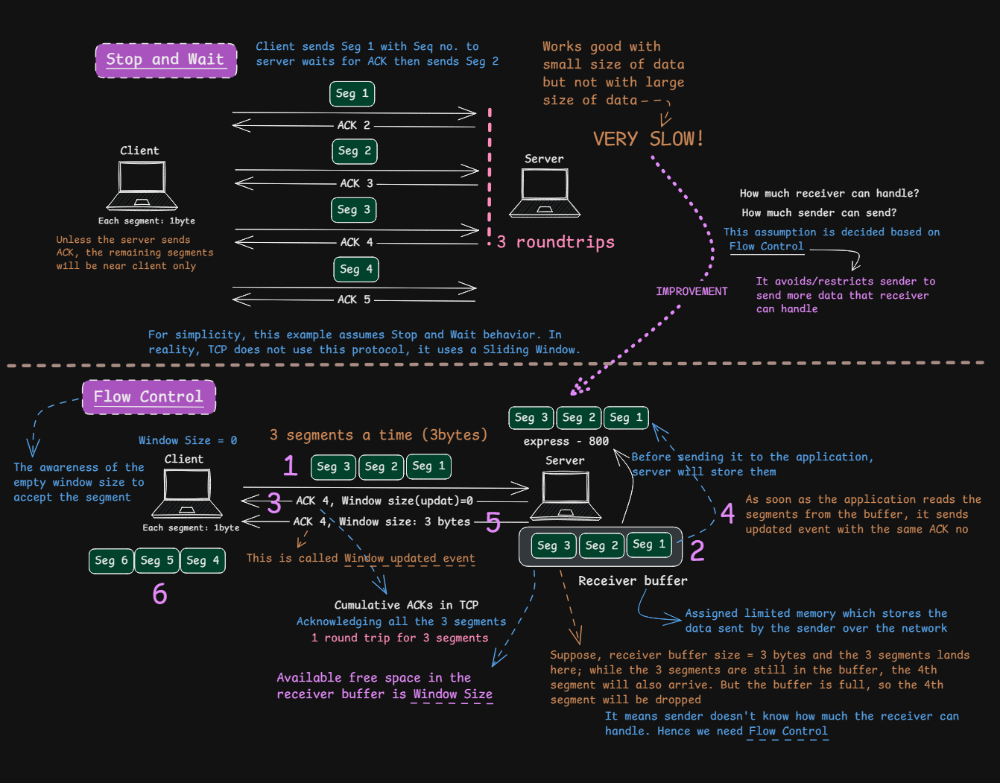
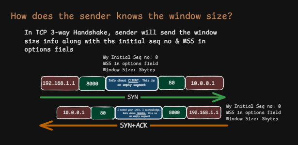
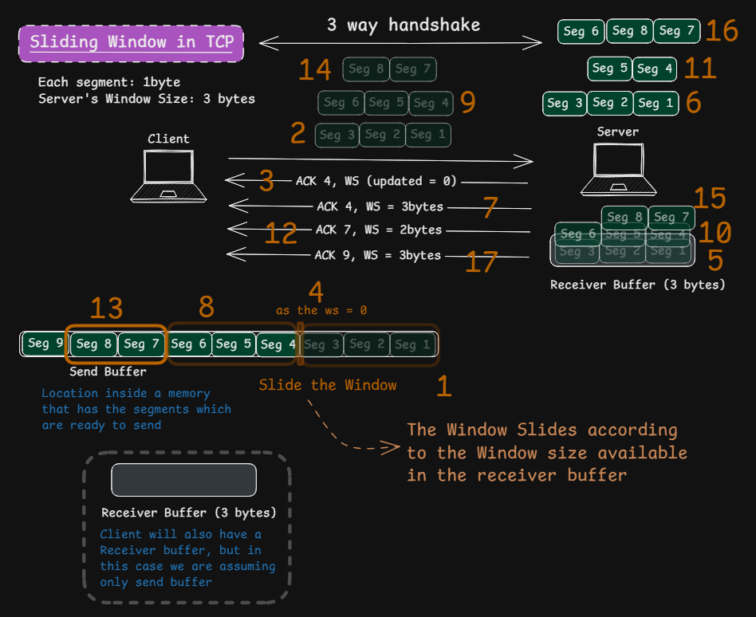
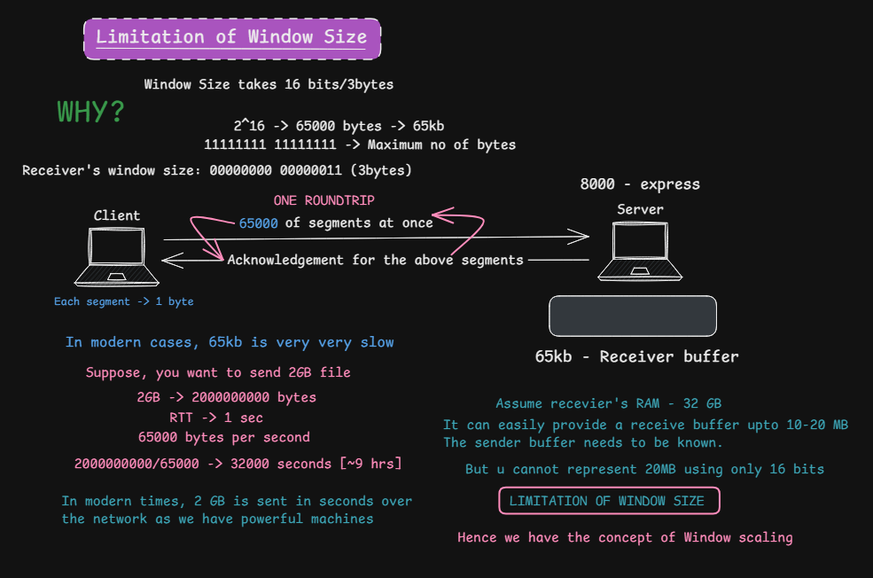
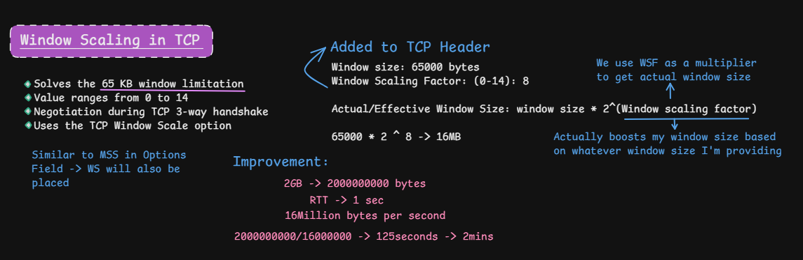
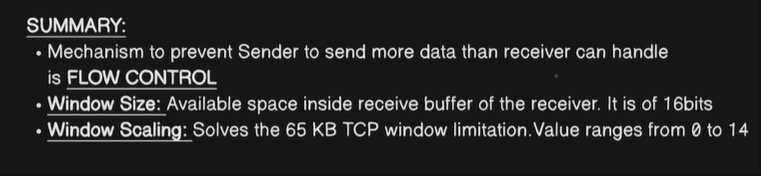

# TCP Flow Control

> **Section:** Computer Networking — [Chai aur Networking](https://youtu.be/PL_6aNL_KqY?si=WrfbZwMiyYEh2WUz)
>
> **Learning objective:** Understand why TCP needs receiver-side flow control, how the advertised receive window (`rwnd`) works, how sliding-window transmission differs from stop-and-wait, and how the TCP Window Scale option overcomes the 16-bit window-field limit.

[← Back to Computer Networking](https://github.com/Priya200227/computer-networking)

---

## 1. Overview

**TCP flow control** prevents a sender from overwhelming the receiving host with more data than the receiver can buffer.

The receiver advertises how much additional sequence space it is currently prepared to accept. The sender uses this information to limit the amount of unacknowledged data it has in flight.

- The receiver maintains a TCP receive buffer.
- The receiver advertises its receive window (`rwnd`) in the TCP Window field.
- As the receiving application reads data, buffer space becomes available and the receiver can advertise a larger window.
- If the receiver has no available capacity, it can advertise a zero window.

Flow control is different from congestion control:

| Mechanism | Protects | Main variable |
|---|---|---|
| Flow control | Receiving host | Receiver-advertised window (`rwnd`) |
| Congestion control | Network path | Sender congestion window (`cwnd`) |

In simplified terms, the amount of outstanding data is constrained by both:

\[
\text{Send limit} = \min(rwnd,\ cwnd)
\]

This is a conceptual summary; TCP implementations also account for sequence-space boundaries, acknowledgments, timers, and other protocol details.

## 2. Why flow control is needed

Imagine a sender transmitting data faster than the receiving application can consume it. The receiver's TCP implementation temporarily stores incoming data in a receive buffer. If that buffer fills, additional incoming data may have to be discarded, causing retransmissions and wasted network capacity.

Flow control lets the receiver communicate its current capacity so the sender can regulate how much new data it sends.

### Stop-and-wait as a teaching model

The first part of the supplied diagram illustrates **stop-and-wait**:

1. Sender transmits one segment.
2. Sender waits for an acknowledgment.
3. After receiving the ACK, sender transmits the next segment.

This simple model prevents the sender from flooding the receiver, but it can be inefficient on high-RTT networks because the sender sits idle while waiting for each ACK.

**Important correction:** Stop-and-wait is a teaching model, not how normal TCP data transfer works. TCP uses a sliding-window mechanism, allowing multiple bytes/segments to be in flight before acknowledgments arrive.

## 3. The TCP advertised receive window

The TCP header contains a 16-bit **Window** field. It advertises the receive window: the amount of sequence space, beginning at the acknowledgment number, that the receiver is currently willing to accept.

For introductory examples, the advertised window is often described as the number of free bytes in the receive buffer. That is a useful model; more precisely, it describes a range of acceptable sequence numbers.

### Example: a small receive buffer

Assume for illustration:
- Each segment carries 1 byte.
- The receiver has a 3-byte receive buffer.
- The receiver initially advertises a window of 3 bytes.

The sender can transmit up to 3 bytes within the advertised receive window without waiting for the application to consume data.

If the buffer becomes full, the receiver can advertise a **zero window**. This tells the sender that the receiver currently has no receive-window space available for new data.

When the application reads data from the buffer, space becomes available. The receiver can advertise a window update with a non-zero value, allowing the sender to resume within the updated window.

### When is window information exchanged?

The Window field is present in every TCP header. During connection establishment, each endpoint can advertise its receive-window information in its SYN and SYN-ACK segments.

The Window Scale option, if supported, is also negotiated in SYN segments. See Section 7.

## 4. Sliding window: sending multiple segments efficiently

TCP does not normally wait for an ACK after every segment. Instead, it uses a **sliding window**.

The sender may transmit multiple bytes while they remain within the permitted sending window. As acknowledgments arrive and the receiver advertises available capacity, the usable window advances ("slides"), allowing the sender to transmit more data.

### Conceptual example

Assume the receiver advertises a window of 3 bytes and each segment carries 1 byte.

- The sender can send three bytes within the current receive window.
- The receiver acknowledges received bytes cumulatively.
- If the receiving application consumes data, the receiver can advertise more available space.
- The sender can then advance its sending window.

In real TCP, sequence numbers count **bytes**, not segment numbers. The receive window is expressed in sequence-space bytes.

### ACK number versus Window value

These two fields serve different purposes:

- **ACK number:** identifies the next sequence number expected.
- **Window value:** indicates how much additional sequence space the receiver is currently prepared to accept, subject to Window Scale negotiation.

A receiver can send a window update even when the ACK number does not change. This can happen when the application reads data from the receive buffer, freeing space without new sequence-space data arriving.

## 5. Zero window and persist mechanism

A **zero window** occurs when the receiver advertises that it currently has no available receive-window space. The sender must not send new data beyond the advertised window.

However, the sender cannot simply wait forever: a window-update ACK from the receiver could be lost. TCP therefore uses a **persist mechanism**. The sender periodically sends a zero-window probe so that the receiver responds with its current window information.

The persist mechanism is distinct from ordinary retransmission due to data loss.

## 6. Limitation of the 16-bit Window field

The TCP Window field in the base header is 16 bits wide. Without window scaling, its maximum representable value is:

\[
2^{16}-1 = 65,535\text{ bytes}
\]

That is approximately 64 KiB. On high-bandwidth, high-latency paths, a receive window of about 64 KiB may be too small to keep the network fully utilized.

This relates to the **bandwidth-delay product (BDP)**: the amount of data that can be in flight during one round-trip time. A high-capacity path with a long RTT may need much more than 65,535 bytes in flight to use its available bandwidth efficiently.

## 7. TCP Window Scaling

The **Window Scale** option extends the effective receive-window size beyond the 16-bit base Window field. It is defined in [RFC 7323 — TCP Extensions for High Performance](https://www.rfc-editor.org/rfc/rfc7323).

### 7.1 How it works

- Each endpoint may include a Window Scale option in its SYN.
- The option communicates a shift count for the window values that endpoint will advertise.
- The shift count ranges from 0 to 14.
- Scaling is negotiated independently in each direction.
- The effective window is calculated by shifting the 16-bit Window field left by the negotiated shift count.

\[
\text{Effective Window} = \text{Window Field} \times 2^{\text{Shift Count}}
\]

Example: if the Window field is `65,000` and the negotiated shift count is `8`:

\[
65,000 \times 2^8 = 65,000 \times 256 = 16,640,000\text{ bytes}
\]

That is approximately 15.9 MiB (16.64 MB in decimal units).

### 7.2 Negotiation details

- Window scaling must be negotiated during the TCP handshake using SYN segments.
- The scale value advertised by an endpoint applies to window values that endpoint sends.
- The two directions can use different shift counts.
- The Window Scale option is not used to scale the Window field in SYN segments themselves.
- If the option is not negotiated, the Window field remains unscaled and is limited to 65,535 bytes.

**Do not interpret a shift count of 8 as multiplication by 8.** It means multiplication by \(2^8 = 256\).

## 8. Flow control versus congestion control

| Aspect | Flow control | Congestion control |
|---|---|---|
| Protects | Receiver | Network |
| Controlled by | Receiver's advertised window | Sender's congestion-control algorithm |
| Main variable | `rwnd` | `cwnd` |
| Problem addressed | Receiver buffer exhaustion | Network overload and congestion |

A large receive window does not mean the network can safely carry an equally large burst. The sender is constrained by both the receive window and congestion window.

## 9. Common misconceptions and corrections

| Misconception | Correct explanation |
|---|---|
| TCP uses stop-and-wait for every segment. | TCP uses a sliding window and can have multiple bytes/segments in flight. |
| Window tells the sender how much data the network can handle. | It advertises receiver capacity. Congestion control separately regulates network load. |
| Window field is the congestion window. | `rwnd` and `cwnd` are distinct. |
| A window of 3 means three segments. | The TCP window is measured in bytes of sequence space. |
| Zero window means the connection is closed. | It means the receiver currently advertises no available receive-window space. The connection can remain established. |
| Window Scale value 8 means multiply by 8. | It is a shift count: multiply by \(2^8 = 256\). |
| Window scaling allocates more physical memory. | It changes how a window value is represented; it does not allocate memory or guarantee buffer capacity. |

## 10. Quick revision

- TCP flow control prevents a sender from overwhelming the receiver.
- The receiver advertises its receive window (`rwnd`) in the TCP Window field.
- The base Window field is 16 bits and can represent up to 65,535.
- TCP uses a sliding window, not stop-and-wait for ordinary data transfer.
- ACK number indicates the next byte expected; Window indicates acceptable receive-window space.
- A zero window means the receiver currently has no available receive-window space.
- TCP's persist mechanism helps recover from lost window updates.
- Window Scale is negotiated during the three-way handshake.
- The Window Scale shift count ranges from 0 to 14.
- Effective window = Window field × \(2^{\text{shift count}}\).
- Flow control protects the receiver; congestion control protects the network.
- Sender transmission is constrained by both `rwnd` and `cwnd`.

## References

- [RFC 9293 — Transmission Control Protocol (TCP)](https://www.rfc-editor.org/rfc/rfc9293) — TCP header and receive-window behavior.
- [RFC 9293, Section 3.8.6 — Managing the Window](https://www.rfc-editor.org/rfc/rfc9293#section-3.8.6) — TCP window management.
- [RFC 9293, Section 3.8.6.1 — Zero-Window Probing](https://www.rfc-editor.org/rfc/rfc9293#section-3.8.6.1) — persist behavior.
- [RFC 7323 — TCP Extensions for High Performance](https://www.rfc-editor.org/rfc/rfc7323) — Window Scale option and large TCP windows.
- [RFC 5681 — TCP Congestion Control](https://www.rfc-editor.org/rfc/rfc5681) — congestion-control mechanisms.
