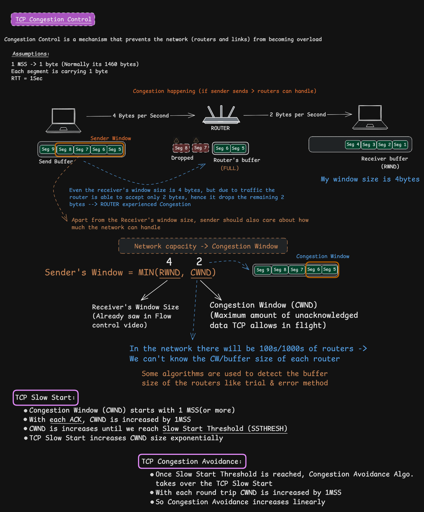
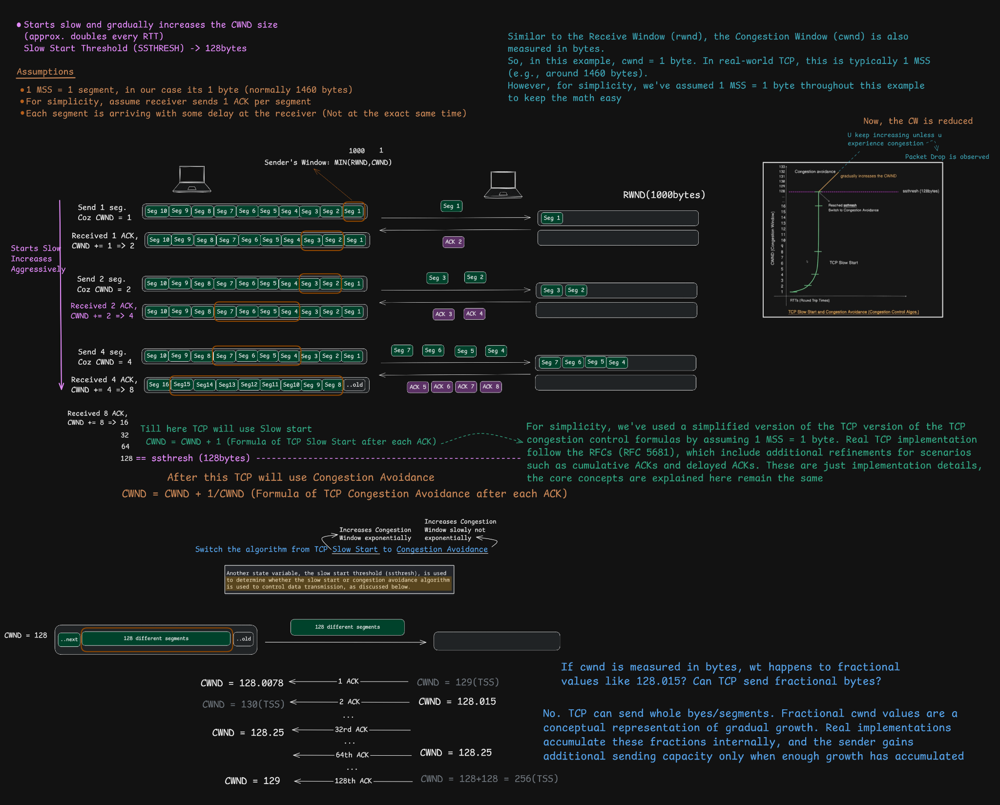
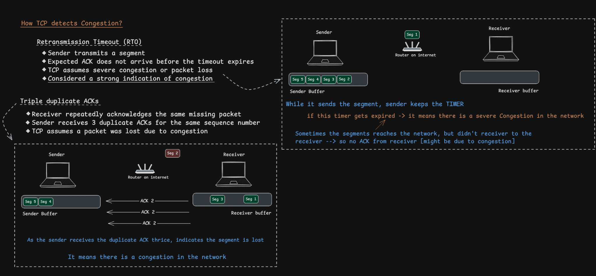
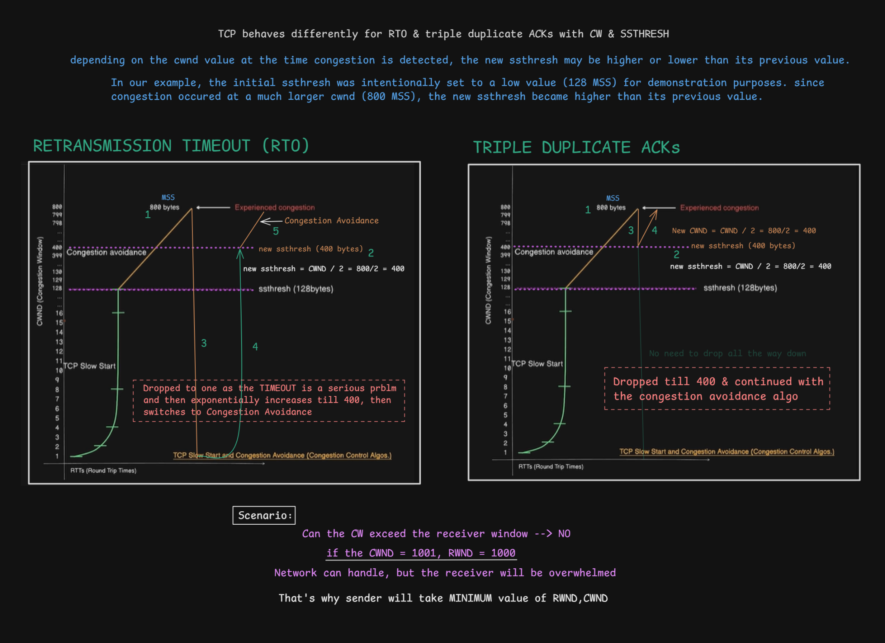
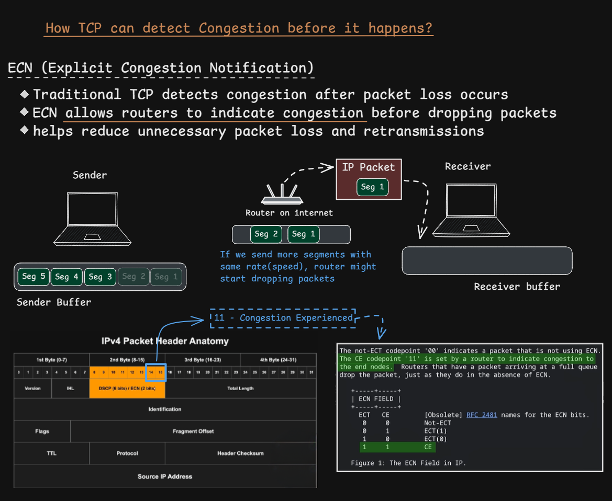
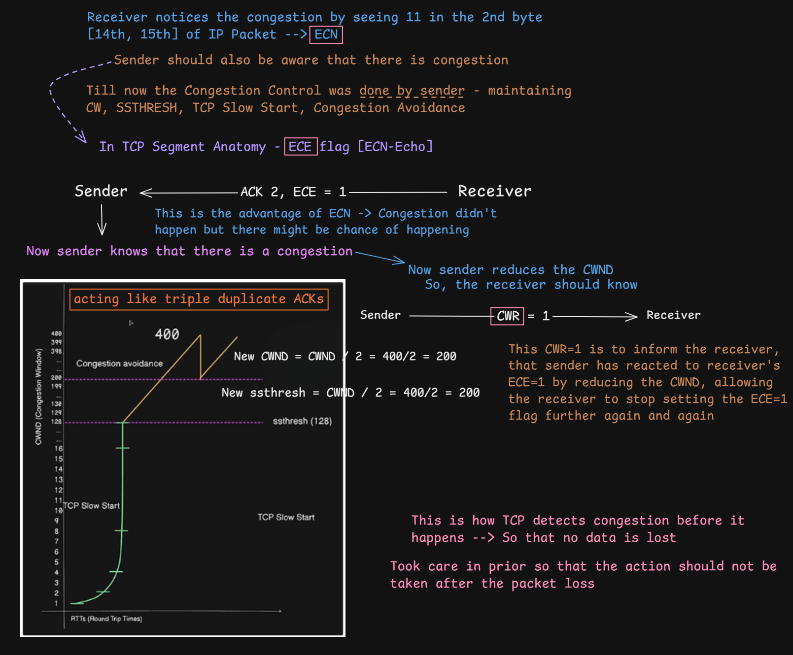

# TCP Congestion Control

> **Section:** Computer Networking — [Chai aur Networking](https://youtu.be/B3JwzcPTZDw?si=mdvL4rvRHvcERgz5)
>
> **Learning objective:** Understand why TCP needs congestion control, how the congestion window (`cwnd`) limits data in flight, how Slow Start and Congestion Avoidance grow the sending rate, how loss signals affect the congestion-control state, and how Explicit Congestion Notification (ECN) can signal congestion without first dropping a packet.

[← Back to Computer Networking](https://github.com/Priya200227/computer-networking)

---

## 1. What is TCP congestion control?

**TCP congestion control** is the set of mechanisms TCP uses to avoid overloading the network path. It regulates how much data a sender injects into the network, adapting to signals that indicate congestion.

Congestion can occur when the traffic offered to a network path exceeds the capacity available at one or more routers or links. Queues can build up, delay can increase, and packets may eventually be dropped.

Congestion control is not the same as flow control:

| Mechanism | Protects | Main variable |
|---|---|---|
| Flow control | Receiving host and its receive buffer | Receiver window (`rwnd`) |
| Congestion control | The network path | Congestion window (`cwnd`) |

The sender is constrained by both limits. A useful high-level model is:

\[
\text{usable sending window} \approx \min(rwnd,\ cwnd)
\]

This is a conceptual summary. Real TCP behavior also depends on sequence-space limits, acknowledgments, retransmission state, pacing, and implementation-specific algorithms.

### Key distinction

- `rwnd` is advertised by the receiver and communicates its available receive capacity.
- `cwnd` is maintained by the sender's congestion-control algorithm and limits how much unacknowledged data may be in the network.
- A large receive buffer does not mean the network can safely carry an equally large burst.

## 2. Important terms

| Term | Meaning |
|---|---|
| MSS | Maximum Segment Size: maximum TCP data payload in one segment, excluding TCP and IP headers |
| RTT | Round-Trip Time: time for a segment to reach the peer and for its acknowledgment to return |
| `cwnd` | Congestion window maintained by the sender |
| `rwnd` | Receive window advertised by the receiver |
| `ssthresh` | Slow-start threshold; helps determine whether TCP uses Slow Start or Congestion Avoidance |
| ACK | Acknowledgment; TCP ACK numbers are cumulative in the basic model |
| RTO | Retransmission timeout |
| ECN | Explicit Congestion Notification |

**Units matter:** `cwnd`, `rwnd`, and `ssthresh` are commonly expressed in bytes (or in MSS-sized units in explanations and implementations). They are not counts of packets unless a diagram explicitly uses one packet as its unit.

## 3. Slow Start

When a TCP connection begins, the sender does not normally start by sending an arbitrarily large amount of data. It begins with an initial congestion window (`IW`) and increases `cwnd` as acknowledgments arrive.

In the classic Slow Start model:

- The sender starts with an initial congestion window.
- As ACKs acknowledge new data, `cwnd` grows.
- With one ACK per full-sized segment, the congestion window grows by roughly one MSS per ACK.
- Across one RTT, this produces approximately exponential growth: the amount of data that can be sent in the next round is roughly doubled.

The exact initial window and behavior are specified and updated by standards; do not assume that every modern TCP connection starts at exactly 1 MSS. The diagram uses 1 byte per segment as a teaching simplification.

### Why is it called Slow Start?

"Slow" is relative to starting at a very large sending rate. Slow Start can grow quickly—approximately exponentially per RTT under the simplified assumptions above. Its purpose is to probe available capacity rather than assume the path can handle a large initial burst.

### Reaching `ssthresh`

TCP uses `ssthresh` as a threshold:

- When `cwnd` is below `ssthresh`, TCP is in Slow Start.
- When `cwnd` reaches or exceeds `ssthresh`, TCP uses Congestion Avoidance.

The exact transitions and growth behavior depend on the congestion-control algorithm and current TCP state.

## 4. Congestion Avoidance

After the sender reaches `ssthresh`, classic TCP Congestion Avoidance increases `cwnd` more cautiously.

A common textbook description is **approximately one MSS per RTT**, rather than doubling every RTT.

An often-used per-ACK approximation is:

\[
cwnd \leftarrow cwnd + \frac{MSS^2}{cwnd}
\]

This formula is a conceptual way to distribute roughly one MSS of growth across the ACKs for a window of data. Implementations can use different algorithms and accounting details.

The key comparison:

| Phase | Simplified growth per RTT |
|---|---|
| Slow Start | Approximately exponential (roughly doubles) |
| Congestion Avoidance | Approximately linear (about one MSS) |

**Important:** Modern TCP is not limited to one universal congestion-control algorithm. CUBIC, for example, is widely deployed and has its own window-growth function. The Slow Start / Congestion Avoidance model is the foundation for understanding the classic TCP congestion-control framework.

## 5. How TCP detects congestion

The diagrams introduce two traditional loss-related signals:

1. **Retransmission Timeout (RTO):** the sender does not receive the expected acknowledgment before the retransmission timer expires.
2. **Three duplicate ACKs:** in the classic Reno-style explanation, repeated ACKs for the same cumulative acknowledgment point suggest that a segment may be missing while later data is still arriving.

### 5.1 Retransmission Timeout (RTO)

When the retransmission timer expires:

- TCP retransmits the earliest unacknowledged data as required.
- A timeout is treated as a strong congestion signal.
- In the classic TCP congestion-control response, `ssthresh` is reduced based on the flight size (typically to about half, subject to a minimum), and `cwnd` is reduced to the loss-recovery restart value (classically 1 MSS).
- TCP then uses Slow Start again until it reaches the new `ssthresh`, followed by Congestion Avoidance.

The RTO is not a fixed one-second constant. TCP calculates and adjusts its retransmission timeout using measured RTT and variation, with rules specified in [RFC 6298](https://www.rfc-editor.org/rfc/rfc6298).

### 5.2 Three duplicate ACKs and Fast Retransmit

In the classic Reno-style model:

- The receiver keeps acknowledging the next byte it expects.
- If a segment is missing but later segments arrive, the receiver may send repeated duplicate ACKs.
- After three duplicate ACKs, the sender infers likely loss and retransmits the missing segment without waiting for the RTO. This is **Fast Retransmit**.
- Classic TCP Reno then uses **Fast Recovery** to avoid dropping all the way back to the initial congestion window.

This is a useful learning model, not a universal description of every modern TCP implementation. SACK, RACK, newer congestion-control algorithms, and other recovery mechanisms can change the detailed behavior.

## 6. How `cwnd` and `ssthresh` respond to loss

The supplied comparison diagram illustrates the classic distinction:

- **RTO:** treated as a more severe signal; classic TCP reduces the congestion window sharply and restarts with Slow Start.
- **Three duplicate ACKs:** classic Reno performs Fast Retransmit and Fast Recovery; it reduces the threshold and congestion window but does not necessarily return to 1 MSS.

A simplified classic Reno description when loss is detected by three duplicate ACKs:

\[
ssthresh \leftarrow \max(FlightSize/2,\ 2 \times MSS)
\]

The sender enters Fast Recovery, retransmits the missing segment, and adjusts its congestion window according to Reno's recovery rules. When recovery completes, it continues in Congestion Avoidance.

For a timeout, the classic response is more conservative. Exact values and state transitions should be read from the applicable TCP specification and congestion-control algorithm, rather than inferred from a single diagram.

## 7. Explicit Congestion Notification (ECN)

Traditional loss-based congestion control often learns about congestion after packet loss or a timeout. **Explicit Congestion Notification (ECN)** provides a way for participating network devices to signal congestion before they need to drop packets.

ECN uses bits in the IP header and TCP feedback:

1. The endpoints negotiate ECN capability during connection setup.
2. A router experiencing congestion may mark an ECN-capable IP packet instead of dropping it, when its queue-management policy chooses to do so.
3. The receiver informs the sender using the TCP `ECE` flag.
4. The sender reduces its congestion window and signals that it has reacted using the TCP `CWR` flag.
5. The receiver stops echoing the congestion indication for that congestion event after the sender's response is observed, according to the ECN procedure.

### 7.1 IP ECN codepoints

The ECN field is two bits in the IP header's DS field. Its codepoints are:

| ECN bits | Meaning |
|---|---|
| `00` | Not-ECT: packet is not ECN-capable |
| `01` | ECT(1): ECN-Capable Transport |
| `10` | ECT(0): ECN-Capable Transport |
| `11` | CE: Congestion Experienced |

A CE mark is a congestion signal; it is not itself a packet-loss indication.

### 7.2 TCP ECE and CWR flags

- **ECE (ECN-Echo):** used by the receiver to echo congestion information to the sender.
- **CWR (Congestion Window Reduced):** sent by the sender to indicate that it has reacted by reducing its congestion window.

**Correction to the simplified diagram:** ECN does not guarantee that no packet will ever be lost. It allows a congestion signal to be delivered without dropping that particular marked packet. Other causes of packet loss can still occur, and routers may still drop packets when necessary.

ECN behavior is standardized in [RFC 3168](https://www.rfc-editor.org/rfc/rfc3168), with later updates and clarifications. TCP ECN negotiation and feedback have also been updated by [RFC 9331](https://www.rfc-editor.org/rfc/rfc9331).

## 8. Flow control and congestion control work together

A sender must consider both the receiver's capacity and the network's capacity:

\[
\text{Allowed outstanding data} \leq \min(rwnd,\ cwnd)
\]

Example:

- Receiver window (`rwnd`) = 1,000 bytes
- Congestion window (`cwnd`) = 1,001 bytes

The sender is still limited to approximately 1,000 bytes by the receiver window. A large congestion window cannot override the receiver's advertised capacity.

Conversely, if `rwnd` is large but `cwnd` is small, congestion control limits the data in flight.

## 9. Common misconceptions and corrections

| Misconception | Correct explanation |
|---|---|
| Congestion control protects the receiver's buffer. | That is flow control (`rwnd`). Congestion control (`cwnd`) protects the network path. |
| `cwnd` is advertised by the receiver. | The sender maintains `cwnd`; the receiver advertises `rwnd`. |
| Slow Start increases by one MSS per RTT. | In the simplified model it increases by about one MSS per ACK, producing roughly exponential growth per RTT. |
| Congestion Avoidance doubles `cwnd` every RTT. | Classic Congestion Avoidance grows approximately linearly, around one MSS per RTT. |
| Every TCP connection starts with exactly 1 MSS. | Initial congestion-window rules have evolved; use the current standard and implementation behavior. |
| Every three duplicate ACKs prove congestion. | They are a loss signal in classic Reno-style recovery; loss can have causes other than congestion, and modern recovery algorithms differ. |
| Every timeout is exactly one second. | RTO is dynamically calculated from RTT measurements and variation. |
| ECN prevents all packet loss. | ECN can signal congestion without dropping the marked packet, but it does not eliminate all packet loss. |
| All TCP implementations use Reno's exact `cwnd` graph. | Modern algorithms such as CUBIC use different growth and recovery behavior. |

## 10. Quick revision

- Congestion control regulates how much data a TCP sender injects into the network.
- `rwnd` protects the receiver; `cwnd` protects the network.
- The usable sending window is constrained by `min(rwnd, cwnd)`.
- Slow Start grows the congestion window rapidly, approximately exponentially per RTT in the simplified model.
- Congestion Avoidance grows more cautiously, approximately linearly in classic TCP.
- `ssthresh` separates the Slow Start and Congestion Avoidance phases.
- RTO is a strong loss/congestion signal and triggers a conservative response.
- Three duplicate ACKs can trigger Fast Retransmit and, in Reno, Fast Recovery.
- ECN allows routers to mark congestion instead of necessarily dropping a packet.
- ECE echoes congestion information; CWR indicates the sender has reduced its congestion window.
- Modern TCP congestion-control algorithms may differ from the classic Reno model.

## References

- [RFC 5681 — TCP Congestion Control](https://www.rfc-editor.org/rfc/rfc5681) — classic Slow Start, Congestion Avoidance, Fast Retransmit, and Fast Recovery.
- [RFC 9438 — CUBIC for Fast and Long-Distance Networks](https://www.rfc-editor.org/rfc/rfc9438) — a modern TCP congestion-control algorithm.
- [RFC 6298 — Computing TCP's Retransmission Timer](https://www.rfc-editor.org/rfc/rfc6298) — RTO calculation and retransmission timer behavior.
- [RFC 3168 — The Addition of Explicit Congestion Notification (ECN) to IP](https://www.rfc-editor.org/rfc/rfc3168) — ECN marking and feedback.
- [RFC 9331 — Accurate ECN (AccECN) for TCP](https://www.rfc-editor.org/rfc/rfc9331) — updated TCP ECN feedback mechanism.
- [RFC 9293 — Transmission Control Protocol (TCP)](https://www.rfc-editor.org/rfc/rfc9293) — current base TCP specification.

---

**Next:** [TCP Inspect with Wireshark](../18-tcp-with-wireshark/README.md)
