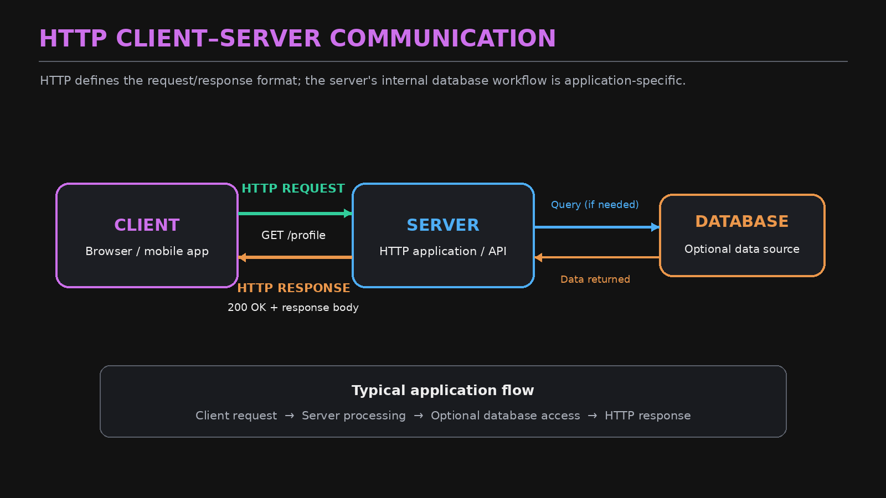

# HTTP: Overview, HTTP/1.0 and HTTP/1.1

> [!NOTE]
> **Section:** Computer Networking - [HTTP Fundamentals](https://youtu.be/5n5_IRlYr64?si=SeT5GA2L0bGL8kkH)
>
> **Learning objective:** Understand HTTP as an application-layer protocol, how clients and servers exchange requests and responses, and how HTTP/1.0 and HTTP/1.1 differ in TCP connection management.

[← Back to Computer Networking Repository](https://github.com/Priya200227/computer-networking)

---

## 1. What Is HTTP?

**HTTP (Hypertext Transfer Protocol)** is an application-layer protocol that defines how clients and servers communicate over a network.

It specifies the format and rules for exchanging requests and responses.

The word *Hypertext* refers to text containing links that connect different documents or resources.

### Key characteristics

- **Application-layer protocol:** Operates at the application layer.
- **Client-server communication:** A client sends a request, and a server returns a response.
- **Stateless:** Each request is independent at the HTTP protocol level. HTTP does not inherently remember previous requests.
- **Media independent:** Can transfer different types of content, including HTML, JSON, images, and videos.
- **Language independent:** Can be used by applications written in Python, Java, JavaScript, Go, and other languages.
- **No built-in encryption:** HTTPS uses TLS to protect HTTP communication.

> [!IMPORTANT]
> **Stateless does not mean applications cannot remember users.**
>
> Applications can maintain state using cookies, session IDs, authentication tokens, and server-side storage.

### HTTP and transport protocols

HTTP defines application-level communication, while the underlying transport carries the data.

| HTTP version | Underlying transport |
|---|---|
| HTTP/1.0 | TCP |
| HTTP/1.1 | TCP |
| HTTP/2 | TCP |
| HTTP/3 | QUIC over UDP |

> [!NOTE]
> QUIC is a transport protocol built over UDP. It provides reliability, congestion control, and connection management. HTTP/3 uses QUIC instead of TCP.

### Basic client-server communication



Example:

```http
GET /profile HTTP/1.1
Host: example.com
```

The server processes the request and returns a response:

```http
HTTP/1.1 200 OK
Content-Type: application/json

{"name": "Priya", "role": "Data Analyst"}
```

The simplified application workflow is:

1. The browser sends an HTTP request.
2. The server receives and processes it.
3. The server may retrieve information from a database.
4. The server sends an HTTP response.
5. The browser processes the response.

**Remember:** HTTP defines the request and response format; it does not define how the application internally retrieves or stores data.

---

## 2. HTTP/1.0 — One Connection Per Request by Default

HTTP/0.9 was the earliest version of HTTP. HTTP/1.0 introduced important features such as request methods, headers, and status codes.

### HTTP/0.9 — The beginning

HTTP/0.9 was extremely simple:

- Supported only the `GET` method.
- Used a simple request line.
- Had no HTTP request or response headers.
- Returned the resource body without a formal status line.
- Was primarily designed for retrieving HTML documents.

Example:

```http
GET /index.html
```

### HTTP/1.0 — Connection behaviour

HTTP/1.0 generally opened a new TCP connection for each request/response exchange.

Consider a browser requesting three resources:

1. `index.html`
2. `image.jpg`
3. `about.html`

The simplified sequence:


1. Establish TCP connection.
2. Send request for `index.html`.
3. Receive response.
4. Close TCP connection.
5. Establish another TCP connection for `image.jpg`.
6. Repeat the process for `about.html`.

This creates additional connection-establishment overhead.

> [!WARNING]
> The diagram illustrates the default HTTP/1.0 behaviour. Persistent connections were possible through extensions, so a new TCP connection for every request was not an absolute requirement.

### HTTP/1.0 Keep-Alive

HTTP/1.0 clients and servers could negotiate persistent connections using the `Keep-Alive` mechanism.

Example:

```http
Connection: Keep-Alive
Keep-Alive: timeout=5, max=100
```

This allowed multiple request/response exchanges to reuse a TCP connection when both sides supported the mechanism.


**Key takeaway:** HTTP/1.0 generally closed the TCP connection after each exchange, but Keep-Alive extensions could allow connection reuse.

---

## 3. HTTP/1.1 — Persistent Connections by Default

HTTP/1.1 improved connection management by making **persistent connections the default behaviour**.

Instead of establishing a new TCP connection for every request, a client can reuse the same connection for multiple requests.


### How HTTP/1.1 works

Consider a browser requesting:

- `index.html`
- `image.jpg`
- `about.html`

The simplified process:

1. Establish one TCP connection.
2. Send the request for `index.html`.
3. Receive its response.
4. Reuse the same TCP connection for `image.jpg`.
5. Receive its response.
6. Reuse the connection for `about.html`.
7. Close the connection when it is no longer needed.

This reduces repeated TCP connection-establishment overhead.

### Connection behaviour

HTTP/1.1 uses persistent connections by default.

To explicitly request connection closure:

```http
Connection: close
```

> [!IMPORTANT]
> `Connection: keep-alive` is generally unnecessary in HTTP/1.1 because persistence is the default. `Connection: close` requests that the connection be closed after the current exchange.

---

## 4. HTTP/1.1 Pipelining

HTTP/1.1 also introduced **pipelining**, which allows a client to send multiple requests over the same connection without waiting for each previous response.

Unlike ordinary sequential request handling, the client can send several requests in succession.


### How pipelining works

Suppose a browser needs three resources:

```text
Request 1: GET /index.html
Request 2: GET /image.jpg
Request 3: GET /about.html
```

With pipelining:

1. The client sends Request 1.
2. Without waiting for its response, it sends Request 2.
3. It then sends Request 3.
4. The server processes the requests.
5. The server must return the responses in the same order as the requests.

### Limitation: Head-of-Line Blocking

HTTP/1.1 pipelining has an important limitation.

**Responses must be returned in request order.**

Suppose:

- Request 1 takes 5 seconds to process.
- Request 2 takes 1 second.
- Request 3 takes 2 seconds.

Even if responses for Requests 2 and 3 are ready earlier, they cannot be delivered ahead of Response 1 in the HTTP/1.1 pipeline.

This is called **application-layer head-of-line blocking**.

> [!WARNING]
> HTTP/1.1 pipelining is not enabled by default and was not widely adopted because of implementation and interoperability limitations. Modern browsers generally rely on other connection-management strategies.

---

## 5. HTTP/1.0 vs. HTTP/1.1

| Feature | HTTP/1.0 | HTTP/1.1 |
|---|---|---|
| TCP connection | New connection per exchange by default | Persistent connection by default |
| Connection reuse | Supported through Keep-Alive extensions | Built in by default |
| Keep-Alive | Requires negotiation | Default behaviour |
| Multiple outstanding requests | No standard pipelining | Optional pipelining |
| Pipelining | Not supported as a standard feature | Supported |
| Response ordering | One exchange at a time in the basic model | Pipelined responses must follow request order |
| Head-of-line blocking | No HTTP/1.1-style pipelining issue | Can occur with pipelining |

### Main differences

- **HTTP/1.0:** Typically establishes and closes a TCP connection for each request/response exchange.
- **HTTP/1.1:** Reuses persistent TCP connections by default.
- **HTTP/1.1 pipelining:** Allows multiple requests to be sent without waiting for previous responses, but responses must remain ordered.

---

## Key Takeaways

> [!IMPORTANT]
> The biggest difference between HTTP/1.0 and HTTP/1.1 is **TCP connection management**.

| Concept | Remember |
|---|---|
| HTTP | Application-layer request/response protocol |
| Statelessness | HTTP does not inherently maintain application session state |
| HTTP/0.9 | Simple GET-only protocol |
| HTTP/1.0 | Non-persistent connections by default |
| Keep-Alive | Allows HTTP/1.0 connection reuse through negotiation |
| HTTP/1.1 | Persistent connections by default |
| Pipelining | Multiple requests sent without waiting for earlier responses |
| Head-of-Line Blocking | A delayed earlier response holds up later pipelined responses |

**Core idea:**

HTTP/1.0 generally created a separate TCP connection for each request, while HTTP/1.1 improved efficiency by allowing multiple requests to reuse a persistent connection.

## References

- [RFC 1945 — HTTP/1.0](https://www.rfc-editor.org/rfc/rfc1945.html)
- [RFC 2068 — HTTP/1.1 (Original Specification)](https://www.rfc-editor.org/rfc/rfc2068.html)
- [RFC 9110 — HTTP Semantics](https://www.rfc-editor.org/rfc/rfc9110.html)
- [RFC 9112 — HTTP/1.1](https://www.rfc-editor.org/rfc/rfc9112.html)
- [RFC 9114 — HTTP/3](https://www.rfc-editor.org/rfc/rfc9114.html)
- [MDN — HTTP Overview](https://developer.mozilla.org/en-US/docs/Web/HTTP/Overview)

---

**Next:** HTTP/2 and HTTP/3
