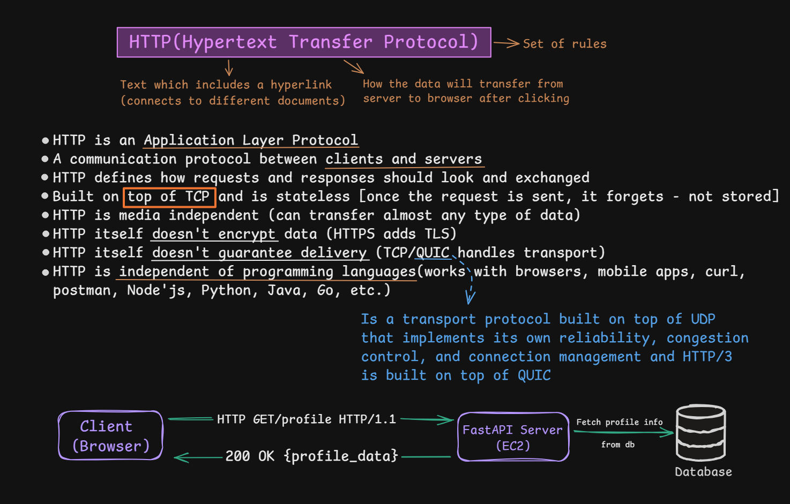
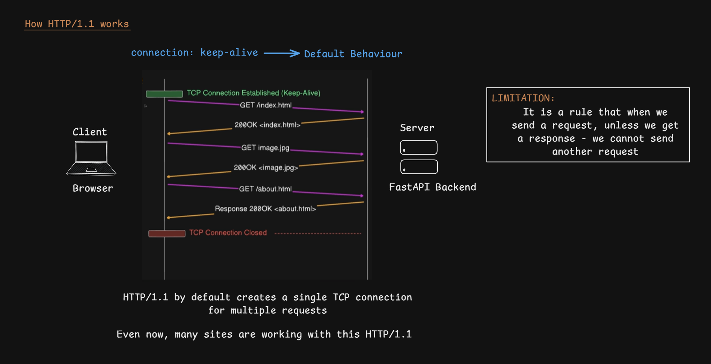
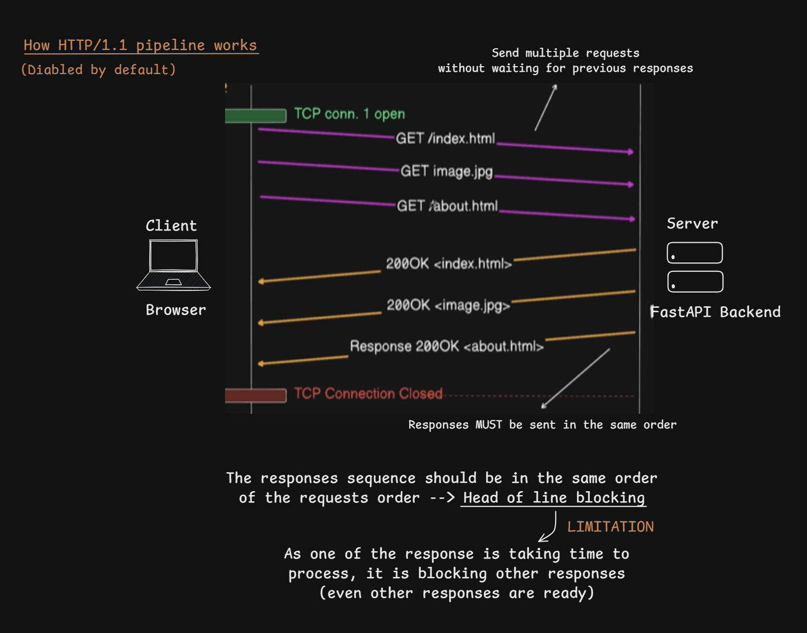

# HTTP: Overview, HTTP/1.0 and HTTP/1.1

> [!NOTE]
> **Section:** Computer Networking — [HTTP Fundamentals](https://youtu.be/5n5_IRlYr64?si=SeT5GA2L0bGL8kkH)
>
> **Learning objective:** Understand HTTP client-server communication and how HTTP/1.0 and HTTP/1.1 differ in TCP connection management, connection reuse, and request pipelining.

[← Back to Computer Networking Repository](https://github.com/Priya200227/computer-networking)

---

## 1. What Is HTTP?

**HTTP (Hypertext Transfer Protocol)** is an **application-layer protocol** that defines how clients and servers exchange requests and responses over a network.

The term *Hypertext* refers to text containing hyperlinks that connect different documents or resources.

### Key characteristics

- **Client-server protocol:** A client sends a request, and a server returns a response.
- **Stateless:** Each HTTP request is independent at the protocol level. HTTP does not inherently remember previous requests.
- **Media independent:** Supports different types of content, including HTML, JSON, images, and videos.
- **Language independent:** Can be used by applications written in Python, Java, JavaScript, Go, and other languages.
- **No built-in encryption:** HTTPS uses TLS to protect HTTP communication.

> [!IMPORTANT]
> **Stateless does not mean applications cannot remember users.**
>
> Applications can maintain state using cookies, session IDs, authentication tokens, and server-side storage.

### HTTP and transport protocols

HTTP defines application-level communication; the transport protocol carries the data between endpoints.

| HTTP version | Transport |
|---|---|
| HTTP/1.0 | TCP |
| HTTP/1.1 | TCP |
| HTTP/2 | TCP |
| HTTP/3 | QUIC over UDP |

> [!NOTE]
> QUIC is a transport protocol built over UDP. It provides reliability, congestion control, and connection management. HTTP/3 uses QUIC instead of TCP.

### Client-server communication


A simplified example:

**Client request**

```http
GET /profile HTTP/1.1
Host: example.com
```

**Server response**

```http
HTTP/1.1 200 OK
Content-Type: application/json

{"name": "Priya", "role": "Data Analyst"}
```

The application workflow:

1. The browser sends an HTTP request.
2. The server receives and processes it.
3. The server may retrieve information from a database.
4. The server sends an HTTP response.
5. The browser processes the response.

**Remember:** HTTP defines the request and response format. It does not dictate how the server internally retrieves or stores data.

---

## 2. HTTP/1.0 — Non-Persistent Connections by Default

HTTP/0.9 was the earliest version of HTTP. It was extremely simple:

- Supported only the `GET` method.
- Had no HTTP request or response headers.
- Returned the requested resource without a formal status line.
- Was primarily designed for retrieving HTML documents.

HTTP/1.0 introduced important features such as request methods, headers, and status codes.

### HTTP/1.0 connection behaviour

HTTP/1.0 generally established a **new TCP connection for each request/response exchange**.

Consider a browser requesting three resources:

- `index.html`
- `image.jpg`
- `about.html`



The simplified process:

1. Establish a TCP connection.
2. Send a request for `index.html`.
3. Receive the response.
4. Close the TCP connection.
5. Establish another connection for `image.jpg`.
6. Repeat the process for `about.html`.

This creates additional TCP connection-establishment overhead.

> [!IMPORTANT]
> This is the typical HTTP/1.0 behaviour, not an absolute rule. Persistent connections were possible through extensions such as Keep-Alive.

### HTTP/1.0 Keep-Alive

HTTP/1.0 clients and servers could negotiate persistent connections using the Keep-Alive mechanism.

For example, a client could send:

```http
Connection: Keep-Alive
```

When supported by both sides, the connection could be reused for multiple request/response exchanges instead of being closed after every exchange.

**Key takeaway:** HTTP/1.0 used non-persistent connections by default, but Keep-Alive extensions allowed connection reuse.

---

## 3. HTTP/1.1 — Persistent Connections by Default

HTTP/1.1 improved connection management by making **persistent connections the default behaviour**.

Instead of establishing a new TCP connection for every request, a client can reuse the same connection for multiple requests.



### How HTTP/1.1 works

Consider a browser requesting:

- `index.html`
- `image.jpg`
- `about.html`

The simplified process:

1. Establish one TCP connection.
2. Send the request for `index.html`.
3. Receive its response.
4. Reuse the same connection for `image.jpg`.
5. Receive its response.
6. Reuse the connection for `about.html`.
7. Close the connection when it is no longer needed.

This reduces repeated TCP connection-establishment overhead.

### Connection behaviour

HTTP/1.1 uses persistent connections by default.

To explicitly request connection closure, a client can send:

```http
Connection: close
```

> [!TIP]
> `Connection: keep-alive` is generally unnecessary in HTTP/1.1 because persistent connections are the default. `Connection: close` requests that the connection be closed after the current exchange.

---

## 4. HTTP/1.1 Pipelining

**HTTP/1.1 pipelining** allows a client to send multiple requests over the same TCP connection without waiting for the previous responses.

This is different from ordinary sequential request handling, where the client waits for a response before sending the next request.



### How pipelining works

Suppose a browser needs three resources:

```text
Request 1: GET /index.html
Request 2: GET /image.jpg
Request 3: GET /about.html
```

With pipelining:

1. The client sends Request 1.
2. Without waiting for its response, it sends Request 2.
3. It then sends Request 3.
4. The server processes the requests.
5. The server returns responses in the same order as the requests.

### Limitation: Head-of-Line Blocking

HTTP/1.1 pipelining has an important limitation: **responses must be returned in request order**.

Suppose:

- Request 1 takes 5 seconds to process.
- Request 2 takes 1 second.
- Request 3 takes 2 seconds.

Even if the responses for Requests 2 and 3 are ready earlier, they cannot be delivered ahead of Response 1 in the pipeline.

This is called **application-layer head-of-line blocking**.

> [!WARNING]
> Pipelining is optional and was not widely adopted because of implementation and interoperability limitations. Modern browsers generally use other connection-management strategies.

---

## 5. HTTP/1.0 vs. HTTP/1.1

| Feature | HTTP/1.0 | HTTP/1.1 |
|---|---|---|
| TCP connection | Non-persistent by default | Persistent by default |
| Connection reuse | Possible through Keep-Alive extensions | Built in by default |
| Connection closure | Typically after each exchange | Remains open unless closed |
| Multiple outstanding requests | No standard pipelining | Optional pipelining |
| Response ordering | One exchange at a time in the basic model | Pipelined responses must follow request order |
| Head-of-line blocking | No HTTP/1.1-style pipelining issue | Can occur with pipelining |

### The three differences to remember

1. **HTTP/1.0:** Typically establishes a separate TCP connection for each request/response exchange.
2. **HTTP/1.1:** Reuses persistent TCP connections by default.
3. **HTTP/1.1 pipelining:** Allows multiple requests to be sent without waiting for previous responses, but responses must remain ordered.

---

## Key Takeaways

> [!IMPORTANT]
> The biggest improvement from HTTP/1.0 to HTTP/1.1 is **persistent TCP connection management**.

| Concept | Remember |
|---|---|
| HTTP | Application-layer request/response protocol |
| Statelessness | HTTP does not inherently maintain application session state |
| HTTP/0.9 | Simple GET-only protocol |
| HTTP/1.0 | Non-persistent connections by default |
| Keep-Alive | Extension that allowed HTTP/1.0 connection reuse |
| HTTP/1.1 | Persistent connections by default |
| Pipelining | Multiple requests sent without waiting for earlier responses |
| Head-of-Line Blocking | A delayed earlier response holds up later pipelined responses |

**Core idea:**

HTTP/1.0 generally created a separate TCP connection for each request/response exchange, while HTTP/1.1 improved efficiency by allowing multiple exchanges to reuse a persistent connection.

## References

- [RFC 1945 — HTTP/1.0](https://www.rfc-editor.org/rfc/rfc1945.html)
- [RFC 2068 — HTTP/1.1 (Original Specification)](https://www.rfc-editor.org/rfc/rfc2068.html)
- [RFC 9110 — HTTP Semantics](https://www.rfc-editor.org/rfc/rfc9110.html)
- [RFC 9112 — HTTP/1.1](https://www.rfc-editor.org/rfc/rfc9112.html)
- [RFC 9114 — HTTP/3](https://www.rfc-editor.org/rfc/rfc9114.html)
- [MDN — HTTP Overview](https://developer.mozilla.org/en-US/docs/Web/HTTP/Overview)

---

**Next:** HTTP/2 and HTTP/3
