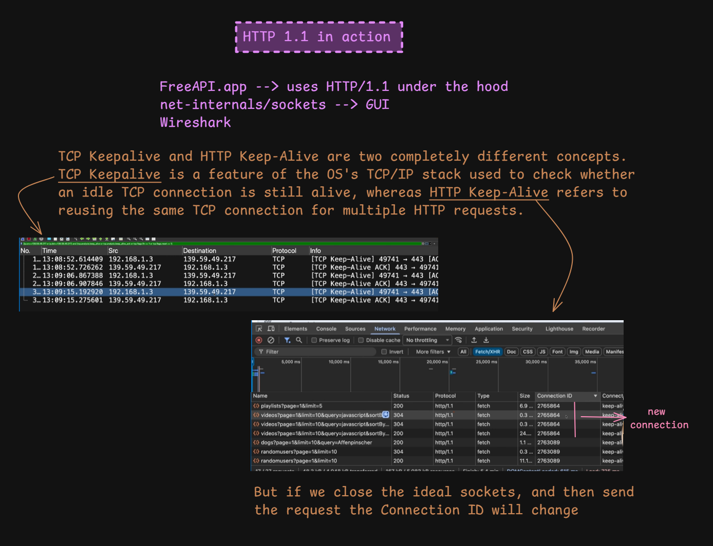
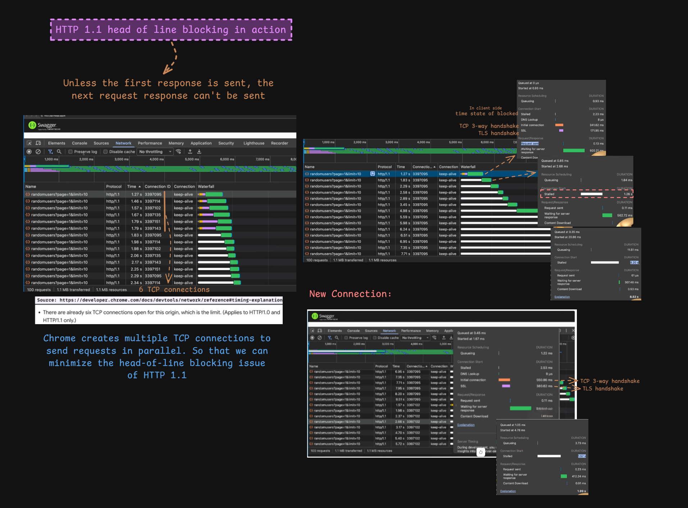

# HTTP/1.1 in Action: Connection Reuse and Head-of-Line Blocking

> [!NOTE]
> **Section:** Computer Networking - [HTTP 1.1 in action](https://youtu.be/bIPvH42Jesk?si=YPh1Qa94zegwLtQv) & [HTTP 1.1 head of line blocking in action](https://youtu.be/zoKBDaihBlU?si=r8fqC2LQaugz1Z81)
>
> **Learning objective:** Observe HTTP/1.1 persistent connection reuse in browser developer tools and Wireshark, understand the difference between TCP Keep-Alive and HTTP Keep-Alive, and investigate head-of-line blocking.

[← Back to Computer Networking Repository](https://github.com/Priya200227/computer-networking)

---

## 1. Observing HTTP/1.1 in Practice

HTTP/1.1 uses **persistent connections by default**, allowing multiple HTTP request/response exchanges to reuse the same TCP connection.

To observe this behaviour, we can use:

- **FreeAPI.app:** A website/API that generates HTTP requests.
- **Chrome DevTools — Network:** Inspect request timing, protocol, connection ID, and connection reuse.
- **Wireshark:** Inspect TCP packets, connection activity, and TCP-level Keep-Alive probes.

### What to observe

When multiple API requests are sent to the same server:

- Requests may use the same connection ID.
- The browser can reuse an existing TCP connection.
- A new connection ID indicates that the browser is using a different connection.



### Understanding the connection ID

In Chrome DevTools, the Network panel can display a **Connection ID** for requests.

| Observation | Meaning |
|---|---|
| Same Connection ID | Requests reused the same underlying connection |
| Different Connection ID | Requests used different connections |

For example, if several API requests show the same connection ID, the browser is reusing an existing connection instead of establishing a new TCP connection for every request.

> [!IMPORTANT]
> Connection ID is browser diagnostic information, not an HTTP header or a value transmitted as part of the HTTP protocol.

### TCP Keep-Alive vs. HTTP Keep-Alive

These are two different concepts.

| TCP Keep-Alive | HTTP Keep-Alive |
|---|---|
| Feature of the TCP stack | HTTP connection-management behaviour |
| Checks whether an idle TCP connection is still reachable | Allows multiple HTTP exchanges to reuse one connection |
| Uses TCP-level probes | Reuses an existing TCP connection for HTTP requests |
| Operates at the transport layer | Operates at the application protocol level |

Wireshark may label certain packets as:

```text
[TCP Keep-Alive]
[TCP Keep-Alive ACK]
```

These labels refer to TCP-level Keep-Alive activity. They do **not** mean that an HTTP request is being sent.

> [!WARNING]
> Do not confuse a TCP Keep-Alive probe with HTTP persistent connection reuse. HTTP/1.1 can reuse a connection without TCP Keep-Alive probes being involved.

---

## 2. HTTP/1.1 Head-of-Line Blocking in Practice

**Head-of-Line (HOL) blocking** occurs when an earlier item delays the processing or delivery of later items.

In HTTP/1.1, this limitation is particularly relevant to request pipelining.

### Why does it happen?

HTTP/1.1 pipelining allows a client to send multiple requests over the same connection without waiting for each previous response.

However, the server must send the responses in the same order as the requests.

Consider three requests:

```text
Request 1: GET /index.html
Request 2: GET /image.jpg
Request 3: GET /about.html
```

Suppose the first request takes longer to process.

Even if the responses for Requests 2 and 3 are ready earlier, they cannot be sent ahead of Response 1 on that HTTP/1.1 pipelined connection.



### How browsers reduce the impact

Browsers can open multiple TCP connections to the same server origin.

Instead of sending every request through one connection, requests can be distributed across several connections.

This allows multiple requests to progress in parallel and reduces the impact of waiting behind a delayed response on one connection.

The browser's Network panel can show:

- Multiple Connection IDs.
- Requests progressing concurrently.
- Separate TCP connection-establishment timings.
- TLS handshake timings for HTTPS connections.
- Request and response timing in the waterfall view.

### Why do new connections have overhead?

For a new HTTPS connection, the browser may need to perform:

1. TCP three-way handshake.
2. TLS handshake.
3. HTTP request/response exchange.

Reusing an existing connection avoids repeating connection establishment for every request.

> [!NOTE]
> The exact number of connections a browser opens per origin depends on its implementation, version, and connection-pooling policies. The six connections shown in the diagram are an observed example, not a universal HTTP/1.1 requirement.

---

## 3. Key Takeaways

| Concept | Remember |
|---|---|
| HTTP/1.1 persistence | Multiple HTTP exchanges can reuse one TCP connection |
| Connection ID | Browser diagnostic information used to identify connection reuse |
| TCP Keep-Alive | TCP-level probes that check an idle connection |
| HTTP Keep-Alive | Reuse of a TCP connection for multiple HTTP exchanges |
| HTTP/1.1 pipelining | Multiple requests sent without waiting for previous responses |
| Head-of-Line Blocking | A delayed earlier response holds up later pipelined responses |
| Multiple TCP connections | Allow requests to progress concurrently across separate connections |

> [!IMPORTANT]
> **Connection reuse reduces connection-establishment overhead. Multiple connections allow parallel transfers.**
>
> These are related but different techniques.

## References

- [RFC 9112 — HTTP/1.1](https://www.rfc-editor.org/rfc/rfc9112.html)
- [RFC 9110 — HTTP Semantics](https://www.rfc-editor.org/rfc/rfc9110.html)
- [Chrome DevTools — Network Reference](https://developer.chrome.com/docs/devtools/network/reference/)
- [RFC 1122 — Requirements for Internet Hosts](https://www.rfc-editor.org/rfc/rfc1122.html)

---

**Next:** HTTP/2 — Multiplexing and Stream-Level Head-of-Line Blocking
