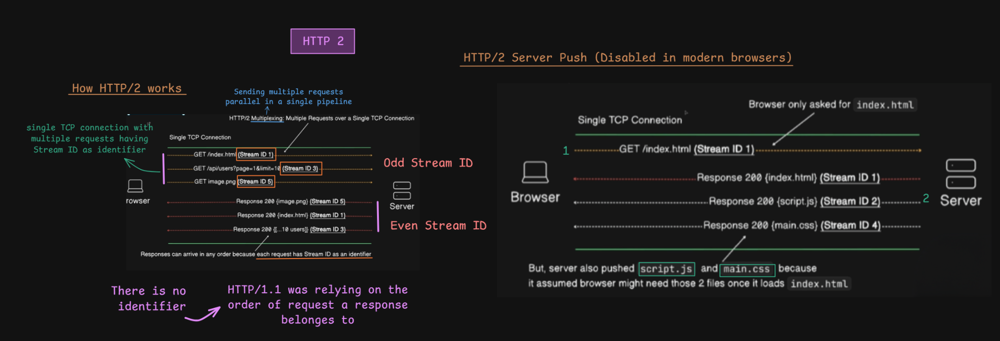

# HTTP/2: Multiplexing, Streams and Frames

> [!NOTE]
> **Section:** Computer Networking - [HTTP 2 overview](https://youtu.be/yqVkmfAO1Dw?si=aeHUiY4Uafj0SdC5) & [HTTP 2 frames](https://youtu.be/dX0DK0zt6WU?si=SZo6R6MooLyBqL8L)
>
> **Learning objective:** Understand how HTTP/2 multiplexes multiple streams over a single TCP connection, how requests and responses are represented using frames, and how HTTP/2 traffic can be inspected using Wireshark.

[← Back to Computer Networking Repository](https://github.com/Priya200227/computer-networking)

---

## 1. How HTTP/2 Works

HTTP/2 improves HTTP communication by introducing **binary framing and multiplexing**.

Unlike HTTP/1.1, where pipelined responses must follow request order, HTTP/2 allows multiple independent streams to share a single TCP connection.

### HTTP/2 Multiplexing

**Multiplexing** allows multiple requests and responses to be exchanged concurrently over one TCP connection.

Each request/response exchange belongs to a separate **stream**, identified by a Stream ID.


For example, a browser can request:

- `GET /index.html` — Stream ID 1
- `GET /api/users` — Stream ID 3
- `GET /image.png` — Stream ID 5

The server can send frames belonging to these streams in an interleaved order.

### Stream IDs

HTTP/2 uses Stream IDs to identify individual streams.

| Stream ID | Initiator |
|---|---|
| 0 | Reserved for connection-level frames; not a normal request stream |
| Odd IDs (1, 3, 5...) | Client-initiated streams |
| Even IDs (2, 4, 6...) | Server-initiated streams |

Stream IDs identify streams, not individual frames. Multiple frames can belong to the same stream.

> [!IMPORTANT]
> HTTP/2 does not require responses from different streams to follow request order. Frames from different streams can be interleaved.
>
> However, **the order of frames within an individual stream must be preserved**.

### HTTP/1.1 vs. HTTP/2

| Feature | HTTP/1.1 | HTTP/2 |
|---|---|---|
| Message format | Text-based | Binary framing |
| Multiplexing | No | Yes |
| Stream IDs | No | Yes |
| Multiple requests | Sequential handling or optional pipelining | Concurrent streams |
| Response ordering | Pipelined responses follow request order | Independent streams can progress separately |
| Header compression | No standard header compression | HPACK |

> [!NOTE]
> HTTP/2 multiplexing reduces HTTP-level head-of-line blocking, but HTTP/2 commonly runs over TCP. Packet loss can still delay delivery of data across the TCP connection.

---

## 2. HTTP/2 Server Push

**Server Push** was designed to allow a server to send resources to a client before the client explicitly requested them.

For example:

1. The browser requests `index.html`.
2. The server sends the HTML response.
3. The server anticipates that the browser will need `script.js` and `main.css`.
4. The server proactively pushes those resources.


Server Push was intended to reduce additional request latency when the server could predict which resources the client would need.

> [!WARNING]
> Server Push is now largely obsolete in browser-based web development. Major browsers, including Chrome, have withdrawn or disabled support. Understand the concept, but do not treat it as a modern performance optimization to rely on.

---

## 3. HTTP/2 Frames

HTTP/2 uses **binary frames** as its basic protocol communication units.

Instead of transmitting complete HTTP messages as one text-based block, HTTP/2 divides communication into frames.

A frame contains:

- A frame header.
- A frame payload.

A request or response can consist of multiple frames.


### Example: Multiple Requests

Consider three requests:

**Request 1**

```http
POST /api/v1/users
Content-Type: application/json
```

This request contains headers and a body.

It may be represented using:

- A HEADERS frame containing compressed headers.
- One or more DATA frames containing the request body.

**Request 2**

```http
GET /api/v1/orders
```

This request has headers but no request body, so it does not need a DATA frame for a request body.

**Request 3**

```http
GET /index.html
```

This also requires a HEADERS frame and does not need a request-body DATA frame.

### Frames and Stream IDs

Each frame is associated with a Stream ID.

For example:

| Frame | Stream ID | Purpose |
|---|---:|---|
| DATA | 1 | Carries request body data |
| HEADERS | 5 | Carries request headers |
| HEADERS | 3 | Carries request headers |
| HEADERS | 1 | Additional headers for Stream 1 |

Frames belonging to different streams can be interleaved over the same connection.

The receiver uses Stream IDs to associate each frame with its corresponding stream.

> [!IMPORTANT]
> Frames from different streams can be interleaved, but frames within the same stream must be processed in the required protocol order.
>
> For example, a DATA frame cannot be processed as the beginning of a stream's message before its required preceding HEADERS frame.

### Common HTTP/2 Frame Types

| Frame type | Purpose |
|---|---|
| `DATA` | Carries request or response body data |
| `HEADERS` | Carries compressed header information |
| `PRIORITY` | Legacy mechanism for expressing stream priority; deprecated |
| `RST_STREAM` | Terminates an individual stream |
| `SETTINGS` | Communicates connection-level settings |
| `PUSH_PROMISE` | Announces a server-initiated pushed stream |
| `PING` | Checks connection responsiveness |
| `GOAWAY` | Initiates connection shutdown |
| `WINDOW_UPDATE` | Controls flow-control windows |
| `CONTINUATION` | Continues a header block across frames |

> [!NOTE]
> HTTP/2 headers are compressed using **HPACK**. The HEADERS frame carries the encoded header block; the frame itself is not the HPACK compression algorithm.

---

## 4. Structure of an HTTP/2 Frame

Every HTTP/2 frame begins with a fixed-size **9-byte frame header**, followed by a payload.


### Frame Header Layout

| Field | Size | Description |
|---|---:|---|
| Length | 24 bits | Payload length in bytes |
| Type | 8 bits | Identifies the frame type |
| Flags | 8 bits | Provides frame-specific control information |
| Reserved bit | 1 bit | Reserved for protocol use |
| Stream ID | 31 bits | Identifies the associated stream |

**Total frame header size:**

\[
24 + 8 + 8 + 1 + 31 = 72 \text{ bits} = 9 \text{ bytes}
\]

### Understanding the Fields

- **Length:** Specifies the size of the frame payload, excluding the 9-byte header.
- **Type:** Identifies whether the frame is DATA, HEADERS, SETTINGS, or another frame type.
- **Flags:** Provides additional information depending on the frame type.
- **Reserved bit:** Reserved by the protocol and normally sent as zero.
- **Stream ID:** Associates the frame with a particular stream. Stream ID 0 is used for connection-level frames.

### Frame Payload

The payload depends on the frame type.

For example:

- A DATA frame carries application data.
- A HEADERS frame carries an HPACK-encoded header block.
- A SETTINGS frame carries configuration parameters.
- A PING frame carries an 8-byte opaque value.

> [!IMPORTANT]
> Not every frame contains application request or response data. Some frames manage the connection, streams, flow control, or protocol settings.

---

## 5. Inspecting HTTP/2 Frames with Wireshark

Wireshark can display HTTP/2 frames when it can identify and decode the HTTP/2 connection.

The frame-level view helps you understand how HTTP/2 communication works beyond the browser's Network panel.

In the packet capture, observe:

- HTTP/2 frame types such as `HEADERS`, `DATA`, and `SETTINGS`.
- Stream IDs associated with frames.
- Frame payload lengths.
- Request and response header blocks.
- DATA frames carrying application content.

### Important observations

1. A single HTTP/2 request can produce multiple frames.
2. Multiple streams can share one TCP connection.
3. Frames from different streams can be interleaved.
4. Frames within an individual stream retain their required order.
5. Request and response bodies are carried in DATA frames when present.

> [!TIP]
> When inspecting encrypted HTTPS traffic, Wireshark may not be able to decode HTTP/2 application frames unless the TLS session keys are available. Seeing TCP packets alone does not mean the HTTP/2 payload is readable.

---

## 6. Key Takeaways

| Concept | Remember |
|---|---|
| Multiplexing | Multiple streams share one TCP connection |
| Stream ID | Identifies an individual stream |
| Odd Stream IDs | Client-initiated streams |
| Even Stream IDs | Server-initiated streams |
| Frame | Basic binary unit of HTTP/2 communication |
| HEADERS frame | Carries compressed header information |
| DATA frame | Carries application data |
| Frame header | Fixed size of 9 bytes |
| HPACK | Header compression mechanism in HTTP/2 |
| Server Push | Server-initiated resource delivery; largely obsolete in browsers |
| Wireshark | Can inspect HTTP/2 frames when traffic is decodable |

> [!IMPORTANT]
> **The core idea of HTTP/2 is that multiple independent streams can share one TCP connection through binary frames.**
>
> Stream IDs identify the streams, while frame types describe the purpose of each frame.

---

## References

- [RFC 9113 — HTTP/2](https://www.rfc-editor.org/rfc/rfc9113.html)
- [RFC 7541 — HPACK: Header Compression for HTTP/2](https://www.rfc-editor.org/rfc/rfc7541.html)
- [MDN — Introduction to HTTP/2](https://developer.mozilla.org/en-US/docs/Web/HTTP/Guides/Messages)
- [Wireshark — HTTP/2 Display Filter Reference](https://www.wireshark.org/docs/dfref/h/http2.html)

---

**Next:** [Why HTTP/2 is binary protocol](../24-http-2-binary-protocol)
