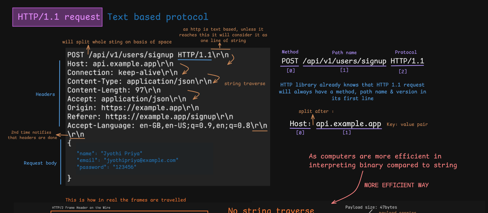
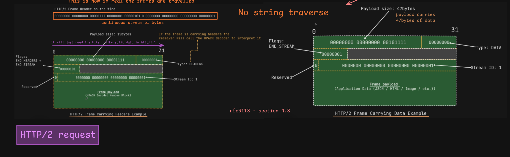

# Why Is HTTP/2 a Binary Protocol?

> [!NOTE]
> **Section:** Computer Networking — HTTP/2
>
> **Learning objective:** Understand why HTTP/2 uses binary framing instead of HTTP/1.1's text-based message format, how frames are structured, and how HTTP/2 carries headers and application data.

[← Back to Computer Networking Repository](https://github.com/Priya200227/computer-networking)

---

## 1. HTTP/1.1 — Text-Based Protocol

HTTP/1.1 uses a **text-based message format**. Requests and responses are represented using readable textual elements such as methods, paths, protocol versions, headers, and message bodies.

Example HTTP/1.1 request:

```http
POST /api/v1/users/signup HTTP/1.1
Host: api.example.com
Connection: keep-alive
Content-Type: application/json
Content-Length: 97
Accept: application/json
Accept-Language: en-US,en;q=0.9

{
  "name": "Priya",
  "email": "priya@example.com"
}
```

### How is the request interpreted?

The request contains two main sections:

**1. Request line**

```http
POST /api/v1/users/signup HTTP/1.1
```

It contains:

- Method: `POST`
- Request target: `/api/v1/users/signup`
- Protocol version: `HTTP/1.1`

**2. Headers and body**

Headers contain key-value pairs:

```http
Host: api.example.com
Content-Type: application/json
Accept: application/json
```

The empty line separates the headers from the optional message body.

The body contains the application data being sent to the server.



### How does the parser interpret it?

HTTP/1.1 uses textual syntax and defined delimiters to identify message components.

For example:

- Spaces separate elements in the request line.
- `:` separates a header field name from its value.
- `CRLF` (`\r\n`) marks line boundaries.
- An empty line marks the end of the header section.

The parser follows HTTP grammar to identify the request line, headers, and message body.

---

## 2. HTTP/2 — Binary Framing Protocol

HTTP/2 introduced a **binary framing layer**.

Instead of transmitting HTTP messages as textual request and response lines, HTTP/2 divides communication into smaller units called **frames**.

Each frame contains a structured header and a payload.


### Why use binary framing?

Binary framing provides a structured way to represent and process HTTP communication.

Key advantages include:

- **Explicit structure:** Frame headers identify the type and length of each frame.
- **Efficient parsing:** Implementations can process structured binary fields without parsing an entire text-based message format.
- **Multiplexing:** Frames from multiple streams can be interleaved over one connection.
- **Stream identification:** Each frame carries a Stream ID.
- **Extensibility:** Different frame types support different protocol operations.

> [!IMPORTANT]
> HTTP/2 being a binary protocol does **not** mean that all application data must be binary.
>
> JSON, HTML, images, and other application content can still be carried inside HTTP/2 DATA frames. Binary framing describes how HTTP/2 structures and transports the messages.

---

## 3. HTTP/2 Frame Structure

A frame is the basic unit of HTTP/2 communication.

Every HTTP/2 frame consists of:

1. A fixed-size 9-byte frame header.
2. A variable-length frame payload.

### Frame Header

| Field | Size | Purpose |
|---|---:|---|
| Length | 24 bits | Specifies the payload length in bytes |
| Type | 8 bits | Identifies the frame type |
| Flags | 8 bits | Provides frame-specific control information |
| Reserved bit | 1 bit | Reserved for protocol use |
| Stream ID | 31 bits | Identifies the associated stream |

Total header size:

\[
24 + 8 + 8 + 1 + 31 = 72\text{ bits} = 9\text{ bytes}
\]

The payload length does not include the 9-byte frame header.

### Frame Types

Two important frame types are:

**1. HEADERS frame**

Carries HTTP header information encoded using HPACK.

For example:

```text
:method: POST
:path: /api/v1/users
:authority: api.example.com
content-type: application/json
```

The receiver uses the HPACK decoder to reconstruct the header fields.

**2. DATA frame**

Carries application data, such as:

```json
{
  "name": "Priya",
  "email": "priya@example.com"
}
```

A request or response body may be split across multiple DATA frames.



> [!NOTE]
> A request containing a body commonly uses HEADERS followed by one or more DATA frames. A request without a body may use only a HEADERS frame, with the `END_STREAM` flag indicating that the stream direction is finished.

---

## 4. How HTTP/2 Transmits Frames

Consider an HTTP/2 POST request containing JSON data.

The communication can be represented as:

```text
HTTP/2 Request
      |
      v
  HEADERS Frame
  (HPACK-encoded headers)
      |
      v
    DATA Frame
  (JSON application data)
      |
      v
  TCP Connection
```

The receiver:

1. Reads the frame header.
2. Identifies the frame type and Stream ID.
3. Reads the payload using the specified length.
4. Decodes the header block when processing HEADERS frames.
5. Reconstructs the request or response from the received frames.

Frames from different streams can be interleaved over the same TCP connection. The receiver uses Stream IDs to associate frames with their respective streams.

> [!IMPORTANT]
> HTTP/2 uses binary framing at the protocol layer, but application-level content retains its own format. HPACK compresses HTTP headers; it does not compress every DATA payload.

---

## 5. HTTP/1.1 vs. HTTP/2

| Feature | HTTP/1.1 | HTTP/2 |
|---|---|---|
| Message representation | Text-based syntax | Binary framing |
| Message structure | Request/status lines, headers and optional body | Frames |
| Parsing | Textual grammar and delimiters | Structured binary fields |
| Multiplexing | Not supported | Supported |
| Stream ID | Not available | Available |
| Header compression | No standard mechanism | HPACK |
| Frame types | No HTTP/2-style frames | HEADERS, DATA, SETTINGS, etc. |

---

## Key Takeaways

> [!IMPORTANT]
> **HTTP/1.1 uses readable textual message syntax, while HTTP/2 uses structured binary frames to carry HTTP communication.**

| Concept | Remember |
|---|---|
| HTTP/1.1 | Text-based message format |
| HTTP/2 | Binary framing layer |
| Frame | Basic unit of HTTP/2 communication |
| Frame header | Fixed size of 9 bytes |
| HEADERS | Carries HPACK-encoded header information |
| DATA | Carries application data |
| HPACK | Compresses HTTP header fields |
| Stream ID | Identifies the stream associated with a frame |

## References

- [RFC 9112 — HTTP/1.1](https://www.rfc-editor.org/rfc/rfc9112.html)
- [RFC 9113 — HTTP/2](https://www.rfc-editor.org/rfc/rfc9113.html)
- [RFC 7541 — HPACK: Header Compression for HTTP/2](https://www.rfc-editor.org/rfc/rfc7541.html)

---

**Next:** HPACK — Header Compression in HTTP/2
