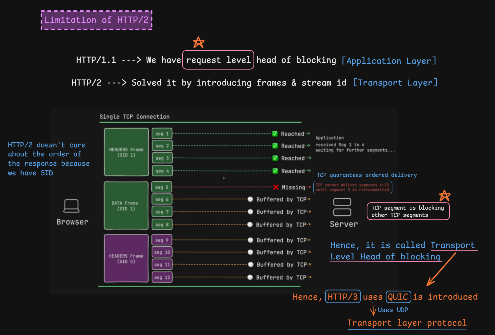

# HTTP/2 Head-of-Line Blocking

> [!NOTE]
> **Section:** Computer Networking - [HTTP/2 Head of Line Blocking](https://youtu.be/75UeaBsdbF0?si=glp9WItNrSBxz6B8)
>  
> **Learning objective:** Understand why HTTP/2 multiplexing does not completely eliminate head-of-line blocking, how TCP packet loss affects multiple HTTP/2 streams, and why HTTP/3 uses QUIC.

[← Back to Computer Networking Repository](https://github.com/Priya200227/computer-networking)

---

## 1. Understanding Head-of-Line Blocking

**Head-of-Line (HOL) Blocking** occurs when a delayed or missing piece of data prevents subsequent data from being processed or delivered, even when that subsequent data is otherwise ready.

The important distinction is that HOL blocking can occur at different layers.

| HTTP version | Main limitation |
|---|---|
| HTTP/1.1 | Application-level HOL blocking with pipelining |
| HTTP/2 | Transport-level HOL blocking caused by TCP |
| HTTP/3 | Uses QUIC to avoid TCP-level cross-stream HOL blocking |

## 2. HTTP/1.1 vs HTTP/2

### HTTP/1.1 — Application-level HOL blocking

HTTP/1.1 pipelining allows a client to send multiple requests without waiting for previous responses.

However, responses must be returned in the same order as their requests.

For example:

1. Request 1 takes 5 seconds.
2. Request 2 takes 1 second.
3. Request 3 takes 2 seconds.

Even if the responses to Requests 2 and 3 are ready earlier, they cannot be returned ahead of Response 1 in the pipeline.

This creates **application-level head-of-line blocking**.

### HTTP/2 — Multiplexing improves the situation

HTTP/2 introduced:

- Binary framing.
- Multiple independent streams.
- Stream IDs.
- Multiplexing over a single TCP connection.

Each request/response exchange is associated with a stream ID.

For example:

```text
Single TCP Connection

Stream 1 → Request: index.html
Stream 3 → Request: users
Stream 5 → Request: image.png
```

Frames belonging to different streams can be interleaved over the same TCP connection.

Unlike HTTP/1.1 pipelining, HTTP/2 does not require responses from different streams to be completed in request order.

**This removes the HTTP-level response-ordering restriction between independent streams.**

## 3. The Remaining Limitation: TCP Head-of-Line Blocking

Although HTTP/2 supports independent streams, all their frames travel through the same TCP connection.

Remember:

**TCP guarantees reliable, ordered delivery of bytes.**

Suppose the sender transmits TCP segments containing data from multiple HTTP/2 streams:

```text
TCP Segment 1  → Reaches receiver
TCP Segment 2  → Reaches receiver
TCP Segment 3  → Reaches receiver
TCP Segment 4  → Reaches receiver

TCP Segment 5  → LOST

TCP Segment 6  → Reaches receiver
TCP Segment 7  → Reaches receiver
TCP Segment 8  → Reaches receiver
```

What happens?

- Segments 1–4 can be delivered in order.
- Segment 5 is missing.
- Later segments may be received and buffered.
- TCP cannot deliver the later bytes to the application as an ordered byte stream until the missing data is recovered.
- HTTP/2 frames belonging to other streams can therefore be delayed too.

<badge color="danger">Transport-level HOL blocking</badge>

The important point is that TCP does not understand HTTP/2 stream IDs. It sees one ordered byte stream.



## 4. Why Does HTTP/3 Use QUIC?

HTTP/3 uses **QUIC**, a transport protocol built over UDP.

QUIC supports multiple independent streams within one connection.

Unlike TCP, loss affecting one QUIC stream does not prevent other independent streams from delivering their data.

For example:

```text
QUIC Connection

Stream 1 → Delayed due to packet loss
Stream 3 → Continues delivering data
Stream 5 → Continues delivering data
```

This avoids TCP-level cross-stream head-of-line blocking.

> [!IMPORTANT]
> HTTP/3 does not eliminate every form of head-of-line blocking. Data within an individual QUIC stream must still be delivered in order. The key improvement is that loss on one stream does not block the delivery of data on other independent streams.

## 5. Comparison

| Feature | HTTP/1.1 | HTTP/2 | HTTP/3 |
|---|---|---|---|
| Multiplexing | No standard multiplexing | Yes | Yes |
| Transport | TCP | TCP | QUIC over UDP |
| Independent streams | No | Yes | Yes |
| TCP-level cross-stream HOL | Not applicable to its basic request model | Possible | Avoided because it does not use TCP |
| Response ordering across streams | Pipelined responses must remain ordered | Independent streams | Independent streams |

## Key Takeaways

> [!IMPORTANT]
> **HTTP/2 solved application-level response-ordering limitations through multiplexing, but TCP still introduces transport-level head-of-line blocking. HTTP/3 uses QUIC to address this problem.**

| Concept | Remember |
|---|---|
| HTTP/1.1 HOL | Later pipelined responses wait for earlier responses |
| HTTP/2 multiplexing | Multiple streams share one TCP connection |
| TCP HOL | Lost TCP data delays delivery of subsequent bytes |
| QUIC | Provides independent transport streams |
| HTTP/3 | Avoids TCP-level cross-stream HOL blocking |

## References

- [RFC 9113 — HTTP/2](https://www.rfc-editor.org/rfc/rfc9113.html)
- [RFC 9000 — QUIC Transport Protocol](https://www.rfc-editor.org/rfc/rfc9000.html)
- [RFC 9114 — HTTP/3](https://www.rfc-editor.org/rfc/rfc9114.html)
- [Cloudflare — HTTP/2 and HTTP/3](https://www.cloudflare.com/learning/performance/http2-vs-http3/)

---

**Next:** [QUIC Protocol Overview](../27-quic-protocol-overview/README.md)

