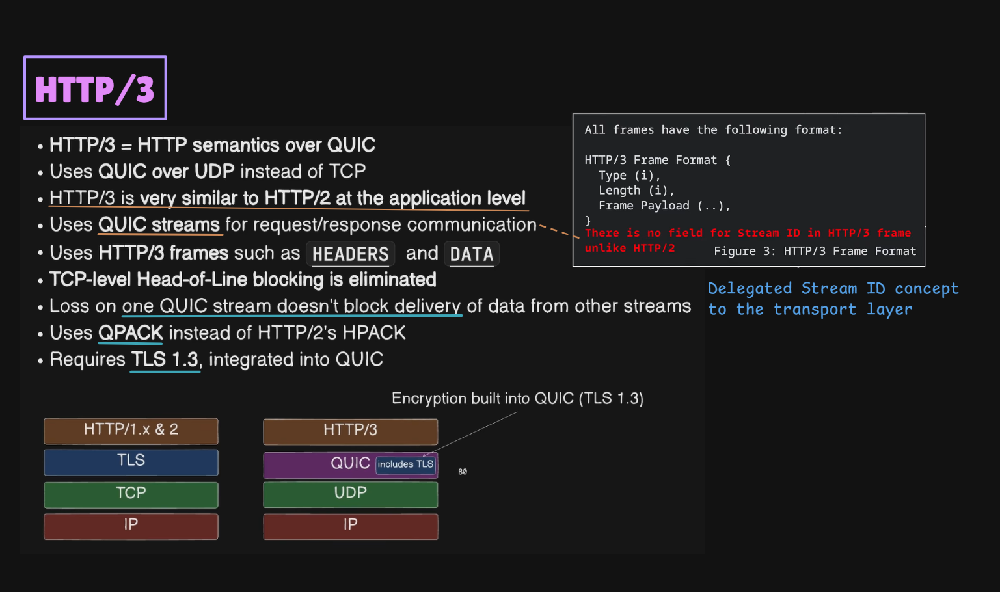
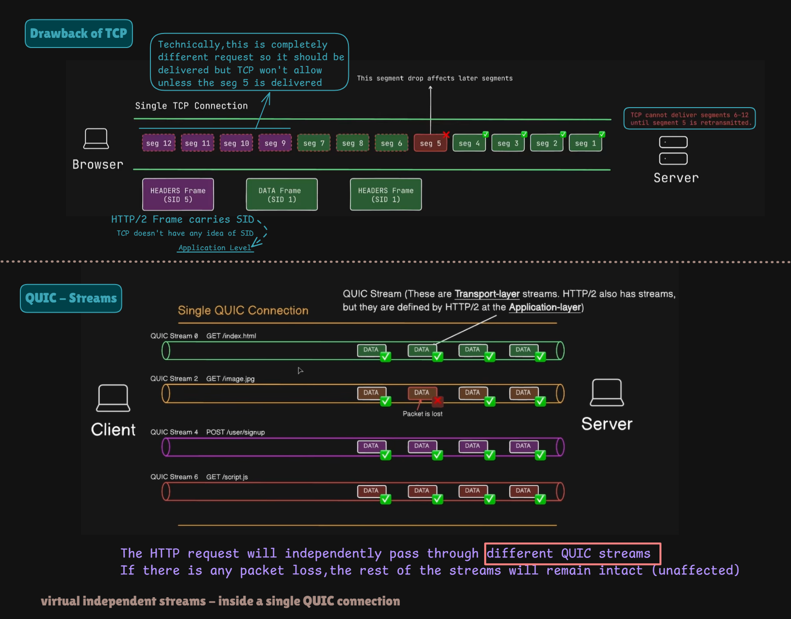
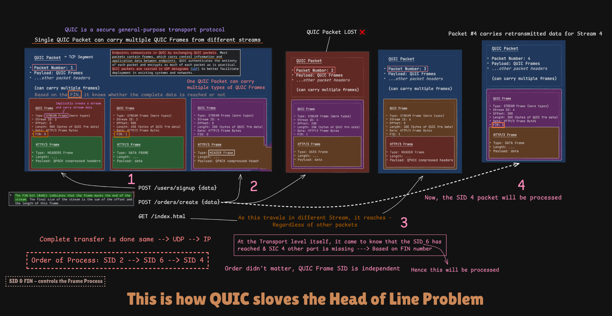

# HTTP/3 — How It Uses QUIC

> [!NOTE]
> **Section:** Computer Networking - [HTTP/3 how it uses QUIC](https://youtu.be/CI7Dx-m1eQ4?si=vHDAn_C5h9V3myJ3)
> 
> **Learning objective:** Understand how HTTP/3 uses QUIC for communication, how HTTP/3 frames differ from HTTP/2 frames, and how QUIC streams reduce transport-level head-of-line blocking.

[← Back to Computer Networking Repository](https://github.com/Priya200227/computer-networking)

---

## 1. What Is HTTP/3?

**HTTP/3 is the third major version of HTTP. It carries HTTP semantics over the QUIC transport protocol instead of TCP.**

HTTP/3 retains the core HTTP concepts used in earlier versions:

- Requests and responses
- Methods such as GET and POST
- Status codes such as 200 and 404
- Headers
- Request and response bodies

The major architectural change is its underlying transport protocol.

| HTTP version | Transport |
|---|---|
| HTTP/1.1 | TCP |
| HTTP/2 | TCP |
| HTTP/3 | QUIC over UDP |

### HTTP/2 vs HTTP/3 protocol stack

**HTTP/2:**

```text
       HTTP/2
          |
         TLS
          |
         TCP
          |
          IP
```

**HTTP/3:**

```text
       HTTP/3
          |
         QUIC
     (TLS 1.3 integrated)
          |
         UDP
          |
          IP
```

> [!IMPORTANT]
> HTTP/3 does not run directly over UDP. It runs over QUIC, and QUIC uses UDP as its underlying datagram transport.



## 2. HTTP/3 and QUIC Streams

HTTP/2 introduced application-layer streams to allow multiple requests and responses to be multiplexed over one TCP connection.

However, TCP provides an ordered byte stream. If a TCP segment is lost, TCP cannot deliver later bytes to the application until the missing bytes are recovered.

This can cause **transport-level Head-of-Line (HOL) blocking**.

### How QUIC changes this

QUIC provides independent streams at the transport layer.

Each QUIC stream has its own stream ID and its own ordered delivery of data.

For example, one QUIC connection can carry several streams:

```text
             One QUIC Connection
                      |
       +--------------+--------------+
       |              |              |
    Stream 0       Stream 2       Stream 4
    index.html     image.jpg      signup request
       |              |              |
    Data frames    Data frames    Data frames
```

If data belonging to Stream 2 is lost, QUIC can continue delivering available data from Streams 0 and 4.

The missing data must still be recovered before the affected stream can deliver later data in order.

> [!IMPORTANT]
> QUIC eliminates TCP-level cross-stream head-of-line blocking. It does not eliminate every form of blocking: data within an individual QUIC stream is still delivered in order.



### HTTP/2 streams vs QUIC streams

| Feature | HTTP/2 | HTTP/3 |
|---|---|---|
| Stream layer | Application layer | Transport layer, provided by QUIC |
| Stream identification | HTTP/2 Stream ID | QUIC Stream ID |
| Underlying transport | TCP | QUIC over UDP |
| Cross-stream blocking from TCP loss | Possible | Avoided |
| Multiplexing | Yes | Yes |

The important distinction is that HTTP/2 defines its own streams, while HTTP/3 maps HTTP requests and responses onto QUIC streams.

## 3. HTTP/3 Frames

HTTP/3 uses frames to represent HTTP messages and related protocol information.

Common HTTP/3 frame types include:

- **HEADERS:** Carries HTTP header fields.
- **DATA:** Carries HTTP message body data.
- **SETTINGS:** Communicates HTTP/3 settings.
- **GOAWAY:** Helps initiate graceful shutdown of a connection or stream processing.

### HTTP/3 frame format

An HTTP/3 frame has this general structure:

```text
+----------------------+
| Frame Type           |
+----------------------+
| Frame Length         |
+----------------------+
| Frame Payload        |
+----------------------+
```

The frame type and length are encoded as QUIC variable-length integers.

**Important difference from HTTP/2:**

- HTTP/2 frames contain a Stream Identifier in their frame header.
- HTTP/3 frames do not contain a Stream ID.
- HTTP/3 relies on the QUIC stream carrying the frame to identify which stream the data belongs to.

This is why the stream identifier is handled by the transport layer in HTTP/3.

> [!NOTE]
> Do not confuse an HTTP/3 frame with a QUIC frame. HTTP/3 frames carry HTTP-level information, while QUIC frames carry transport-level information.

## 4. How HTTP/3 Data Travels Through QUIC

There are three important building blocks:

| Unit | Responsibility |
|---|---|
| HTTP/3 frame | Represents HTTP-level information such as headers or body data |
| QUIC frame | Represents transport-level information such as stream data, acknowledgments or control information |
| QUIC packet | Contains one or more QUIC frames and is carried inside a UDP datagram |

A simplified flow looks like this:

```text
HTTP Request
     |
     v
HTTP/3 Frames
(HEADERS + DATA)
     |
     v
QUIC STREAM Frames
     |
     v
QUIC Packets
     |
     v
UDP Datagrams
     |
     v
IP
```

### Can one QUIC packet carry multiple streams?

Yes. A QUIC packet can contain multiple QUIC frames. Those frames can carry data belonging to different streams.

For example:

```text
QUIC Packet
    |
    +-- QUIC STREAM Frame (Stream 2)
    |
    +-- QUIC STREAM Frame (Stream 6)
    |
    +-- QUIC STREAM Frame (Stream 4)
```

The receiver uses the stream IDs in the QUIC STREAM frames to associate data with the correct streams.

### What happens when a packet is lost?

Suppose a packet contains data for multiple streams and that packet is lost.

1. The receiver does not receive the frames carried by that packet.
2. QUIC detects the loss using its recovery mechanisms.
3. The sender retransmits the relevant information in new QUIC packets.
4. Data from independent streams can continue to be delivered when available.
5. The affected stream still needs its missing data before it can deliver later data in order.

**Important:** QUIC does not necessarily retransmit the original packet. It retransmits the information that needs recovery, which can be carried in newly constructed packets.



## 5. HPACK vs QPACK

HTTP/2 uses **HPACK** for HTTP header compression.

HTTP/3 uses **QPACK** instead.

| Feature | HPACK | QPACK |
|---|---|---|
| Used by | HTTP/2 | HTTP/3 |
| Purpose | Compress HTTP headers | Compress HTTP headers |
| Transport context | TCP-based HTTP/2 | QUIC-based HTTP/3 |
| Design consideration | Works with HTTP/2's ordered transport | Designed to work with independent QUIC streams |

QPACK is designed to avoid the head-of-line blocking problems that would arise from directly using HPACK's synchronization approach with QUIC's independent streams.

You do not need to learn QPACK's internal encoding instructions in depth at this stage. Understand its purpose and why HTTP/3 uses it.

## 6. Key Takeaways

> [!IMPORTANT]
> HTTP/3 uses QUIC over UDP. HTTP/3 handles HTTP semantics and frames, while QUIC handles transport streams, stream IDs, reliability, and packet delivery.

| Concept | Remember |
|---|---|
| HTTP/3 | HTTP semantics over QUIC |
| QUIC | Transport protocol used by HTTP/3 |
| UDP | Underlying datagram transport for QUIC |
| QUIC streams | Independent transport-level streams |
| HTTP/3 frames | Carry HTTP-level information |
| QUIC frames | Carry transport-level information |
| QUIC packets | Carry one or more QUIC frames |
| Stream ID | Belongs to the QUIC transport stream |
| QPACK | Header compression for HTTP/3 |
| HOL blocking | QUIC avoids TCP-level cross-stream blocking |

**The core idea:** HTTP/3 keeps HTTP's request-response model but uses QUIC to provide independent transport streams. This avoids TCP-level cross-stream head-of-line blocking and allows HTTP/3 to benefit from QUIC's secure, low-latency transport.

## References

- [RFC 9114 — HTTP/3](https://www.rfc-editor.org/rfc/rfc9114.html)
- [RFC 9000 — QUIC: A UDP-Based Multiplexed and Secure Transport](https://www.rfc-editor.org/rfc/rfc9000.html)
- [RFC 9001 — Using TLS to Secure QUIC](https://www.rfc-editor.org/rfc/rfc9001.html)
- [RFC 9204 — QPACK: Field Compression for HTTP/3](https://www.rfc-editor.org/rfc/rfc9204.html)

---

**Next topic:** [TLS Overview](../29-tls/README.md)
